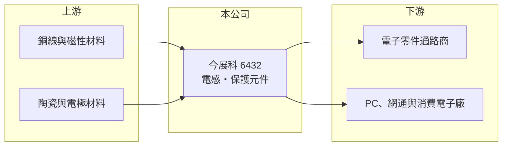

# 6432 今展科

> 上櫃｜[[產業索引-電子零組件業|電子零組件業]]｜上市（櫃）日期 2015/05/20

# 第一章：企業模式與商業藍圖

> [!info] 撰寫說明
> 精簡版，由 Claude 依公開資料整理，架構比照 [[2330台積電]]，資料截至 2026-10-08。來源：櫃買中心開放資料快照（基本資料、2026 年第二季資產負債與損益、本益比殖利率）、Goodinfo 經營績效頁、nStock 公司簡介。產品別比重、應用市場、客戶與生產據點未查得，公開資料有限。#待校對

今展科技（以下簡稱今展科）是一家[[被動元件]]公司，主要銷售各類[[電感]]與[[保護元件]]，理解它的關鍵在於：被動元件是每塊電路板都要用上數十到數百顆的基礎零件，需求跟著整體電子產業走，小廠的獲利則取決於能否在大廠主導的市場中找到利基規格。

- **核心業務：** 今展科成立於 2001 年，2015 年在櫃買中心掛牌，總部在新北三重。依 nStock 整理的公司簡介，主要銷售各類電感及保護元件。電感負責在電源電路中儲能與濾波，保護元件則防止靜電或突波損壞電路，兩者都是電源管理與訊號完整性不可缺少的零件。
- **營收結構：** 產品別、應用市場與地區別比重未查得（#待校對）。營收規模約 10 億至 14 億元，毛利率約 22% 至 30%，屬於中小型被動元件廠的典型水準。
- **營運據點：** 生產據點與子公司未查得（#待校對）。台灣被動元件中小廠多在中國或東南亞設廠，以貼近電子組裝客戶。
- **長期方向：** 2020 至 2025 年營收在 10 億至 14 億元之間起伏，毛利率由約 30% 下滑到 22%，顯示產品組合或價格面臨壓力。被動元件產業長期受惠於電子產品電源管理複雜度提高，例如 [[AI 伺服器]]與車用電子對高功率電感的需求，但今展科能否切入這些高階應用，公開資料未能確認。

# 第二章：護城河深度與競爭優勢

今展科的護城河有限，主要競爭力來自產品線組合與客戶服務，在規模上遠不及龍頭。

- **競爭優勢：** 被動元件需通過客戶的料號認證才能出貨，一旦進入設計，通常會在該產品週期內持續採用。今展科同時提供電感與保護元件，能讓客戶在同一供應商取得多種零件，降低採購管理成本。
- **主要對手：** 電感領域有日本 TDK、村田製作所，台灣的 [[2327國巨]]（含奇力新）、3357臺慶科；保護元件領域有 6284佳邦、[[6224聚鼎]]、2428興勤 等。這些公司規模與技術廣度都大於今展科。
- **觀察重點：** 長期應觀察[[毛利率]]能否止跌回升，以及營業利益率能否回到 2020 至 2021 年約 9% 至 10% 的水準。2022 年後營業利益率只有 0.2% 至 3%，代表本業競爭力明顯下滑。

# 第三章：財務體質與盈利規模

資料日期：2026-10-08，表格是撰寫當時的快照；最新月營收、毛利率、累計 EPS 由自動排程寫在本筆記的屬性欄位（月營收、毛利率、累計EPS 等）。#待校對

今展科的財務特徵是低負債、現金充裕，但本業獲利自 2022 年後明顯轉弱，近年 EPS 有相當比例來自業外收益。

| 年度 | 營收（億元） | [[毛利率]] | [[營業利益率]] | EPS（元） | [[ROE]] |
|---|---|---|---|---|---|
| 2021 | 13.6 | 28.9% | 8.78% | 2.91 | 11.6% |
| 2022 | 11.1 | 23.3% | 0.24% | 1.50 | 5.79% |
| 2023 | 10.8 | 24.0% | 1.82% | 1.19 | 4.63% |
| 2024 | 10.2 | 26.0% | 2.36% | 1.68 | 6.36% |
| 2025 | 11.2 | 22.2% | 2.97% | 0.48 | 1.76% |

（來源：Goodinfo 經營績效頁；2020 年營收 11 億元、EPS 2.91 元。）

- **營收規模：** 2020 至 2025 年營收年複合成長率約 0.4%（推算），沒有長期成長。2026 年上半年營收約 6.16 億元、毛利率約 22%、營業利益率約 3.5%、EPS 1.64 元（櫃買中心資料），其中業外收益約 0.42 億元，是營業利益 0.21 億元的兩倍。
- **獲利：** 2021 至 2025 年平均 ROE 約 6.0%（推算），且呈下降趨勢。2022 至 2024 年營業利益率不到 3%，EPS 卻有 1.2 至 1.7 元，說明業外收益（來源未查得，#待校對）是支撐獲利的重要來源。
- **財務特色：** 2026 年第二季總資產約 14.7 億元、負債約 4.0 億元、權益約 10.7 億元，負債比僅約 27%，流動資產約 11.8 億元，財務結構保守，每股淨值約 27.6 元。資本公積約 4.6 億元，高於保留盈餘。最近一年度現金股利約 1.2 元（櫃買中心本益比資料），高於 2025 年 EPS 0.48 元，配息超過當年獲利，部分可能來自累積盈餘或資本公積（#待校對）。
- **[[ROIC]] 與 [[WACC]]：** 2025 年營業利益約 0.33 億元（11.2 億元 × 2.97%），稅後約 0.27 億元；投入資本以權益 10.7 億元到「權益加全部負債」14.7 億元為區間，ROIC 約 2% 至 2.5%（推算，有息負債未查得）。WACC 以 [[CAPM]] 推估：無風險利率 1.75%、市場風險溢酬 6%、β 假設 1.0，權益成本約 7.8%；負債占 5%、稅前成本 2.5%、稅率 20%，WACC 約 7.5%（推算）。2022 年後本業 ROIC 遠低於 WACC，代表本業並未創造價值，帳上資金若不能投入更高報酬的用途，長期股東報酬將主要依賴配息與業外收益。

# 第四章：總體風險與地緣政治

今展科的風險在於被動元件的價格週期、大廠競爭與本業獲利能力下滑。

- **產業週期：** 被動元件是典型的強週期產業，終端需求變化會透過通路與客戶庫存放大，出現「缺貨漲價、庫存過剩跌價」的循環。2022 年後的毛利率下滑與此週期有關（推估）。
- **營運風險：** 小廠在價格戰中議價力弱，大廠擴產或降價時，市占與毛利都會受壓。獲利依賴業外收益，業外收益不穩定時 EPS 波動會很大。
- **其他風險：** 電感使用銅線與磁性材料，原料價格波動影響成本；生產若集中在中國，面臨美中關稅與供應鏈移轉；匯率變動影響出口報價。

# 專有名詞解析

## 應用

- **[[AI 伺服器]]**：搭載 GPU 等加速器、用於訓練與推論人工智慧模型的伺服器，功耗與散熱需求遠高於一般伺服器。

## 金融

- **[[CAPM]]**：資本資產定價模型，以無風險利率加上 β 乘以市場風險溢酬估算股東要求報酬率。

## 產業

- **[[被動元件]]**：不需外加電源即可運作的基礎電子零件，主要包括電容、電阻與電感，每塊電路板都大量使用。
- **[[電感]]**：以線圈儲存磁能的被動元件，用於電源電路的儲能、濾波與抑制雜訊。
- **[[保護元件]]**：防止靜電、突波或過電流損壞電路的元件，例如 ESD 抑制器、壓敏電阻與保險絲。

# 核心供應鏈

- 上游：漆包銅線、鐵氧體與合金磁粉、陶瓷與電極材料供應商。#待校對
- 下游／客戶：電子零件通路商，以及 PC、網通、消費電子與電源製造商；具名客戶未查得。#待校對
- 同業：[[2327國巨]]、3357臺慶科、6284佳邦、[[6224聚鼎]]、2428興勤，國際有 TDK、村田製作所。

## 最新新聞
<!-- news:start -->
<!-- news:end -->

## 相關連結
- [公開資訊觀測站](https://mopsov.twse.com.tw/mops/web/t05st03?step=1&firstin=1&co_id=6432)
- [Goodinfo](https://goodinfo.tw/tw/StockDetail.asp?STOCK_ID=6432)
- [Yahoo 股市](https://tw.stock.yahoo.com/quote/6432)
- [鉅亨網新聞](https://www.cnyes.com/twstock/6432/news)
