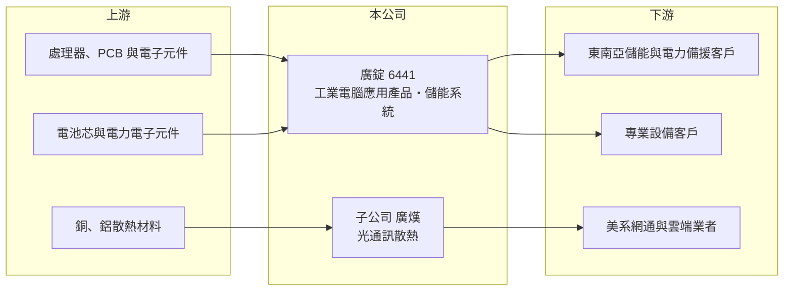

# 6441 廣錠

> 上櫃｜[[產業索引-電腦及週邊設備業|電腦及週邊設備業]]｜上市（櫃）日期 2017/09/27

# 第一章：企業模式與商業藍圖

> [!info] 撰寫說明
> 精簡版，由 Claude 依公開資料整理，架構比照 [[2330台積電]]，資料截至 2026-10-08。來源：櫃買中心開放資料快照（基本資料、2026 年第二季資產負債與損益、本益比殖利率）、Goodinfo 經營績效頁、nStock 公司簡介、優分析與經濟日報 2026 年新聞標題。與 [[8050廣積]] 的關係及博弈機台業務依記憶整理，已標註待校對。公開資料有限。#待校對

廣錠是一家正處於轉型陣痛期的小型電子公司，理解它的關鍵在於：原本的工業電腦應用產品營收大幅萎縮，公司正嘗試以[[儲能系統]]與子公司廣熯的光通訊散熱打開新局，但到 2026 年仍處於毛損與虧損。

- **核心業務：** 廣錠 2011 年設立，2017 年在櫃買中心掛牌，總部位於新北汐止，主要營業項目為[[工業電腦]]相關應用產品與能源儲存設備的研發、設計、製造與銷售。依記憶，廣錠由工業電腦廠 [[8050廣積]] 分拆或轉投資成立，早期以博弈機台的主機板與控制系統為主力（#待校對），這類產品屬於工業電腦的專業應用分支。
- **營收結構：** 產品別比重公開資料未查得。依新聞標題，2026 年 4 月公司取得東盟地區儲能系統大單，並把 AI 資料中心的電力備援列為新方向；2026 年 8 月報導子公司廣熯取得美系網通與雲端大廠的[[光通訊]]散熱訂單。營收規模已從 2021 年的 15.3 億元降到 2025 年的 2.35 億元，2026 年前 9 月累計約 1.21 億元、年減約 43%。
- **營運據點：** 生產據點與銷售地區在本次查得資料中未揭露（#待校對）。公司總部與研發位於台灣。
- **長期方向：** 廣錠的長期課題是找到能取代舊產品的新營收來源。儲能與 AI 電力備援的市場成長快，但需要系統整合與電池管理能力；光通訊散熱則搭上 AI 資料中心的高速傳輸需求。兩者都還在接單初期，能否帶來足以轉虧為盈的營收規模，仍有高度不確定性。

# 第二章：護城河深度與競爭優勢

廣錠目前很難說有明確的護城河，原有業務的需求萎縮，新業務仍在建立客戶與技術基礎。

- **競爭優勢：** 若廣錠確實源自廣積集團（#待校對），可以借重集團在工業電腦設計、長期供貨與品質管理上的經驗。小公司的優點是能接少量、高客製化的專案，儲能系統與散熱元件都屬於需要依客戶規格調整的產品，這是它切入新市場的方式。
- **主要對手：** 儲能系統領域競爭者包括 [[2308台達電]]、[[1503士電]]、[[1513中興電]] 等大型電力設備廠，以及眾多中國儲能系統商；光通訊散熱則面對 [[3017奇鋐]]、[[3324雙鴻]] 等散熱大廠。工業電腦應用產品的同業有 [[8050廣積]]、[[2395研華]] 等。與這些對手相比，廣錠的規模與資源都明顯不足。
- **觀察重點：** 長期最該追蹤的是毛利率能否轉正。2025 年毛利率為 -10.9%、2026 年上半年仍是毛損，代表營收規模已低到無法攤提生產成本。其次是 2026 年 6 月總經理辭任後的經營團隊與策略是否穩定。

# 第三章：財務體質與盈利規模

資料日期：2026-10-08，表格是撰寫當時的快照；最新月營收、毛利率、累計 EPS 由自動排程寫在本筆記的屬性欄位（月營收、毛利率、累計EPS 等）。#待校對

廣錠的財務呈現連年虧損與營收萎縮，2021 至 2025 年除 2022 年接近損益兩平外，每年都虧損。

| 年度 | 營收（億元） | [[毛利率]] | [[營業利益率]] | EPS（元） | [[ROE]] |
|---|---|---|---|---|---|
| 2020 | 12.5 | 11.1% | -4.97% | -1.24 | -4.7% |
| 2021 | 15.3 | 6.74% | -10.2% | -2.88 | -11.1% |
| 2022 | 5.81 | 17.4% | -11.4% | 0.02 | -0.09% |
| 2023 | 6.83 | 15.9% | -12.9% | -1.42 | -5.53% |
| 2024 | 5.40 | 20.9% | -29.0% | -2.65 | -10.4% |
| 2025 | 2.35 | -10.9% | -113% | -5.16 | -24.3% |

（來源：Goodinfo 經營績效頁。2026 年上半年依櫃買中心資料：營收 0.61 億元、毛損 0.72 億元、營業虧損 1.38 億元、EPS -2.63 元。）

- **營收規模：** 2020 至 2025 年營收由 12.5 億元降到 2.35 億元，年複合成長率約 -28%（推算）。2021 年營收高峰後，2022 年驟降六成，顯示主要產品的需求或客戶出現結構性流失（推估）。
- **獲利：** 近五年（2021 至 2025）平均 ROE 約 -10.3%（推算）。2025 年營業虧損約 2.66 億元，超過當年營收，代表公司的固定費用與存貨損失遠大於營收規模。
- **財務特色：** 依 2026 年第二季資料，總資產約 15.8 億元、權益總計約 9.1 億元（歸屬母公司 8.8 億元）、負債約 6.7 億元且幾乎都是流動負債。股本 5.33 億元，每股淨值約 16.5 元，仍高於面額，帳上淨值是目前的緩衝。非流動資產約 9.7 億元，推估包含廠房與轉投資（未查得細項）。目前未配發股利。以現在的虧損速度，半年約減少淨值 1.4 億元，若無法改善，淨值緩衝將在數年內耗盡（推算）。
- **[[ROIC]] 與 [[WACC]]：** 2025 年營業虧損約 2.66 億元，虧損年度不計所得稅，投入資本以權益總計 9.1 億元到「權益加全部負債」15.8 億元為區間，ROIC 約 -17% 至 -29%（推算），為負值。WACC 以 [[CAPM]] 推估：無風險利率 1.75%、市場風險溢酬 6%、β 假設 1.2（虧損小型股常見值），權益成本約 9%；負債多為營業性負債，WACC 約 8% 至 9%（推算）。ROIC 遠低於 WACC，代表公司目前在持續消耗股東資本，只有新業務放量、毛利率轉正，利差才有機會改善。

# 第四章：總體風險與地緣政治

廣錠的風險以經營持續性為核心，包括營收萎縮、新業務執行與經營團隊變動。

- **產業週期：** 原有工業電腦應用產品的需求已大幅萎縮，若屬博弈機台相關產品（#待校對），則受各地博弈市場景氣與法規影響。儲能市場雖然長期成長，但價格競爭激烈，電池與系統報價持續下滑。
- **營運風險：** 營收規模太小，固定費用與存貨跌價損失會讓虧損擴大，形成毛損。新業務仍依賴少數大單，單一專案延誤或取消就會讓全年營收大幅波動。2026 年 6 月總經理辭任、8 月內部稽核主管異動，也更正過 2025 年年報內容，經營團隊的穩定度與內控需要觀察。
- **其他風險：** 若虧損持續，公司可能需要增資或減資彌補[[累積虧損]]，稀釋或影響股東權益。儲能專案涉及海外電網法規與電池安全認證；光通訊散熱則依賴美系客戶的資本支出。匯率與原料價格波動影響有限但不可忽視。

# 專有名詞解析

## 應用

- **[[儲能系統]]**：以電池儲存電力並在需要時放電的系統，可用於削峰填谷、備援與參與電力輔助服務。

## 金融

- **[[累積虧損]]**：歷年虧損累積後尚未彌補的金額，依公司法須先彌補完畢才能分配盈餘。

## 產業

- **[[工業電腦]]**：用於工廠自動化、交通、醫療等場域的電腦，強調長期供貨、耐用與穩定。
- **[[光通訊]]**：以光纖與雷射傳輸資料的技術，AI 資料中心的高速光收發模組需要專門的散熱設計。

# 核心供應鏈

- 上游：處理器、PCB 與電子元件；儲能所需的電池芯、電池管理與電力轉換元件；散熱用銅、鋁材料（具體供應商未查得）。
- 下游／客戶：東盟地區儲能與電力備援客戶、美系網通與雲端大廠（新聞未點名），以及工業電腦應用產品的專業設備客戶（#待校對）。
- 同業：[[8050廣積]]、[[2395研華]]；儲能 [[2308台達電]]、[[1503士電]]、[[1513中興電]]；散熱 [[3017奇鋐]]、[[3324雙鴻]]。

## 最新新聞
<!-- news:start -->
<!-- news:end -->

## 相關連結
- [公開資訊觀測站](https://mopsov.twse.com.tw/mops/web/t05st03?step=1&firstin=1&co_id=6441)
- [Goodinfo](https://goodinfo.tw/tw/StockDetail.asp?STOCK_ID=6441)
- [Yahoo 股市](https://tw.stock.yahoo.com/quote/6441)
- [鉅亨網新聞](https://www.cnyes.com/twstock/6441/news)
