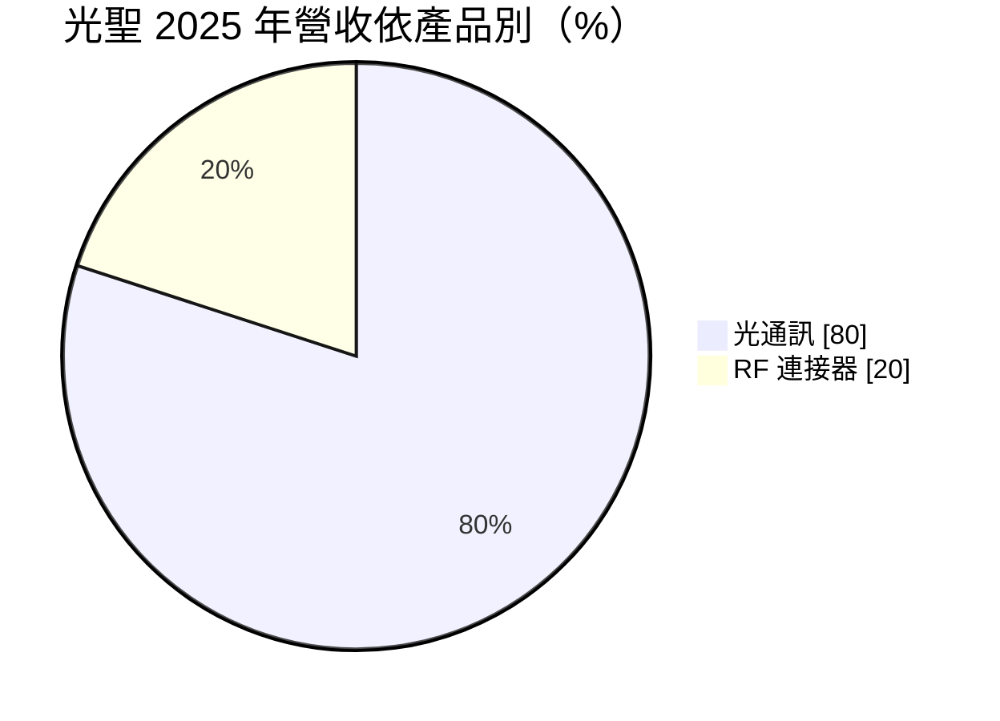
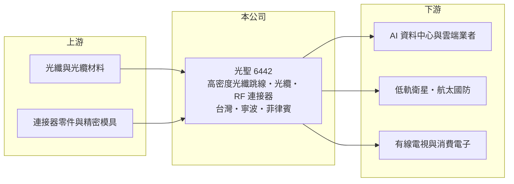

# 6442 光聖

> 上市｜[[產業索引-通信網路業|通信網路業]]｜上市（櫃）日期 2015/07/14

# 第一章：企業模式與商業藍圖

> [!info] 撰寫說明
> 本文由 Claude 依公開資料整理，架構比照 [[2330台積電]] 的四章研究，資料截至 2026-10-08。財務數字來源：Goodinfo 年度經營績效頁、證交所開放資料（基本資料、2026 年第二季資產負債、損益與營益分析、股利、每月營收）、富果研究整理的 2026 年 3 月法說會摘要；客戶名稱未揭露。#待校對

評估一家光纖連接公司，要看它的產品數量是否隨 AI 叢集規模倍增，以及客製化能力能否讓它避開價格戰。本章說明光聖（股票代號：6442）如何從有線電視射頻元件起家，轉型為 AI 資料中心被動光纖連接的關鍵供應商。

## 一、核心定位：被動光纖連接與射頻連接器

光聖成立於 1996 年，2015 年在證交所上市，實收資本額約 8.2 億元。公司有兩大產品線：一是光通訊被動元件，包括高密度[[光纖跳線]]、光纖配線盤與多芯光纜；二是射頻（RF）連接器，早期以有線電視網路為主。

被動光纖產品不需要電力，任務是把成千上萬條光纖在機櫃與機房之間精準地連接、分配與管理。AI 資料中心的 GPU 叢集需要大量高速光連線，每座機房的光纖芯數成倍增加，這是光聖營收在兩年內從 26 億元成長到 105 億元的根本原因。

## 二、營收結構：光通訊成為絕對主力

* **光通訊：** 2024 年約占 65%，2025 年升到約 80%。成長主要來自 AI 資料中心使用的高密度光纖跳線盤與光纜，部分光纜的光纖芯數已達 6,912 芯。
* **RF 連接器：** 2025 年約占 20%，應用已從有線電視轉向[[低軌衛星]]、航太國防與消費電子等附加價值較高的領域。

## 三、生產布局與長期方向

光聖的生產據點包括台灣總部、中國寧波與菲律賓，菲律賓新廠 2025 年 7 月開始營運、2026 年投入生產，三地產能可以彈性調配，降低地緣政治風險；捷克與美國另設有生產或研發據點。長期方向是走客製化路線避開價格競爭，並布局 [[CPO]] 相關的光纖陣列單元（FAU）與外部雷射光源模組，以及拉曼光譜儀等生醫與科學應用。公司持有超過 180 項有效專利，子公司合聖規劃申請公開發行。

# 第二章：護城河深度與競爭優勢

在長期價值投資中，「護城河」指企業抵禦競爭、維持超額利潤的保護機制。本章分析光聖的優勢、限制與競爭對手。

## 一、光聖護城河的組成

* **客製化與高密度設計：** AI 資料中心的光纖布線依每個客戶的機房架構客製，芯數、長度與配線方式都不同。能快速設計並大量交付的廠商不多，這讓光聖能維持 50% 以上的毛利率，遠高於一般連接器廠。
* **一線客戶長期合作：** 公司與一線歐美客戶建立長期合作關係，新機房的設計往往沿用已驗證的供應商。
* **非中國產能：** 台灣與菲律賓產能符合美國客戶分散供應鏈的需求。

這些優勢建立在 AI 資本支出的高成長期，被動光纖本身技術門檻低於主動光元件，長期護城河的深度仍待驗證。

## 二、主要競爭對手

| 對手 | 定位 | 對光聖的威脅 |
|---|---|---|
| Corning（康寧） | 全球光纖與資料中心布線龍頭 | 產品線完整、與雲端業者關係深 |
| [[3163波若威]] | 光纖陣列與配線盤 ODM | 在資料中心光纖連接產品重疊 |
| [[3363上詮]] | 光纖連接器與 CPO 光纖陣列 | 爭取 CPO 光纖連接訂單 |
| 中國光纖連接廠 | 低價量產 | 在標準化產品壓低價格 |

## 三、守得住／守不住／觀察重點

守得住的是需要客製設計、快速交貨的高密度光纖專案。守不住的是標準規格跳線與光纜的價格，一旦產品標準化，中國廠會迅速跟進。長期觀察重點是菲律賓新廠的產能爬坡、CPO 相關產品能否量產，以及毛利率能否維持公司目標的 50% 以上。

# 第三章：財務體質與盈利規模

資料日期：2026-10-08，表格是撰寫當時的快照；最新月營收、毛利率、累計 EPS 由自動排程寫在本筆記的屬性欄位（月營收、毛利率、累計EPS 等）。#待校對

財務報表是檢驗護城河是否真實存在的最終標準。本章用六年的三率、ROE 與資本報酬，檢視光聖的獲利品質。

## 一、多年度經營績效

| 年度 | 營收（新台幣） | [[毛利率]] | [[營業利益率]] | EPS（元） | [[ROE]] |
|---|---|---|---|---|---|
| 2020 | 24.1 億 | 16.9% | 1.13% | -0.57 | -2.08% |
| 2021 | 28.1 億 | 21.4% | 6.43% | 1.56 | 6.0% |
| 2022 | 29.4 億 | 31.8% | 9.86% | 4.85 | 17.2% |
| 2023 | 26.2 億 | 35.5% | 8.63% | 2.53 | 8.31% |
| 2024 | 64.1 億 | 55.6% | 20.2% | 14.3 | 36.7% |
| 2025 | 105 億 | 57.7% | 24.1% | 23.46 | 33.7% |
| 2026 上半年 | 63.9 億 | 59.5% | 29.7% | 19.07 | 未查得 |

2024 年是光聖的轉折點：營收倍增，毛利率從 35% 跳到 56%，代表產品從一般連接器轉成高附加價值的 AI 資料中心光纖方案。2021 至 2025 年平均 ROE 約 20.4%（推算），營收年複合成長率約 39%（推算），但這個平均值混合了轉型前後兩個階段。每股淨值從 2024 年的 48.6 元升至 2025 年的 87.9 元，部分來自可轉換公司債轉換。2025 年度現金股利每股 11.8 元，配息率約五成（推算）。

## 二、[[ROIC]] 與 [[WACC]]：價值創造利差

**ROIC 推算：** 2025 年營業利益約 25.3 億元（105 億 × 24.1%），稅後約 20.2 億元。2026 年第二季股東權益約 135.9 億元，負債約 63.9 億元，假設有息負債（含可轉換公司債）約四成、約 25.6 億元（推估），投入資本約 161.5 億元，ROIC 約 12.5%（推算）。由於權益在 2025 至 2026 年因轉換公司債與獲利累積大幅增加，若用 2025 年平均資本計算，ROIC 會更高。

**WACC 推算：** 台灣 10 年期公債 1.75%、市場風險溢酬 6%、β 取光通訊同業常見值 1.3，股東權益成本約 9.6%；負債成本 2%、稅後 1.6%；權益占投入資本約 84%，WACC 約 8.3%（推算）。

**結論：** ROIC 高於 WACC 約 4 個百分點以上，代表 AI 光纖需求讓光聖進入創造價值的階段。2026 年上半年營業利益率接近 30%，利差仍在擴大，但這建立在 AI 資本支出高峰之上，需要觀察景氣反轉時的韌性。

# 第四章：總體風險與地緣政治

任何企業都無法脫離宏觀環境獨立存在。本章分析光聖長期必須面對的風險。

## 一、AI 資本支出週期

光聖的高成長高度依賴雲端業者的 AI 機房建置。2020 至 2023 年營收只有 24 億至 29 億元，說明在 AI 需求出現之前，公司的規模與獲利都有限。若雲端業者放緩資本支出，營收與毛利率都可能明顯回落。

## 二、客戶集中與技術演進

營收集中在少數歐美一線客戶，客戶調整布線架構或分散供應商，都會影響訂單。CPO 等新架構可能改變機櫃內外的光纖連接方式，公司需要持續投入新產品，才能在下一代架構保住位置。

## 三、產能擴張與匯率

菲律賓新廠初期的良率與成本控制需要時間，海外擴產也帶來管理挑戰。營收以美元計價為主，新台幣升值會壓縮獲利。

# 專有名詞解析

## 半導體

- **[[CPO]]**：共同封裝光學，把光學收發元件與交換晶片封裝在一起，縮短電訊號距離以降低功耗。

## 應用

- **[[低軌衛星]]**：在約 500 至 2,000 公里高度運行的通訊衛星，延遲低，需要大量地面接收終端與天線。

## 金融

- **[[ROIC]]**：投入資本報酬率，稅後營業利益除以股東權益與有息負債的合計，衡量本業對所有資金提供者的報酬。
- **[[WACC]]**：加權平均資金成本，依股東權益與負債的比重加權計算的資金成本，ROIC 高於它才代表創造價值。

## 產業

- **[[光纖跳線]]**：兩端裝有連接器的光纖線，用來連接機櫃內外的光通訊設備，資料中心使用量極大。

# 核心供應鏈

## 1. 上游：光纖與零件
- 光纖與光纜材料：Corning 等光纖廠（供應關係待校對）
- 連接器零件與精密模具供應商

## 2. 中游：光聖與同業
- 同業：[[3163波若威]]、[[3363上詮]]、Corning、中國光纖連接廠

## 3. 下游：客戶
- 一線歐美 AI 資料中心與雲端客戶（名稱未揭露）
- 低軌衛星、航太國防與消費電子客戶

## 最新新聞
<!-- news:start -->
<!-- news:end -->

## 相關連結
- [公開資訊觀測站](https://mopsov.twse.com.tw/mops/web/t05st03?step=1&firstin=1&co_id=6442)
- [Goodinfo](https://goodinfo.tw/tw/StockDetail.asp?STOCK_ID=6442)
- [Yahoo 股市](https://tw.stock.yahoo.com/quote/6442)
- [鉅亨網新聞](https://www.cnyes.com/twstock/6442/news)
