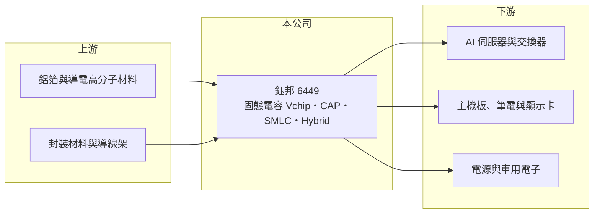

# 6449 鈺邦

> 上市｜[[產業索引-電子零組件業|電子零組件業]]｜上市（櫃）日期 2014/12/09

# 第一章：企業模式與商業藍圖

> [!info] 撰寫說明
> 精簡版，由 Claude 依公開資料整理，架構比照 [[2330台積電]]，資料截至 2026-10-08。來源：證交所開放資料快照（基本資料、2026 年第二季資產負債與損益、2025 年度股利）、Goodinfo 經營績效頁、優分析 2025 年 12 月鈺邦法說會報導。應用別營收比重未查得；苗栗與中國生產據點為憑記憶撰寫。#待校對

鈺邦科技（以下簡稱鈺邦）是台灣主要的[[導電高分子電容]]（俗稱固態電容）廠，理解它的關鍵在於：AI 伺服器、GPU 與交換器的電源電路需要大量低阻抗、耐高溫的電容，鈺邦的晶片型固態電容正好切入這個需求，讓一家原本以主機板與筆電為主的零件廠，轉為 [[AI 伺服器]]供應鏈的一員。

- **核心業務：** 鈺邦成立於 2005 年，2014 年 12 月掛牌，專注導電高分子鋁固態電容。依 2025 年 12 月法說會報導，產品線包括 Vchip（表面黏著型固態電容）、CAP（晶片型高分子電容）、SMLC（用於取代鉭質高分子電容的產品）與 Hybrid（混合型電容）。這些產品用在 CPU、GPU 周邊的電源電路，負責穩定供電與濾除雜訊。
- **營收結構：** 應用別比重未查得（#待校對）。報導指出輝達 NVLink 交換器大量採用 Vchip、鈺邦為主要供應商，SMLC 正送樣給筆電、伺服器、電源與 SSD 客戶測試；Hybrid 則受車規、AI 伺服器與 USB PD 3.1 快充需求帶動。
- **營運據點：** 總部與主要工廠在苗栗竹南，並在中國設有生產基地（憑記憶，#待校對）。依報導，泰國新廠預計 2026 年第一季完工，用於分散生產地並服務東南亞的伺服器組裝鏈。
- **長期方向：** 公司規劃 2026 年整體產能平均成長約兩成，其中 Vchip 由 2025 年的 1 億顆擴至 1.2 億顆、CAP 由 6,000 萬顆擴至 1 億顆、Hybrid 由約 600 萬顆擴至 1,000 萬顆。產能擴張集中在高階產品，代表鈺邦的成長主軸是 AI 與高階運算的電源需求。

# 第二章：護城河深度與競爭優勢

鈺邦的護城河來自高分子電容的材料與製程技術，以及打入 AI 晶片供應鏈後的認證門檻。

- **競爭優勢：** 固態電容的導電高分子材料、含浸與封裝製程都有技術門檻，尤其晶片型產品要在極小體積內達到低等效串聯電阻與高可靠度。打入 GPU 與交換器的參考設計後，後續世代產品通常延續採用，形成轉換成本。
- **主要對手：** 國際對手為日本 Panasonic（POSCAP、SP-Cap）、村田製作所、KEMET 等；台灣同業有 [[2472立隆電]]、2375凱美、8042金山電 以及 [[2327國巨]] 集團。日系廠在高階鉭質與高分子電容仍居領先，鈺邦以性價比與交期爭取替代機會。
- **觀察重點：** 長期最該觀察 CAP 與 SMLC 能否在 AI 伺服器與筆電大規模取代日系產品。若成功，[[毛利率]]有機會維持在 35% 左右的高檔；若替代進度不如預期，擴產後的折舊將壓縮獲利率。

# 第三章：財務體質與盈利規模

資料日期：2026-10-08，表格是撰寫當時的快照；最新月營收、毛利率、累計 EPS 由自動排程寫在本筆記的屬性欄位（月營收、毛利率、累計EPS 等）。#待校對

鈺邦的財務特徵是營收與毛利率同步成長、負債低，帳上另有大額金融資產未實現利益。

| 年度 | 營收（億元） | [[毛利率]] | [[營業利益率]] | EPS（元） | [[ROE]] |
|---|---|---|---|---|---|
| 2021 | 28.2 | 26.5% | 14.3% | 3.49 | 13.0% |
| 2022 | 24.9 | 26.1% | 10.9% | 3.82 | 12.8% |
| 2023 | 29.3 | 27.2% | 12.9% | 3.73 | 11.7% |
| 2024 | 35.0 | 29.9% | 15.0% | 6.08 | 14.7% |
| 2025 | 44.7 | 34.7% | 18.6% | 7.38 | 13.9% |

（來源：Goodinfo 經營績效頁；2020 年營收 23.8 億元、EPS 3.10 元。）

- **營收規模：** 2020 至 2025 年營收年複合成長率約 13.4%（推算），2024 至 2025 年明顯加速，與 AI 伺服器需求同步。2026 年上半年營收約 25.0 億元、毛利率約 35.5%、營業利益率約 17.3%、EPS 4.42 元（證交所資料）。
- **獲利：** 2021 至 2025 年平均 ROE 約 13.2%（推算）。營業利益率由 11% 升到 19%，但 ROE 沒有同步大幅上升，原因是權益中含大量未實現評價利益，墊高了分母。
- **財務特色：** 2026 年第二季總資產約 116 億元、負債約 46 億元、權益約 70 億元，非流動負債僅約 1.4 億元，長期借款很少，每股淨值約 76 元。權益中「其他權益」約 28 億元，2026 年上半年其他綜合損益約 20 億元，代表持有的金融資產市值大幅上升（標的未查得，#待校對）。2025 年度配發現金股利 4.2 元，以 2025 年 EPS 推算配息率約 57%；公司章程採剩餘股利政策，優先保留盈餘支應擴產。
- **[[ROIC]] 與 [[WACC]]：** 2025 年營業利益約 8.3 億元（44.7 億元 × 18.6%），稅後約 6.6 億元；投入資本以權益 70 億元到「權益加全部負債」116 億元為區間，ROIC 約 6% 至 10%（推算）。若扣除約 28 億元的未實現評價利益、只看投入營運的資本（約 42 億元），ROIC 約 16%（推算）。WACC 以 [[CAPM]] 推估：無風險利率 1.75%、市場風險溢酬 6%、β 假設 1.2（AI 供應鏈股波動較大），權益成本約 9.0%；負債占一成、稅前成本 2.5%、稅率 20%，WACC 約 8.3%（推算）。以營運資本衡量，本業 ROIC 明顯高於 WACC，代表固態電容本業正在創造價值。

# 第四章：總體風險與地緣政治

鈺邦的風險在於 AI 需求的集中度、被動元件週期與擴產執行。

- **產業週期：** 被動元件有明顯的庫存與價格週期，雖然 AI 伺服器需求支撐高階產品，但筆電與主機板等傳統應用仍受 PC 景氣影響。
- **營運風險：** 高階產品依賴少數 AI 晶片與交換器平台，若客戶改變設計或轉向日系供應商，成長會受影響。泰國新廠與大幅擴產若遇到良率或需求不如預期，折舊將壓縮毛利率。
- **其他風險：** 鋁箔、導電高分子材料價格波動影響成本；持有的金融資產市值波動會影響權益與每股淨值；生產跨台灣、中國與泰國，需因應關稅與地緣政治變化。

# 專有名詞解析

## 應用

- **[[AI 伺服器]]**：搭載 GPU 等加速器、用於訓練與推論人工智慧模型的伺服器，功耗與散熱需求遠高於一般伺服器。

## 金融

- **[[CAPM]]**：資本資產定價模型，以無風險利率加上 β 乘以市場風險溢酬估算股東要求報酬率。

## 產業

- **[[被動元件]]**：不需外加電源即可運作的基礎電子零件，主要包括電容、電阻與電感，每塊電路板都大量使用。
- **[[導電高分子電容]]**：以導電高分子取代電解液作為陰極的電容，阻抗低、耐高溫、壽命長，俗稱固態電容。
- **[[鉭質電容]]**：以鉭金屬為陽極的電容，體積小、容量大，但原料稀缺、價格較高。

# 核心供應鏈

- 上游：鋁箔、導電高分子材料、封裝材料與導線架供應商。#待校對
- 下游／客戶：依 2025 年報導，[[NVDA輝達]] NVLink 交換器平台大量採用 Vchip；其他客戶為主機板、筆電、伺服器、電源與 SSD 製造商（如 [[2382廣達]]、[[2376技嘉]]、[[2377微星]] 等產業代表，非公司揭露客戶）。#待校對
- 同業：[[2472立隆電]]、2375凱美、8042金山電、[[2327國巨]]，國際有 Panasonic、村田製作所、KEMET。

## 最新新聞
<!-- news:start（自動產生，請勿手動編輯此範圍） -->
- 2026-10-12 🏛️ 重訊 15:54｜係因本公司有價證券於集中交易市場達公布注意交易資訊標準， 故公布相關財務業務等重大訊息，以利投資人區別瞭解｜[觀測站](https://mops.twse.com.tw/mops/#/web/t05st01)
- 2026-10-07 📰 媒體 16:31｜鈺邦SMLC擴大鉭電容替代商機，NB出貨後再攻SSD、伺服器｜[鉅亨網](https://news.cnyes.com/news/id/6623695)

完整紀錄：[[6449鈺邦 新聞]]
<!-- news:end -->

## 相關連結
- [公開資訊觀測站](https://mopsov.twse.com.tw/mops/web/t05st03?step=1&firstin=1&co_id=6449)
- [Goodinfo](https://goodinfo.tw/tw/StockDetail.asp?STOCK_ID=6449)
- [Yahoo 股市](https://tw.stock.yahoo.com/quote/6449)
- [鉅亨網新聞](https://www.cnyes.com/twstock/6449/news)
