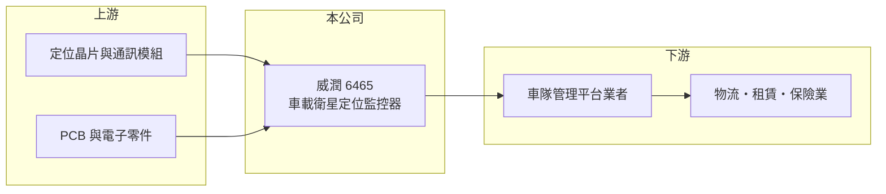

# 6465 威潤

> 上櫃｜[[產業索引-通信網路業|通信網路業]]｜上市（櫃）日期 2015/11/20

# 第一章：企業模式與商業藍圖

> [!info] 撰寫說明
> 本文由 Claude 依公開資料整理，架構比照 [[2330台積電]] 的四章研究，資料截至 2026-10-08。財務數字來源：Goodinfo 年度經營績效頁、櫃買中心開放資料（基本資料、2026 年第二季資產負債與損益、每月營收、本益比殖利率）、CMoney 與 winvest 報導標題；產品與客戶描述多為推估，已標「待校對」。公開資料有限。#待校對

評估一家小型硬體公司，要看它是否找到夠專精的利基市場，以及營收規模能否跨過損益兩平點。本章說明威潤科技（股票代號：6465，以下簡稱威潤）如何在車載衛星定位監控器領域經營，並在多年虧損後轉為獲利。

## 一、核心定位：車載衛星定位監控器

威潤成立於 2010 年，2015 年在櫃買中心掛牌。依 CMoney 報導標題，公司定位為車載衛星定位監控器廠商。這類產品安裝在車輛上，透過 [[GNSS]] 衛星定位取得車輛位置，再經行動網路回傳到雲端平台，是典型的 [[IoT]] 物聯網應用，用於車隊管理、物流追蹤、租賃車與保險等場域（應用細節待校對）。

車載定位監控器的價值不只是硬體本身，而是與客戶的車隊管理平台整合。客戶一旦大量部署某款裝置，後續擴充通常沿用同一規格，這是小型廠商能在利基市場生存的原因。

## 二、營收規模與結構

威潤的營收規模很小，2020 至 2025 年在 1.6 億至 2.6 億元之間。2026 年營收明顯放大，1 至 8 月累計約 2.34 億元，年增約九成，4 至 7 月單月營收年增率多在 40% 至 170% 之間。各產品與地區的營收比重未查得。

值得注意的是，2026 年第二季資產負債表的股本約 4.7 億元，而公司基本資料的實收資本額已達約 5.9 億元，代表公司在 2026 年有增資或股本變動（原因未查得），每股盈餘會因此被稀釋。

## 三、長期方向

車隊數位化、物流追蹤與保險業的使用量計費，是車載定位裝置的長期需求來源。威潤的長期課題是把 2026 年的營收成長轉成穩定的規模，脫離過去「營收不足、固定費用壓垮獲利」的狀態。

# 第二章：護城河深度與競爭優勢

在長期價值投資中，「護城河」指企業抵禦競爭、維持超額利潤的保護機制。本章分析威潤的優勢、限制與競爭對手。

## 一、威潤的優勢與限制

* **利基專精：** 車載定位監控器需要整合定位、通訊、電源管理與車規耐用性，並配合各國電信網路認證。專注單一品類讓公司在設計與客戶支援上累積經驗。
* **高毛利的產品屬性：** 2025 年[[毛利率]]約 60%，2026 年上半年約 80%，顯示產品具有軟硬體整合的附加價值（毛利率大幅提升的原因未查得）。

限制在於規模太小，2020 至 2024 年連續五年營業虧損，代表過去的優勢不足以支撐固定費用。護城河很窄，需要持續觀察。

## 二、主要競爭對手

| 對手 | 定位 | 對威潤的威脅 |
|---|---|---|
| CalAmp、Teltonika 等國際車載裝置廠 | 車隊管理與定位裝置 | 規模大、通路與平台完整 |
| 台灣車用電子與車載通訊廠 | 車載通訊與監控 | 可能切入同一利基 |
| 中國車載定位廠 | 低價量產 | 壓低硬體價格 |

## 三、守得住／守不住／觀察重點

守得住的是已部署客戶的後續擴充與換機需求。守不住的是一般定位器硬體的價格。長期觀察重點是 2026 年的營收成長能否延續、高毛利率的來源是否可持續，以及增資資金的用途。

# 第三章：財務體質與盈利規模

資料日期：2026-10-08，表格是撰寫當時的快照；最新月營收、毛利率、累計 EPS 由自動排程寫在本筆記的屬性欄位（月營收、毛利率、累計EPS 等）。#待校對

財務報表是檢驗護城河是否真實存在的最終標準。本章用六年的三率、ROE 與資本報酬，檢視威潤的獲利品質。

## 一、多年度經營績效

| 年度 | 營收（新台幣） | [[毛利率]] | [[營業利益率]] | EPS（元） | [[ROE]] |
|---|---|---|---|---|---|
| 2020 | 2.41 億 | 28.8% | -24.3% | -2.96 | -31.7% |
| 2021 | 2.09 億 | 34.8% | -22.5% | -1.71 | -16.2% |
| 2022 | 1.91 億 | 25.0% | -41.1% | -2.85 | -30.9% |
| 2023 | 2.42 億 | 29.6% | -25.0% | -1.66 | -23.8% |
| 2024 | 1.61 億 | 24.0% | -54.3% | -1.32 | -20.3% |
| 2025 | 2.63 億 | 60.3% | 14.6% | 0.86 | 8.58% |
| 2026 上半年 | 1.56 億 | 80.0% | 32.1% | 1.80 | 未查得 |

2025 年是威潤的轉折點：毛利率從約 24% 跳升到 60%，營業利益率由負轉正，結束連續五年的虧損。2026 年上半年稅前淨利 0.87 億元中，[[業外收益]]約 0.37 億元，占比超過四成，評估本業時應以營業利益為準。2021 至 2025 年平均 ROE 約 -16.5%（推算），營收年複合成長率約 5.9%（推算）。最近一次現金股利每股 0.2 元。

## 二、[[ROIC]] 與 [[WACC]]：價值創造利差

**ROIC 推算：** 2025 年營業利益約 0.38 億元（2.63 億 × 14.6%），稅後約 0.31 億元。2026 年第二季股東權益約 5.8 億元，負債僅 0.8 億元，假設有息負債約 0.3 億元（推估，多為租賃負債），投入資本約 6.1 億元，ROIC 約 5.0%（推算）。2020 至 2024 年營業虧損，ROIC 均為負值。

**WACC 推算：** 台灣 10 年期公債 1.75%、市場風險溢酬 6%、β 取小型電子股常見值 1.2，股東權益成本約 9.0%；負債成本 2.5%、稅後 2.0%；權益占投入資本約 95%，WACC 約 8.6%（推算）。

**結論：** 2025 年 ROIC 仍低於 WACC，長期來看公司過去並未創造價值。若 2026 年上半年約 32% 的營業利益率能延續、營收規模持續放大，ROIC 才有機會超越資金成本。

# 第四章：總體風險與地緣政治

任何企業都無法脫離宏觀環境獨立存在。本章分析威潤長期必須面對的風險。

## 一、規模與客戶集中

營收規模小，少數大型專案或客戶就能決定全年營收。2026 年的高成長若來自單一專案，專案結束後營收可能回落，過去五年的虧損說明固定費用對小公司的壓力。

## 二、技術與通訊規格

車載定位裝置依賴行動網路，各國 2G、3G 網路關閉會帶來換機需求，也迫使廠商持續開發新規格產品。若跟不上 4G、5G 物聯網規格與各國認證，產品會被淘汰。

## 三、股本變動與匯率

2026 年股本增加會稀釋每股盈餘，增資用途與效益需要觀察。營收以外銷為主時（比重未查得），新台幣升值也會影響獲利。

# 專有名詞解析

## 應用

- **[[GNSS]]**：全球衛星導航系統的統稱，包括美國 GPS、歐盟 Galileo 等，用來取得裝置的精確位置。
- **[[IoT]]**：物聯網，讓各種設備連上網路、彼此交換資料，用於工廠、醫療與資產管理等場域。

## 金融

- **[[業外收益]]**：本業以外的收入，例如投資收益、股利、利息與資產處分利得，波動通常較大。
- **[[ROIC]]**：投入資本報酬率，稅後營業利益除以股東權益與有息負債的合計，衡量本業對所有資金提供者的報酬。
- **[[WACC]]**：加權平均資金成本，依股東權益與負債的比重加權計算的資金成本，ROIC 高於它才代表創造價值。

# 核心供應鏈

## 1. 上游：晶片與模組
- 定位晶片與行動通訊模組供應商（具體廠商未查得）
- PCB 與電子零件

## 2. 中游：威潤與同業
- 同業：CalAmp、Teltonika、中國車載定位廠

## 3. 下游：客戶
- 車隊管理平台業者、物流、租賃與保險業（具體客戶未查得，待校對）

## 最新新聞
<!-- news:start（自動產生，請勿手動編輯此範圍） -->
- 2026-10-12 🏛️ 重訊 14:46｜公告本公司受邀參加統一證券舉辦之線上法人說明會｜[觀測站](https://mops.twse.com.tw/mops/#/web/t05st01)
- 2026-10-07 📰 媒體 17:50｜營收速報 - 威潤(6465)9月營收3,019萬元年增率高達196.37％｜[鉅亨網](https://news.cnyes.com/news/id/6623806)

完整紀錄：[[6465威潤 新聞]]
<!-- news:end -->

## 相關連結
- [公開資訊觀測站](https://mopsov.twse.com.tw/mops/web/t05st03?step=1&firstin=1&co_id=6465)
- [Goodinfo](https://goodinfo.tw/tw/StockDetail.asp?STOCK_ID=6465)
- [Yahoo 股市](https://tw.stock.yahoo.com/quote/6465)
- [鉅亨網新聞](https://www.cnyes.com/twstock/6465/news)
