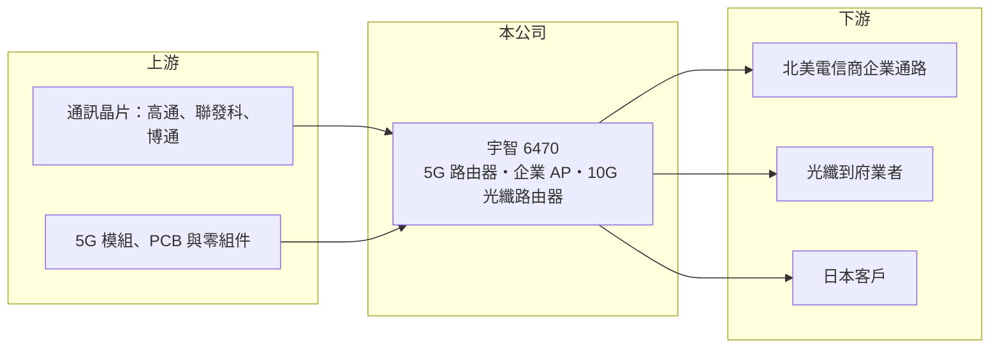

# 6470 宇智

> 上櫃｜[[產業索引-通信網路業|通信網路業]]｜上市（櫃）日期 2015/11/03

# 第一章：企業模式與商業藍圖

> [!info] 撰寫說明
> 本文由 Claude 依公開資料整理，架構比照 [[2330台積電]] 的四章研究，資料截至 2026-10-08。財務數字來源：Goodinfo 年度經營績效頁、櫃買中心開放資料（基本資料、2026 年第二季資產負債與損益、每月營收、本益比殖利率）、富果研究整理的 2025 年 10 月法說會摘要；產品營收比重、生產據點與股東背景未查得。#待校對

評估一家中小型網通設備廠，要看它能否在大型 [[ODM]] 不願經營的利基市場站穩，並跟上通訊規格每隔幾年一次的世代交替。本章說明宇智網通（股票代號：6470，以下簡稱宇智）如何以 5G 路由器、企業級無線基地台與高速光纖路由器經營北美與日本市場。

## 一、核心定位：三類連網設備

宇智成立於 2004 年，2015 年在櫃買中心掛牌，實收資本額約 3.8 億元。依 2025 年 10 月法說會，公司產品分為三類：

* **蜂巢式連網：** [[5G]] 室內外路由器與橋接器，並開發 RedCap、LTE Cat-1/Cat-M 等低功耗物聯網方案。主要用途包括企業網路備援與車載路由器，2025 年上半年這兩類產品出貨增加，是營收成長的主因。
* **無線連網：** 企業級無線基地台（[[AP]]），新案以 [[Wi-Fi 7]] 為主，並已規劃 2028 至 2029 年的 Wi-Fi 8。
* **有線連網：** 10GbE 高速光纖路由器，公司視為未來的重要成長引擎。

## 二、市場與客戶

宇智的市場集中在北美與日本。北美方面，2025 年新增一家 5G 路由器客戶，透過電信商的企業通路銷售 5G 備援產品；光纖到府市場的 10G 路由器在推廣初期已有客戶追加訂單；日本市場的 10G 光纖路由器也取得初步訂單。各產品與地區的營收比重未查得。

## 三、長期方向

公司的長期策略是深耕 5G/6G、Wi-Fi 7/8 與高速光纖技術，並在邊緣設備加入輕量 AI 運算，應用於網路資安與本地決策，目標是從硬體製造商轉型為解決方案供應商。通訊規格每三至五年升級一次，每次升級都帶來換機需求，但也要求公司持續投入研發，才能在新世代取得客戶設計案。

# 第二章：護城河深度與競爭優勢

在長期價值投資中，「護城河」指企業抵禦競爭、維持超額利潤的保護機制。本章分析宇智的優勢、限制與競爭對手。

## 一、宇智的優勢與限制

* **利基市場與電信認證：** 5G 企業備援與車載路由器屬於量不大、規格多的利基產品，大型 ODM 投入意願較低。產品需要通過電信商與當地法規認證，一旦取得認證並上架電信商通路，後續訂單具有延續性。
* **多規格技術組合：** 同時具備蜂巢式、Wi-Fi 與光纖三種連網技術，能提供客戶組合方案。

限制是規模小、毛利率只有 16% 至 22%，議價能力有限，且營收集中在少數客戶，護城河屬於窄的類型。

## 二、主要競爭對手

| 對手 | 定位 | 對宇智的威脅 |
|---|---|---|
| [[5388中磊]] | 寬頻與 5G 設備 ODM | 規模大，可提供完整電信產品線 |
| [[3596智易]] | 寬頻閘道器與 Wi-Fi 設備 | 在光纖到府與 Wi-Fi 設備重疊 |
| [[6285啟碁]] | 網通、車用與衛星 ODM | 在車載與 5G 設備局部競爭 |
| Cradlepoint、Digi 等國際品牌 | 企業 5G 路由器 | 品牌與通路優勢 |

## 三、守得住／守不住／觀察重點

守得住的是已通過電信商認證、上架通路的利基產品。守不住的是規格成熟後的價格，大型 ODM 進場後毛利會被壓縮。長期觀察重點是 10G 光纖路由器能否從小量訂單擴大成穩定營收，以及營收能否擺脫 2026 年的衰退。

# 第三章：財務體質與盈利規模

資料日期：2026-10-08，表格是撰寫當時的快照；最新月營收、毛利率、累計 EPS 由自動排程寫在本筆記的屬性欄位（月營收、毛利率、累計EPS 等）。#待校對

財務報表是檢驗護城河是否真實存在的最終標準。本章用六年的三率、ROE 與資本報酬，檢視宇智的獲利品質。

## 一、多年度經營績效

| 年度 | 營收（新台幣） | [[毛利率]] | [[營業利益率]] | EPS（元） | [[ROE]] |
|---|---|---|---|---|---|
| 2020 | 22.0 億 | 21.6% | 11.1% | 4.80 | 22.4% |
| 2021 | 17.2 億 | 20.9% | 7.96% | 3.42 | 15.2% |
| 2022 | 25.8 億 | 17.3% | 7.69% | 6.17 | 25.4% |
| 2023 | 23.7 億 | 16.5% | 7.62% | 4.18 | 15.8% |
| 2024 | 19.7 億 | 16.6% | 6.79% | 3.60 | 12.2% |
| 2025 | 19.5 億 | 18.0% | 8.63% | 3.87 | 12.6% |
| 2026 上半年 | 5.65 億 | 16.7% | 0.65% | 1.06 | 未查得 |

宇智的營收隨專案起伏，2022 年高峰後逐年回落，2026 年 1 至 8 月累計營收約 7.9 億元、年減約 45%，本業幾乎只剩損益兩平。匯率對獲利影響很大：2025 年上半年因約 1.5 億元的外幣兌換損失，EPS 只有 0.13 元，全年仍有 3.87 元，代表下半年獲利與匯兌回升（細節待校對）；2026 年上半年本業利益僅 0.04 億元，EPS 主要來自業外收入與所得稅利益。2021 至 2025 年平均 ROE 約 16.2%（推算），營收年複合成長率約 3.2%（推算）。最近一次現金股利每股 2.5 元。

## 二、[[ROIC]] 與 [[WACC]]：價值創造利差

**ROIC 推算：** 2025 年營業利益約 1.68 億元（19.5 億 × 8.63%），稅後約 1.35 億元。2026 年第二季股東權益約 11.3 億元，負債約 6.1 億元，假設有息負債約三成、約 1.8 億元（推估），投入資本約 13.1 億元，ROIC 約 10.3%（推算）。

**WACC 推算：** 台灣 10 年期公債 1.75%、市場風險溢酬 6%、β 取網通同業常見值 1.0，股東權益成本約 7.8%；負債成本 2.5%、稅後 2.0%；權益占投入資本約 86%，WACC 約 7.0%（推算）。

**結論：** 2025 年 ROIC 高於 WACC 約 3 個百分點，過去多數年度也有創造價值。但 2026 年上半年營業利益率只有 0.65%，若全年維持這個水準，ROIC 會跌到資金成本以下，新產品放量的速度是關鍵。

# 第四章：總體風險與地緣政治

任何企業都無法脫離宏觀環境獨立存在。本章分析宇智長期必須面對的風險。

## 一、客戶集中與專案週期

營收集中在少數北美與日本客戶，專案結束或客戶調整庫存時，營收可能大幅下滑，2026 年的衰退即是例子。網通設備的[[長鞭效應]]也會放大終端需求的波動。

## 二、匯率風險

營收以美元計價，公司採自然避險，但 2025 年上半年仍認列約 1.5 億元的匯兌損失，幾乎抵銷全部本業獲利。對低毛利的網通廠來說，匯率是影響獲利最大的外部因素之一。

## 三、規格世代與競爭

Wi-Fi、5G 與光纖規格持續升級，研發投入不可間斷。大型 ODM 若看好企業 5G 或 10G 光纖市場而積極進場，宇智的利基優勢可能被侵蝕。

# 專有名詞解析

## 應用

- **[[AP]]**：無線基地台，把有線網路轉成 Wi-Fi 訊號，是企業與家庭無線網路的接入設備。

## 金融

- **[[長鞭效應]]**：終端需求的小幅變動，沿供應鏈往上游傳遞時被逐級放大，造成上游庫存與訂單劇烈波動。
- **[[ROIC]]**：投入資本報酬率，稅後營業利益除以股東權益與有息負債的合計，衡量本業對所有資金提供者的報酬。
- **[[WACC]]**：加權平均資金成本，依股東權益與負債的比重加權計算的資金成本，ROIC 高於它才代表創造價值。

## 產業

- **[[ODM]]**：原廠委託設計製造，代工廠可提出設計方案並負責生產，與客戶綁定較深，議價能力較高。
- **[[5G]]**：第五代行動通訊技術，速度與連線數量大幅提升，可用於企業網路備援與固定無線寬頻。
- **[[Wi-Fi 7]]**：第七代 Wi-Fi 標準（802.11be），支援更寬的頻道與多頻段同時傳輸，速度與延遲都明顯改善。

# 核心供應鏈

## 1. 上游：晶片與零組件
- 通訊晶片：[[QCOM高通]]、[[2454聯發科]]、[[AVGO博通]]（供應關係為產業常見組合，待校對）
- 5G 模組、PCB 與零組件

## 2. 中游：宇智與同業
- 同業：[[5388中磊]]、[[3596智易]]、[[6285啟碁]]、Cradlepoint、Digi

## 3. 下游：客戶
- 北美電信商企業通路、光纖到府業者、日本網通客戶（具體客戶名稱未查得）

## 最新新聞
<!-- news:start -->
<!-- news:end -->

## 相關連結
- [公開資訊觀測站](https://mopsov.twse.com.tw/mops/web/t05st03?step=1&firstin=1&co_id=6470)
- [Goodinfo](https://goodinfo.tw/tw/StockDetail.asp?STOCK_ID=6470)
- [Yahoo 股市](https://tw.stock.yahoo.com/quote/6470)
- [鉅亨網新聞](https://www.cnyes.com/twstock/6470/news)
