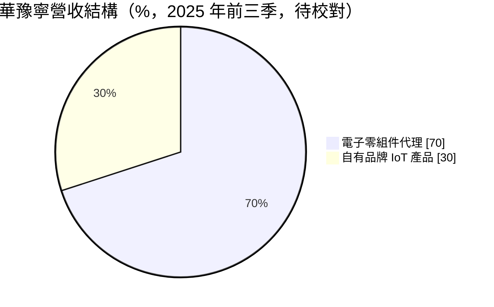
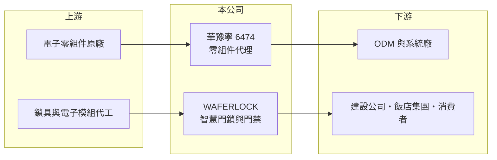

# 6474 華豫寧

> 上櫃｜[[產業索引-電子通路業|電子通路業]]｜上市（櫃）日期 2025/11/25

# 第一章：企業模式與商業藍圖

> [!info] 撰寫說明
> 精簡版，由 Claude 依公開資料整理，架構比照 [[2330台積電]] 的四章研究，資料截至 2026-10-08。來源：優分析 2025 年 11 月 IPO 報導、Goodinfo 經營績效頁、櫃買中心開放資料快照（基本資料、2026 年第二季損益與資產負債）。公開資料有限，代理品牌與主要客戶未查得。#待校對

華豫寧是一家同時經營電子零組件代理與自有品牌智慧門鎖的公司，2025 年 11 月才在櫃買中心掛牌。本章說明它的「雙引擎」模式，以及為何自有品牌是長期毛利的關鍵。

- **核心業務：** 華豫寧成立於 1992 年，原本以[[電子通路]]起家，替原廠在台灣銷售電子零組件。之後發展自有品牌 WAFERLOCK（維夫拉克），產品包括感應式電子鎖、智慧家居、辦公大樓門禁與飯店門鎖系統，也就是[[物聯網]]應用。公司把這兩塊業務稱為「雙引擎驅動」，目標是逐步把營收重心移向毛利較高的自有產品。
- **營收結構：** 依 2025 年前三季的 IPO 報導，自有產品約占 30%、電子零組件代理約占 70%（原文敘述不完整，待校對）。代理業務提供規模與現金流，自有品牌則拉高整體毛利率，這也是華豫寧毛利率約 20% 遠高於一般通路商的原因。
- **營運據點：** 公司在中部科學園區有自有的智慧辦公大樓，取得 2021 年 LEED 白金級、2022 年台灣智慧建築鑽石級等認證，本身就是智慧建築產品的展示案例。自有品牌客戶包括建設公司、飯店集團、ODM 廠與一般消費者。
- **長期方向：** 公司以 DSR（設計導入銷售報告）與商業智慧系統追蹤專案，從拜訪客戶、[[設計導入]]到量產全程管理，提高代理業務的轉換率。智慧門鎖則跟著新建案、飯店翻新與智慧建築法規推進成長。2025 年 11 月 25 日以每股 31.8 元承銷價上櫃。

# 第二章：護城河深度與競爭優勢

華豫寧的護城河主要建立在自有品牌與建案通路，而不是代理本身。本章分析這兩塊的競爭力。

- **競爭優勢：** 智慧門鎖要通過建商與飯店的規格認證，一旦進入建案或飯店體系，後續的維修、更換與擴充通常沿用同一品牌，具有一定的轉換成本。公司取得台灣智慧建材標章與智慧建築系統整合商評等，這些資格也是承接建案的門檻。
- **主要對手：** 智慧門鎖市場有國際品牌與國內鎖具大廠，例如 [[9924福興]]，也有大量中國低價品牌。電子通路業務則面對 [[3702大聯大]]、[[3036文曄]] 等大型通路商，華豫寧在這塊屬於小型業者。
- **觀察重點：** 第一，自有品牌營收占比能否持續提高，這直接決定毛利率能否維持在 20% 以上。第二，兩大事業的組織與財務是否進一步分開管理，讓投資人能清楚看到自有品牌的獲利能力。第三，上櫃後的配息政策是否穩定。

# 第三章：財務體質與盈利規模

資料日期：2026-10-08，表格是撰寫當時的快照；最新月營收、毛利率、累計 EPS 由自動排程寫在本筆記的屬性欄位（月營收、毛利率、累計EPS 等）。#待校對

華豫寧的營收規模多年維持在 40 億元上下，毛利率隨自有品牌比重提升而上移。本章用多年度數據說明它的獲利結構。

| 年度 | 營收（億元） | [[毛利率]] | [[營業利益率]] | EPS（元） | [[ROE]] |
|---|---|---|---|---|---|
| 2021 | 44.1 | 18.2% | 6.59% | 6.21 | 24.0% |
| 2022 | 43.4 | 19.6% | 6.84% | 4.21 | 13.9% |
| 2023 | 40.3 | 16.3% | 3.36% | 0.75 | 2.59% |
| 2024 | 40.9 | 19.2% | 5.03% | 2.62 | 8.72% |
| 2025 | 38.5 | 22.2% | 6.13% | 3.49 | 10.4% |
| 2026 上半年 | 21.7 | 21.4% | 5.67% | 2.05 | 未查得 |

- **營收規模：** 2021 至 2025 年營收從 44.1 億元降到 38.5 億元，年複合成長率約 -3.3%（推算），主要是代理業務隨電子景氣調整；2026 年上半年營收回升。早年 EPS 較高部分是因為上櫃前股本較小，跨年比較 EPS 時要注意股本變動。
- **獲利：** 毛利率從 2023 年的 16.3% 升到 2025 年的 22.2%，反映自有產品比重提高。近 5 年平均 ROE 約 11.9%（推算），在通路類公司中屬中上水準。
- **財務特色：** 2026 年第二季末股東權益 16.9 億元、負債總計 18.0 億元，其中非流動負債 2.4 億元，可能與自有大樓有關（推估）。實收資本額 5.25 億元。

**[[ROIC]] 與 [[WACC]]：** 有息負債明細未查得，以負債總計的四成多、約 8 億元推估。2025 年稅後營業利益約 1.89 億元（38.5 億 × 6.13% × 0.8），投入資本為權益 16.9 億元加有息負債 8 億元，約 24.9 億元，ROIC 約 7.6%（推算）。WACC 用 CAPM 推估：無風險利率 1.75%、市場風險溢酬 6%、β 取 0.9（同業常見值，假設），股東權益成本約 7.2%；負債成本 2.5%、稅率 20%，以權益 68%、負債 32% 加權，WACC 約 5.5%（推算）。結論是：華豫寧在正常年份 ROIC 略高於 WACC，代表自有品牌帶來的毛利讓公司能小幅創造價值；2023 年這類低谷年則低於資金成本。

# 第四章：總體風險與地緣政治

華豫寧同時面對電子景氣與營建景氣兩種循環。本章整理主要風險。

- **產業週期：** 代理業務約占七成，會隨半導體與消費性電子的庫存循環起伏，2023 年營業利益率降到 3.36% 就是例子。智慧門鎖則和建案推案量、飯店投資相關，營建景氣轉弱時需求會延後。
- **營運風險：** 自有品牌需要持續投入研發、認證與售後服務，費用較固定；若營收成長不如預期，營業利益率會受壓。代理業務則有原廠收回代理權與庫存跌價的風險。
- **其他風險：** 智慧門鎖涉及資訊安全與個資保護，產品若出現資安事件會損及品牌。中國低價智慧鎖的競爭、匯率變動與零組件成本上升也會影響毛利。

# 專有名詞解析

## 應用

- **[[物聯網]]**：讓門鎖、家電、感測器等設備連上網路並可遠端管理的應用，簡稱 IoT。

## 金融

- **[[ROIC]]**：投入資本報酬率，稅後營業利益除以股東權益加有息負債，衡量本業運用資本的效率。
- **[[WACC]]**：加權平均資金成本，股東權益成本與負債成本依資本結構加權，是 ROIC 必須超越的門檻。

## 產業

- **[[電子通路]]**：替上游原廠銷售零組件並提供備貨、技術支援與帳期的中間商，毛利率低、靠周轉賺錢。
- **[[設計導入]]**：通路商或原廠協助客戶在新產品設計階段採用某顆晶片，量產後在產品生命週期內持續出貨。

# 核心供應鏈

- 上游：電子零組件原廠（品牌未查得）、鎖具與電子模組供應商。
- 下游／客戶：ODM 與系統廠、建設公司、飯店集團、一般消費者。
- 同業：電子通路 [[3702大聯大]]、[[3036文曄]]；鎖具 [[9924福興]]。

## 最新新聞
<!-- news:start -->
<!-- news:end -->

## 相關連結
- [公開資訊觀測站](https://mopsov.twse.com.tw/mops/web/t05st03?step=1&firstin=1&co_id=6474)
- [Goodinfo](https://goodinfo.tw/tw/StockDetail.asp?STOCK_ID=6474)
- [Yahoo 股市](https://tw.stock.yahoo.com/quote/6474)
- [鉅亨網新聞](https://www.cnyes.com/twstock/6474/news)
