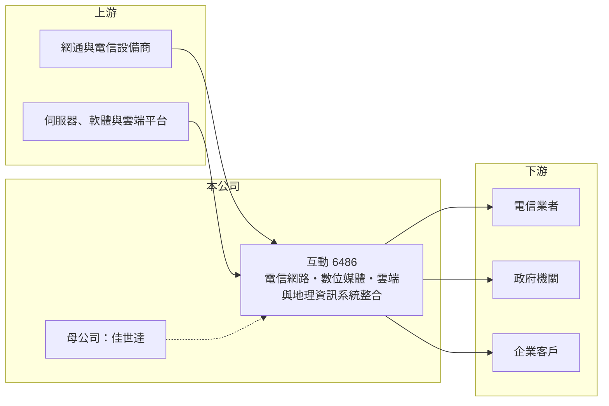

# 6486 互動

> 上櫃｜[[產業索引-通信網路業|通信網路業]]｜上市（櫃）日期 2016/09/13

# 第一章：企業模式與商業藍圖

> [!info] 撰寫說明
> 本文由 Claude 依公開資料整理，架構比照 [[2330台積電]] 的四章研究，資料截至 2026-10-08。財務數字來源：Goodinfo 年度經營績效頁、櫃買中心開放資料（基本資料、2026 年第二季資產負債與損益、每月營收、本益比殖利率）、nStock 公司簡介；客戶結構與專案內容部分憑記憶整理，已標「待校對」，各業務營收比重未查得。公開資料有限。#待校對

評估一家[[系統整合]]公司，要看它的收入是一次性的工程專案，還是能延伸成長期維運的經常性收入，以及它在客戶網路中扮演多深的角色。本章說明互動國際數位（股票代號：6486，以下簡稱互動）如何以電信網路與資訊系統整合服務經營。

## 一、核心定位：電信與資訊系統整合商

互動成立於 2003 年，2016 年在櫃買中心掛牌，實收資本額約 5.1 億元，最終母公司為 [[2352佳世達]]。公司業務包括五大類：電信暨寬頻網路系統服務、無線傳輸服務、數位媒體系統服務、雲端資訊系統服務與地理資訊系統服務。

系統整合商的角色是替客戶規劃架構、採購設備、安裝建置並提供後續維護。互動的客戶以電信業者與政府、企業為主（客戶結構待校對），專案包括電信核心與寬頻網路設備建置、數位媒體平台與地理資訊系統。這類業務的毛利率取決於專案中軟體與服務的比重：硬體轉售越多，毛利率越低。

## 二、營收特性：專案型收入

互動的收入屬於[[專案型收入]]，大型專案驗收的月份營收會暴增。例如 2026 年 8 月單月營收約 14.9 億元，超過 2025 年全年營收的一半，9 月隨即回落到約 1.7 億元。這說明公司的單月或單季營收不能直接外推，應以多年平均觀察。各業務的營收比重未查得。

## 三、長期方向

電信業者持續升級寬頻、5G 與雲端網路，政府推動數位轉型與地理資訊應用，是系統整合服務的長期需求來源。互動近年也布局[[低軌衛星]]相關網通與雲端服務（細節待校對）。長期關鍵在於提高軟體與維運服務的比重，讓營收從一次性專案逐步轉成較穩定的經常性收入。

# 第二章：護城河深度與競爭優勢

在長期價值投資中，「護城河」指企業抵禦競爭、維持超額利潤的保護機制。本章分析互動的優勢、限制與競爭對手。

## 一、互動的優勢與限制

* **電信網路的建置經驗：** 電信核心與寬頻網路專案需要熟悉電信商的設備、規範與作業流程，承作過的整合商較容易取得後續擴充與維護合約。
* **集團資源：** 身為佳世達集團成員，可借助集團的硬體、醫療與解決方案資源，拓展跨領域專案。

限制是專案收入波動大，且硬體轉售比重提高時毛利率下降。2024 年起毛利率從四成多降到約 32%，2026 年上半年再降到約 28%，可能反映專案組合轉向硬體比重較高的案件（推估），護城河屬於窄的類型。

## 二、主要競爭對手

| 對手 | 定位 | 對互動的威脅 |
|---|---|---|
| [[2471資通]] | 電信系統整合與軟體 | 在電信專案直接競爭 |
| [[6214精誠]] | 大型資訊服務商 | 在企業與政府資訊專案競爭 |
| [[2480敦陽科]] | 企業系統整合 | 在網路與雲端專案重疊 |
| [[6183關貿]] | 政府與企業資訊服務 | 在政府專案競爭 |

## 三、守得住／守不住／觀察重點

守得住的是已承作電信網路的維護與擴充需求。守不住的是大型標案的價格競爭，以及硬體轉售的低毛利。長期觀察重點是大型專案結束後的營收基礎，以及維運服務在營收中的比重能否提高。

# 第三章：財務體質與盈利規模

資料日期：2026-10-08，表格是撰寫當時的快照；最新月營收、毛利率、累計 EPS 由自動排程寫在本筆記的屬性欄位（月營收、毛利率、累計EPS 等）。#待校對

財務報表是檢驗護城河是否真實存在的最終標準。本章用六年的三率、ROE 與資本報酬，檢視互動的獲利品質。

## 一、多年度經營績效

| 年度 | 營收（新台幣） | [[毛利率]] | [[營業利益率]] | EPS（元） | [[ROE]] |
|---|---|---|---|---|---|
| 2020 | 18.6 億 | 43.2% | 14.7% | 6.33 | 20.9% |
| 2021 | 18.7 億 | 45.5% | 16.0% | 6.73 | 21.6% |
| 2022 | 20.5 億 | 41.5% | 13.7% | 5.43 | 16.7% |
| 2023 | 22.9 億 | 41.7% | 13.8% | 6.26 | 17.0% |
| 2024 | 25.3 億 | 32.4% | 13.3% | 5.87 | 15.1% |
| 2025 | 26.9 億 | 32.2% | 13.0% | 5.78 | 14.6% |
| 2026 上半年 | 10.4 億 | 27.9% | 5.73% | 1.05 | 未查得 |

互動過去六年營收穩定成長、每年都有獲利，營業利益率維持在 13% 至 16%，對系統整合商而言相當穩健。毛利率雖然下降，但營業利益率大致守住，代表費用控制良好。2021 至 2025 年平均 ROE 約 17.0%（推算），營收年複合成長率約 9.5%（推算）。最近一次現金股利每股 6 元，高於 2025 年 EPS，配息率超過 100%（推算），公司長年維持高配息。

## 二、[[ROIC]] 與 [[WACC]]：價值創造利差

**ROIC 推算：** 2025 年營業利益約 3.5 億元（26.9 億 × 13.0%），稅後約 2.8 億元。2026 年第二季權益總計約 17.8 億元，負債約 24.6 億元，大部分為專案相關的應付款與合約負債，假設有息負債約兩成、約 4.9 億元（推估），投入資本約 22.7 億元，ROIC 約 12.3%（推算）。

**WACC 推算：** 台灣 10 年期公債 1.75%、市場風險溢酬 6%、β 取資訊服務同業常見值 0.9，股東權益成本約 7.2%；負債成本 2.5%、稅後 2.0%；權益占投入資本約 78%，WACC 約 6.0%（推算）。

**結論：** ROIC 高出 WACC 約 6 個百分點，代表互動長期以輕資產模式創造價值，客戶預收款與應付款也降低了自有資金需求。觀察重點是毛利率下滑是否會擴大到營業利益率。

# 第四章：總體風險與地緣政治

任何企業都無法脫離宏觀環境獨立存在。本章分析互動長期必須面對的風險。

## 一、專案集中與驗收時點

大型專案的驗收時點決定營收認列，單一專案延後驗收就可能讓整季營收大幅波動。客戶集中在電信業者時（待校對），電信商的資本支出週期會直接影響互動的接案量。

## 二、毛利率下滑

硬體轉售比重提高會壓低毛利率，若營業費用無法同步下降，營業利益率將受影響。2026 年上半年營業利益率降到約 5.7%，需要觀察是否為短期專案組合因素。

## 三、技術與人才

電信網路正走向雲端化與軟體化，整合商需要持續培養雲端、資安與軟體人才。若技術轉型落後，未來可能只剩低毛利的硬體轉售角色。

# 專有名詞解析

## 應用

- **[[系統整合]]**：替客戶規劃、採購並整合不同廠牌的硬體與軟體，建置成可運作的完整系統，並提供後續維護。
- **[[低軌衛星]]**：在約 500 至 2,000 公里高度運行的通訊衛星，延遲低，需要大量地面接收終端與天線。

## 金融

- **[[ROIC]]**：投入資本報酬率，稅後營業利益除以股東權益與有息負債的合計，衡量本業對所有資金提供者的報酬。
- **[[WACC]]**：加權平均資金成本，依股東權益與負債的比重加權計算的資金成本，ROIC 高於它才代表創造價值。

## 產業

- **[[專案型收入]]**：依專案進度或驗收認列的收入，金額大但不連續，營收波動通常較大。

# 核心供應鏈

## 1. 上游：設備與軟體
- 網通與電信設備、伺服器、軟體與雲端平台供應商（具體廠商未查得）

## 2. 中游：互動與同業
- 母公司：[[2352佳世達]]
- 同業：[[2471資通]]、[[6214精誠]]、[[2480敦陽科]]、[[6183關貿]]

## 3. 下游：客戶
- 電信業者，例如 [[2412中華電]]、[[3045台灣大]]、[[4904遠傳]]（是否為客戶待校對）
- 政府機關與企業客戶

## 最新新聞
<!-- news:start -->
<!-- news:end -->

## 相關連結
- [公開資訊觀測站](https://mopsov.twse.com.tw/mops/web/t05st03?step=1&firstin=1&co_id=6486)
- [Goodinfo](https://goodinfo.tw/tw/StockDetail.asp?STOCK_ID=6486)
- [Yahoo 股市](https://tw.stock.yahoo.com/quote/6486)
- [鉅亨網新聞](https://www.cnyes.com/twstock/6486/news)
