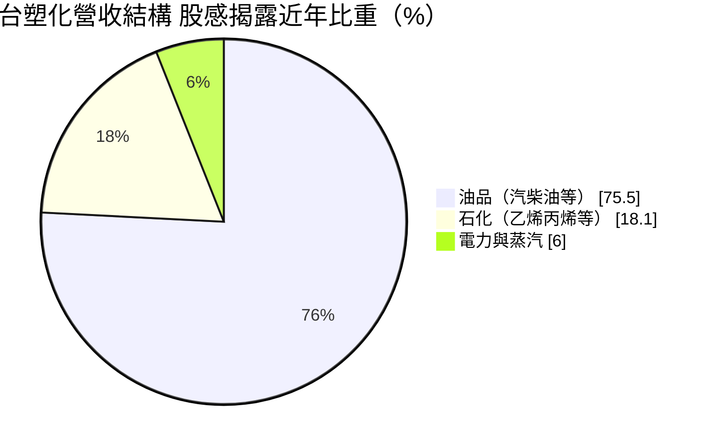
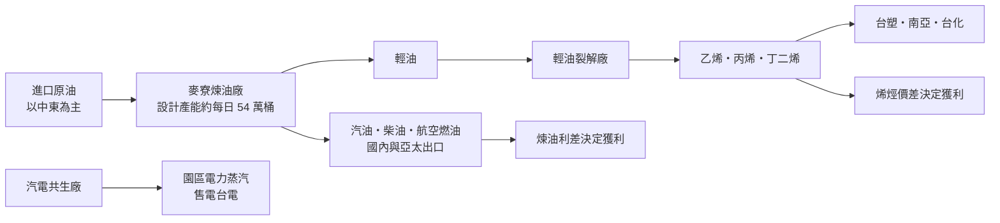
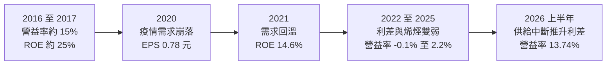
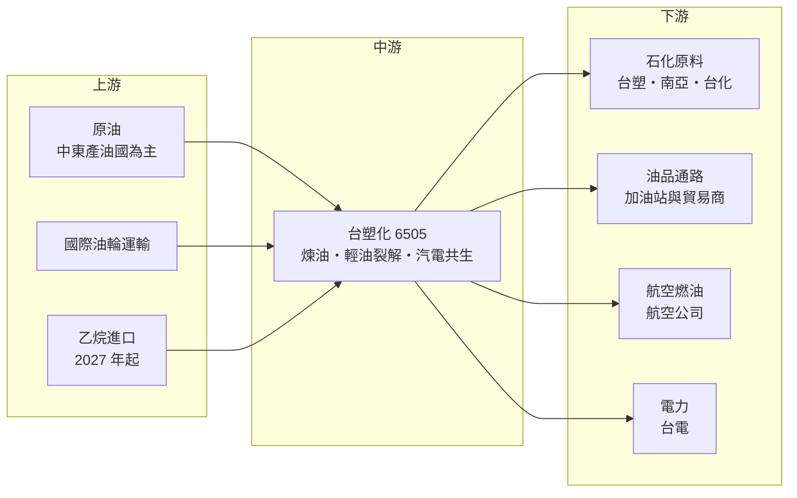

# 6505 台塑化

> 上市｜[[產業索引-油電燃氣業|油電燃氣業]]｜上市（櫃）日期 2003/12/26

# 第一章：企業模式與商業藍圖

> [!info] 撰寫說明
> 本文由 Claude 依公開資料整理，架構比照 [[2330台積電]] 的四章研究，資料截至 2026-10-08。財務數字來源：證交所開放資料快照（基本資料、2026 年第二季資產負債與綜合損益、營益分析、2025 年度股利）、Goodinfo 經營績效頁與股利政策頁（2016 至 2025 年）、Yahoo 股市季現金流量表（2021 至 2026 年）、股感公司資料（營收比重）、經濟日報 2026 年 6 月報導（煉油產能利用率）、優分析 2026 年 9 月報導（乙烷進料計畫）；乙烯年產能、六輕各廠投產年份與內外銷比重係憑記憶或期間不明的二手整理，尚未逐條比對原始文件。#待校對

在評估一家公司的長期投資價值時，第一步是看懂它靠什麼賺錢、這門生意的景氣循環有多大。本章針對台塑石化（股票代號：6505，以下簡稱台塑化）的商業模式進行定性分析，說明它作為台塑集團「源頭」的角色、煉油與石化兩大事業如何此消彼長，以及為什麼它的獲利會在不同年份之間出現數倍的落差。

## 一、核心定位：台灣唯一的民營煉油廠與集團原料源頭

台塑化於 1992 年 4 月 6 日核准設立，由 [[1301台塑]]、[[1326台化]]、[[1303南亞]] 等集團公司共同出資，2003 年 12 月 26 日掛牌上市。它是台灣唯一的民營石油煉製業者，主要對手是國營的台灣中油。核心資產集中在雲林麥寮的六輕園區，包括煉油廠、[[輕油裂解]]廠與[[汽電共生]]廠，以及專用港口、儲槽與管線網路。

依經濟日報 2026 年 6 月的報導，台塑化每日處理約 44 萬桶原油時，煉油產能利用率約 81%，由此推算煉油設計產能約為每日 54 萬桶（推算），是亞洲規模名列前茅的單一煉油基地。乙烯方面，六輕共有三座輕油裂解廠，年產能合計約 290 萬噸（待校對）。

台塑化在集團中的角色可以從兩個面向理解：

- **能源供應者：** 把進口原油煉成汽油、柴油、航空燃油、液化石油氣與燃料油等油品，一部分在國內銷售，與中油分食台灣市場，另一部分出口到亞太地區。國內與出口的比重大約各半（CMoney 整理，期間未標，待校對）。
- **集團原料源頭：** 把煉油過程產生的輕油送進裂解廠，生產[[乙烯]]、丙烯、丁二烯等基本石化原料，再以管線供應台塑、南亞、台化，做成塑膠、纖維與化學品。台塑化好比是台塑集團這棵大樹的根，下游三家公司的原料穩定度，很大程度取決於它。

## 二、事業板塊：煉油為主，烯烴與公用事業為輔

依股感公司資料揭露的營收比重（期間未註明，推估為近年年報資料）：

- **煉油（約七成五）：** 營收與獲利的主要來源。煉油廠的獲利取決於[[煉油利差]]，也就是成品油售價減去原油成本的差額。利差寬時，煉油廠即使銷量不變，獲利也會大幅增加；利差窄時，龐大的營收只能換來很薄的利潤。
- **烯烴（約兩成）：** 輕油裂解生產的乙烯、丙烯、丁二烯，主要供應集團公司，也對外銷售。這個事業的獲利取決於烯烴價格與輕油成本的差距，近年受到美國[[乙烷裂解]]與中國大量新產能的壓力，長期處於低迷。
- **公用事業（約 6%）：** 汽電共生廠供應六輕園區的電力與蒸汽，多餘電力售予台電。這部分營收規模不大，但相對穩定，替公司提供一塊與油價無關的收入。

## 三、資本轉化邏輯：利差與開工率決定一切

- **薄利多銷的大宗商品生意：** 台塑化每年營收動輒五、六千億元，但毛利率在平淡年份只有 2% 至 4%。這是因為原油成本占售價的絕大部分，公司真正賺到的只是中間的加工利差。利差每變動一點點，乘上龐大的處理量，對獲利的影響就非常大。
- **[[開工率]]的營運槓桿：** 煉油與裂解廠的折舊、人力與維修多是固定成本，開工率高時這些成本被大量產品分攤，開工率低時則會侵蝕獲利。台塑化會依煉油與石化的相對利差調整進料，例如石化利差差時減少裂解、把資源轉向油品。
- **存貨評價的放大效果：** 煉油廠必須持有大量原油與成品庫存。油價上漲時，低價買進的庫存以高價賣出，會出現額外的庫存利益；油價急跌時則會產生[[存貨跌價損失]]。因此台塑化的單季獲利，經常同時反映利差與油價方向兩個因素。

## 四、企業長期藍圖：原料多元化與減碳

- **以乙烷降低裂解成本：** 依優分析 2026 年 9 月報導，台塑化計畫把部分麥寮裂解爐改為可使用乙烷進料，預計 2026 年底完成、2027 年投入運轉，初期每年採購約 30 萬噸乙烷，成本估計比輕油每噸低約 150 至 200 美元。這是台塑化面對美國乙烷裂解競爭的結構性回應：與其被低成本對手壓著打，不如部分改用相同的低成本原料。
- **集團上游供料：** 不論石化景氣好壞，台塑化都是集團三家公司的原料來源。這種內部需求讓它的裂解廠在景氣差時仍有基本的出貨量，但也意味著它難以單獨決定是否大幅減產或關廠。
- **能源轉型與減碳：** 汽電共生改善能效、降低燃煤比重、發展低碳燃料，是因應台灣[[碳費]]與國際減碳規範的長期課題（未查得具體投資金額）。煉油業長期面對 [[EV]] 普及帶來的汽油需求下滑，如何把資產逐步轉向化學品與低碳能源，是台塑化未來十年的核心問題。

# 第二章：護城河深度與競爭優勢

在長期價值投資中，「護城河」指企業抵禦競爭、長期維持超額利潤的保護機制。本章分析台塑化難以複製的資產、亞太煉油與石化市場的主要競爭對手，以及這些優勢在承平時期與供給中斷時期分別能發揮多少作用。

## 一、台塑化護城河的核心組成要素

台塑化的護城河主要來自「難以複製的資產」，但因為產品是全球定價的大宗商品，這條護城河只能保護它不被淘汰，無法保證超額利潤，屬於「窄護城河」。

- **1. 大型[[煉化一體化]]園區：** 六輕把煉油、裂解、發電、港口與下游塑化工廠整合在同一個園區，原料與產品以管線直接輸送，物流與能源成本低。以台灣目前的環保、土地與用水條件，幾乎不可能再核准同規模的新煉油廠，因此現有產能本身就是稀缺資產。
- **2. 國內油品市場的雙寡占：** 台灣油品市場主要由台塑化與中油兩家供應，新進者要建煉油廠或大規模進口成品油的門檻都很高。這讓台塑化在國內市場有穩定的銷售基礎。
- **3. 集團內需與財務實力：** 烯烴產品透過管線直接供應台塑、南亞、台化，需求穩定、運輸成本低。加上台塑化負債比長期很低，在景氣低谷時仍能維持營運與配息，不必被迫出售資產。

## 二、全球主要競爭對手格局

| 對手 | 定位 | 對台塑化的影響 |
|---|---|---|
| 台灣中油 | 國營煉油與石化 | 國內油品市場唯一同等規模的對手，油價受政策影響 |
| SK 能源、GS Caltex、S-Oil | 南韓出口型煉油廠 | 在亞太油品出口市場直接競爭 |
| Reliance、新加坡煉油中心 | 印度與新加坡大型出口煉廠 | 規模大、成本低，影響亞洲區域利差 |
| 恆力石化、浙江石化、中石化 | 中國煉化一體化業者 | 中國成品油出口配額與新產能會改變區域供給 |
| 美國與中東乙烷裂解廠 | 以天然氣乙烷為原料的烯烴廠 | 原料成本明顯低於輕油裂解，壓低全球乙烯價格 |

## 三、優勢轉化：哪些守得住、哪些守不住

- **守得住：** 國內油品市場與集團內需。只要台灣仍需要汽柴油與航空燃油，台塑化與中油的雙寡占結構就很難被打破。在全球供給中斷的時期，例如 2026 年中東衝突造成亞洲成品油供應吃緊，台塑化能以高開工率吃下利差擴大的好處，2026 年上半年營業利益率達 13.74%（證交所資料）。
- **守不住：** 烯烴事業與承平時期的煉油利差。面對美國乙烷裂解與中國大規模新產能，台塑化的輕油裂解在成本與規模上都不占優勢，2026 年第二季裂解廠平均利用率只有約 33%。煉油在供需平衡的年份也只能賺到區域平均利差，2024 年營業利益率甚至是 -0.1%。
- **觀察重點：** 長期可以追蹤三件事。第一是亞洲煉油產能的增減，特別是中國成品油出口政策；第二是乙烷進料改造完成後，烯烴事業的成本能否明顯改善；第三是台灣與國際碳成本上升後，台塑化的減碳投資能否讓它比同業更有競爭力。

# 第三章：財務體質與盈利規模

資料日期：2026-10-08。數字取自 Goodinfo 經營績效頁與股利政策頁、證交所開放資料快照與 Yahoo 股市季現金流量表，表格是撰寫當時的快照；最新月營收、毛利率、累計 EPS 由自動排程寫在本筆記的屬性欄位（月營收、毛利率、累計EPS 等）。#待校對

財務報表是檢驗護城河是否真實存在的最終標準。本章用十年的三率、ROE、現金流與資本報酬，檢視台塑化在煉化週期中的獲利品質，並區分結構性變化與週期性波動。

## 一、獲利能力的基石：三率

| 年度 | 營收（億元） | [[毛利率]] | [[營業利益率]] | EPS（元） | [[ROE]] |
|---|---|---|---|---|---|
| 2016 | 5,462 | 17.7% | 15.8% | 7.95 | 26.3% |
| 2017 | 6,241 | 16.4% | 14.7% | 8.42 | 24.5% |
| 2018 | 7,676 | 10.1% | 8.66% | 6.31 | 17.5% |
| 2019 | 6,460 | 7.39% | 5.69% | 3.86 | 10.9% |
| 2020 | 4,153 | 3.12% | 0.67% | 0.78 | 2.28% |
| 2021 | 6,201 | 10.6% | 8.9% | 5.19 | 14.6% |
| 2022 | 8,480 | 1.91% | 0.64% | 1.51 | 4.24% |
| 2023 | 7,126 | 3.79% | 2.16% | 2.30 | 6.64% |
| 2024 | 6,638 | 1.55% | -0.10% | 0.63 | 1.81% |
| 2025 | 6,262 | 3.52% | 1.74% | 1.04 | 2.98% |

（來源：Goodinfo 經營績效頁，合併報表。2026 年上半年依證交所資料，營收 3,449.7 億元、毛利率 15.25%、營業利益率 13.74%、EPS 4.32 元。）

- **兩個時代：** 2016 至 2017 年台塑化的營業利益率約 15%，ROE 約 25%，是煉油與石化利差同時處於高檔的黃金期；2022 至 2025 年則連續四年營業利益率在 2% 上下，ROE 只有 2% 至 7%。2016 至 2020 年平均 ROE 約 16.3%，2021 至 2025 年平均只有約 6.1%（推算）。這個落差主要來自全球煉化產能擴張，特別是中國大型煉化一體化專案與美國乙烷裂解產能陸續投產，壓縮了亞洲的利差。
- **營收不等於獲利：** 2022 年營收創下 8,480 億元的高點，營業利益率卻只有 0.64%，因為營收主要反映油價上漲，利差並沒有改善。看台塑化不能看營收成長，要看利差與營業利益率。2016 至 2025 年營收年複合成長率只有約 1.5%（推算）。
- **極端的週期性：** 營業利益率在十年間從 15.8% 到 -0.1% 之間擺盪，2026 年上半年又因中東供給中斷回到 13.74%。這種波動幅度，說明台塑化本質上是週期股，任何單一年份的獲利都不能直接外推。

## 二、[[ROE]]：資本效率

台塑化的財務結構非常保守。依證交所 2026 年第二季資料，總資產約 5,904.6 億元、負債約 980.4 億元，負債比約 16.6%；權益總計約 4,924.2 億元，每股淨值約 51.11 元。權益中有約 1,496.5 億元屬於「其他權益」，主要是持有金融資產的未實現評價（推估包含持有集團公司股票的評價），這部分不會產生營業利益，卻會拉大計算 ROE 的分母。

低負債讓台塑化在景氣低谷時不會有財務危機，但也讓 ROE 完全取決於本業利差。景氣好時，ROE 可以超過 20%；景氣平淡時，龐大的權益只能換到個位數的報酬。

## 三、資本支出、自由現金流與股利

- **[[自由現金流]]：** 依 Yahoo 股市季資料加總（推算），以營業現金流加投資現金流計算，2022 年約負 130.5 億元、2023 年約 375.2 億元、2024 年約 10.0 億元、2025 年約 484.8 億元。2022 年轉負，主要是第二季油價高漲使存貨與應收帳款占用大量營運資金；其餘年份即使獲利微薄，仍大多能維持正的自由現金流。
- **[[CapEx]]：** 2022 至 2025 年投資活動的淨流出每年大多只有數十億元，與營業現金流相比很低（推算）。台灣已難再新設大型煉油產能，台塑化的資本支出以歲修、能效改善、減碳與乙烷進料改造為主，屬於維持型投資。
- **股利穩定度：** 依 Goodinfo 資料，2016 至 2025 年度現金股利在 0.59 元至 6.3 元之間大幅波動，從未配發股票股利。以現金股利除以 EPS 計算，2016 至 2022 年度配發率大多在 73% 至 76% 之間（推算），顯示公司習慣把約四分之三的獲利配出；2024 與 2025 年度配發 0.8 元與 1.2 元，超過當年 EPS，是動用過去累積的未分配盈餘維持配息。對投資人而言，台塑化的股利「配發率穩定、金額不穩定」，股利跟著前一年的獲利起伏。

## 四、[[ROIC]] 與 [[WACC]]：價值創造利差

- **ROIC（推算）：** 以 2025 年營收 6,262 億元乘以營業利益率 1.74%，營業利益約 109 億元，扣除 20% 稅率後稅後營業利益約 87 億元。投入資本以 2026 年第二季權益總計約 4,924 億元，加上有息負債（本次未查得借款明細，依負債總額約 980 億元且以應付帳款為主推估約 300 億元），合計約 5,224 億元，ROIC 約 1.7%（推算）；若扣除其他權益中約 1,497 億元的金融資產評價，ROIC 約 2.3%。以 2026 年上半年營業利益約 474 億元年化計算，ROIC 則升到約 14.5%（推算）。
- **WACC（推算）：** 以 [[CAPM]] 估算股東權益成本：無風險利率取台灣 10 年期公債約 1.75%，市場風險溢酬 6%，β 假設 0.8（煉化同業常見值約 0.7 至 0.9，未查得台塑化實際數字），權益成本約 6.55%。稅前負債成本假設 2%、稅率 20%，稅後約 1.6%。負債約占投入資本一成、權益約九成，WACC 約 6.1%（推算）。
- **價值創造判斷：** 2021 至 2025 年台塑化的平均 ROE 約 6.1%，幾乎等於推算的權益成本，代表這五年整體上沒有創造超額價值；2022 至 2025 年的 ROIC 更明顯低於 WACC。相反地，2016 至 2017 年與 2026 年上半年這類利差高峰期，ROIC 遠高於 WACC。台塑化的價值創造高度集中在少數景氣高峰年份，長期投資人應以完整週期的平均報酬評估，而不是用高峰或谷底的單一年度下判斷。

# 第四章：總體風險與地緣政治

任何企業都無法脫離宏觀環境獨立存在，煉油業更是直接暴露在原油價格與地緣政治之下。本章分析台塑化未來必須面對的地緣政治、產業週期、營運與長期轉型風險。

## 一、地緣政治風險

- **中東與航道風險：** 台塑化的原油主要來自中東，運輸需經過荷莫茲海峽等關鍵航道。2026 年的中東衝突顯示，供給中斷短期可能讓成品油利差擴大、對煉油廠有利，但若衝突擴大到原油無法取得，開工率反而會被迫下降。這種風險對台塑化是「雙面刃」，結果取決於中斷的程度與時間長短。
- **兩岸與能源安全：** 麥寮是台灣能源供應的關鍵設施，原油進口與產品出口都依賴海運。兩岸若發生封鎖或衝突，台塑化會同時面對原料與銷售的中斷。
- **中國的產業政策：** 中國是全球煉化產能擴張最快的國家，其成品油出口配額、煉廠整併與石化自給率政策，都會直接影響亞洲的利差與烯烴價格。

## 二、產業週期與市場結構風險

- **煉油利差循環：** 煉油利差受全球產能、需求、歲修與突發事件影響，波動極大。從 2016 年到 2025 年，台塑化的營業利益率在 15.8% 到 -0.1% 之間擺盪，未來也很可能維持這種大起大落的型態。
- **烯烴結構性供過於求：** 中國新增乙烯產能與美國、中東乙烷裂解廠的低成本產能，使亞洲輕油裂解業者長期處於成本劣勢。即使乙烷進料改造完成，也只能改善部分產能的成本。
- **油價下跌的庫存損失：** 油價急跌時，高價買進的原油庫存會造成存貨跌價損失，可能讓利差不差的季度仍出現虧損。

## 三、營運環境的隱性風險

- **工安與環保：** 六輕過去曾多次發生火災與工安事故，也長期面對空氣污染、用水與地層下陷等爭議。重大工安事故可能導致停工、罰款與擴建計畫受阻。
- **集團治理：** 台塑化與台塑、南亞、台化之間有大量原料互供與交叉持股。關係人交易的定價與資本配置，需要從少數股東的角度持續檢視。
- **歲修與電價：** 煉油與裂解廠定期歲修會造成單季產量下降；汽電共生售電的價格受政府能源政策影響。

## 四、科技與法規演進風險

煉油是成熟技術，台塑化的風險不在技術落後，而在需求長期下降與碳成本上升。台灣已開徵碳費，歐盟等主要市場也持續提高碳排放規範；電動車普及長期會壓抑汽油需求，航空與航運的低碳燃料規範也在逐步推進。若台塑化無法把產品組合逐步轉向化學品、低碳燃料或氫能等新領域，以化石燃料為主的資產在未來十年可能面臨開工率下降與價值減損的壓力。反過來說，台灣難以再建新煉油廠，現有產能在轉型期間仍有一定的稀缺價值，這是台塑化在能源轉型中可以爭取的時間。

# 專有名詞解析

## 應用

- **[[EV]]**：電動車，以電池與馬達取代內燃機，長期會壓抑汽油需求。

## 金融

- **[[存貨跌價損失]]**：存貨的市價低於帳面成本時必須認列的損失，油價急跌時煉油廠常出現此項。
- **[[自由現金流]]**：營業活動現金流減去資本支出，代表企業可自由用於配息、還債或併購的現金。
- **[[ROIC]]**：投入資本報酬率，稅後營業利益除以股東權益加有息負債，衡量本業運用資本的效率。
- **[[WACC]]**：加權平均資金成本，依股東權益與負債的比重，加權計算公司取得資金的平均成本。
- **[[CAPM]]**：資本資產定價模型，以無風險利率加上 β 乘以市場風險溢酬估算股東要求報酬率。

## 產業

- **[[煉油利差]]**：成品油售價與原油成本之間的差額，是煉油廠獲利的核心指標，英文常稱 crack spread。
- **[[輕油裂解]]**：把輕油在高溫下裂解成乙烯、丙烯等基本石化原料的製程，台灣俗稱的「輕裂」。
- **[[乙烷裂解]]**：以天然氣中的乙烷為原料生產乙烯，美國頁岩氣使其原料成本遠低於輕油裂解。
- **[[烯烴]]**：乙烯、丙烯、丁二烯等含雙鍵的基本石化原料，是塑膠與合成橡膠的起點。
- **[[乙烯]]**：最重要的基本石化原料，用來生產聚乙烯、PVC 等塑膠，乙烯價格常被視為石化景氣指標。
- **[[汽電共生]]**：同時產生電力與蒸汽的發電方式，可提高能源效率，六輕園區用它供應自身用電與蒸汽。
- **[[開工率]]**：實際處理量占設計產能的比例，煉油與石化廠的獲利高度取決於此數字。
- **[[煉化一體化]]**：把煉油、石化裂解與下游化學品生產整合在同一園區，以管線輸送原料，降低物流與能源成本。
- **[[碳費]]**：政府依企業碳排放量收取的費用，台灣已開徵，高耗能產業成本將上升。

# 核心供應鏈

## 1. 上游：原料與運輸
- 原油：中東產油國及其他產油地區
- 原油運輸：國際油輪船東
- 乙烷：依 2026 年規劃，2027 年起部分裂解爐改用進口乙烷

## 2. 中游：台塑化本身與集團夥伴
- 煉油、輕油裂解、汽電共生：台塑化麥寮六輕園區
- 股東與集團互供：[[1301台塑]]、[[1303南亞]]、[[1326台化]]

## 3. 同業競爭者
- 台灣：台灣中油
- 亞洲出口煉廠：SK 能源、GS Caltex、S-Oil、Reliance
- 中國煉化：恆力石化、浙江石化、中石化

## 4. 下游：客戶
- 石化原料：[[1301台塑]]、[[1303南亞]]、[[1326台化]]
- 油品通路：台塑石油加油站、國內外油品貿易商
- 航空燃油：[[2618長榮航]]、[[2610華航]]
- 電力：台灣電力公司

## 最新新聞
<!-- news:start（自動產生，請勿手動編輯此範圍） -->
- 2026-10-21 📰 媒體 12:10｜鉅亨速報 - Factset 最新調查：台塑化(6505-TW)目標價調升至120元，幅度約4.35%｜[鉅亨網](https://news.cnyes.com/news/id/6634895)
- 2026-10-18 📰 媒體 12:37｜〈熱門股〉煉油利差維持高檔+荷姆茲商船遇襲 台塑化周漲10.86%｜[鉅亨網](https://news.cnyes.com/news/id/6632861)
- 2026-10-13 📰 媒體 22:10｜鉅亨速報 - Factset 最新調查：台塑化(6505-TW)目標價調升至115元，幅度約6.48%｜[鉅亨網](https://news.cnyes.com/news/id/6629722)
- 2026-10-13 📰 媒體 20:11｜鉅亨速報 - Factset 最新調查：台塑化(6505-TW)EPS預估上修至9.01元，預估目標價為110元｜[鉅亨網](https://news.cnyes.com/news/id/6629643)
- 2026-10-12 📰 媒體 20:23｜〈台塑四寶業績〉四寶Q3賺762億元季增18% 南亞前3季賺逾1股本、台塑化同步創高｜[鉅亨網](https://news.cnyes.com/news/id/6628710)

完整紀錄：[[6505台塑化 新聞]]
<!-- news:end -->

## 相關連結
- [公開資訊觀測站](https://mopsov.twse.com.tw/mops/web/t05st03?step=1&firstin=1&co_id=6505)
- [Goodinfo](https://goodinfo.tw/tw/StockDetail.asp?STOCK_ID=6505)
- [Yahoo 股市](https://tw.stock.yahoo.com/quote/6505)
- [鉅亨網新聞](https://www.cnyes.com/twstock/6505/news)
