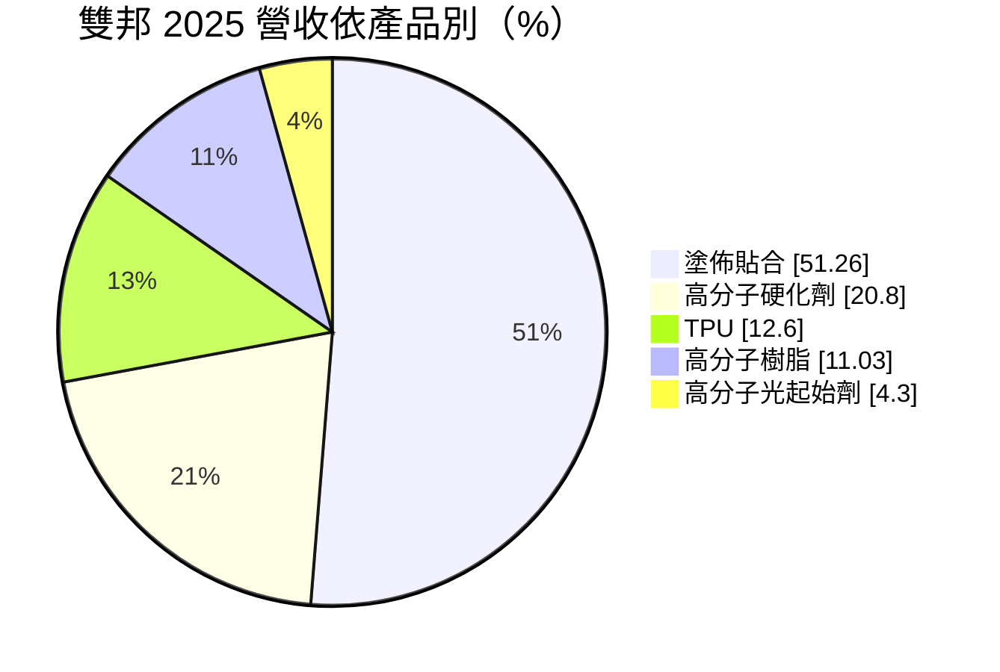
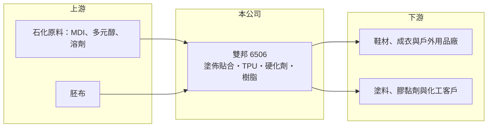

# 6506 雙邦

> 上櫃｜[[產業索引-紡織纖維|紡織纖維]]｜上市（櫃）日期 2011/05/03

# 第一章：企業模式與商業藍圖

> [!info] 撰寫說明
> 精簡版，由 Claude 依公開資料整理，架構比照 [[2330台積電]]，資料截至 2026-10-08。來源：Goodinfo 經營績效年表（2019 至 2025 年）；富邦 e 點通（MoneyDJ）公司基本資料（2025 年產品營收比重）；櫃買中心開放資料快照（基本資料、2026 年第二季資產負債與上半年損益）。客戶、應用終端與產能未查得，公開資料有限。#待校對

雙邦實業（以下簡稱雙邦）成立於 1989 年 11 月、2011 年 5 月上櫃，總部與工廠位於南投縣南投市，董事長為張崇棠，總經理為許瑜娟。它雖然被歸在紡織類股，實際上是一家「布料加工加上高分子化學」的公司，年營收約 16 至 22 億元。

- **核心業務：** 雙邦的業務分成兩塊：一是[[塗佈貼合]]，把薄膜或塗層加到布料上，做出防水、透濕或耐磨等功能布；二是自製高分子化學品，包括硬化劑、[[TPU]]、高分子樹脂與光起始劑。化學品可以供給自己的塗佈貼合使用，也可以外賣，形成一定程度的上下游整合。
- **營收結構：** 依 2025 年產品別營收比重，塗佈貼合占 51.26%，高分子硬化劑（含加工）占 20.80%，TPU 占 12.60%，高分子樹脂（含加工）占 11.03%，高分子光起始劑占 4.30%。也就是說，紡織加工與化學品大約各占一半，景氣循環同時受成衣鞋材與化工產業影響。
- **營運據點：** 總部與主要工廠在南投市永興路，海外據點與產能規模這次未查得。從資產結構看，非流動負債約 5.4 億元，推估有廠房與設備相關的長期借款。
- **長期方向：** 公開資料未揭露具體擴產計畫。雙邦的長期價值在於「材料自製加功能布加工」的整合能力：若能把 TPU 與樹脂配方應用到更多高附加價值領域（例如環保無溶劑塗層、醫療或戶外用材，推估），就能擺脫一般布料加工的低毛利。

# 第二章：護城河深度與競爭優勢

雙邦的競爭力來自化學配方與塗佈加工的結合，但規模小、毛利率長期在 14% 至 16% 附近，護城河有限。

- **競爭優勢：** 功能布的防水透濕效果取決於樹脂、薄膜配方與貼合製程的搭配，自己掌握高分子配方的加工廠，能比單純代工廠更快調整規格並控制成本。雙邦同時有硬化劑、TPU、樹脂與光起始劑產品，代表它在化學合成上有一定的技術累積。
- **主要對手：** 塗佈貼合與 TPU 薄膜的同業包括 [[1342八貫]]、[[1307三芳]]、[[4433興采]]；化學品方面則與 [[1717長興]]、[[1711永光]]、[[3430奇鈦科]]（光起始劑相關）等規模更大的化工廠有部分重疊。雙邦在各領域都不是龍頭，靠的是整合與彈性。
- **觀察重點：** 2026 年上半年毛利率 20.39%、營業利益率 11.12%，明顯高於過去七年的水準。長期觀察這個改善是否來自產品組合升級（可持續）還是原料價格下跌（一次性），以及化學品外賣比重能否提升。

# 第三章：財務體質與盈利規模

資料日期：2026-10-08，表格是撰寫當時的快照；最新月營收、毛利率、累計 EPS 由自動排程寫在本筆記的屬性欄位（月營收、毛利率、累計EPS 等）。#待校對

雙邦的獲利長期偏薄，營業利益率多在 3% 至 7% 之間，2023 年景氣低谷曾出現本業虧損。

| 年度 | 營收（億元） | [[毛利率]] | [[營業利益率]] | EPS（元） | [[ROE]] |
|---|---|---|---|---|---|
| 2019 | 20.7 | 16.3% | 6.2% | 1.39 | 8.76% |
| 2020 | 16.1 | 14.4% | 3.59% | 0.71 | 4.62% |
| 2021 | 20.1 | 13.8% | 4.2% | 0.83 | 6.01% |
| 2022 | 21.9 | 14.1% | 3.7% | 3.20 | 19.4% |
| 2023 | 15.8 | 7.79% | -3.63% | 0.01 | -1.47% |
| 2024 | 19.1 | 13.7% | 3.61% | 0.75 | 3.89% |
| 2025 | 18.8 | 16.0% | 6.67% | 1.04 | 7.43% |
| 2026 上半年 | 11.17 | 20.39% | 11.12% | 0.94 | 未查得 |

註：2019 至 2025 年取自 Goodinfo，2026 年上半年取自櫃買中心開放資料。2023 年 EPS 為正、ROE 為負，可能是非控制權益或業外影響，數字待校對；2022 年 EPS 明顯高於本業水準，推估含業外收益。

- **長期指標：** 2020 至 2025 年營收年複合成長率約 3.2%（推算），2021 至 2025 年平均 ROE 約 7.1%（推算），但起伏很大。股利紀錄這次未查得。
- **[[ROIC]] 與 [[WACC]]：** 2025 年營業利益約 1.25 億元（18.8 億 × 6.67%），稅後約 1.0 億元。2026 年第二季權益 13.2 億元，總負債 14.0 億元（非流動 5.4 億元），假設有息負債約 8 億元，投入資本約 21.2 億元，ROIC 約 4.7%（推算）；以 2026 年上半年營業利益 1.24 億元年化計算約 9.4%（推算）。WACC 以無風險利率 1.75%、市場風險溢酬 6%、β 0.9（紡織與化工同業常見值）、稅前負債成本 2.8%、稅率 20%、權益比重約 62% 計算約 5.3%（推算）。2025 年 ROIC 略低於 WACC，2026 年上半年明顯高於 WACC；過去多數年份 ROIC 在 WACC 附近或以下，代表長期創造價值的能力有限，近期改善能否延續是關鍵。
- **財務特色：** 2026 年第二季資產 27.1 億元、負債比率約 51%，每股淨值 15.39 元，在小型紡織股中槓桿偏高。營收規模不大但負債比率超過一半，景氣下行時利息負擔與流動性需要留意。

# 第四章：總體風險與地緣政治

雙邦的風險來自原料價格、下游紡織鞋材景氣，以及化工業的環保要求。

- **產業週期：** 塗佈貼合布的需求跟著戶外、運動鞋服品牌的庫存週期，化學品則跟著化工原料價格與下游塗料、膠黏劑景氣。2023 年兩邊同時走弱，營收年減約 28%，本業轉為虧損。
- **營運風險：** 營收規模小、負債比率偏高，單一大客戶流失或原料急漲都會明顯壓縮利潤。產品線分散在五個領域，資源分配與研發聚焦是管理上的挑戰。
- **其他風險：** TPU 與樹脂原料（如 MDI、多元醇）價格跟著石化週期波動；溶劑型塗佈面臨環保法規趨嚴，需要投資無溶劑或水性製程；外銷產品受匯率與下游客戶產地轉移（[[對等關稅]]）影響。

# 專有名詞解析

## 金融

- **[[ROIC]]**：投入資本報酬率，稅後營業利益除以股東權益加有息負債，衡量本業運用資本的效率。
- **[[WACC]]**：加權平均資金成本，股東與債權人要求報酬率的加權平均，是 ROIC 要超越的門檻。

## 產業

- **[[塗佈貼合]]**：在布料表面塗上樹脂或貼上薄膜，使布料具備防水、透濕、耐磨等功能的加工工序。
- **[[TPU]]**：熱塑性聚氨酯，兼具橡膠彈性與塑膠加工性的高分子材料，常用於鞋材、防水薄膜與手機殼。
- **[[對等關稅]]**：美國自 2025 年起依各國貿易條件訂定的進口關稅，稅率依國家而異，影響企業的生產地選擇。

# 核心供應鏈

- 上游：石化原料與胚布供應商名單未查得，台灣化工廠如 [[1303南亞]]、[[1326台化]]（是否供貨給雙邦未查得）。
- 下游／客戶：鞋材、成衣、戶外用品與化工客戶，名單未查得。
- 同業：[[1342八貫]]、[[1307三芳]]、[[4433興采]]、[[1717長興]]、[[1711永光]]。

## 最新新聞
<!-- news:start -->
<!-- news:end -->

## 相關連結
- [公開資訊觀測站](https://mopsov.twse.com.tw/mops/web/t05st03?step=1&firstin=1&co_id=6506)
- [Goodinfo](https://goodinfo.tw/tw/StockDetail.asp?STOCK_ID=6506)
- [Yahoo 股市](https://tw.stock.yahoo.com/quote/6506)
- [鉅亨網新聞](https://www.cnyes.com/twstock/6506/news)
