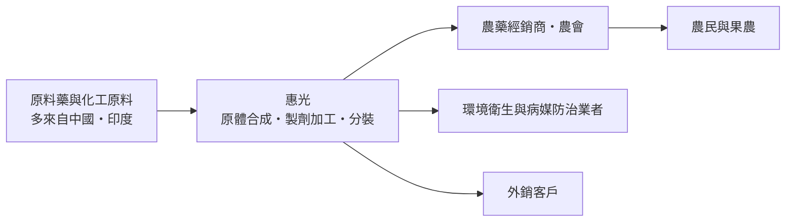
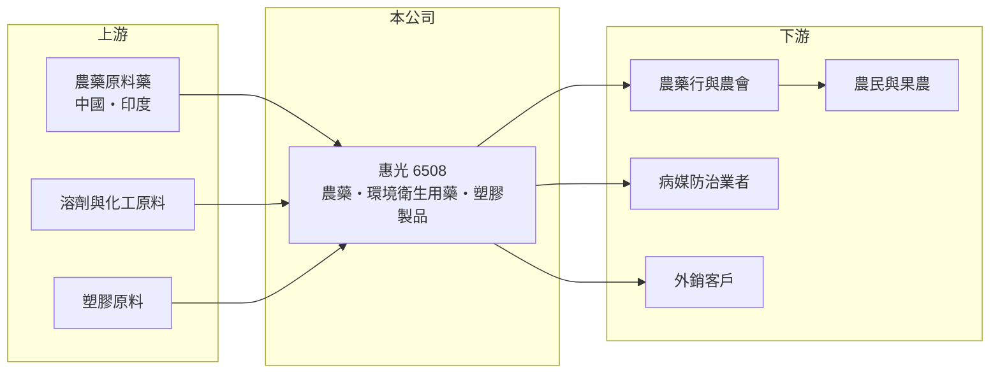

# 6508 惠光

> 上櫃｜[[產業索引-農業科技業|農業科技業]]｜上市（櫃）日期 2004/03/22

# 第一章：企業模式與商業藍圖

> [!info] 撰寫說明
> 本文由 Claude 依公開資料整理，架構比照 [[2330台積電]] 的四章研究，資料截至 2026-10-08。財務數字來源：Goodinfo 年度經營績效頁、nStock 公司簡介、櫃買中心開放資料（基本資料、2026 年第二季資產負債與綜合損益、本益比殖利率）；產品線比重、內外銷比與產能未查得，部分描述憑記憶整理。公開資料有限。#待校對

惠光（股票代號：6508）是台灣歷史最悠久的農藥公司之一。本章說明農藥這門生意的特性：產品需要登記許可、需求跟著農業季節走，而價格則受到中國原料藥供給的強烈影響。

## 一、核心定位：農藥與環境衛生用藥製造商

惠光成立於 1965 年，2004 年 3 月在櫃買中心掛牌，實收資本額約 8.65 億元，董事長兼總經理為陳冠華。登記的主要營業項目包括各種[[農藥]]、肥料、環境衛生藥劑的製造合成、加工、分裝與買賣，塑膠皮、布、板、管材與塑膠膜、袋等工業用塑膠製品的製造，以及相關產品的進出口貿易。

農藥產業可以分成兩段：上游的[[原體]]（有效成分）合成，以及下游的[[製劑]]加工，也就是把原體調配成農民可以直接使用的乳劑、粉劑或粒劑。依記憶，惠光同時具備部分原體合成與製劑加工能力，並以自有品牌銷售給台灣的農藥經銷商，也有部分外銷（待校對）。

## 二、產品線

公開資料未查得惠光的營收比重。依登記業務，產品線可分為（推估）：

* **農藥：** 殺蟲劑、殺菌劑、除草劑等，銷售給農藥行與農會，是營收主體。台灣農藥需要向主管機關申請[[農藥登記]]，每一個產品都要經過藥效與毒性試驗。
* **環境衛生用藥：** 用於居家、公共環境病媒防治的殺蟲劑與消毒劑。
* **塑膠製品：** 塑膠膜、袋與工業用塑膠製品，與農業資材及包裝相關。
* **貿易：** 農化原料與相關產品的進出口。

## 三、資本轉化邏輯

* **登記證是核心資產：** 每一張農藥登記證都代表數年的試驗與審查成本，持有的登記證數量與種類，決定公司能賣哪些產品。
* **季節性與庫存：** 農藥需求集中在作物生長期，公司需要提前備貨，存貨與應收帳款管理很重要。
* **資產紮實：** 2026 年第二季底資產總計約 27.8 億元、負債僅約 3.37 億元，權益約 24.4 億元，財務非常保守，但也代表資本運用效率不高。

## 四、長期方向

台灣農業面臨耕地減少與農藥減量政策，國內農藥總需求長期難有大幅成長。惠光的長期方向可能包括：提高登記證組合中的高價值與低毒產品、拓展外銷市場、發展生物農藥與環境衛生用藥（推估）。2026 上半年營業利益率回升到 7.5%，是否代表農藥價格循環已走出谷底，值得追蹤。

# 第二章：護城河深度與競爭優勢

農藥業的護城河來自登記證與通路，但價格往往由國際原料藥的供需決定。本章分析惠光的競爭位置。

## 一、護城河的組成

* **登記證組合：** 新農藥登記需要藥效、毒理與殘留試驗，耗時耗資。累積數十年的登記證是新進業者無法短期複製的資產。
* **經銷通路：** 台灣農藥透過遍布鄉鎮的農藥行與農會銷售，長期合作的經銷網絡與農民對品牌的信任，是重要的銷售基礎。
* **生產與調配技術：** 製劑配方影響藥效與安全性，穩定的品質是農民回購的關鍵。

## 二、主要競爭對手

| 對手 | 定位 | 與惠光的比較 |
|---|---|---|
| [[1712興農]] | 農藥、肥料與農業通路 | 品牌與通路完整，是台灣主要競爭者 |
| [[4702中美實]] | 農藥與化學品（待校對） | 在部分農藥品項競爭 |
| 國際農化大廠（如拜耳、先正達、科迪華） | 專利新藥與原體 | 掌握專利新藥，高價產品市占高 |
| 中國與印度學名農藥廠 | 低價原體與製劑 | 以價格壓低學名農藥的市價 |

## 三、守得住與守不住

* **守得住：** 既有登記證產品的國內市場與經銷網絡。
* **守不住：** 學名農藥的價格。中國原料藥產能擴張時，市場價格下跌，惠光只能被動接受。
* **觀察重點：** 毛利率能否回到 25% 以上、外銷比重，以及新產品登記的進度。

# 第三章：財務體質與盈利規模

資料日期：2026-10-08，表格是撰寫當時的快照；最新月營收、毛利率、累計 EPS 由自動排程寫在本筆記的屬性欄位（月營收、毛利率、累計EPS 等）。#待校對

惠光的財報可以看到明顯的循環：2021 至 2022 年獲利高峰，2023 至 2025 年明顯下滑，2026 上半年回升。

## 一、多年度財務表

| 年度 | 營收（新台幣） | [[毛利率]] | [[營業利益率]] | EPS（元） | [[ROE]] |
|---|---|---|---|---|---|
| 2021 | 20.9 億 | 26.0% | 11.6% | 3.85 | 13.9% |
| 2022 | 24.9 億 | 24.4% | 11.9% | 3.66 | 12.6% |
| 2023 | 15.3 億 | 22.2% | 5.73% | 1.05 | 3.66% |
| 2024 | 14.8 億 | 21.2% | 3.45% | 1.07 | 3.80% |
| 2025 | 14.2 億 | 22.4% | 4.36% | 0.27 | 0.95% |
| 2026 上半年 | 9.08 億 | 25.4% | 7.51% | 0.88 | 未查得 |

資料來源：Goodinfo；2026 上半年為櫃買中心開放資料。

* **2023 年的斷崖：** 營收從 2022 年的 24.9 億元降到 2023 年的 15.3 億元，營業利益率從 11.9% 降到 5.73%。具體原因未查得，推估與全球農化產品去庫存、中國原料藥價格下跌，以及貿易性營收縮減有關。
* **業外的影響：** 2021 年稅後淨利 3.29 億元高於營業利益 2.42 億元，2025 年則相反，營業利益 0.62 億元、稅後淨利只有 0.23 億元，業外損益是 EPS 波動的重要來源（具體項目未查得）。
* **營收趨勢：** 2020 至 2025 年營收年複合成長率約 -5.1%（推算）。
* **配息：** Goodinfo 統計一般平均現金股利約 1.22 元，近年隨獲利下降，2025 年度約 0.5 元。

## 二、ROE 與長期指標

2021 至 2025 年平均 ROE 約 7.0%（推算），但 2023 年後降到 4% 以下。惠光的權益約 24.4 億元、幾乎沒有負債，股價淨值比約 0.92 倍（櫃買中心資料），市場對它的評價接近帳面淨值，反映資產報酬率偏低。

## 三、[[ROIC]] 與 [[WACC]]

**ROIC 推算：** 2025 年營業利益 0.62 億元，扣除 20% 稅率後約 0.50 億元。2026 年第二季底權益約 24.39 億元，有息負債推估接近零（總負債僅約 3.37 億元），投入資本約 24.4 億元，ROIC 約 2.0%（推算）。以 2026 上半年營業利益 0.68 億元年化，ROIC 約 4.5%（推算）；2021 至 2022 年高峰期約 8% 至 10%（推算，資本基礎以近期數字代替）。

**WACC 推算：** 台灣 10 年期公債殖利率假設 1.75%、市場風險溢酬 6%、β 取化學與農業類股常見值 0.7（同業估計值），股東權益成本約 5.95%。公司幾乎無負債，WACC 約 6%（推算）。

**結論：** 惠光在景氣高峰時 ROIC 高於 WACC，但 2023 至 2025 年的低谷期明顯低於資金成本，長期平均約與資金成本打平或略低。這是典型的「資產紮實、但資本效率不高」的循環型公司，長期價值取決於能否提高資產周轉或把閒置資本回饋股東。

# 第四章：總體風險與地緣政治

農藥業的風險來自原料價格循環、法規與農業結構變化。本章整理惠光的長期風險。

## 一、產業週期

* **農化產品循環：** 全球農藥市場會經歷補庫存與去庫存的循環，中國原料藥產能擴張時價格大跌，學名農藥廠商的毛利隨之下滑，2023 至 2025 年即處於這種低谷。
* **天候與病蟲害：** 天候異常與病蟲害爆發會影響當年用藥量，造成營收的年度波動。

## 二、營運風險

* **原料供應集中：** 農藥原料藥大量來自中國與印度，供應中斷或價格劇烈變動都會影響成本。
* **業外損益波動：** 近年 EPS 受業外損益影響大，投資人難以預估實際獲利。
* **資本效率：** 權益龐大但報酬偏低，若沒有新的成長來源，ROE 難以回升。

## 三、其他風險

* **法規：** 主管機關推動化學農藥減量、禁用高毒性成分，部分登記證可能被取消或限制使用，需要持續投資替代產品。
* **農業結構：** 台灣耕地面積與農業人口長期減少，國內農藥總需求成長有限。
* **環保與工安：** 化學合成工廠面臨環保、工安與鄰近居民的要求，合規成本長期上升。
* **匯率：** 原料進口以美元計價，新台幣貶值會提高成本。

# 專有名詞解析

## 金融

- **[[毛利率]]**：營業毛利占營收的比例，反映產品定價能力與生產成本控制。
- **[[營業利益率]]**：扣除營業費用後的營業利益占營收的比例，衡量本業整體獲利能力。
- **[[ROE]]**：股東權益報酬率，稅後淨利除以股東權益，衡量公司運用股東資金的效率。
- **[[ROIC]]**：投入資本報酬率，稅後營業利益除以股東權益與有息負債的合計，衡量本業對所有資金提供者的報酬。
- **[[WACC]]**：加權平均資金成本，依股東權益與負債的比重加權計算的資金成本，ROIC 高於它才代表創造價值。

## 產業

- **[[農藥]]**：用於防治作物病蟲害與雜草的化學或生物製品，依用途分為殺蟲劑、殺菌劑與除草劑。
- **[[原體]]**：農藥中具有藥效的有效成分，經化學合成取得，是農藥的上游原料。
- **[[製劑]]**：把原體加上溶劑、乳化劑等調配成乳劑、粉劑、粒劑，讓農民可以直接稀釋使用的成品。
- **[[農藥登記]]**：農藥上市前須向主管機關申請許可，提交藥效、毒性與殘留試驗資料，取得登記證才能販售。

# 核心供應鏈

## 1. 上游：原料
- 農藥原料藥：多來自中國與印度的原體廠
- 溶劑、乳化劑與塑膠原料：石化業者的泛用原料（具體供應商未查得）

## 2. 中游：惠光與同業
- 台灣農藥同業：[[1712興農]]、[[4702中美實]]（待校對）
- 國際農化大廠與中國、印度學名農藥廠

## 3. 下游：客戶
- 全台農藥行、農會與農民
- 環境衛生與病媒防治業者、外銷客戶

## 最新新聞
<!-- news:start -->
<!-- news:end -->

## 相關連結
- [公開資訊觀測站](https://mopsov.twse.com.tw/mops/web/t05st03?step=1&firstin=1&co_id=6508)
- [Goodinfo](https://goodinfo.tw/tw/StockDetail.asp?STOCK_ID=6508)
- [Yahoo 股市](https://tw.stock.yahoo.com/quote/6508)
- [鉅亨網新聞](https://www.cnyes.com/twstock/6508/news)
