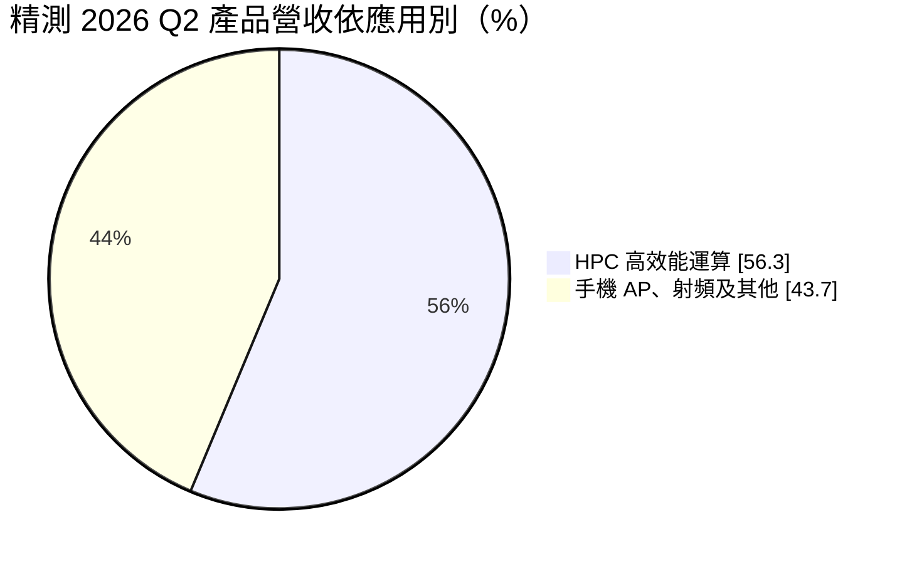
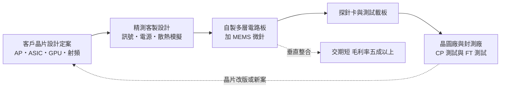
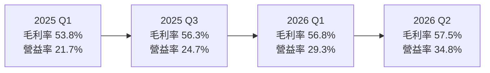
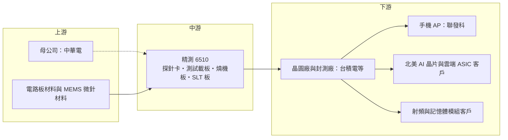

# 6510 精測

> 上櫃｜[[產業索引-半導體業|半導體業]]｜上市（櫃）日期 2016/03/24

# 第一章：企業模式與商業藍圖

> [!info] 撰寫說明
> 本文由 Claude 依公開資料整理，架構比照 [[2330台積電]] 的四章研究，資料截至 2026-10-08。財務數字來源：證交所／櫃買中心開放資料（2026 年第二季財報、基本資料、本益比殖利率）、Goodinfo 年度經營績效、MoneyDJ 季度財務比率、優分析、財訊、旺得富（2026 年第一季法說報導）；產業描述為整理性內容，尚未逐條比對原始文件。#待校對

在評估單一個股的長期投資價值時，首要步驟是拆解企業的底層獲利邏輯。本章針對中華精測科技（股票代號：6510，以下簡稱精測）的商業模式進行定性分析，說明一家從電信研究院走出來的公司，如何在晶片測試介面這個高度客製化的市場建立五成以上的毛利率，以及它從手機晶片轉向 AI 與高效能運算的長期路徑。

## 一、核心定位：一站式晶片測試介面供應商

精測成立於 2005 年，前身是中華電信研究院的研發團隊，2016 年在櫃買中心掛牌，母公司為 [[2412中華電]]（持股比例約三成多，待校對）。總部與工廠位於桃園平鎮。

精測的產品是「測試介面」，也就是晶片在出廠前接受電性測試時，連接晶片與自動測試設備（[[ATE]]）之間的那一層硬體。每一顆新晶片的腳位、訊號速度與電流都不同，測試介面必須針對每一款晶片客製設計，屬於「一款晶片一套治具」的耗材型生意。精測的主要產品包括：

* **[[探針卡]]：** 在晶圓還沒切割前，用上萬根細針接觸晶片上的接點進行[[晶圓針測]]（CP 測試）。精測同時生產探針卡上的多層電路板與 [[MEMS]] 微針，可整合成完整的探針卡。2026 年第一季探針卡營收約 4.05 億元，占總營收近三成，年增 125%。
* **[[測試載板]]：** 晶片封裝完成後的成品測試（[[FT]]）所用的電路板，以及[[燒機測試]]板（Burn-in Board）與系統級測試（[[SLT]]）板。這是精測起家的核心技術，來自多層高頻電路板的設計與製造能力。
* **高速訊號與散熱整合：** 精測強調 112/224 Gbps [[PAM4]] 高速訊號測試、MEMS 混針，以及具導板散熱功能的複雜載板，這些都是 AI 晶片測試的新需求。

依使用者整理的供應鏈關係，精測出現在 [[台積電供應鏈]] 的「測試介面與檢測設備」與 [[聯發科供應鏈]] 的「測試介面與高階檢測分析」環節，供應高階晶圓測試探針卡。

## 二、終端應用板塊：從手機 AP 轉向 HPC 與 AI

精測過去的成長主要來自智慧型手機應用處理器（[[AP]]）的測試介面，近年 [[HPC]] 與 AI 晶片的比重快速上升。依財訊報導，2026 年第二季 HPC 占產品營收 56.3%，已超過半數。

* **HPC 與 AI：** 北美 AI 晶片公司與雲端服務業者自研的 [[ASIC]] 進入量產，帶動高電流、高速的測試載板與探針卡需求。AI 晶片面積大、腳位多、功耗高，測試介面的單價與技術門檻都高於手機晶片。
* **手機 AP：** 主要客戶是台系智慧型手機晶片公司（依優分析報導），手機晶片每年改版，提供穩定的新案需求。
* **射頻與其他：** 射頻晶片與記憶體模組等應用，規模相對小。

## 三、資本轉化邏輯：每一顆新晶片都是一張新訂單

精測的商業模式有兩個關鍵：

* **耗材加客製化：** 探針卡與測試載板會隨使用次數磨耗，每一款新晶片也都需要新的一套。只要客戶持續推出新晶片，精測就有新訂單，營收與晶片的「設計數量」高度相關，而不只是出貨量。
* **垂直整合帶來的交期優勢：** 精測從電路板設計、製造到組裝探針卡都在自家完成，不需要外購關鍵零件，可以在客戶晶片定案後最短時間交貨。對 AI 晶片這種搶上市時程的產品，交期往往比價格更重要，這是精測能長期維持 50% 以上[[毛利率]]的主因之一。

## 四、企業長期藍圖：三廠擴產與探針卡放量

* **產能倍增計畫：** 精測規劃 2026 年 8 月底的整體產能為 2025 年底的兩倍，2027 年第一季底達到三倍。為了應付超出預期的訂單，公司也緊急租用新廠房。
* **平鎮三廠：** 2025 年底董事會通過發行 20 億元無擔保[[可轉換公司債]]，連同先前募資合計約 25.68 億元，主要用於桃園平鎮第三座新廠。新廠預定 2026 年第一季動工、2028 年初完工，產品包括探針卡、IC 測試載板與記憶體模組。2026 年資本支出由原訂 3.5 億元上修至 5 億元。
* **探針卡成為第二引擎：** 探針卡過去是精測相對弱勢的產品，近年 MEMS 探針卡打進 HPC 與 AP 客戶，比重持續提高。公司表示中長期不排除併購，以擴充技術與產能。

# 第二章：護城河深度與競爭優勢

在長期價值投資中，「護城河」指企業抵禦競爭、維持超額利潤的保護機制。本章分析精測在晶片測試介面市場的護城河構成、主要競爭對手，以及這些優勢能否在 AI 測試需求的競爭中轉化為長期利潤。

## 一、精測護城河的核心組成要素

精測的護城河屬於「中等寬度」，由三個要素構成：

* **1. 多層高頻電路板的技術根基：** 測試載板與探針卡電路板需要數十層、極細線路、嚴格控制訊號損耗的電路板，製造難度遠高於一般電路板。精測源自電信研究院的高頻設計能力，加上自有電路板產線，讓它能做出高速、高電流的測試板，這是許多只做組裝的同業做不到的。
* **2. 垂直整合與交期：** 從設計模擬、電路板、微針到組裝一條龍自製，讓精測在客戶晶片設計定案後能快速交貨。測試介面是晶片量產前的最後一道關卡，延誤交期可能讓客戶的新晶片晚上市，因此客戶願意為穩定交期付出溢價。
* **3. 與客戶共同開發的轉換成本：** 測試介面必須在晶片設計階段就與客戶同步開發，客戶的測試程式、良率數據都與特定測試介面綁定。一款晶片導入後，在整個生命週期內通常會持續向同一家供應商追加訂單。

## 二、全球主要競爭對手格局

| 對手 | 定位 | 對精測的威脅 |
|---|---|---|
| FormFactor | 美國，全球最大探針卡廠 | 在高階探針卡與記憶體探針卡市占領先 |
| Technoprobe | 義大利，MEMS 探針卡大廠 | 在 AP 與 HPC 探針卡直接競爭 |
| [[6223旺矽]] | 台灣探針卡與測試設備廠 | 在 HPC 探針卡與台系客戶直接競爭 |
| [[6515穎崴]] | 台灣測試座與探針卡廠 | 在 AI 晶片測試介面互有重疊 |
| [[6683雍智科技]] | 台灣測試載板與燒機板廠 | 在測試載板與燒機板競爭 |

## 三、優勢轉化：哪些市場守得住、哪些守不住

* **守得住：** 高速、高電流的測試載板，以及需要電路板與探針整合設計的高階探針卡。這類產品技術門檻高、交期要求緊，精測的垂直整合優勢最明顯，2025 至 2026 年毛利率維持在 54% 至 58% 即為證明。
* **守不住：** 若手機晶片市場成長停滯、客戶集中度高，精測過去曾經歷單一客戶訂單轉移而大幅衰退的情況。2023 年營收從 43.9 億元降到 28.8 億元、營業利益轉為虧損，就是客戶與產品週期集中的風險顯現。
* **觀察重點：** 第一，HPC 占比能否穩定在五成以上，降低對手機客戶的依賴。第二，探針卡能否在國際大廠面前取得更多 AI 晶片訂單。第三，平鎮三廠完工後，產能擴張是否會拉低稼動率與毛利率。

# 第三章：財務體質與盈利規模

資料日期：2026-10-08。數字取自證交所／櫃買中心開放資料、Goodinfo 年度經營績效、MoneyDJ 季度財務比率與法說會報導，表格是撰寫當時的快照；最新月營收、毛利率、累計 EPS 由自動排程寫在本筆記的屬性欄位（月營收、毛利率、累計EPS 等）。#待校對

財務報表是檢驗護城河是否真實存在的最終標準。本章用多年度的三率、ROE、現金流與資本報酬，檢視精測高毛利率背後的獲利穩定度。

## 一、獲利能力的基石：三率

| 年度 | 營收（億元） | [[毛利率]] | [[營業利益率]] | EPS（元） | [[ROE]] |
|---|---|---|---|---|---|
| 2019 | 33.9 | 53.1% | 25.7% | 19.07 | 9.9% |
| 2020 | 42.1 | 54.1% | 28.2% | 28.48 | 13.8% |
| 2021 | 42.4 | 54.0% | 25.5% | 27.20 | 12.2% |
| 2022 | 43.9 | 52.1% | 19.7% | 23.50 | 9.8% |
| 2023 | 28.8 | 48.2% | -1.8% | 0.99 | 0.03% |
| 2024 | 36.0 | 53.5% | 13.6% | 15.55 | 6.2% |
| 2025 | 48.1 | 55.5% | 24.8% | 30.41 | 11.7% |
| 2026 上半年 | 30.0 | 57.2% | 32.3% | 25.45 | 未查得 |

註：2019 至 2025 年取自 Goodinfo；2026 上半年取自櫃買中心開放資料。

* **[[毛利率]]：** 七年來除了 2023 年的 48%，其餘都在 52% 至 56% 之間，顯示產品定價能力穩定。公司長期毛利率目標為 50% 至 55%，2026 年上半年超過 57%，主因產品組合改善與 AI 導入生產後的良率提升。
* **[[營業利益率]]：** 波動遠大於毛利率，2023 年轉為虧損、2026 年第二季達 34.8%。研發與管理費用相對固定，營收起伏會被放大到營業利益，這是精測獲利週期性的主要來源。
* **營收波動：** 2022 至 2023 年營收衰退約三成四，2024 至 2025 年又連續大幅成長，說明精測的營收與主要客戶的新產品週期高度相關。

## 二、[[ROE]]：資本效率

精測近 5 年（2021 至 2025 年）平均 ROE 約 8.0%（推算），這個數字明顯低於 50% 以上毛利率給人的印象。原因有二：一是 2023 年獲利幾乎歸零拉低平均；二是精測長期持有大量現金，2026 年第二季流動資產約 98 億元，占總資產七成，股東權益基數大，壓低了 ROE。營收方面，2019 至 2025 年年複合成長率約 6.0%（推算），中間經歷一次明顯的衰退。

## 三、資本支出與自由現金流

* **[[CapEx]]：** 精測的資本支出長期不大，2026 年由 3.5 億元上修為 5 億元，主要用於機器設備與廠房。平鎮三廠以可轉債籌資，預計 2026 至 2028 年興建，屆時資本支出會明顯增加。
* **[[自由現金流]]：** 在三廠動工前，精測的營業現金流足以支應資本支出與配息，長期累積大量現金（推估，具體年度數字未查得）。
* **股利：** 依櫃買中心資料，近四季現金股利合計約 15.23 元，以 2025 年 EPS 30.41 元計算，配發率約五成（推算）。

## 四、[[ROIC]] 與 [[WACC]]：價值創造利差

* **ROIC（推算）：** 以 2025 年營收 48.1 億元乘營業利益率 24.8%，營業利益約 11.9 億元，稅後營業利益約 9.54 億元。投入資本以 2026 年第二季股東權益 101.3 億元，加上有息負債約 17 億元（主要為 2026 年發行的可轉債，以非流動負債約 17 億元推估）計算，合計約 118 億元，ROIC 約 8.1%。若以 2026 年上半年營業利益 9.67 億元年化推算，ROIC 約 13%。由於股東權益中有大量現金，若扣除超額現金，實際營運資本報酬會更高。
* **WACC（推算）：** 以 [[CAPM]] 估算：無風險利率 1.75%、市場風險溢酬 6%、β 取 1.2（半導體測試介面同業常見值，未查得公司實際數字），股權成本約 8.95%；稅前負債成本 2.5%、稅後 2.0%；帳面權益占約 86%，WACC 約 8.0%。
* **結論：** 2025 年 ROIC 約 8.1% 與 WACC 約 8.0% 大致相當，2026 年隨營業利益率擴張，ROIC 推估已明顯高於 WACC。精測的問題不是本業賺錢能力，而是現金部位大、獲利週期波動大；三廠完工後若能維持高稼動率，價值創造的利差可望擴大。

# 第四章：總體風險與地緣政治

任何企業都無法脫離宏觀環境獨立存在。本章分析精測未來必須面對的地緣政治、產業週期、營運與技術風險。

## 一、地緣政治風險

* **美國關稅與客戶在地化：** 精測的客戶多為全球晶片設計公司，晶片最終在台灣的晶圓廠與封測廠測試。若美國以關稅或補貼推動晶片在美國測試，測試介面的交付與服務模式可能需要調整。公司表示會維持充足資金水位，以因應美國關稅政策等外部風險。
* **台灣生產集中：** 精測的產能集中在桃園平鎮，與多數台灣半導體供應鏈一樣，面臨兩岸情勢的集中風險。

## 二、產業週期與市場結構風險

* **客戶集中：** 精測過去高度依賴少數手機晶片客戶，2023 年的衰退顯示單一客戶或產品線轉弱的衝擊很大。近年 HPC 比重提高有助分散，但 AI 晶片客戶本身也相對集中。
* **晶片設計週期：** 測試介面的需求與晶片的新設計數量相關。若半導體產業進入庫存調整、客戶減少新案，精測的營收會比晶圓代工更早、更劇烈地反映。

## 三、營運環境的隱性風險

* **擴產與稼動率：** 產能在一年多內擴增到三倍，若 AI 需求放緩，新產能的折舊與人力成本將壓縮毛利率。
* **原物料與定價：** 公司表示原物料價格上漲，正與客戶協商調漲價格，若無法順利轉嫁，毛利率可能受影響。
* **可轉債稀釋：** 20 億元可轉債未來若轉換為股票，會稀釋既有股東的每股盈餘。

## 四、科技演進風險

AI 晶片朝更大面積、更高功耗、更高速傳輸發展，測試介面需要承受越來越高的功耗與電流，並傳輸 224 Gbps 以上的訊號，散熱與訊號完整性的難度持續上升。這對有電路板與探針整合能力的精測是機會；但若先進封裝讓更多測試轉向晶圓級或系統級，測試介面的形式也會改變，精測需要持續投入新一代 MEMS 探針與系統級測試方案，才能維持技術領先。

# 專有名詞解析

## 半導體

- **[[探針卡]]**：晶圓切割前做電性測試用的介面，以大量細針接觸晶片接點，每款晶片需客製一套，屬耗材。
- **[[晶圓針測]]**：晶圓切割前用探針卡逐顆測試晶片電性，篩掉不良品，又稱 CP 測試。
- **[[FT]]**：成品測試，晶片封裝完成後的最終電性測試，使用測試載板與測試座連接測試機。
- **[[燒機測試]]**：在高溫高電壓下讓晶片長時間運作，提早篩出早期失效產品，英文為 Burn-in。
- **[[SLT]]**：系統級測試，把晶片放在接近實際使用的系統環境中測試，AI 與高階處理器越來越常使用。
- **[[ATE]]**：自動測試設備，對晶片送出測試訊號並判讀結果的測試機台，代表廠商為愛德萬與泰瑞達。
- **[[MEMS]]**：微機電系統，以半導體製程做出微小機械結構，探針卡的微細探針即用此技術製造。
- **[[PAM4]]**：四階脈衝振幅調變，一個訊號週期傳送兩個位元，是 112G 與 224G 高速傳輸的主流編碼方式。
- **[[ASIC]]**：特定應用積體電路，為單一用途量身設計的晶片，雲端業者自研的 AI 加速晶片多屬此類。

## 應用

- **[[HPC]]**：高效能運算，泛指 AI 伺服器、資料中心等需要大量運算的應用。
- **[[AP]]**：應用處理器，手機與平板的主運算晶片，整合 CPU、GPU 與各種功能模組。

## 金融

- **[[可轉換公司債]]**：可在一定條件下轉換為公司股票的債券，公司以較低利率籌資，但轉換後會稀釋股本。
- **[[CAPM]]**：資本資產定價模型，以無風險利率加上 β 乘市場風險溢酬估算股東要求的報酬率。

## 產業

- **[[測試載板]]**：成品測試時承載晶片並連接測試機的多層電路板，需依晶片腳位與訊號特性客製設計。

# 核心供應鏈

## 1. 上游：母公司與原物料
- 母公司與技術源頭：[[2412中華電]]（精測前身為中華電信研究院研發團隊）
- 多層電路板與 MEMS 微針：精測自行生產，垂直整合程度高；所用基板材料與金屬原料的供應商未查得

## 2. 中游：精測本身
- 晶圓測試探針卡：MEMS 探針卡打進 HPC 與 AP 客戶，2026 年第一季占營收近三成
- 成品測試載板、燒機板與系統級測試板：精測起家的核心產品

## 3. 下游：測試場域
- 晶圓廠：[[2330台積電]]（高階晶圓測試探針卡）
- 封測廠：[[3711日月光投控]]、[[2449京元電子]]（推估）

## 4. 下游：晶片設計客戶
- 台系手機晶片：[[2454聯發科]]（高階晶圓測試探針卡）
- 北美 AI 晶片公司與雲端業者自研 ASIC：2026 年第二季 HPC 占產品營收 56.3%，客戶名稱未公開
- 射頻晶片與記憶體模組：規模較小，個別名單未查得

## 5. 同業競爭
- 國際探針卡大廠：FormFactor、Technoprobe
- 台灣測試介面廠：[[6223旺矽]]、[[6515穎崴]]、[[6683雍智科技]]

延伸閱讀：[[台積電供應鏈]]、[[聯發科供應鏈]]

## 供應鏈關係
- 供應給 [[2330台積電]]：高階晶圓測試探針卡（台積電供應鏈 › 下游：測試介面與檢測設備）
- 供應給 [[2454聯發科]]：高階晶圓測試探針卡（聯發科供應鏈 › 中游：測試介面與高階檢測分析）

## 最新新聞
<!-- news:start（自動產生，請勿手動編輯此範圍） -->
- 2026-10-14 📰 媒體 16:22｜《半導體》精測10月28日召開線上法說會｜[富聯網](https://news.google.com/rss/articles/CBMiiAFBVV95cUxPTGJNaHNHTE5rd3BaZW5YQXJDbHZqWXZpWk9CbldGSk5WcHhNSGpGSC1uazBqcm9aaHNZRlpiZGV3VHZPVzdTay1neWpUVDNWSHFkdmxYYzFSZjVib1JqYkxkb05UR3h4TDdHeG1BRmo2ZUJwNm94cnJpcnhBX2MyUHZXMmZWaE9T?oc=5)
- 2026-10-14 📰 媒體 16:10｜個股：精測(6510)10/28召開線上法說會｜[富聯網](https://news.google.com/rss/articles/CBMiiAFBVV95cUxPU2tNU1U5TmlOQlJSbnYyb1VQTVAtdzFjWWZackt4WDdVeTdFU3FUSDlPazRWQzh2MzRKVnpDVkQyNlJia1Jsa2x3b0E2ZDZzaFFrWXdEcmV2SE5MdC1DTHVFMWdwa1FJMjVKREdVR0FUMmRZUUhNTmNBd09fMXZsa3lobHRjSnpW?oc=5)
- 2026-10-14 🏛️ 重訊 16:06｜公告本公司將召開線上法說會｜[觀測站](https://mops.twse.com.tw/mops/#/web/t05st01)
- 2026-10-13 📰 媒體 17:25｜AI封測誰最會賺？日月光、旺矽、精測、穎崴、京元電比一比 法人目標價曝光｜[聚財網](https://news.google.com/rss/articles/CBMiTEFVX3lxTFB3RldJOHNKQ2ZTR3hkbjVhbWJnWl9TLW11QkRYdG5hLTlKSTRQdnJfckxVeHM3eUZ5MDJsZV81WXRSNFVZSWxPcUJQd2Q?oc=5)
- 2026-10-13 📰 媒體 12:39｜旺矽、穎崴、漢測、精測 Q3 營收齊創新高，股價表現兩樣情｜[鏈新聞 ABMedia](https://news.google.com/rss/articles/CBMiW0FVX3lxTFBSOWFiY0R2dXc3THdoOUlRc0xBUk9ONFFIOGxTMGh1X2EwcHhoTW40dm9TRGRFRnpYbDMzUVJMS0tKUHpndmNkVnJuTnl3dVRub0ZSbjBrN2FSdDA?oc=5)

完整紀錄：[[6510精測 新聞]]
<!-- news:end -->

## 相關連結
- [公開資訊觀測站](https://mopsov.twse.com.tw/mops/web/t05st03?step=1&firstin=1&co_id=6510)
- [Goodinfo](https://goodinfo.tw/tw/StockDetail.asp?STOCK_ID=6510)
- [Yahoo 股市](https://tw.stock.yahoo.com/quote/6510)
- [鉅亨網新聞](https://www.cnyes.com/twstock/6510/news)
