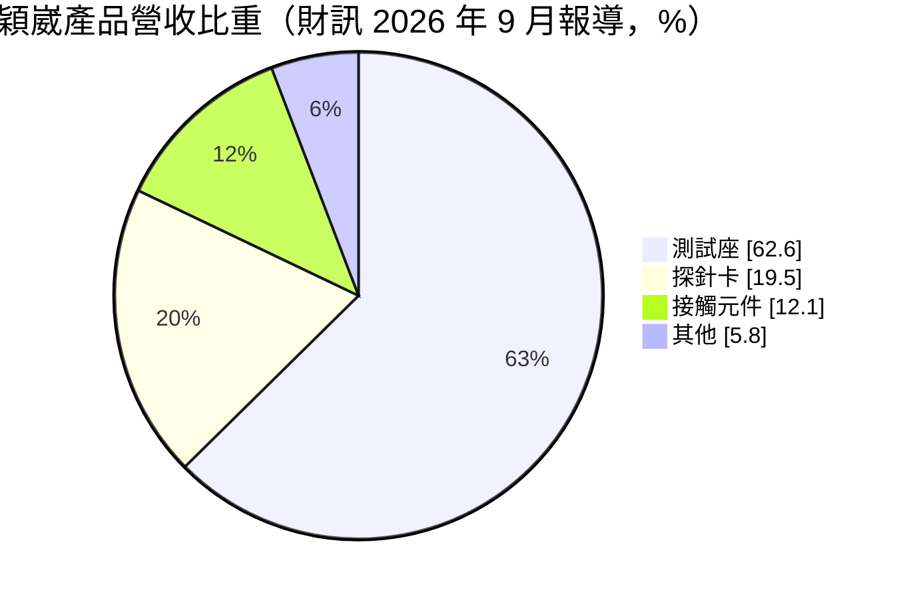
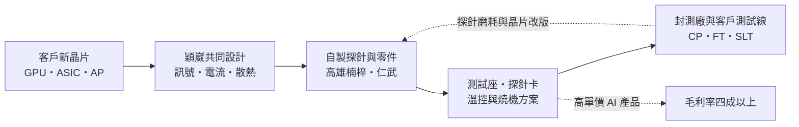
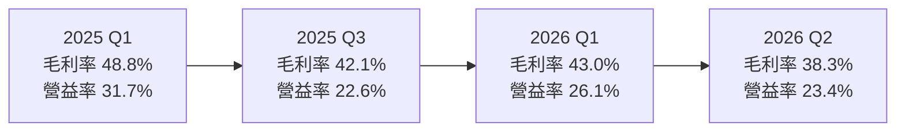
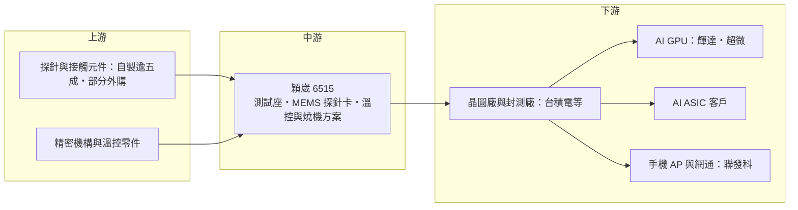

# 6515 穎崴

> 上市｜[[產業索引-半導體業|半導體業]]｜上市（櫃）日期 2021/01/20

# 第一章：企業模式與商業藍圖

> [!info] 撰寫說明
> 本文由 Claude 依公開資料整理，架構比照 [[2330台積電]] 的四章研究，資料截至 2026-10-08。財務數字來源：證交所開放資料（2026 年第二季財報、基本資料、股利）、Goodinfo 年度經營績效、MoneyDJ 季度財務比率、財訊、科技新報、工商時報；產業描述為整理性內容，尚未逐條比對原始文件。#待校對

在評估單一個股的長期投資價值時，首要步驟是拆解企業的底層獲利邏輯。本章針對穎崴科技（股票代號：6515，以下簡稱穎崴）的商業模式進行定性分析，說明一家高雄起家的測試座廠，如何在 AI 晶片測試的浪潮中成為北美 AI 客戶的關鍵供應商，以及它從測試座延伸到探針卡與系統級測試的長期布局。

## 一、核心定位：AI 晶片測試座的領導廠商

穎崴成立於 2001 年，董事長兼總經理王嘉煌是創辦人，總部與主要工廠位於高雄，2021 年在證交所上市。公司生產半導體測試介面，也就是晶片在測試時用來固定晶片、並把晶片接點連到測試機的關鍵零組件。

穎崴的主要產品有三類，依財訊 2026 年 9 月報導的營收比重：

* **[[測試座]]（約 63%）：** 晶片封裝完成後做成品測試（[[FT]]）時，用來承載晶片的插座。穎崴最具代表性的是[[同軸測試座]]，約占營收 37%，其中約一半來自 AI 與 [[HPC]]。同軸測試座用類似同軸電纜的結構隔離每一根訊號針，能在高速訊號下維持訊號品質，是高階 GPU 與 AI 晶片測試的主流方案。
* **[[探針卡]]（約 19%）：** 晶圓切割前做[[晶圓針測]]的介面。穎崴近年投入 [[MEMS]] 探針卡，出貨逐季成長，公司把它列為 2026 年的重要成長動能。
* **接觸元件（約 12%）：** 測試座內部的探針（Pogo Pin）等消耗性零件。穎崴自製探針的比例超過五成，並持續擴充自有產能。

此外，穎崴也提供溫控系統、[[燒機測試]]座與[[SLT]]服務，目標是讓客戶在一家供應商就能完成晶圓測試、成品測試到系統級測試的介面需求。依使用者整理的供應鏈關係，穎崴出現在 [[台積電供應鏈]] 的「測試介面與檢測設備」與 [[聯發科供應鏈]] 的「測試介面與高階檢測分析」環節，供應高階晶片測試座與同軸測試座。

## 二、終端應用板塊：AI 與 HPC 已過半

* **AI 與 HPC：** 依財訊報導，AI 與 HPC 出貨約占營收 52%，公司表示 AI 相關營收已超過四成。穎崴主要供應 [[NVDA輝達]] 探針卡，以及同軸測試座與溫控系統，也打進美系大型 GPU 平台的成品測試座，AI [[ASIC]] 客戶的訂單同樣增加。
* **客戶集中：** 前兩大客戶約占營收四成，前三大客戶超過五成，北美客戶占比很高。這代表穎崴深度綁定 AI 晶片龍頭，也意味著營收對少數客戶的產品週期相當敏感。
* **手機、車用與其他：** 手機 [[AP]] 與網通晶片是穎崴過去的主要市場，車用則以燒機測試座為切入點。

## 三、資本轉化邏輯：跟著晶片改版，持續消耗

測試座與探針卡都是消耗性產品：探針會隨測試次數磨損需要更換，每一款新晶片也需要新的測試座設計。AI 晶片的特性讓這門生意更有利：

* **單價提高：** AI 晶片封裝尺寸越來越大、腳位數以萬計、功耗動輒上千瓦，測試座必須處理翹曲、大電流與散熱問題。穎崴推出可處理超大封裝翹曲的 HyperSocket、業界首款液冷測試座（已取得美國專利）等產品，單價遠高於手機晶片用的測試座。
* **測試時間拉長：** AI 晶片測試項目多、時間長，同樣的出貨量需要更多測試座同時運作，帶動數量需求。

## 四、企業長期藍圖：產能放大與全球布局

* **高雄擴產：** 楠梓廠持續擴充設備，仁武租賃廠房已於 2026 年 4 月量產；仁武自建新廠總投資約 34.99 億元，預計 2027 年底前完工，屆時整體產能可再放大 2 至 3 倍。
* **探針自製率提升：** 公司持續擴充自有探針產能，目標是降低外購比例、確保關鍵零件供應。
* **海外布局：** 穎崴計畫在一到兩年內於東南亞購置既有廠房，並擴大北美營運據點，就近服務 AI 客戶。
* **新世代方案：** 與外部夥伴共同開發從晶圓到封裝等級的 [[CPO]] 自動化測試方案，以及 AI 伺服器機櫃等級的板級測試方案，把業務從單一零件延伸到測試解決方案。

# 第二章：護城河深度與競爭優勢

在長期價值投資中，「護城河」指企業抵禦競爭、維持超額利潤的保護機制。本章分析穎崴在測試座與探針卡市場的護城河構成、主要競爭對手，以及它在 AI 晶片測試的領先能維持多久。

## 一、穎崴護城河的核心組成要素

穎崴的護城河屬於「中等寬度」，核心在於和 AI 晶片龍頭的共同開發關係：

* **1. 高階同軸測試座的技術門檻：** 高速訊號、大電流與散熱是 AI 晶片測試的三大難題，穎崴在同軸結構、液冷與大尺寸封裝翹曲處理上累積了專利與量產經驗。這些技術需要多年與客戶一起除錯才能成熟，新進者很難在短時間內達到同等良率。
* **2. 早期參與設計的轉換成本：** 測試座必須在晶片設計階段就與客戶同步開發，客戶的測試程式、良率數據都與特定測試座綁定。AI 晶片的生命週期內，客戶通常會持續向原供應商追加訂單，換供應商的風險遠大於節省的成本。
* **3. 關鍵零件自製：** 探針是測試座與探針卡的核心零件，穎崴自製比例超過五成並持續擴產。自製能縮短交期、控制品質，也讓穎崴在需求暴增時比依賴外購的同業更能確保出貨。

## 二、全球主要競爭對手格局

| 對手 | 定位 | 對穎崴的威脅 |
|---|---|---|
| Cohu、Smiths Interconnect 等 | 歐美測試座與接觸元件大廠 | 在國際 IDM 與部分 GPU 客戶競爭 |
| Leeno Industrial、ISC | 韓國測試座與探針廠 | 在手機與記憶體測試座以價格競爭 |
| [[6510精測]] | 台灣測試載板與探針卡廠 | 在 AI 晶片探針卡與測試介面互有重疊 |
| [[6223旺矽]] | 台灣探針卡與測試設備廠 | 在 MEMS 探針卡與 HPC 客戶直接競爭 |
| FormFactor、Technoprobe | 國際探針卡大廠 | 穎崴探針卡業務的主要對手 |

## 三、優勢轉化：哪些市場守得住、哪些守不住

* **守得住：** 高階 AI 與 HPC 晶片的同軸測試座與溫控方案。這類產品技術門檻高、客戶重視良率與交期，穎崴 2025 年毛利率 45.3%、營業利益率 26.3%，都是歷年高點附近，顯示它在高階市場具定價能力。
* **守不住：** 一般消費性晶片的測試座，以及探針卡市場中國際大廠已經主導的領域。2026 年第二季毛利率降到 38.3%，低於 2025 年上半年接近 49% 的水準，可能反映產品組合變化、擴產成本與新產品初期良率，顯示高毛利率並非理所當然。
* **觀察重點：** 第一，前三大客戶占比超過五成，AI 龍頭客戶的產品世代更替是否持續採用穎崴。第二，MEMS 探針卡能否成為穩定的第二支柱。第三，仁武新廠完工後，毛利率能否維持在 40% 以上。

# 第三章：財務體質與盈利規模

資料日期：2026-10-08。數字取自證交所開放資料、Goodinfo 年度經營績效、MoneyDJ 季度財務比率與財經報導，表格是撰寫當時的快照；最新月營收、毛利率、累計 EPS 由自動排程寫在本筆記的屬性欄位（月營收、毛利率、累計EPS 等）。#待校對

財務報表是檢驗護城河是否真實存在的最終標準。本章用多年度的三率、ROE、現金流與資本報酬，檢視穎崴在 AI 測試需求帶動下的獲利品質與資本效率。

## 一、獲利能力的基石：三率

| 年度 | 營收（億元） | [[毛利率]] | [[營業利益率]] | EPS（元） | [[ROE]] |
|---|---|---|---|---|---|
| 2019 | 28.0 | 44.3% | 24.5% | 19.00 | 43.5% |
| 2020 | 29.1 | 40.1% | 23.0% | 17.42 | 31.8% |
| 2021 | 28.9 | 41.9% | 20.5% | 14.46 | 20.7% |
| 2022 | 51.2 | 45.3% | 26.2% | 32.22 | 33.2% |
| 2023 | 36.8 | 37.1% | 15.1% | 13.52 | 12.9% |
| 2024 | 58.0 | 43.7% | 23.6% | 34.31 | 26.3% |
| 2025 | 78.6 | 45.3% | 26.3% | 46.93 | 27.9% |
| 2026 上半年 | 65.0 | 40.5% | 24.6% | 38.24 | 未查得 |

註：2019 至 2025 年取自 Goodinfo；2026 上半年取自證交所開放資料。2019 至 2020 年為上市前，股東權益基數較小，ROE 偏高。

* **[[毛利率]]：** 長期落在 37% 至 45% 之間，景氣低點的 2023 年為 37.1%，高點約 45%。毛利率的高低主要取決於高階同軸測試座與 AI 產品的占比。
* **[[營業利益率]]：** 長期維持在 15% 至 26%，營收規模擴大時費用率下降，營業利益率提升明顯。
* **營收的週期性：** 2022 年營收大增 77% 後，2023 年衰退約 28%，2024 年又成長 58%。穎崴的營收與主要客戶的晶片世代與庫存週期高度連動，成長期與衰退期的幅度都很大。

## 二、[[ROE]]：資本效率

穎崴近 5 年（2021 至 2025 年）平均 ROE 約 24.2%（推算），即使在 2023 年的低谷也有 12.9%，在台灣半導體零組件公司中屬於高水準。高 ROE 來自兩個因素：營業利益率長期在兩成以上，以及資產周轉快、不需要大量重資產投資。營收方面，2019 至 2025 年年複合成長率約 18.8%（推算）。

## 三、資本支出與自由現金流

* **[[CapEx]]：** 依科技新報引述公司說法，2026 與 2027 年每年資本支出約 30 億至 40 億元，主要用於仁武自建新廠與探針產能，金額接近過去數年的總和，代表穎崴正進入大規模投資期。
* **[[自由現金流]]：** 過去穎崴屬於輕資產模式，自由現金流長期為正（推估）。2026 至 2027 年資本支出大幅提高，自由現金流可能明顯縮小。2026 年上半年股東權益由第一季約 65.7 億元增加到約 86.2 億元，每股淨值由 180 元升至 237 元，增幅大於當季獲利，推估與增資或可轉債轉換有關（細節未查得）。
* **股利：** 2025 年度每股配發現金 50 元，其中 25 元來自盈餘、25 元來自[[資本公積]]。以 EPS 46.93 元計算，總配發超過 100%，盈餘分配部分約 53%（推算）。

## 四、[[ROIC]] 與 [[WACC]]：價值創造利差

* **ROIC（推算）：** 以 2025 年營收 78.6 億元乘營業利益率 26.3%，營業利益約 20.7 億元，稅後營業利益約 16.5 億元。投入資本以 2026 年第二季股東權益 86.2 億元，加上有息負債約 15 億元（官方資料未拆分，以非流動負債約 15.7 億元推估）計算，合計約 101 億元，ROIC 約 16.3%。若以 2026 年上半年營業利益 16.0 億元年化，ROIC 約 25%。
* **WACC（推算）：** 以 [[CAPM]] 估算：無風險利率 1.75%、市場風險溢酬 6%、β 取 1.3（高成長半導體零組件常見值，未查得公司實際數字），股權成本約 9.55%；稅前負債成本 2.5%、稅後 2.0%；帳面權益占約 85%，WACC 約 8.4%。
* **結論：** ROIC 約 16% 至 25% 明顯高於 WACC 約 8.4%，代表穎崴長期在替股東創造價值。未來的關鍵在於 30 億至 40 億元的年度資本支出能否維持同樣的報酬率；若新產能遇到 AI 需求放緩，ROIC 會快速向 WACC 靠攏。

# 第四章：總體風險與地緣政治

任何企業都無法脫離宏觀環境獨立存在。本章分析穎崴未來必須面對的地緣政治、產業週期、營運與技術風險。

## 一、地緣政治風險

* **北美客戶集中與關稅：** 北美客戶占營收比重很高，美國若以關稅或在地化政策要求測試在美國完成，穎崴需要在當地建立服務與產能。公司已規劃擴大北美營運據點。
* **台灣生產集中：** 主要產能集中在高雄，與多數台灣半導體供應鏈一樣面臨兩岸風險。公司計畫在東南亞購置廠房，部分原因即是分散生產據點。

## 二、產業週期與市場結構風險

* **AI 投資循環：** 穎崴目前的成長高度依賴 AI 資料中心投資。若雲端業者放緩資本支出，或 AI 晶片進入庫存調整，測試座與探針卡的需求會比晶片出貨更早、更劇烈地下滑。2023 年營收衰退約 28% 即是前例。
* **客戶集中：** 前三大客戶占營收超過五成，任何一家客戶轉單或改變測試策略，都可能造成營收大幅波動。

## 三、營運環境的隱性風險

* **擴產執行：** 產能在兩年內放大 2 至 3 倍，需要同時招募大量工程師與技術人員，高雄地區的半導體人才競爭也在加劇。
* **毛利率稀釋：** 新廠初期稼動率與良率較低，加上探針卡等新產品仍在爬坡，2026 年第二季毛利率已降到 38.3%，未來可能持續受到擴產成本影響。
* **配息來源：** 2025 年度一半股利來自資本公積，這種配發方式無法長期持續，未來股利將更直接反映實際獲利。

## 四、科技演進風險

AI 晶片的封裝越來越大、功耗越來越高，測試座需要處理翹曲、上千瓦的散熱與更高速的訊號，技術難度持續上升。穎崴目前在液冷測試座與超大封裝測試座居於領先，但若測試方式改變，例如更多測試轉向晶圓級、或 CPO 等新架構需要全新的光電測試方案，既有的測試座優勢未必能完全延續，穎崴需要持續投資新一代測試技術。

# 專有名詞解析

## 半導體

- **[[測試座]]**：成品測試時承載晶片、把晶片接點連到測試板的插座，內含大量探針，需依晶片封裝客製。
- **[[同軸測試座]]**：以類似同軸電纜的金屬屏蔽結構隔離每根訊號探針的測試座，可在高速訊號下維持訊號品質。
- **[[探針卡]]**：晶圓切割前做電性測試用的介面，以大量細針接觸晶片接點，每款晶片需客製一套，屬耗材。
- **[[晶圓針測]]**：晶圓切割前用探針卡逐顆測試晶片電性，篩掉不良品，又稱 CP 測試。
- **[[FT]]**：成品測試，晶片封裝完成後的最終電性測試，使用測試載板與測試座連接測試機。
- **[[燒機測試]]**：在高溫高電壓下讓晶片長時間運作，提早篩出早期失效產品，英文為 Burn-in。
- **[[SLT]]**：系統級測試，把晶片放在接近實際使用的系統環境中測試，AI 與高階處理器越來越常使用。
- **[[MEMS]]**：微機電系統，以半導體製程做出微小機械結構，探針卡的微細探針即用此技術製造。
- **[[ASIC]]**：特定應用積體電路，為單一用途量身設計的晶片，雲端業者自研的 AI 加速晶片多屬此類。
- **[[CPO]]**：共同封裝光學，把光收發元件與交換器或運算晶片封裝在一起，以縮短電訊號距離並降低耗電。

## 應用

- **[[HPC]]**：高效能運算，泛指 AI 伺服器、資料中心等需要大量運算的應用。
- **[[AP]]**：應用處理器，手機與平板的主運算晶片，整合 CPU、GPU 與各種功能模組。

## 金融

- **[[資本公積]]**：公司發行股票溢價等非營業來源累積的資本，可在法定條件下發放現金給股東。
- **[[CAPM]]**：資本資產定價模型，以無風險利率加上 β 乘市場風險溢酬估算股東要求的報酬率。

# 核心供應鏈

## 1. 上游：探針與零組件
- 探針（Pogo Pin）等接觸元件：穎崴自製比例超過五成並持續擴產，其餘外購，外購供應商未查得
- 液冷與溫控系統所需的精密機構與散熱零件：供應商未查得

## 2. 中游：穎崴本身
- 測試座：約占營收六成多，其中同軸測試座約占營收 37%
- MEMS 探針卡：約占營收兩成，是 2026 年的重要成長動能
- 溫控系統、燒機測試座與系統級測試服務

## 3. 下游：測試場域
- 晶圓廠：[[2330台積電]]（高階晶片測試座）
- 封測廠：[[3711日月光投控]]、[[2449京元電子]]（推估）

## 4. 下游：晶片設計客戶
- AI GPU：[[NVDA輝達]]（探針卡、同軸測試座與溫控系統）
- 美系大型 GPU 平台：[[AMD超微]]（待校對）
- AI ASIC：訂單增加，客戶名稱未公開
- 手機 AP 與網通晶片：[[2454聯發科]]（高階同軸測試座）

## 5. 同業競爭
- 歐美測試座廠：Cohu、Smiths Interconnect
- 韓國測試座廠：Leeno Industrial、ISC
- 國際探針卡大廠：FormFactor、Technoprobe
- 台灣測試介面廠：[[6510精測]]、[[6223旺矽]]

延伸閱讀：[[台積電供應鏈]]、[[聯發科供應鏈]]

## 供應鏈關係
- 供應給 [[2330台積電]]：高階晶片測試座 (Socket)（台積電供應鏈 › 下游：測試介面與檢測設備）
- 供應給 [[2454聯發科]]：高階同軸測試座 (Socket)（聯發科供應鏈 › 中游：測試介面與高階檢測分析）

## 最新新聞
<!-- news:start（自動產生，請勿手動編輯此範圍） -->
- 2026-10-13 📰 媒體 10:57｜超車穎崴 旺矽登測試介面股王 ［工商時報］｜[富聯網](https://news.google.com/rss/articles/CBMihgFBVV95cUxOMnU3clNWSmJIMENuRnV0WjljN0xNN3V2WXVuSWxwd19NSzVRUTNtdnBTdXMtVUdIWlQ2T0RVY2c4dnNtbGJ4OVpSZXVXUlpqcGxabHNqNHEtVkNwYkJTSnMwQ2NqS1JhV0R0UTVHUTN1NG04cEdha2E4NzVNVEFQSkMtYWE3dw?oc=5)
- 2026-10-13 📰 媒體 04:10｜超車穎崴 旺矽登測試介面股王｜[中時新聞網](https://news.google.com/rss/articles/CBMia0FVX3lxTFBDYTJaUGhFUlRNMVhmQmZ4OG9UcGtjZk0tRXppa3Awb21jVG5oRy1yTjJXMXQ1cUhZcjZ3M2QwMlBudDY3TURtaEx1bVFWVVFFdmNMd2Z4LTA3SEpiZ2l4M2MtZ1V1aWZTcE5j?oc=5)
- 2026-10-13 📰 媒體 03:00｜超車穎崴旺矽登測試介面股王- 日報｜[工商時報](https://news.google.com/rss/articles/CBMiX0FVX3lxTFBFSHZ1X2M1OTg1a2FXMmxQNUdCbGNnRy14NGUzRmZjbFB6bVNncTRVX3dTU0NhYkxoTGJGM2lrdExNMlVmdlBYQjN4WWRpcGFOR0hPZE9KOWZSZ3BYeU1F?oc=5)
- 2026-10-12 📰 媒體 18:30｜封測逆勢勁揚！「這檔」連拔3根寫新高挾旺矽、久元漲停 穎崴衝7%、欣銓攻6.45%｜[FTNN 新聞網](https://news.google.com/rss/articles/CBMiS0FVX3lxTE1Vc1lSWFNUTGl1OWRSalhCU1FRTVdPU3FOcEVDbngyWklHMmxGTDdtRnpWOFNmMzJCMEw0TFA5VE5RZkIzZzEzUnlvOA?oc=5)
- 2026-10-12 📰 媒體 17:00｜穎崴 ／ 6515.TW 股價走勢與即時報價｜[BigGo 財經](https://news.google.com/rss/articles/CBMiVEFVX3lxTE5XM1NGeFNoWFFRNEUxMmtpeGVNbDlmVE5zYWstX1M5b1VMdHotVnZQZWsyWVpfeUkzNUtsendmUjFBaEFmZW84SjlVX3FKVExMYkRqOQ?oc=5)

完整紀錄：[[6515穎崴 新聞]]
<!-- news:end -->

## 相關連結
- [公開資訊觀測站](https://mopsov.twse.com.tw/mops/web/t05st03?step=1&firstin=1&co_id=6515)
- [Goodinfo](https://goodinfo.tw/tw/StockDetail.asp?STOCK_ID=6515)
- [Yahoo 股市](https://tw.stock.yahoo.com/quote/6515)
- [鉅亨網新聞](https://www.cnyes.com/twstock/6515/news)
