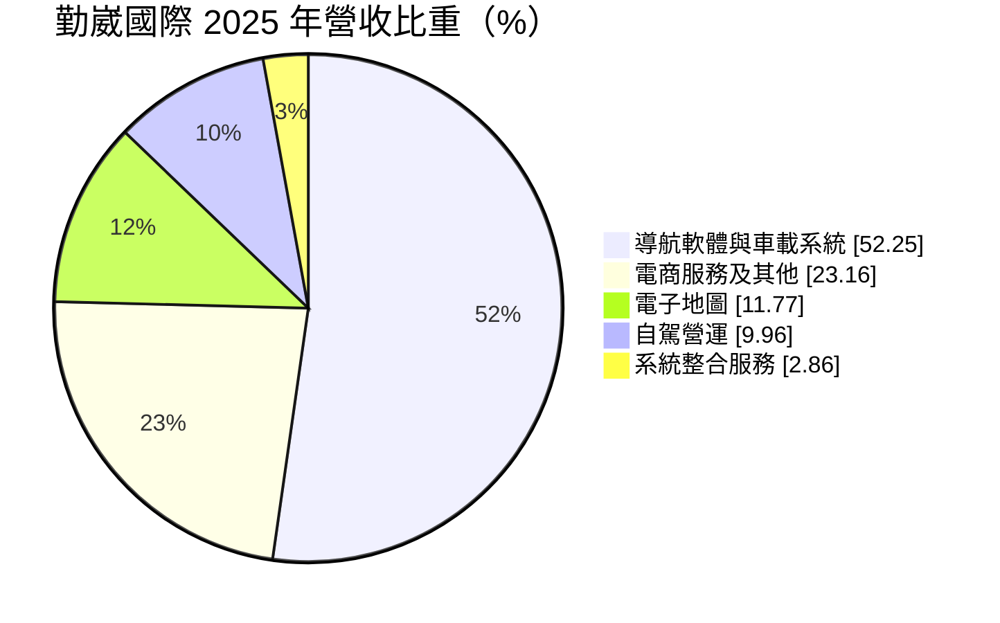
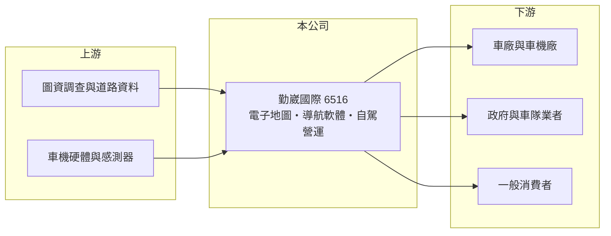

# 6516 勤崴國際

> 上櫃｜[[產業索引-資訊服務業|資訊服務業]]｜上市（櫃）日期 2019/05/06

# 第一章：企業模式與商業藍圖

> [!info] 撰寫說明
> 精簡版，由 Claude 依公開資料整理，架構比照 [[2330台積電]]，資料截至 2026-10-08。來源：Goodinfo 經營績效年表（2019 至 2025 年）；富邦 e 點通（MoneyDJ）公司基本資料（2025 年營收比重）；櫃買中心開放資料快照（基本資料、2026 年第二季資產負債與上半年損益、每月營收、股利）。產品品牌、客戶與自駕專案內容依記憶整理，標示待校對。#待校對

勤崴國際（勤崴國際科技，英文 Kingwaytek）成立於 2007 年 12 月、2019 年 5 月上櫃，總部在台北市中正區羅斯福路，實收資本額約 5.63 億元，董事長柯應鴻、總經理黃晟中。它是台灣少數自有[[電子地圖]]與導航軟體的公司，消費者熟悉的「導航王」系列 App 即為其產品（待校對），2025 年營收約 5.5 億元，近年把業務延伸到車廠的車載系統與[[自駕車]]營運。

- **核心業務：** 勤崴的核心資產是自行建置與更新的台灣電子地圖圖資，在這個基礎上發展出三類收入：賣給消費者與車廠的導航軟體與車載系統（52%）、授權給企業與政府使用的電子地圖（12%），以及自駕車的營運服務（10%）。另有約 23% 來自電商服務及其他，具體內容未查得。
- **營收結構：** 車載導航多半以「每台車授權費」或「專案開發費」計價，跟著合作車款的銷量走；圖資授權與 App 訂閱則屬[[經常性收入]]。自駕營運是向地方政府或業者提供自駕巴士的營運服務，以專案或標案形式收費（待校對）。
- **營運據點與客戶產業：** 以台灣為主要市場，客戶包括車廠與車機廠、物流與車隊業者、政府機關與一般消費者（具體名單待校對）。圖資的價值在於「在地化與即時更新」，所以勤崴的市場集中在台灣本地。
- **長期方向：** 汽車朝電動化、聯網化與自動駕駛發展，車廠需要更精細的[[高精地圖]]與車載軟體。勤崴的長期方向是從「導航 App 公司」轉型為「車用圖資與自駕服務供應商」，自駕營運比重在 2025 年已接近一成，是觀察轉型成果的重要指標。

# 第二章：護城河深度與競爭優勢

勤崴的護城河來自長年累積的台灣在地圖資，這是需要大量人力與時間才能建立的資料資產。

- **競爭優勢：** 電子地圖要有道路、門牌、景點、交通規則等大量資料，並且持續更新，新進者要從零開始建置的成本極高。勤崴在台灣深耕多年，圖資與車廠整合經驗形成實質進入門檻。車廠一旦把導航系統整合進車機，整個車款生命週期內很少更換供應商，形成轉換成本。
- **主要對手：** 消費端最大的對手是免費的 Google 地圖（[[GOOGL谷歌]]）與 Apple 地圖（[[AAPL蘋果]]），讓付費導航 App 市場持續萎縮。車用端則與國際圖資商如 HERE、TomTom 競爭（待校對），自駕領域另有其他自駕新創與系統整合商。
- **觀察重點：** 第一，車載系統與圖資授權能否取代消費者 App，成為主要成長動能；第二，自駕營運能否從政府示範案走向常態化商轉；第三，[[營業利益率]]在 2021 年轉正後能否持續提升到兩成以上。

# 第三章：財務體質與盈利規模

資料日期：2026-10-08，表格是撰寫當時的快照；最新月營收、毛利率、累計 EPS 由自動排程寫在本筆記的屬性欄位（月營收、毛利率、累計EPS 等）。#待校對

勤崴的財務特色是軟體公司常見的高毛利，但營業利益率仍在爬坡階段，ROE 不高。

| 年度 | 營收（億元） | [[毛利率]] | [[營業利益率]] | EPS（元） | [[ROE]] |
|---|---|---|---|---|---|
| 2019 | 2.55 | 50.2% | -2.52% | 0.08 | 0.39% |
| 2020 | 2.75 | 49.8% | -7.29% | 0.14 | 0.56% |
| 2021 | 3.44 | 56.4% | 9.35% | 1.09 | 4.72% |
| 2022 | 4.81 | 51.7% | 18.0% | 1.71 | 7.80% |
| 2023 | 5.05 | 47.9% | 10.6% | 1.20 | 5.93% |
| 2024 | 4.44 | 56.7% | 9.89% | 1.47 | 7.76% |
| 2025 | 5.47 | 54.6% | 11.8% | 1.52 | 8.09% |
| 2026 上半年 | 3.26 | 48.8% | 16.5% | 1.32 | 未查得 |

註：2019 至 2025 年取自 Goodinfo（2020 年 EPS 與淨利推算值有出入，待校對）；2026 年上半年取自櫃買中心開放資料推算（營業毛利 1.59 億元、營業利益 0.54 億元）。

- **長期指標：** 2020 至 2025 年營收年複合成長率約 14.7%（推算），2021 至 2025 年平均 ROE 約 6.9%（推算）。櫃買中心快照顯示最近一年度現金股利約 2.34 元，高於 2025 年 EPS 1.52 元，推估含資本公積配發，代表公司帳上現金充裕、再投資需求不大。稅後淨利常高於營業利益，推估來自利息收入或政府補助等業外收入。2026 年 1 至 8 月累計營收較去年同期成長約 24%，上半年營業利益率提高到 16.5%。
- **[[ROIC]] 與 [[WACC]]：** 2025 年營業利益約 0.65 億元（5.47 億 × 11.8%），稅後約 0.52 億元；2026 年第二季股東權益 9.46 億元，有息負債未查得，負債總額僅 2.49 億元，假設有息負債接近 0，ROIC 約 5.5%（推算）。以 2026 年上半年年化營業利益約 1.08 億元計算，ROIC 約 9%（推算）。WACC 以無風險利率 1.75%、市場風險溢酬 6%、β 1.0（中小型軟體股常見值）推得權益成本 7.75%，資本幾乎全為權益，WACC 約 7.75%（推算）。ROIC 在 2025 年低於 WACC、2026 年上半年略高，代表勤崴正處於從「打平資金成本」走向「創造價值」的轉折點，關鍵在獲利改善能否持續。
- **財務特色：** 2026 年第二季總資產 11.95 億元、負債比率約 21%，[[每股淨值]] 16.95 元。低負債、高現金是輕資產軟體公司的典型結構，但淨值中有相當部分是尚未有效運用的現金（推估），拉低了 ROE。

# 第四章：總體風險與地緣政治

勤崴的風險在於消費導航市場萎縮與新業務商轉的不確定性。

- **產業週期：** 車載系統收入跟著台灣新車銷量走，車市景氣反轉時授權費會減少。自駕業務仰賴政府示範計畫與補助，預算週期與政策方向會影響訂單。
- **營運風險：** 免費地圖 App 持續侵蝕付費導航市場；若車廠改用國際車機平台內建的地圖服務，在地圖資商的角色可能被邊緣化。圖資更新需要長期投入人力，成本難以壓縮。
- **其他風險：** 自駕車事故涉及法規與責任歸屬，一旦發生事故，可能衝擊業務與商譽。台灣自駕相關法規仍在建立中，商轉時程有不確定性。圖資屬於敏感地理資訊，也受國家安全與資料法規約束。

# 專有名詞解析

## 應用

- **[[電子地圖]]**：以數位資料呈現道路、地址與地理資訊的地圖，是導航與車隊管理系統的基礎。
- **[[高精地圖]]**：精度達公分等級、包含車道與交通標誌等細節的地圖，供自動駕駛車輛定位與規劃路線。
- **[[自駕車]]**：能在特定條件下自行感知環境並駕駛的車輛，依自動化程度分為 L1 至 L5。

## 金融

- **[[經常性收入]]**：每年固定重複發生的收入，例如維運年約、訂閱費，能讓營收比一次性專案更穩定。
- **[[ROIC]]**：投入資本報酬率，稅後營業利益除以股東權益加有息負債，衡量本業運用資本的效率。
- **[[WACC]]**：加權平均資金成本，股東與債權人要求報酬率的加權平均，是 ROIC 要超越的門檻。

# 核心供應鏈

- 上游：道路與地理資料來源、車機硬體與自駕感測器供應商（具體名單未查得）。
- 下游／客戶：車廠與車機廠、地方政府與車隊業者、導航 App 使用者（具體名單待校對）。
- 同業：國際圖資商 HERE、TomTom，以及免費地圖服務 [[GOOGL谷歌]]、[[AAPL蘋果]]。

## 最新新聞
<!-- news:start -->
<!-- news:end -->

## 相關連結
- [公開資訊觀測站](https://mopsov.twse.com.tw/mops/web/t05st03?step=1&firstin=1&co_id=6516)
- [Goodinfo](https://goodinfo.tw/tw/StockDetail.asp?STOCK_ID=6516)
- [Yahoo 股市](https://tw.stock.yahoo.com/quote/6516)
- [鉅亨網新聞](https://www.cnyes.com/twstock/6516/news)
