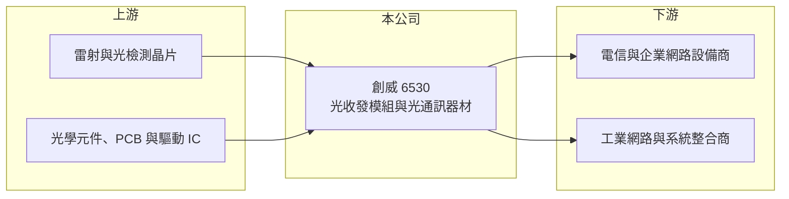

# 6530 創威

> 上櫃｜[[產業索引-通信網路業|通信網路業]]｜上市（櫃）日期 2018/01/23

# 第一章：企業模式與商業藍圖

> [!info] 撰寫說明
> 本文由 Claude 依公開資料整理，架構比照 [[2330台積電]] 的四章研究，資料截至 2026-10-08。財務數字來源：Goodinfo 年度經營績效頁、櫃買中心開放資料（基本資料、2026 年第二季資產負債與損益、每月營收、本益比殖利率）、nStock 公司簡介、CMoney 與自由時報報導標題；產品、應用與客戶描述多為推估，已標「待校對」。公開資料有限。#待校對

評估一家小型光通訊公司，要看它的產品落在光通訊市場的哪個區塊，是追逐資料中心最新速度的主流戰場，還是規格穩定、量小樣多的利基市場。本章說明創威光電（股票代號：6530，以下簡稱創威）的經營模式與財務特性。

## 一、核心定位：光通訊器材製造商

創威成立於 2002 年，2018 年 1 月在櫃買中心掛牌，實收資本額約 3.4 億元。依公司登記的業務範圍，主要從事光學器材與電信器材的研發、生產與銷售，並提供應用設計、測試、維修與技術諮詢服務。CMoney 報導將其定位為[[光收發模組]]製造廠商，市場也把它歸類為[[矽光子]]概念股。

光收發模組負責在光纖網路兩端把電訊號轉換成光訊號、再轉回電訊號，是電信、企業網路與資料中心都需要的元件。依速度、傳輸距離與工作溫度不同，產品規格非常多樣。創威的營收規模約 3 億元，推估以工業、電信與企業網路等量小樣多的利基市場為主（待校對），而不是與大型模組廠在資料中心高速模組上正面競爭。

## 二、營收規模與結構

創威營收在 2020 至 2025 年介於 2.5 億至 3.3 億元，成長平穩。2026 年 1 至 8 月累計營收約 2.5 億元、年增約 16%。各產品與地區的營收比重未查得。

## 三、長期方向

光通訊需求隨 5G、光纖到府、工業網路與資料中心持續擴大，速度也從 10G、25G 往 100G 以上升級。創威的長期課題是在利基市場維持高毛利，同時評估是否投入矽光子等新一代技術。由於公司規模小，研發資源有限，選擇正確的利基比追逐所有規格更重要。

# 第二章：護城河深度與競爭優勢

在長期價值投資中，「護城河」指企業抵禦競爭、維持超額利潤的保護機制。本章分析創威的優勢、限制與競爭對手。

## 一、創威的優勢與限制

* **利基市場的客製能力：** 量小樣多的光模組需要依客戶系統調整規格與韌體，大廠通常不願承接。能快速提供客製產品與技術服務，是小型模組廠的生存空間。
* **毛利率持續提升：** [[毛利率]]從 2020 年的 36% 提升到 2025 年的 46%，2026 年上半年約 47%，代表產品組合往高附加價值移動。

限制是規模太小，上游雷射與光學元件議價能力弱，且缺乏資料中心大客戶的量產訂單，護城河屬於窄的類型。

## 二、主要競爭對手

| 對手 | 定位 | 對創威的威脅 |
|---|---|---|
| [[4979華星光]] | 光收發模組與元件 | 規模較大，產品線重疊 |
| [[4908前鼎]] | 光收發模組 | 在電信與企業網路模組競爭 |
| [[4977眾達-KY]] | 光通訊元件與模組 | 爭取相同的利基客戶 |
| 中國光模組大廠 | 大量產能、價格低 | 壓低標準品價格 |

## 三、守得住／守不住／觀察重點

守得住的是需要客製服務的利基客戶。守不住的是標準規格模組的價格。長期觀察重點是毛利率能否維持在四成以上，以及營收能否突破長期停留的 3 億元規模。

# 第三章：財務體質與盈利規模

資料日期：2026-10-08，表格是撰寫當時的快照；最新月營收、毛利率、累計 EPS 由自動排程寫在本筆記的屬性欄位（月營收、毛利率、累計EPS 等）。#待校對

財務報表是檢驗護城河是否真實存在的最終標準。本章用六年的三率、ROE 與資本報酬，檢視創威的獲利品質。

## 一、多年度經營績效

| 年度 | 營收（新台幣） | [[毛利率]] | [[營業利益率]] | EPS（元） | [[ROE]] |
|---|---|---|---|---|---|
| 2020 | 2.49 億 | 36.1% | 13.2% | 0.76 | 5.73% |
| 2021 | 2.71 億 | 38.9% | 17.0% | 1.09 | 8.2% |
| 2022 | 2.74 億 | 44.7% | 22.2% | 1.59 | 11.8% |
| 2023 | 2.52 億 | 42.9% | 19.2% | 1.25 | 9.14% |
| 2024 | 2.81 億 | 43.2% | 21.5% | 1.64 | 11.9% |
| 2025 | 3.28 億 | 46.2% | 24.0% | 1.95 | 13.7% |
| 2026 上半年 | 1.87 億 | 47.3% | 27.2% | 1.29 | 未查得 |

營收成長不快，但獲利率逐年提升，營業利益率從 13% 升到 2026 年上半年的 27%，代表產品組合改善與規模經濟同時發揮。2021 至 2025 年平均 ROE 約 10.9%（推算），營收年複合成長率約 4.9%（推算）。最近一次現金股利每股 2 元，與 2025 年 EPS 相當，配息率接近 100%（推算）。

## 二、[[ROIC]] 與 [[WACC]]：價值創造利差

**ROIC 推算：** 2025 年營業利益約 0.79 億元（3.28 億 × 24.0%），稅後約 0.63 億元。2026 年第二季權益總計約 4.6 億元，負債約 1.7 億元，假設有息負債約 0.3 億元（推估），投入資本約 4.9 億元，ROIC 約 12.8%（推算）。

**WACC 推算：** 台灣 10 年期公債 1.75%、市場風險溢酬 6%、β 取小型光通訊股常見值 1.2，股東權益成本約 9.0%；負債成本 2.5%、稅後 2.0%；權益占投入資本約 94%，WACC 約 8.5%（推算）。

**結論：** ROIC 高於 WACC 約 4 個百分點，且利差隨獲利率提升逐年擴大，代表創威近年已開始創造價值。不過公司規模小、資料有限，數字容易受單一年度波動影響。

# 第四章：總體風險與地緣政治

任何企業都無法脫離宏觀環境獨立存在。本章分析創威長期必須面對的風險。

## 一、規模與客戶集中

營收僅約 3 億元，少數客戶的訂單變化就會造成明顯波動。小公司在景氣低谷時抵禦價格戰與固定費用的能力也較弱。

## 二、技術世代交替

光模組速度每隔幾年就升級一次，矽光子、[[CPO]] 等新技術可能改變模組的設計與供應鏈。若無法跟上規格升級，既有產品會被淘汰；若投入新技術，研發費用又可能侵蝕獲利。

## 三、上游元件與匯率

雷射晶片與光學元件多向國際大廠採購，缺貨或漲價時小廠議價能力有限。營收以外銷為主時（比重未查得），新台幣升值會壓縮獲利。市場將其視為矽光子概念股，股價波動可能遠大於基本面變化。

# 專有名詞解析

## 半導體

- **[[矽光子]]**：在矽晶片上製作光學元件，以光取代電傳輸資料，可降低 AI 資料中心的傳輸耗電。
- **[[CPO]]**：共同封裝光學，把光學收發元件與交換晶片封裝在一起，縮短電訊號距離以降低功耗。

## 金融

- **[[ROIC]]**：投入資本報酬率，稅後營業利益除以股東權益與有息負債的合計，衡量本業對所有資金提供者的報酬。
- **[[WACC]]**：加權平均資金成本，依股東權益與負債的比重加權計算的資金成本，ROIC 高於它才代表創造價值。

## 產業

- **[[光收發模組]]**：把電訊號轉成光訊號、再把光訊號轉回電訊號的模組，是資料中心與電信網路的連接元件。

# 核心供應鏈

## 1. 上游：光電元件
- 雷射與光檢測晶片：[[3081聯亞]] 等磊晶與晶片廠（供應關係待校對）
- 光學元件、PCB 與驅動 IC 供應商

## 2. 中游：創威與同業
- 同業：[[4979華星光]]、[[4908前鼎]]、[[4977眾達-KY]]

## 3. 下游：客戶
- 電信與企業網路設備商、工業網路與系統整合商（具體客戶未查得，待校對）

## 最新新聞
<!-- news:start（自動產生，請勿手動編輯此範圍） -->
- 2026-10-20 🏛️ 重訊 14:32｜公告本公司受邀參加宏遠證券所舉辦之115年Q3法人說明會｜[觀測站](https://mops.twse.com.tw/mops/#/web/t05st01)

完整紀錄：[[6530創威 新聞]]
<!-- news:end -->

## 相關連結
- [公開資訊觀測站](https://mopsov.twse.com.tw/mops/web/t05st03?step=1&firstin=1&co_id=6530)
- [Goodinfo](https://goodinfo.tw/tw/StockDetail.asp?STOCK_ID=6530)
- [Yahoo 股市](https://tw.stock.yahoo.com/quote/6530)
- [鉅亨網新聞](https://www.cnyes.com/twstock/6530/news)
