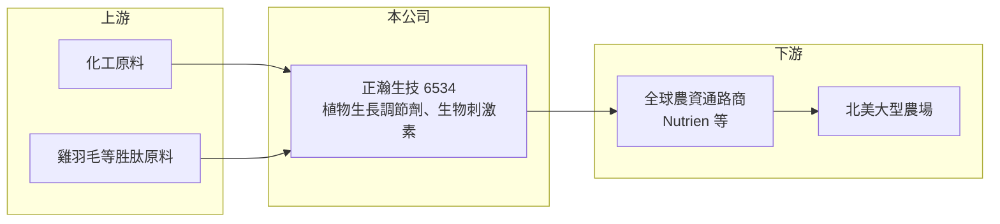

# 6534 正瀚-創

> 創新板｜[[產業索引-生技醫療業|生技醫療業]]｜上市（櫃）日期 2023/12/21

# 第一章：企業模式與商業藍圖

> [!info] 撰寫說明
> 精簡版，由 Claude 依公開資料整理，架構比照 [[2330台積電]] 的四章研究，資料截至 2026-10-08。來源：Goodinfo 年度經營績效頁、富果 2026 年 7 月法說會備忘錄、證交所開放資料（基本資料、2026 年第二季資產負債與綜合損益、營益分析、股利、每月營收）。創新板／新掛牌，公開資料有限；產品別營收比重未查得。#待校對

正瀚生技是一家研發在台灣、市場在北美的農業生技公司，以極高的毛利率著稱。本章說明它的產品、商業模式與長期方向。

## 一、核心定位：替農作物增產的農業生技公司

正瀚成立於 2013 年，研發總部在南投，2023 年 12 月在證交所[[創新板]]掛牌，實收資本額約 10.3 億元，董事長吳正邦（證交所開放資料）。公司的產品有三類：[[植物生長調節劑]]（公司起家產品）、高效肥料，以及未來發展核心的[[生物刺激素]]（富果）。

* **B2B 賣給農資通路：** 公司不直接面對農民，而是與全球前三大農資通路商合作（例如 Nutrien 集團），由通路商把產品賣給大型農場。北美市場占營收超過 90%。
* **研發在台灣、製造在美國與台灣：** 研發集中在南投，生產據點包括彰濱工業區兩座工廠與美國加州一座工廠，產品行銷全球。

## 二、技術核心：登記證與作用機制

植物生長調節劑在美國必須取得環保署（EPA）登記才能銷售，從開發到上市往往需要 10 至 15 年。正瀚擁有 13 張原體登記證（公司稱數量為全美第二多）與 165 張產品登記證（富果）。這些登記證是公司最重要的資產，新進者即使有配方，也要花十年以上才能取得同樣的銷售資格。

生物刺激素方面，公司的核心技術「內穩系統素」取自雞羽毛水解後篩選出的兩百多條胜肽，已進行兩千場以上田間試驗，平均增產兩成以上（公司數據）。

## 三、長期藍圖：從北美走向全球、從調節劑轉向生物刺激素

公司計畫在 2026 至 2027 年推出 6 款新產品（4 款植物生長調節劑、2 款生物刺激素），並把產品重心逐步轉向生物刺激素。市場上則從北美擴大到南美（阿根廷已承認美國登記證）、東南亞（馬來西亞、印尼、越南預期 2026 年開始貢獻）與歐洲（保加利亞田間試驗，預計 2027 至 2028 年進入）。2020 至 2025 年營收成長 2.6 倍、年複合成長率約 21%（富果）。

# 第二章：護城河深度與競爭優勢

正瀚的毛利率長期在八成以上，遠高於一般農化同業，本章分析這個優勢的來源與可持續性。

## 一、護城河的核心組成要素

* **法規登記證：** 美國 EPA 登記需要長時間的毒理、環境與田間資料，13 張原體登記證形成十年以上的進入障礙。這是正瀚高毛利最根本的來源。
* **研發與作用機制：** 公司深入研究產品在植物體內的作用機制，能符合歐美市場對安全性與有效性的要求，也能據此開發新用途、延長產品生命週期。
* **通路夥伴與逆向研發：** 由大型通路商回饋市場缺口，再引導研發方向，使新產品上市時已有明確需求與銷售管道。

## 二、主要競爭對手

| 對手 | 定位 | 對正瀚的威脅 |
|---|---|---|
| Valent BioSciences（住友化學旗下，待校對） | 植物生長調節劑大廠 | 產品線與登記證規模大 |
| Fine Americas、Nufarm | 植物生長調節劑與農化 | 在北美特定作物市場競爭 |
| 拜耳、先正達、科迪華 | 全球農化與種子巨頭 | 布局生物製劑，資源雄厚 |
| [[1712興農]] | 台灣農藥與肥料廠 | 主要在台灣市場，重疊有限 |

## 三、守得住與守不住

* **守得住：** 已取得登記、通路已建立的植物生長調節劑產品，毛利率 2021 至 2025 年維持在 79% 至 84%（Goodinfo）。
* **守不住：** 對北美單一市場與少數通路的依賴。北美占營收九成以上，通路商庫存調整或作物價格下跌時，訂單會明顯波動。
* **觀察重點：** 生物刺激素新產品的上市速度，以及東南亞、南美營收能否在 2027 年後占到一成以上。

# 第三章：財務體質與盈利規模

資料日期：2026-10-08，表格是撰寫當時的快照；最新月營收、毛利率、累計 EPS 由自動排程寫在本筆記的屬性欄位（月營收、毛利率、累計EPS 等）。#待校對

本章用多年度數據檢視正瀚的成長性、超高毛利率與資本報酬。

## 一、多年度三率與 ROE

| 年度 | 營收（新台幣） | [[毛利率]] | [[營業利益率]] | EPS（元） | [[ROE]] |
|---|---|---|---|---|---|
| 2021 | 10.2 億 | 83.3% | 35.3% | 3.45 | 18.2% |
| 2022 | 14.3 億 | 79.1% | 35.6% | 4.79 | 24.4% |
| 2023 | 15.1 億 | 83.2% | 37.4% | 4.76 | 20.1% |
| 2024 | 16.4 億 | 83.4% | 33.2% | 4.63 | 18.4% |
| 2025 | 18.2 億 | 83.9% | 34.3% | 4.51 | 17.4% |
| 2026 上半年 | 13.3 億 | 85.73% | 51.84% | 5.59 | 未查得 |

註：2021 至 2025 年取自 Goodinfo；2026 上半年取自證交所營益分析與綜合損益。Goodinfo 另有 2015 至 2020 年資料，毛利率同樣在 81% 至 84%。

* **穩定成長：** 2021 至 2025 年營收年複合成長率約 15.6%（推算），每年都創新高。
* **毛利率八成以上：** 毛利率長期維持在 80% 以上，營業利益率約 33% 至 37%，代表研發與行銷費用雖高，獲利仍非常豐厚。
* **明顯的季節性：** 2026 年上半年營收 13.3 億元，1 至 8 月累計約 14.3 億元（證交所每月營收），下半年營收很少。這反映北半球春季用藥的出貨高峰，上半年營業利益率特別高，不能直接年化。
* **ROE 長期約兩成：** 2021 至 2025 年平均 ROE 約 19.7%（推算），在不靠財務槓桿的情況下仍有很高的資本報酬。

## 二、股利與財務結構

公司採半年配息，2025 年下半年配發現金股利 4.30 元、2026 年上半年配發 1.00 元（證交所股利資料）。2026 年第二季底總資產約 38.1 億元、總負債約 11.8 億元（其中流動負債約 10.1 億元）、權益約 26.3 億元，每股淨值 26.08 元（證交所資產負債）。有息負債金額未查得。

## 三、[[ROIC]] 與 [[WACC]]

**ROIC 推算：** 2025 年營業利益約 18.2 億 × 34.3% ≈ 6.24 億元，稅後約 4.99 億元。假設總負債 11.8 億元的一半約 5.9 億元為有息負債（實際可能更低），加上 2026 年第二季權益 26.3 億元，投入資本約 32.2 億元，ROIC 約 15.5%（推算）。

**WACC 推算：** 台灣 10 年期公債 1.75%、市場風險溢酬 6%、β 取農化同業常見值 0.8，權益成本約 6.6%；負債成本 3%、稅率 20%，權益占比約 82%，WACC 約 5.8%（推算）。

**結論：** ROIC 約為 WACC 的 2.5 倍以上，利差接近 10 個百分點，代表登記證形成的護城河確實轉化為長期的超額報酬。只要毛利率維持八成、營收持續成長，公司就能持續創造價值。

# 第四章：總體風險與地緣政治

本章整理正瀚長期面對的農業週期、法規與地緣風險。

## 一、產業週期

* **農產品價格與農民收入：** 作物價格下跌時，農民會削減肥料與增產資材支出，通路商也會降低庫存。
* **氣候與季節：** 出貨集中在北半球春季，若遇乾旱、洪水或播種期延後，當年營收可能大幅波動。

## 二、營運風險

* **市場與通路集中：** 北美占營收九成以上，主要通路商的策略改變或併購，都會直接影響正瀚。
* **新產品登記時程：** 新產品需經 EPA 等機關審查，時程不確定，可能延後營收貢獻。

## 三、其他風險

* **法規變動：** 美國或其他國家若對植物生長調節劑或生物製劑的登記規範改變，可能增加成本或限制銷售。
* **匯率與關稅：** 營收以美元計價，新台幣升值會壓低獲利；台灣生產出口美國的部分也受美國關稅政策影響，美國加州廠可部分對沖。

# 專有名詞解析

## 金融

- **[[創新板]]**：證交所 2021 年設立的板塊，讓尚未獲利但具技術或創新能力的公司掛牌，初期限合格投資人交易。
- **[[ROIC]]**：投入資本報酬率，衡量企業用股東與債權人投入的資本，每年能產生多少稅後營業利益。
- **[[WACC]]**：加權平均資金成本，股東要求報酬與負債利息依資本結構加權後的平均值，是判斷是否創造價值的門檻。

## 產業

- **[[植物生長調節劑]]**：調控植物發芽、開花、結果與抗逆境等生理反應的物質，在美國需取得 EPA 登記才能販售。
- **[[生物刺激素]]**：以胜肽、微生物或天然萃取物刺激植物自身代謝，提升養分吸收與抗逆境能力的農業資材。

# 核心供應鏈

- 上游：化工原料、胜肽原料（雞羽毛水解）與包材。
- 下游／客戶：全球前三大農資通路商（例如 Nutrien），最終使用者為北美、南美與東南亞的大型農場。
- 同業：Valent BioSciences、Fine Americas、Nufarm、拜耳、先正達、科迪華、[[1712興農]]。

## 最新新聞
<!-- news:start（自動產生，請勿手動編輯此範圍） -->
- 2026-10-20 🏛️ 重訊 14:20｜公告本公司簽定國內第一次有擔保轉換公司債代收及 存儲債款專戶合約｜[觀測站](https://mops.twse.com.tw/mops/#/web/t05st01)

完整紀錄：[[6534正瀚-創 新聞]]
<!-- news:end -->

## 相關連結
- [公開資訊觀測站](https://mopsov.twse.com.tw/mops/web/t05st03?step=1&firstin=1&co_id=6534)
- [Goodinfo](https://goodinfo.tw/tw/StockDetail.asp?STOCK_ID=6534)
- [Yahoo 股市](https://tw.stock.yahoo.com/quote/6534)
- [鉅亨網新聞](https://www.cnyes.com/twstock/6534/news)
