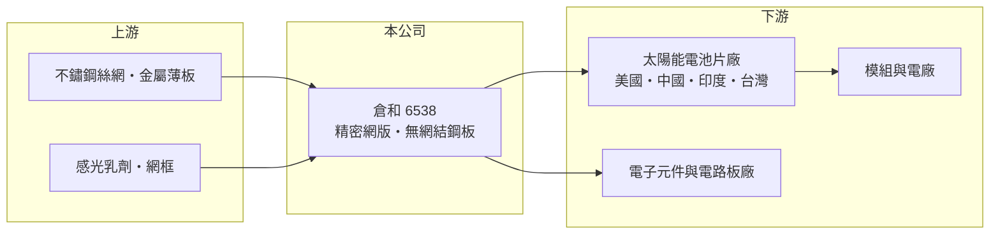

# 6538 倉和

> 上櫃｜[[產業索引-電子零組件業|電子零組件業]]｜上市（櫃）日期 2016/10/21

# 第一章：企業模式與商業藍圖

> [!info] 撰寫說明
> 精簡版，由 Claude 依公開資料整理，架構比照 [[2330台積電]] 的四章研究，資料截至 2026-10-08。來源：櫃買中心開放資料（基本資料、2026 年第二季資產負債與綜合損益、每月營收備註）、Goodinfo 經營績效頁（2020 至 2025 年度數字）、鉅亨號投顧研究文章（2026 年營運與市場結構）。產品線細節與生產據點有部分憑記憶整理，已標註待校對。公開資料有限。#待校對

倉和是一家專做「印刷工具」的公司：它不生產太陽能電池，而是生產電池廠用來把導電[[銀漿]]印到矽晶片上的精密網版。理解倉和，關鍵在於理解網版是消耗品、而且印刷精度直接決定客戶的電池效率與銀漿成本。

- **核心業務：** 倉和成立於 1994 年，總部在桃園龜山，2016 年 10 月在櫃買中心掛牌。主力產品是[[太陽能電池]]印刷用的[[網版]]，包括不鏽鋼絲網版、無網結鋼板與傳統網版；網版在產線上會隨印刷次數磨損，需要定期更換，因此本質上是隨客戶產量重複購買的耗材生意。公司也供應被動元件、印刷電路板等電子產業使用的網版，但規模小於太陽能（待校對）。
- **營收結構：** 公開來源未揭露產品別比重，但每月營收公告多以「太陽能網版銷貨量」說明營收變化，可判斷太陽能是最主要的收入來源（推估）。地區上，過去以中國電池片廠為大宗，依 2026 年的研究文章，非中國市場（以美國為首）的營收已在當年 7 月超過中國，這代表客戶結構正從中國單一市場轉向分散。
- **營運據點：** 台灣為研發與高階網版的生產基地，並持續擴充產能；公司另設有中國生產據點服務當地客戶（待校對），並已成立印度子公司，對應印度政府扶植本土太陽能製造的需求。多地設廠的目的，是讓耗材能貼近客戶產線、縮短交期。
- **長期方向：** 太陽能電池的技術演進（例如 [[TOPCon]]、異質接面與無主柵設計）都要求更細、更均勻的銀漿線路，以降低銀的用量並提高轉換效率。倉和的長期機會在於「降銀」趨勢下高規格細線網版的滲透率提升，以及美國、印度等新興電池產能的建置。

# 第二章：護城河深度與競爭優勢

網版本身不是高科技產品，但「印得細、印得穩、印得久」需要長期的材料與張網工藝累積。本章說明倉和的優勢在哪裡、競爭壓力來自哪裡。

- **競爭優勢：** 倉和的優勢在細線印刷能力與配合客戶調整製程的服務。電池廠導入新網版需要上線測試印刷良率與效率，一旦驗證通過，客戶通常不會為了小幅價差頻繁更換供應商，這形成一定的轉換成本。高規格的不鏽鋼絲網版與無網結鋼板毛利較高，產品組合往高階移動時，[[毛利率]]會明顯改善，2023 至 2024 年毛利率維持在 43% 上下即是例證。
- **主要對手：** 主要競爭者是中國的網版廠，它們貼近全球最大的電池片產能、成本低，在中國市場價格競爭激烈（具體廠商名稱未查得）。在美國與印度等非中國市場，客戶基於供應鏈安全考量偏好非中系供應商，倉和的相對位置較有利。
- **護城河的限制：** 網版的技術門檻低於半導體材料，且電池技術每隔幾年就換代，舊規格網版的優勢可能歸零。倉和屬於「窄護城河」，需要持續跟上電池技術路線，才能維持高階產品的溢價。
- **觀察重點：** 長期應觀察三件事：非中國市場營收占比是否持續提高、細線與無網結產品占比能否支撐毛利率回到 40% 以上，以及電池技術若轉向更少依賴網印的金屬化方式（例如電鍍銅），對網版需求的長期影響。

# 第三章：財務體質與盈利規模

資料日期：2026-10-08，表格是撰寫當時的快照；最新月營收、毛利率、累計 EPS 由自動排程寫在本筆記的屬性欄位（月營收、毛利率、累計EPS 等）。#待校對

倉和的財務數字呈現典型的「跟著太陽能景氣起伏」：產業擴產年獲利亮眼，供過於求年則大幅衰退。本章用多年度數字檢視它的獲利波動與資本報酬。

| 年度 | 營收（億元） | [[毛利率]] | [[營業利益率]] | EPS（元） | [[ROE]] |
|---|---|---|---|---|---|
| 2020 | 19.4 | 50.6% | 32.3% | 11.52 | 26.8% |
| 2021 | 13.2 | 40.8% | 15.3% | 4.13 | 8.9% |
| 2022 | 14.9 | 37.9% | 12.2% | 4.57 | 10.0% |
| 2023 | 21.5 | 43.0% | 21.5% | 9.11 | 18.3% |
| 2024 | 22.1 | 43.2% | 21.1% | 9.23 | 17.0% |
| 2025 | 14.5 | 33.2% | 4.3% | 1.15 | 2.2% |
| 2026 上半年 | 6.93 | 40.0% | 13.8% | 2.10 | 未查得 |

- **營收規模與成長：** 2020 至 2025 年營收在 13 億至 22 億元之間大幅擺盪，2020 年到 2025 年的年複合成長率約為負 5.7%（推算），代表倉和的營收不是穩定成長型，而是高度週期型。2025 年營收衰退約三成，主要反映全球太陽能產業供過於求、中國電池廠減產。
- **獲利：** 毛利率長期在 33% 至 50% 之間，屬於耗材廠中偏高的水準，但營業費用相對固定，營收下滑時[[營業利益率]]會被大幅壓縮，2025 年只剩 4.3%。2026 年上半年毛利率回升到 40.0%、營業利益率 13.8%，稅後淨利 0.78 億元，顯示高規格產品與美國訂單帶來的組合改善（數字來自櫃買中心 2026 年第二季累計財報）。
- **財務特色：** 2026 年第二季底總資產 30.0 億元、股東權益 19.2 億元，負債比約 36%，財務結構穩健；非流動負債約 4.9 億元，主要應與已發行的[[可轉換公司債]]「倉和一」有關（推估）。2021 至 2025 年平均 ROE 約 11.3%（推算），Goodinfo 統計的歷年平均現金股利約 3.73 元，2025 年度現金股利約 1.53 元、高於當年 EPS，代表公司在低谷年仍動用累積盈餘維持配息。
- **[[ROIC]] 與 [[WACC]]：** 以 2025 年營業利益約 0.62 億元（14.5 億 × 4.25%）、稅率 20% 計，稅後營業利益約 0.49 億元；投入資本以 2026 年第二季股東權益 19.2 億元加非流動負債 4.9 億元（有息負債明細未查得，以此近似）約 24.1 億元計，2025 年 ROIC 約 2%（推算）。景氣較好的 2023 至 2024 年，稅後營業利益約 3.7 億元，ROIC 約 15% 至 18%（推算）；2026 年上半年年化約 6%（推算）。WACC 以 CAPM 推估：無風險利率 1.75%、市場風險溢酬 6%、β 假設 1.1（中小型電子零組件常見值，非來源數字），股權成本約 8.4%；負債成本假設 2%、稅後 1.6%，股權與負債約 8 比 2，WACC 約 7%（推算）。結論是倉和在太陽能擴產年 ROIC 明顯高於 WACC、能創造價值，但在產業低谷年 ROIC 低於 WACC，長期平均是否持續創造價值，取決於高階產品占比能否讓低谷不再那麼深。

# 第四章：總體風險與地緣政治

倉和的命運與太陽能產業高度綁定，而太陽能是政策驅動、產能擴張極快的產業。本章整理它必須長期面對的風險。

- **產業週期：** 太陽能產業每隔幾年就經歷一次「擴產、價格崩跌、減產」的循環，網版需求跟著電池片稼動率波動。2025 年營收與獲利的大幅下滑說明了這種週期的殺傷力，投資人應以完整循環的平均獲利來評估，而不是看單一高峰年。
- **營運風險：** 電池技術路線換代快，若主流金屬化製程改用電鍍銅或其他不需網印的方式，網版需求可能結構性下降。另外，大客戶集中於少數電池片廠，單一客戶擴產或停產都會明顯影響營收。
- **地緣政治與政策：** 美國對中國太陽能產品的關稅與在地製造補貼、印度的本土製造政策，是倉和非中國市場成長的主要推力；但政策一旦轉向（例如補貼縮減），美國電池片產能的建置速度也會放慢。中國市場則面臨本土供應商的價格競爭。
- **其他風險：** 白銀價格上漲會讓客戶更積極導入降銀製程，對高階網版是利多，但若銀價大跌，降銀的急迫性下降。匯率方面，外銷比重高，新台幣升值會壓縮以台幣計算的營收與毛利。

# 專有名詞解析

## 金融

- **[[可轉換公司債]]**：持有人可在約定期間依轉換價格把債券轉為公司股票的債券，票面利率通常很低。

## 產業

- **[[網版]]**：以絲網或金屬薄板製成、帶有圖案開孔的印刷模具，用來把漿料精準印到基材上，屬於隨產量消耗的耗材。
- **[[太陽能電池]]**：把光能轉為電能的半導體元件，矽晶電池正面需要以網印銀漿形成導電線路。
- **[[TOPCon]]**：穿隧氧化層鈍化接觸太陽能電池技術，轉換效率高於傳統 PERC，是近年主流電池片技術之一。
- **[[銀漿]]**：含銀粉的導電漿料，是太陽能電池金屬化的關鍵材料，也是電池片除矽晶圓外的主要成本之一。

# 核心供應鏈

- 上游：不鏽鋼絲網與金屬薄板、感光乳劑、網框等材料供應商（具體廠商未查得）。網版廠的另一個重要「合作方」是銀漿供應商，網版開孔設計需要與漿料特性搭配，台灣相關廠商如 [[3691碩禾]]（待校對）。
- 下游／客戶：太陽能電池片廠為主，美國新設電池片產能是近年成長最快的客群；台灣電池廠如 [[6244茂迪]]、[[6443元晶]] 屬於同一產業鏈（是否為倉和客戶未查得）。另有被動元件與電路板等電子產業客戶（待校對）。
- 同業：中國網版廠為主要競爭者（名稱未查得）；台灣的太陽能耗材與材料同業可參考 [[3691碩禾]]。

## 最新新聞
<!-- news:start（自動產生，請勿手動編輯此範圍） -->
- 2026-10-06 🏛️ 重訊 16:13｜本公司可轉換公司債倉和一(代號：65381)達公布注意交易 資訊標準，故公告相關訊息，以利投資人區別瞭解。｜[觀測站](https://mops.twse.com.tw/mops/#/web/t05st01)

完整紀錄：[[6538倉和 新聞]]
<!-- news:end -->

## 相關連結
- [公開資訊觀測站](https://mopsov.twse.com.tw/mops/web/t05st03?step=1&firstin=1&co_id=6538)
- [Goodinfo](https://goodinfo.tw/tw/StockDetail.asp?STOCK_ID=6538)
- [Yahoo 股市](https://tw.stock.yahoo.com/quote/6538)
- [鉅亨網新聞](https://www.cnyes.com/twstock/6538/news)
