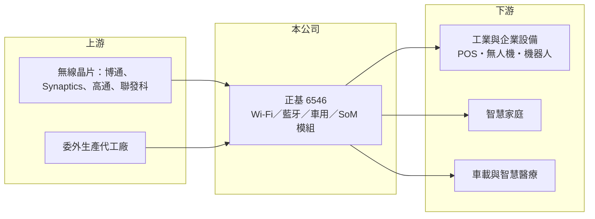

# 6546 正基

> 上櫃｜[[產業索引-通信網路業|通信網路業]]｜上市（櫃）日期 2022/05/24

# 第一章：企業模式與商業藍圖

> [!info] 撰寫說明
> 本文由 Claude 依公開資料整理，架構比照 [[2330台積電]] 的四章研究，資料截至 2026-10-08。財務數字來源：Goodinfo 年度經營績效頁、櫃買中心開放資料（基本資料、2026 年第二季資產負債與損益、每月營收、本益比殖利率）、poorstock 法說會資料整理；各產品與應用的營收比重、主要客戶名稱未查得。#待校對

評估一家無線模組公司，要看它在晶片廠與終端品牌之間能提供多少附加價值，以及每一代 Wi-Fi 規格升級能否帶來單價提升。本章說明正基科技（股票代號：6546，以下簡稱正基）如何以[[無線模組]]服務物聯網與工業客戶。

## 一、核心定位：自有品牌的 AIoT 無線模組商

正基成立於 2000 年，總部位於新竹，2022 年在櫃買中心掛牌，實收資本額約 6.7 億元。公司以自有品牌研發與銷售無線通訊模組，生產委外加工，客戶以企業對企業（B2B）為主。產品包括 Wi-Fi／藍牙模組、車用模組、系統模組（SoM）與 5G RedCap 模組，應用涵蓋 POS 機、無人機、人形機器人等工業與企業設備，以及智慧家庭、車載與智慧醫療。

無線模組的價值在於把晶片、天線匹配、射頻電路與各國認證整合成一個可直接使用的元件。終端廠商若自行設計無線電路，需要射頻人才並通過各國認證，成本高且耗時；採用模組可以縮短產品上市時間。這是模組廠存在的根本原因。

## 二、晶片夥伴與產品世代

正基與多家晶片廠合作，包括 [[AVGO博通]]、Synaptics、[[QCOM高通]]、[[2454聯發科]]、德州儀器與 Silicon Labs，處理器方面支援 ARM、英特爾與 MIPS 架構。多晶片平台的好處是能依客戶需求選擇方案，降低對單一晶片廠的依賴。

依公司產品藍圖，2026 年推出 [[Wi-Fi 7]] 模組、5G RedCap 模組與 SoM 模組，2027 年推出 Wi-Fi 8 模組並布局智慧座艙、邊緣運算與預先訓練的 AIoT 模組。多款產品已達 AEC-Q104 車規標準。各產品與應用的營收比重未查得。

## 三、長期方向

正基的長期方向是從單純的無線模組，往整合運算、連網與 AI 軟體的[[Edge AI]] 系統模組延伸，提高每個模組的附加價值。Wi-Fi 規格升級有望提升平均售價，車用與機器人等長生命週期應用則能讓營收更穩定。

# 第二章：護城河深度與競爭優勢

在長期價值投資中，「護城河」指企業抵禦競爭、維持超額利潤的保護機制。本章分析正基的優勢、限制與競爭對手。

## 一、正基護城河的組成

* **射頻設計與認證經驗：** 二十多年的模組設計經驗與各國無線認證能力，讓客戶能省下大量研發與認證時間。客戶產品一旦採用某款模組並完成認證，在產品生命週期內很少更換。
* **工業與車用的長生命週期：** 工業設備與車用產品的生命週期長達五年以上，模組訂單延續性高於消費性電子。

限制是模組廠夾在晶片廠與品牌之間，毛利率約 20% 至 24%，且營收高度依賴主要客戶，護城河屬於窄的類型。

## 二、主要競爭對手

| 對手 | 定位 | 對正基的威脅 |
|---|---|---|
| [[3694海華]] | 無線通訊模組 | 產品線與客戶群重疊 |
| 村田製作所 | 全球無線模組大廠 | 規模與品牌優勢明顯 |
| u-blox、Quectel（移遠） | 物聯網與蜂巢模組 | 在 IoT 與車用模組競爭 |
| 中國模組廠 | 低價量產 | 在標準模組壓低價格 |

## 三、守得住／守不住／觀察重點

守得住的是已完成認證、生命週期長的工業與車用設計案。守不住的是消費性與標準模組的價格。長期觀察重點是 Wi-Fi 7、車用與 SoM 模組的放量速度，以及營收能否回到 2021 至 2022 年 30 億元以上的水準。

# 第三章：財務體質與盈利規模

資料日期：2026-10-08，表格是撰寫當時的快照；最新月營收、毛利率、累計 EPS 由自動排程寫在本筆記的屬性欄位（月營收、毛利率、累計EPS 等）。#待校對

財務報表是檢驗護城河是否真實存在的最終標準。本章用六年的三率、ROE 與資本報酬，檢視正基的獲利品質。

## 一、多年度經營績效

| 年度 | 營收（新台幣） | [[毛利率]] | [[營業利益率]] | EPS（元） | [[ROE]] |
|---|---|---|---|---|---|
| 2020 | 26.7 億 | 21.6% | 13.8% | 4.76 | 24.7% |
| 2021 | 33.9 億 | 22.4% | 14.7% | 6.78 | 31.0% |
| 2022 | 35.1 億 | 22.9% | 14.4% | 7.77 | 28.4% |
| 2023 | 21.9 億 | 23.9% | 12.3% | 4.19 | 13.7% |
| 2024 | 23.8 億 | 20.3% | 8.0% | 3.59 | 11.9% |
| 2025 | 23.4 億 | 23.6% | 10.5% | 2.73 | 9.01% |
| 2026 上半年 | 11.0 億 | 27.7% | 12.5% | 2.06 | 未查得 |

2021 至 2022 年疫情期間的缺料與拉貨潮讓營收衝上 35 億元，2023 年隨庫存調整驟降近四成，是典型的[[長鞭效應]]。之後營收穩定在 22 億至 24 億元，ROE 也從三成降到一成左右，2022 年掛牌後股本擴大也稀釋了 EPS。2026 年上半年毛利率升到約 28%，是近年新高。2021 至 2025 年平均 ROE 約 18.8%（推算），營收年複合成長率約 -8.9%（推算）。最近一次現金股利每股 2.5 元，配息率約九成（推算）。

## 二、[[ROIC]] 與 [[WACC]]：價值創造利差

**ROIC 推算：** 2025 年營業利益約 2.46 億元（23.4 億 × 10.5%），稅後約 1.97 億元。2026 年第二季權益總計約 21.6 億元，負債約 15.3 億元，其中非流動負債 7.4 億元，假設有息負債約 7.6 億元（推估），投入資本約 29.1 億元，ROIC 約 6.7%（推算）。

**WACC 推算：** 台灣 10 年期公債 1.75%、市場風險溢酬 6%、β 取無線模組同業常見值 1.0，股東權益成本約 7.8%；負債成本 2.5%、稅後 2.0%；權益占投入資本約 74%，WACC 約 6.3%（推算）。

**結論：** 2025 年 ROIC 僅略高於 WACC，價值創造有限；2020 至 2022 年的高峰期則明顯創造價值。若 2026 年上半年的毛利率改善能延續，ROIC 可望回升到 8% 以上。

# 第四章：總體風險與地緣政治

任何企業都無法脫離宏觀環境獨立存在。本章分析正基長期必須面對的風險。

## 一、客戶集中與庫存週期

公司營收高度依賴主要客戶的訂單，2023 年營收大跌即反映客戶庫存調整。模組位於終端產品的上游，需求波動會被放大。

## 二、晶片廠與技術變化

晶片廠若推出高度整合的單晶片方案，或直接提供參考設計給終端廠，會削弱模組廠的角色。模組廠也依賴晶片廠的供貨與授權，晶片缺貨時出貨受限。

## 三、委外生產與匯率

生產委外加工，產能與品質依賴代工夥伴。營收以美元計價為主，新台幣升值會壓縮毛利。

# 專有名詞解析

## 半導體

- **[[Edge AI]]**：在終端或邊緣設備上直接執行 AI 運算，不必把資料全部傳回雲端，可降低延遲與頻寬成本。

## 金融

- **[[長鞭效應]]**：終端需求的小幅變動，沿供應鏈往上游傳遞時被逐級放大，造成上游庫存與訂單劇烈波動。
- **[[ROIC]]**：投入資本報酬率，稅後營業利益除以股東權益與有息負債的合計，衡量本業對所有資金提供者的報酬。
- **[[WACC]]**：加權平均資金成本，依股東權益與負債的比重加權計算的資金成本，ROIC 高於它才代表創造價值。

## 產業

- **[[無線模組]]**：把無線通訊晶片、射頻電路與天線介面整合成可直接使用的元件，並先通過各國認證。
- **[[Wi-Fi 7]]**：第七代 Wi-Fi 標準（802.11be），支援更寬的頻道與多頻段同時傳輸，速度與延遲都明顯改善。

# 核心供應鏈

## 1. 上游：晶片與代工
- 無線晶片：[[AVGO博通]]、Synaptics、[[QCOM高通]]、[[2454聯發科]]、德州儀器、Silicon Labs
- 處理器架構：[[ARM安謀]]、[[INTC英特爾]]
- 委外生產代工廠（名稱未查得）

## 2. 中游：正基與同業
- 同業：[[3694海華]]、村田製作所、u-blox、Quectel

## 3. 下游：客戶
- 工業與企業設備、智慧家庭、車載與醫療設備廠（具體客戶名稱未查得）

## 最新新聞
<!-- news:start -->
<!-- news:end -->

## 相關連結
- [公開資訊觀測站](https://mopsov.twse.com.tw/mops/web/t05st03?step=1&firstin=1&co_id=6546)
- [Goodinfo](https://goodinfo.tw/tw/StockDetail.asp?STOCK_ID=6546)
- [Yahoo 股市](https://tw.stock.yahoo.com/quote/6546)
- [鉅亨網新聞](https://www.cnyes.com/twstock/6546/news)
