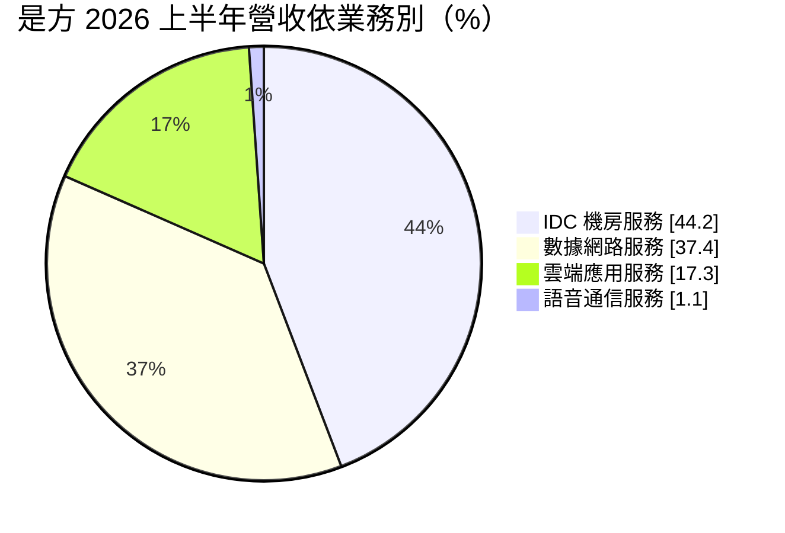
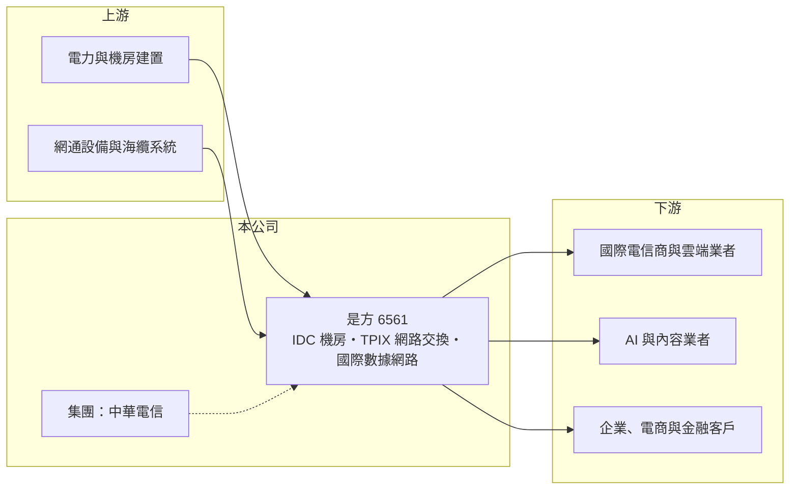

# 6561 是方

> 上櫃｜[[產業索引-通信網路業|通信網路業]]｜上市（櫃）日期 2018/06/05

# 第一章：企業模式與商業藍圖

> [!info] 撰寫說明
> 本文由 Claude 依公開資料整理，架構比照 [[2330台積電]] 的四章研究，資料截至 2026-10-08。財務數字來源：Goodinfo 年度經營績效頁、櫃買中心開放資料（基本資料、2026 年第二季資產負債與損益、每月營收、本益比殖利率）、富果研究整理的 2026 年 8 月法說會摘要；與中華電信的股權關係憑記憶整理，已標「待校對」。#待校對

評估一家資料中心公司，要看它是否掌握稀缺的網路匯聚位置，以及機房出租能否轉成長期、穩定的經常性收入。本章說明是方電訊（股票代號：6561，以下簡稱是方）如何以中立機房與國際網路交換中心，成為台灣最重要的網路匯流樞紐之一。

## 一、核心定位：台灣的網路匯流樞紐

是方成立於 1991 年，2018 年在櫃買中心掛牌，實收資本額約 7.8 億元，屬於 [[2412中華電]] 集團（持股關係待校對）。公司經營[[IDC]] 機房，並營運台北網際網路交換中心（TPIX）、雲端交換平台（CCX）與海纜交換中心（TPCX），讓國內外電信商、雲端業者與內容業者在同一處互相連接。

網路交換中心的價值在於[[網路效應]]：越多業者在這裡互連，新業者就越需要進駐，形成自我強化的循環。國際客戶貢獻超過一半營收，全球市值前十大企業中超過半數是是方的客戶，國際影音平台也把快取伺服器放在是方機房，以就近服務台灣用戶。

## 二、營收結構

* **IDC 機房服務：** 機櫃出租、電力與維運，是最大且成長最快的業務，合約期通常長達數年，屬於經常性收入。
* **數據網路服務：** 國際專線、VPN 與 [[SD-WAN]]，服務跨國企業的網路連線。
* **雲端應用服務：** IaaS、PaaS、SaaS 與雲端交換平台，協助企業連接多家雲端業者。
* **語音通信：** 毛利低，將隨合約到期逐步退出。

## 三、機房布局與長期方向

是方目前有麗源（LY）、宏鼎（HD）與聯雲（LY2）三棟機房，總樓地板面積約 15,000 坪。LY2 於 2024 年 6 月啟用，專為 AI 伺服器設計，支援水冷與每機櫃最高 150kW，銷售率已近九成，預計 2027 年滿載。下一座中科雲林虎尾機房預計 2026 年第四季動工、2028 年營運，並於 2026 年第四季引進多重[[海纜]]系統強化國際備援。公司將 2026 至 2030 年定位為高成長期，願景是成為東亞數位匯流與 AI 算力應用中心。

# 第二章：護城河深度與競爭優勢

在長期價值投資中，「護城河」指企業抵禦競爭、維持超額利潤的保護機制。本章分析是方的護城河與競爭格局。

## 一、是方護城河的組成

* **網路交換中心的網路效應：** TPIX 與海纜交換中心匯集大量電信與雲端業者，新進者很難複製這種多方互連的生態。這是是方營業利益率高達 35% 至 40% 的主要原因。
* **客戶轉換成本：** 客戶把伺服器與網路設備放進機房後，搬遷需要停機、重新布線與測試，風險與成本都很高，因此續約率高。
* **稀缺的電力與土地：** 都會區適合蓋高功率機房的土地與電力有限，AI 機房的高電力需求更提高了新進者門檻。

## 二、主要競爭對手

| 對手 | 定位 | 對是方的威脅 |
|---|---|---|
| [[2412中華電]] | 電信龍頭，自有大型機房 | 集團內也提供機房服務（關係待校對） |
| [[3045台灣大]]、[[4904遠傳]] | 電信業者自有 IDC | 在企業機房市場競爭 |
| 國際資料中心業者 | 大型中立機房 | 進入台灣市場、規模與資金雄厚 |
| 雲端業者自建機房 | 超大規模資料中心 | 降低對中立機房的需求 |

## 三、守得住／守不住／觀察重點

守得住的是網路交換與多方互連帶來的中立機房地位。守不住的是一般機櫃出租的價格，國際業者與電信商都在擴充台灣機房容量。長期觀察重點是 LY2 的滿載速度、虎尾新機房的建置進度與電力取得，以及 AI 客戶能否帶來更高單價的機櫃需求。

# 第三章：財務體質與盈利規模

資料日期：2026-10-08，表格是撰寫當時的快照；最新月營收、毛利率、累計 EPS 由自動排程寫在本筆記的屬性欄位（月營收、毛利率、累計EPS 等）。#待校對

財務報表是檢驗護城河是否真實存在的最終標準。本章用六年的三率、ROE 與資本報酬，檢視是方的獲利品質。

## 一、多年度經營績效

| 年度 | 營收（新台幣） | [[毛利率]] | [[營業利益率]] | EPS（元） | [[ROE]] |
|---|---|---|---|---|---|
| 2020 | 25.6 億 | 43.7% | 30.3% | 8.67 | 20.8% |
| 2021 | 28.0 億 | 44.8% | 31.1% | 9.75 | 22.6% |
| 2022 | 30.8 億 | 47.7% | 33.7% | 11.85 | 26.1% |
| 2023 | 32.4 億 | 48.9% | 35.5% | 11.84 | 26.5% |
| 2024 | 37.9 億 | 47.4% | 35.3% | 13.82 | 28.7% |
| 2025 | 39.4 億 | 52.6% | 40.2% | 15.75 | 32.6% |
| 2026 上半年 | 20.3 億 | 48.5% | 37.2% | 7.57 | 未查得 |

是方是這組公司中財務最穩定的一家：六年營收逐年成長、營業利益率從 30% 提升到 40%，ROE 從約 21% 升到約 33%。高毛利來自機房與網路交換的規模經濟，新機房填滿後，增加的營收大部分轉為利潤。2021 至 2025 年平均 ROE 約 27.3%（推算），營收年複合成長率約 8.9%（推算）。公司按季配息，近四季現金股利合計約 14.3 元，配息率約九成（推算）。

## 二、[[ROIC]] 與 [[WACC]]：價值創造利差

**ROIC 推算：** 2025 年營業利益約 15.8 億元（39.4 億 × 40.2%），稅後約 12.7 億元。2026 年第二季權益總計約 32.7 億元，負債約 37.6 億元，其中非流動負債 23 億元（含機房租賃與借款），假設有息負債（含租賃負債）約六成、約 22.6 億元（推估），投入資本約 55.3 億元，ROIC 約 22.9%（推算）。

**WACC 推算：** 台灣 10 年期公債 1.75%、市場風險溢酬 6%、β 取電信與機房業者常見值 0.7，股東權益成本約 6.0%；負債成本 2.5%、稅後 2.0%；權益占投入資本約 59%，WACC 約 4.3%（推算）。

**結論：** ROIC 高出 WACC 約 18 個百分點，代表是方長期大幅創造價值。資料中心屬於資本密集產業，是方能維持高 ROIC，關鍵在於網路交換中心帶來的高單價與高續約率。新機房投入期的折舊會暫時壓低報酬，需要觀察擴張期的利差變化。

# 第四章：總體風險與地緣政治

任何企業都無法脫離宏觀環境獨立存在。本章分析是方長期必須面對的風險。

## 一、電力與擴建風險

AI 機房的用電密度遠高於傳統機房，台灣的電力供應、電價調整與綠電取得都會影響新機房的進度與成本。虎尾機房若因電力或施工延誤，會影響 2028 年後的成長。

## 二、競爭與價格

國際資料中心業者與電信商持續在台灣擴充機房，雲端業者也自建超大規模資料中心，一般機櫃出租的價格可能受壓。是方需要依靠網路交換與互連服務維持差異化。

## 三、地緣政治與海纜

是方的價值建立在台灣作為國際網路樞紐的地位。兩岸緊張、海纜遭破壞或國際業者調整亞太布局，都可能影響國際客戶的進駐意願。公司以多重海纜與日本北海道資料中心合作作為備援。

# 專有名詞解析

## 應用

- **[[SD-WAN]]**：軟體定義廣域網路，以軟體集中管理企業各據點的網路連線，可混用專線與一般網路降低成本。

## 金融

- **[[ROIC]]**：投入資本報酬率，稅後營業利益除以股東權益與有息負債的合計，衡量本業對所有資金提供者的報酬。
- **[[WACC]]**：加權平均資金成本，依股東權益與負債的比重加權計算的資金成本，ROIC 高於它才代表創造價值。

## 產業

- **[[IDC]]**：網際網路資料中心，提供機櫃、電力、空調與網路連線，讓企業把伺服器放在專業機房託管。
- **[[網路效應]]**：使用者越多、產品或平台對每位使用者的價值就越高的現象，能形成自我強化的競爭優勢。
- **[[海纜]]**：鋪設在海底的光纖電纜，承載絕大部分的國際網路流量，是國際網路連線的骨幹。

# 核心供應鏈

## 1. 上游：電力、機房與網路設備
- 機房電力與空調建置、網通設備與海纜系統供應商
- 機房電力與散熱設備：[[2308台達電]]（供應關係待校對）

## 2. 中游：是方與同業
- 集團：[[2412中華電]]（持股關係待校對）
- 同業：[[3045台灣大]]、[[4904遠傳]]、國際資料中心業者

## 3. 下游：客戶
- 國際電信商與雲端業者、國際影音與內容業者、AI 客戶、企業、電商與金融客戶

## 最新新聞
<!-- news:start（自動產生，請勿手動編輯此範圍） -->
- 2026-10-06 📰 媒體 17:37｜是方9月營收3.58億元年增1成 中科虎尾AIDC本月動土｜[鉅亨網](https://news.cnyes.com/news/id/6622779)

完整紀錄：[[6561是方 新聞]]
<!-- news:end -->

## 相關連結
- [公開資訊觀測站](https://mopsov.twse.com.tw/mops/web/t05st03?step=1&firstin=1&co_id=6561)
- [Goodinfo](https://goodinfo.tw/tw/StockDetail.asp?STOCK_ID=6561)
- [Yahoo 股市](https://tw.stock.yahoo.com/quote/6561)
- [鉅亨網新聞](https://www.cnyes.com/twstock/6561/news)
