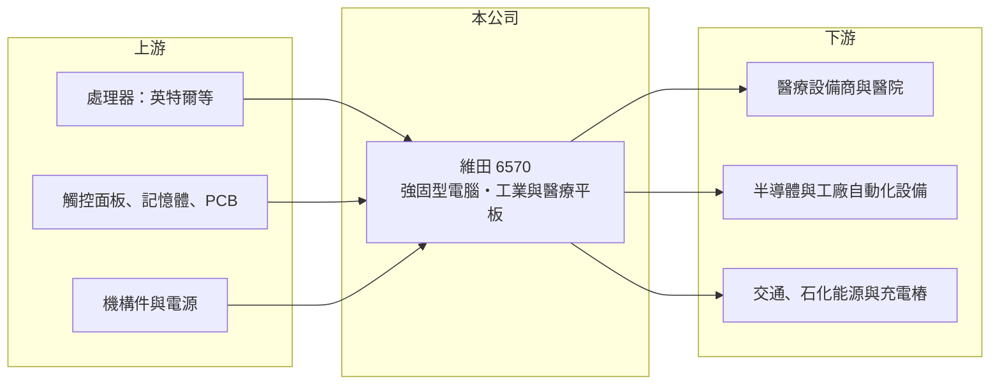

# 6570 維田

> 上櫃｜[[產業索引-電腦及週邊設備業|電腦及週邊設備業]]｜上市（櫃）日期 2017/12/11

# 第一章：企業模式與商業藍圖

> [!info] 撰寫說明
> 精簡版，由 Claude 依公開資料整理，架構比照 [[2330台積電]]，資料截至 2026-10-08。來源：櫃買中心開放資料快照（基本資料、2026 年第二季資產負債與損益、本益比殖利率）、Goodinfo 經營績效頁、優分析 2026 年 1 月報導、自由時報與經濟日報新聞標題。產品線與市場分布部分依記憶整理，已標註待校對。公開資料有限。#待校對

維田（英文名 Wincomm）是一家小型[[工業電腦]]廠，理解它的關鍵在於：它專做無風扇、可在嚴苛環境運作的強固型電腦與觸控平板，客戶多是醫療、交通與工廠設備業者，訂單量小但客製化程度高，因此毛利率能維持在三成五上下。

- **核心業務：** 維田成立於 2004 年，2017 年在櫃買中心掛牌。產品以無風扇[[強固型電腦]]、工業級與醫療級觸控平板電腦、嵌入式系統為主（#待校對）。2026 年公司在智慧製造、智慧交通、智慧醫療三大領域都有新品，著重市場包括半導體設備、[[邊緣 AI]]、石化能源、醫療與交通，並有醫療新品、充電樁人機介面（HMI）與邊緣 AI 新專案逐步發酵。
- **營收結構：** 產品別與地區別比重在本次查得資料中未揭露。依記憶，歐美市場占比較高，醫療與工廠自動化是主要應用（#待校對）。2025 年營收 9.16 億元、年增 3%，2025 年第四季單季 2.5 億元，季增兩成。
- **營運據點：** 總部與生產推估在台灣（#待校對）。工業電腦的生產屬於多樣少量，需要彈性的組裝與測試產線，而不是大規模代工廠。
- **長期方向：** 公司的長期方向是讓工業電腦往邊緣 AI 升級，並擴大在半導體設備、醫療與能源等高門檻市場的布局。2026 年 6 月董事會決議發行第二次無擔保[[可轉換公司債]]，並於 8 月收足款項，顯示公司正在籌措擴張所需資金（用途未查得）。

# 第二章：護城河深度與競爭優勢

維田的護城河來自工業客戶的客製化與長期供貨關係，屬於利基型的中等護城河，但規模小、品牌知名度不及大廠。

- **競爭優勢：** 工業電腦客戶在設備中導入某一款強固電腦後，需要長期維持相同規格，更換供應商要重新做相容性與環境測試，[[轉換成本]]高。公司表示產品客製化程度與客戶依賴度高，所以即使 2026 年記憶體缺料，對毛利率的影響也不大，這說明它對客戶有一定的議價能力。醫療級產品需通過醫療電氣安全認證（#待校對），進一步提高門檻。
- **主要對手：** 台灣工業電腦同業眾多，包括 [[2395研華]]、[[6166凌華]]、3416融程電、[[3479安勤]]、3088艾訊、8234新漢、[[6579研揚]]、3022威強電、[[3594磐儀]]。其中融程電同樣以強固型平板與車載電腦為主，是產品最接近的對手。
- **觀察重點：** 毛利率長期維持在 34% 至 38%，但營業利益率從 2022 年的 16.5% 降到 2025 年的 6.4%，代表營收不成長時費用壓縮獲利。2026 年上半年營業利益率回升到 14.5%，長期要追蹤的是新領域專案能否讓營收突破 2022 年 11.4 億元的高點。

# 第三章：財務體質與盈利規模

資料日期：2026-10-08，表格是撰寫當時的快照；最新月營收、毛利率、累計 EPS 由自動排程寫在本筆記的屬性欄位（月營收、毛利率、累計EPS 等）。#待校對

維田的財務是典型的小型工業電腦廠：毛利率高且穩定，但營收規模小，獲利對營收變化非常敏感。

| 年度 | 營收（億元） | [[毛利率]] | [[營業利益率]] | EPS（元） | [[ROE]] |
|---|---|---|---|---|---|
| 2020 | 6.08 | 33.8% | 6.9% | 1.14 | 7.07% |
| 2021 | 8.74 | 34.2% | 13.9% | 3.58 | 20.7% |
| 2022 | 11.4 | 37.4% | 16.5% | 5.35 | 24.0% |
| 2023 | 9.44 | 37.9% | 12.1% | 2.92 | 12.5% |
| 2024 | 8.89 | 37.1% | 9.32% | 1.59 | 7.01% |
| 2025 | 9.16 | 34.3% | 6.4% | 1.29 | 5.84% |

（來源：Goodinfo 經營績效頁。2026 年上半年依櫃買中心資料：營收 5.50 億元、毛利率 38.0%、營業利益率 14.5%、EPS 1.73 元。）

- **營收規模：** 2020 至 2025 年營收由 6.08 億元增至 9.16 億元，年複合成長率約 8.5%（推算），但成長集中在 2021 至 2022 年，之後三年持平。2026 年上半年營收 5.5 億元，已超過 2025 年全年的六成，若延續將創新高。
- **獲利：** 近五年（2021 至 2025）平均 ROE 約 14.0%（推算），但趨勢由 2022 年的 24% 一路降到 2025 年的 5.8%。這是[[營業槓桿]]的反向作用：營收少一成，營業利益就可能少三到四成。
- **財務特色：** 依 2026 年第二季資料，總資產約 14.5 億元、股東權益約 8.4 億元、負債約 6.1 億元，其中非流動負債約 3.3 億元，推估主要是新發行的可轉換公司債。非流動資產約 8.3 億元，占總資產近六成，對工業電腦廠而言偏高，推估包含廠房或轉投資（細項未查得）。櫃買中心資料顯示近一年現金股利 1.1 元，以 2025 年 EPS 1.29 元計[[配息率]]約 85%（推算）；Goodinfo 統計長期平均現金股利約 1.89 元。自由現金流是否長期為正未查得。
- **[[ROIC]] 與 [[WACC]]：** 以 2025 年營業利益約 0.59 億元（9.16 億元 × 6.4%）、稅率 20% 計算，稅後營業利益約 0.47 億元。投入資本以股東權益 8.4 億元到「權益加全部負債」14.5 億元為區間，ROIC 約 3.2% 至 5.6%（推算）；2022 年營業利益約 1.88 億元，以目前資本規模計算約 10% 至 18%（推算，當年實際資本較小，數字應更高）。WACC 以 [[CAPM]] 推估：無風險利率 1.75%、市場風險溢酬 6%、β 假設 1.0（工業電腦股常見值），權益成本約 7.75%；可轉債票面利率低，稅後負債成本假設 1.5%、負債占兩成，WACC 約 6.5%（推算）。2021 至 2023 年 ROIC 高於 WACC，2024 至 2025 年則低於 WACC；2026 年上半年獲利回升，年化後有機會重回 WACC 之上（推算）。

# 第四章：總體風險與地緣政治

維田的風險來自規模小、景氣循環與擴張資金的運用。

- **產業週期：** 工業電腦需求跟著製造業、醫療與交通的資本支出起伏，2023 至 2025 年營收停滯就是客戶去化庫存與投資放緩的結果。降息與 AI 邊緣運算可能帶動新一輪投資，但時點難以預測。
- **營運風險：** 營收不到 10 億元，單一大專案的有無就會左右全年獲利。新品從試樣認證到量產往往需要一年以上，部分專案在 2026 年初仍在客戶試樣階段，尚未貢獻營收。記憶體等關鍵零件缺料可能影響交期。
- **其他風險：** 發行可轉換公司債若轉換為股票，會稀釋既有股東的每股盈餘。外銷比重高（#待校對），美國關稅政策與新台幣匯率會影響報價與毛利。

# 專有名詞解析

## 應用

- **[[邊緣 AI]]**：在終端或靠近資料產生處（工廠、醫院、企業機房）執行 AI 運算，而非全部送到雲端資料中心。

## 金融

- **[[可轉換公司債]]**：持有人可在約定期間依轉換價格換成公司股票的公司債，利率較低，但轉換後會稀釋股權。
- **[[營業槓桿]]**：固定成本占比高的公司，營收增加時利潤增幅大於營收增幅，反之亦然。

## 產業

- **[[工業電腦]]**：用於工廠自動化、交通、醫療等場域的電腦，強調長期供貨、耐用與穩定。
- **[[強固型電腦]]**：可耐受高低溫、震動、粉塵與潮濕的電腦，常採無風扇設計，用於工廠、車輛與戶外場域。

# 核心供應鏈

- 上游：處理器供應商 [[INTC英特爾]] 等；觸控面板、記憶體、PCB、機構件與電源供應商（具體名單未查得）。
- 下游／客戶：醫療設備商與醫院、半導體設備與工廠自動化業者、交通與石化能源業者、充電樁製造商（客戶名稱未公開，#待校對）。
- 同業：3416融程電、[[2395研華]]、[[6166凌華]]、[[3479安勤]]、3088艾訊、8234新漢、[[6579研揚]]、3022威強電、[[3594磐儀]]。

## 最新新聞
<!-- news:start -->
<!-- news:end -->

## 相關連結
- [公開資訊觀測站](https://mopsov.twse.com.tw/mops/web/t05st03?step=1&firstin=1&co_id=6570)
- [Goodinfo](https://goodinfo.tw/tw/StockDetail.asp?STOCK_ID=6570)
- [Yahoo 股市](https://tw.stock.yahoo.com/quote/6570)
- [鉅亨網新聞](https://www.cnyes.com/twstock/6570/news)
