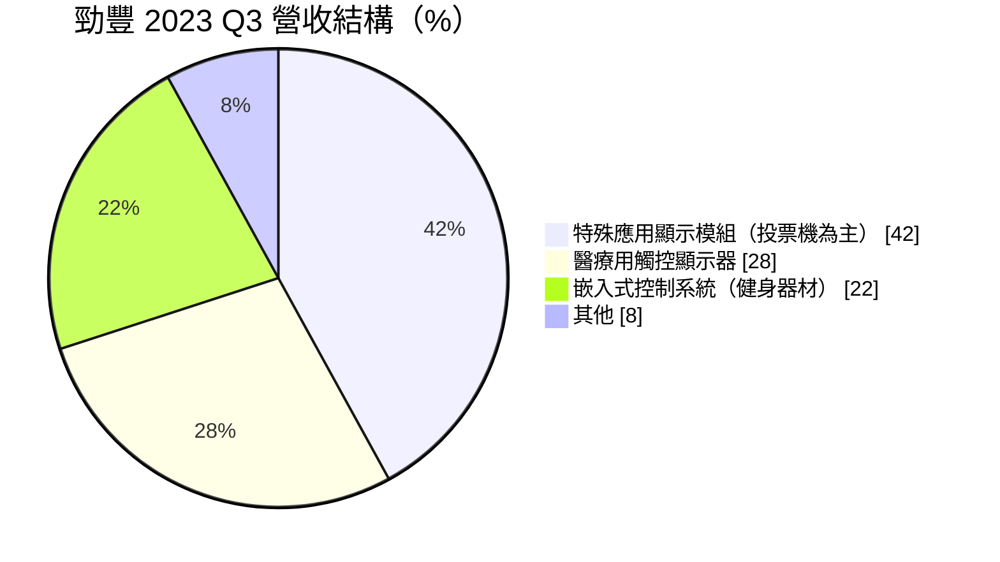
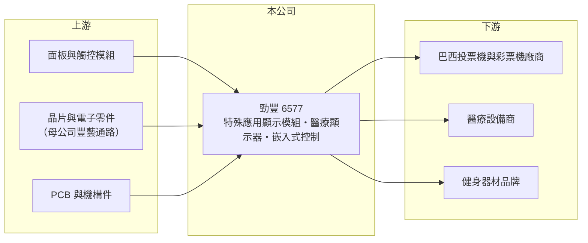

# 6577 勁豐

> 上櫃｜[[產業索引-電腦及週邊設備業|電腦及週邊設備業]]｜上市（櫃）日期 2017/03/21

# 第一章：企業模式與商業藍圖

> [!info] 撰寫說明
> 精簡版，由 Claude 依公開資料整理，架構比照 [[2330台積電]]，資料截至 2026-10-08。來源：櫃買中心開放資料快照（基本資料、2026 年第二季資產負債與損益、本益比殖利率）、Goodinfo 經營績效頁、財訊（Money Weekly）2024 年報導。營收比重為 2023 年第三季數字，近年比重未查得。公開資料有限。#待校對

勁豐是 IC 通路商 [[6189豐藝]] 旗下的顯示與控制系統設計製造公司，理解它的關鍵在於：它不做大眾消費電子，而是替投票機、醫療設備、健身器材等特殊用途產品設計顯示模組與控制板，市場小但規格特殊，因此能維持三成以上的毛利率。

- **核心業務：** 勁豐成立於 2000 年，2017 年在櫃買中心掛牌，母公司豐藝持股約 66%。產品分為三大類：特殊應用顯示模組（以選舉投票機為主，也包括彩票機）、醫療用觸控顯示器，以及[[嵌入式控制系統]]（主要用於健身器材）。這些產品都需要依客戶設備客製化，屬於 [[ODM]] 型態的專業代工。
- **營收結構：** 依財訊報導的 2023 年第三季數字，特殊應用顯示模組占 42%、醫療用觸控顯示器占 28%、嵌入式控制系統占 22%，其餘約 8%。巴西投票機與彩票機市場的龍頭廠商是重要客戶，2023 年營收成長主要來自巴西投票機訂單；投票機需求跟著選舉週期起伏，是勁豐營收波動的主要原因。
- **營運據點：** 生產據點在本次查得資料中未揭露（#待校對）。母公司豐藝是電子零件通路商，能協助勁豐取得面板、晶片等關鍵零件，這是集團內的供應鏈綜效。
- **長期方向：** 勁豐的長期方向是在投票機之外，擴大醫療與健身器材等需求較穩定的應用，降低對選舉週期的依賴。2024 年的展望即以健身器材新機種與醫療器材穩定出貨為主要動能，同時持續承接巴西投票機與彩票機訂單。

# 第二章：護城河深度與競爭優勢

勁豐的護城河來自特殊應用市場的客製化能力與長期客戶關係，屬於利基型護城河，從近年 30% 以上的毛利率與兩成以上的 ROE 可以看出它在這些小市場具有定價能力。

- **競爭優勢：** 投票機、醫療顯示器與健身器材控制板的出貨量不大，大型面板與代工廠通常不願投入，勁豐因此能在這些利基市場取得較好的價格。醫療設備需要通過醫療法規與長期可靠度驗證，一旦導入就會在產品生命週期內持續供貨，[[轉換成本]]高。透過母公司豐藝的通路網路取得零件，也讓它在缺料時期較有保障（推估）。
- **主要對手：** 工業與醫療顯示器同業包括 [[3594磐儀]]、[[2395研華]] 的顯示產品線、[[6579研揚]]，以及專業工控顯示器廠（#待校對）；嵌入式控制系統則與各類工業電腦與電子代工廠競爭。投票機等特殊專案的競爭者多為國際系統整合商的其他供應商，公開資料未點名。
- **觀察重點：** 毛利率由 2021 年 24.4% 升到 2025 年 33.1%，2026 年上半年 34.2%，顯示產品組合持續改善。長期要追蹤的是醫療與健身比重能否持續提高，讓營收在沒有大型選舉訂單的年份也能維持。

# 第三章：財務體質與盈利規模

資料日期：2026-10-08，表格是撰寫當時的快照；最新月營收、毛利率、累計 EPS 由自動排程寫在本筆記的屬性欄位（月營收、毛利率、累計EPS 等）。#待校對

勁豐的財務是高 ROE、高配息的小型利基公司，營收規模約 20 億元，近年獲利率明顯提升。

| 年度 | 營收（億元） | [[毛利率]] | [[營業利益率]] | EPS（元） | [[ROE]] |
|---|---|---|---|---|---|
| 2020 | 17.7 | 27.8% | 15.0% | 5.31 | 18.7% |
| 2021 | 17.5 | 24.4% | 11.5% | 4.24 | 15.0% |
| 2022 | 18.9 | 24.5% | 10.3% | 5.08 | 17.9% |
| 2023 | 25.3 | 25.3% | 11.9% | 7.11 | 23.7% |
| 2024 | 22.5 | 31.3% | 18.4% | 6.63 | 29.0% |
| 2025 | 20.8 | 33.1% | 19.6% | 5.64 | 22.2% |

（來源：Goodinfo 經營績效頁。2026 年上半年依櫃買中心資料：營收 10.5 億元、毛利率 34.2%、營業利益率 18.6%、EPS 3.52 元。）

- **營收規模：** 2020 至 2025 年營收由 17.7 億元增至 20.8 億元，年複合成長率約 3.3%（推算）。2023 年因巴西投票機大單衝到 25.3 億元，之後兩年回落，顯示選舉訂單帶來的營收波動。
- **獲利：** 近五年（2021 至 2025）平均 ROE 約 21.6%（推算），在電腦週邊族群中屬於前段。營收在 2024 至 2025 年下滑，但營業利益率反而由 11.9% 升到 19.6%，代表產品組合往高毛利的醫療與特殊應用移動。
- **財務特色：** 依 2026 年第二季資料，總資產約 26.1 億元、股東權益約 14.1 億元、負債約 11.9 億元且幾乎都是流動負債（非流動負債僅 0.6 億元），流動資產 21.4 億元，財務結構穩健。櫃買中心資料顯示近一年現金股利 5.0 元，以 2025 年 EPS 5.64 元計[[配息率]]約 89%（推算）；Goodinfo 統計長期平均現金股利約 4.23 元，配息穩定。自由現金流是否長期為正未查得，但長期高配息推估現金流良好。
- **[[ROIC]] 與 [[WACC]]：** 以 2025 年營業利益約 4.08 億元（20.8 億元 × 19.6%）、稅率 20% 計算，稅後營業利益約 3.26 億元。有息負債未查得，投入資本以股東權益 14.1 億元到「權益加全部負債」26.1 億元為區間，ROIC 約 12.5% 至 23%（推算）。WACC 以 [[CAPM]] 推估：無風險利率 1.75%、市場風險溢酬 6%、β 假設 0.9（同業常見值），權益成本約 7.15%；負債多為營業性負債，WACC 約 6.5% 至 7%（推算）。ROIC 明顯高於 WACC，勁豐長期持續創造經濟價值。

# 第四章：總體風險與地緣政治

勁豐的風險來自選舉訂單的週期性、客戶集中，以及母公司控股結構。

- **產業週期：** 投票機訂單跟著巴西等國的選舉時程出現，選舉年營收大增、非選舉年回落，屬於可預期但難以平滑的週期。健身器材需求在疫情期間暴增後回落，也有明顯的消費週期。
- **營運風險：** 營收集中在少數特殊應用客戶，例如巴西投票機與彩票機龍頭，單一客戶招標結果或換供應商會明顯影響營收。產品屬於客製化小量生產，面板與晶片等零件停產時需要重新設計，增加成本。
- **其他風險：** 母公司豐藝持股約 66%，經營決策與資本配置受母公司影響，少數股東的影響力有限。海外客戶比重高，匯率與各國政府採購政策（例如投票機規範改變）會影響訂單。2026 年 10 月召開股東臨時會，決議內容未查得，需後續確認是否涉及重大結構變動。

# 專有名詞解析

## 金融

- **[[轉換成本]]**：客戶更換供應商需付出的時間、驗證與風險成本，越高代表既有供應商的地位越穩固。
- **[[配息率]]**：現金股利占當年度每股盈餘的比例，反映公司把獲利分給股東的程度。

## 產業

- **[[ODM]]**：原廠委託設計製造，代工廠負責產品設計與生產，品牌商負責銷售。
- **[[嵌入式控制系統]]**：內建在設備中、專門控制特定功能的電腦系統，例如健身器材的控制面板與主板。
- **[[電子通路]]**：代理半導體與電子零件、提供庫存與技術支援的中間商，連接原廠與製造客戶。

# 核心供應鏈

- 上游：面板與觸控模組供應商（例如 [[2409友達]]、[[3481群創]]，#待校對）；晶片與電子零件，部分經由母公司 [[6189豐藝]] 的[[電子通路]]取得；PCB 與機構件。
- 下游／客戶：巴西投票機與彩票機龍頭廠商、醫療設備商與健身器材品牌（客戶名稱未公開）。
- 同業：[[3594磐儀]]、[[2395研華]]、[[6579研揚]]、[[6570維田]]。

## 最新新聞
<!-- news:start -->
<!-- news:end -->

## 相關連結
- [公開資訊觀測站](https://mopsov.twse.com.tw/mops/web/t05st03?step=1&firstin=1&co_id=6577)
- [Goodinfo](https://goodinfo.tw/tw/StockDetail.asp?STOCK_ID=6577)
- [Yahoo 股市](https://tw.stock.yahoo.com/quote/6577)
- [鉅亨網新聞](https://www.cnyes.com/twstock/6577/news)
