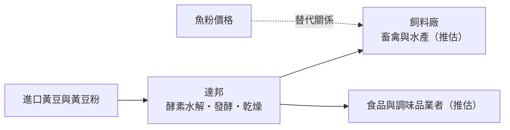
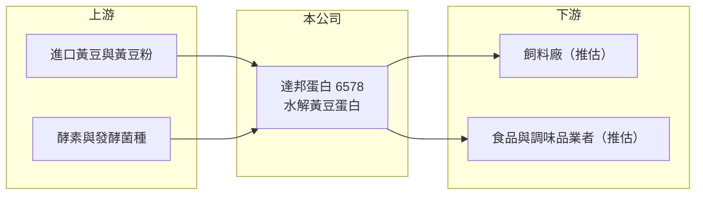

# 6578 達邦蛋白

> 上櫃｜[[產業索引-農業科技業|農業科技業]]｜上市（櫃）日期 2018/09/18

# 第一章：企業模式與商業藍圖

> [!info] 撰寫說明
> 本文由 Claude 依公開資料整理，架構比照 [[2330台積電]] 的四章研究，資料截至 2026-10-08。財務數字來源：Goodinfo 年度經營績效頁、nStock 公司簡介、櫃買中心開放資料（基本資料、2026 年第二季資產負債與綜合損益、本益比殖利率）；產品用途、客戶、產能與虧損原因未查得。公開資料有限。#待校對

達邦蛋白生技（股票代號：6578，以下簡稱達邦）是一家以黃豆為原料、生產水解蛋白產品的小型公司。本章說明這類蛋白質原料業者的商業模式，以及它過去幾年為何在虧損與損益兩平之間徘徊。

## 一、核心定位：水解黃豆蛋白的製造商

達邦成立於 2001 年，2018 年 9 月在櫃買中心掛牌，2023 年 10 月更名為達邦蛋白生技股份有限公司，實收資本額約 7.19 億元，產業類別為農業科技。依 nStock 整理的公司資料，主要業務為製造、批發及銷售[[水解黃豆]]。

水解是利用酵素或發酵，把黃豆中的大分子蛋白質切成較小的胜肽與胺基酸，使其更容易被消化吸收、也較少引起過敏或抗營養反應。這類產品可用在兩個市場：一是畜禽與水產[[飼料]]，作為魚粉等動物性蛋白的替代原料；二是食品與調味料，作為蛋白質原料或風味來源（推估，達邦實際的用途比重未查得，待校對）。

## 二、產品線與產能

公開資料未查得達邦的產品線比重、產能與工廠據點。從公司更名為「蛋白生技」來看，公司的定位是以黃豆為基礎的蛋白質原料與生技應用，而非一般的大豆加工（推估）。2026 年 1 至 9 月累計營收約 2.96 億元、年增約 30%（nStock），營收規模仍小。

## 三、資本轉化邏輯

* **原料成本決定毛利：** 黃豆與黃豆粉價格隨國際穀物行情波動，產品售價若無法即時調整，[[毛利率]]就會被壓縮。2021 至 2022 年毛利率只有 4% 至 5%，與當時穀物價格高漲同期。
* **與魚粉的替代關係：** 若主要用於飼料，水解植物蛋白的價值很大程度取決於魚粉價格；魚粉昂貴時替代需求增加，魚粉便宜時需求減弱（推估）。
* **固定成本高：** 水解與乾燥設備屬於固定成本，產量不足時單位成本高，這是營收縮小時虧損擴大的主因（推估）。

## 四、長期方向

全球飼料業與食品業都在尋找替代動物性蛋白的原料，以降低成本並因應永續要求，[[替代蛋白]]是長期趨勢。達邦的挑戰在於規模：2025 年營收約 3.09 億元，只有 2019 年高點 6.47 億元的一半左右。2026 上半年轉為獲利、營收明顯回升，能否持續擴大規模並維持獲利，是長期價值的關鍵。

# 第二章：護城河深度與競爭優勢

蛋白質原料是競爭激烈的大宗型市場，小型業者的護城河有限。本章分析達邦的競爭位置。

## 一、護城河的組成

* **製程技術：** 酵素選擇、水解條件與乾燥製程影響產品的消化率、風味與穩定度，累積的製程經驗是差異化來源。
* **客戶驗證：** 飼料廠與食品廠更換原料需要試驗配方與驗證品質，一旦通過，客戶傾向持續採用。
* **規模限制：** 達邦的營收規模小，原料採購與設備利用率都難以和大型業者相比，護城河相對淺。

## 二、主要競爭對手

| 對手 | 定位 | 與達邦的比較 |
|---|---|---|
| 1232大統益 | 黃豆壓榨與黃豆粉 | 規模大，掌握黃豆粉供應，可延伸加值產品 |
| [[1210大成]]、[[1215卜蜂]] | 飼料與畜產一條龍 | 自有配方與原料採購，也是潛在客戶 |
| 國際大豆蛋白與發酵豆粕業者 | 大型蛋白原料廠 | 規模與成本優勢明顯 |
| 魚粉與其他動物性蛋白供應商 | 替代品 | 價格變化直接影響需求 |

## 三、守得住與守不住

* **守得住：** 已通過驗證的客戶配方，以及特定規格產品的利基市場。
* **守不住：** 大宗型產品的價格。原料與替代品價格由國際市場決定，達邦議價能力有限。
* **觀察重點：** 營收能否持續回升到 4 億元以上、毛利率能否維持在 20% 以上，以及更名後的產品定位是否帶來新客戶。

# 第三章：財務體質與盈利規模

資料日期：2026-10-08，表格是撰寫當時的快照；最新月營收、毛利率、累計 EPS 由自動排程寫在本筆記的屬性欄位（月營收、毛利率、累計EPS 等）。#待校對

達邦的財報顯示一家小型原料廠在營收萎縮時的困境，以及 2026 年的初步回升。

## 一、多年度財務表

| 年度 | 營收（新台幣） | [[毛利率]] | [[營業利益率]] | EPS（元） | [[ROE]] |
|---|---|---|---|---|---|
| 2019 | 6.47 億 | 20.1% | 6.05% | 0.72 | 3.01% |
| 2020 | 6.05 億 | 16.4% | 2.54% | 0.24 | 1.03% |
| 2021 | 4.71 億 | 4.6% | -13.6% | -1.92 | -9.08% |
| 2022 | 4.34 億 | 4.46% | -14.4% | -1.15 | -6.37% |
| 2023 | 3.84 億 | 12.1% | -7.79% | -1.07 | -6.77% |
| 2024 | 3.38 億 | 20.3% | -0.54% | 0.17 | 1.14% |
| 2025 | 3.09 億 | 22.3% | -9.11% | -0.96 | -6.67% |
| 2026 上半年 | 1.90 億 | 24.3% | 5.7% | 0.20 | 未查得 |

資料來源：Goodinfo；2026 上半年為櫃買中心開放資料。各年度稅後淨利除以 EPS 推得的股數，從 2021 年約 3,200 萬股增加到 2025 年約 7,200 萬股，推估期間曾辦理增資，跨年度 EPS 不宜直接比較。

* **營收長期萎縮：** 2020 至 2025 年營收年複合成長率約 -12.6%（推算）。
* **毛利率回升但仍虧損：** 毛利率從 2021 至 2022 年的 4% 多回升到 2025 年的 22.3%，但 2025 年仍有營業虧損，代表營收規模不足以支撐營業費用。2025 年稅後淨損 0.69 億元大於營業虧損 0.28 億元，推估有業外損失或資產減損（未查得說明）。
* **2026 年轉機：** 2026 上半年營業利益率轉正為 5.7%，營收也明顯成長。
* **配息：** Goodinfo 統計一般平均現金股利約 0.61 元，2024 年度曾配發 0.4 元。

## 二、ROE 與長期指標

2021 至 2025 年平均 ROE 約 -5.5%（推算），五年中有四年虧損。2026 年第二季底權益約 10.09 億元、負債僅約 1.11 億元，財務結構非常保守，增資取得的資金讓公司沒有短期償債壓力，但保留盈餘只剩約 0.26 億元。

## 三、[[ROIC]] 與 [[WACC]]

**ROIC 推算：** 2025 年營業利益為 -0.28 億元，虧損時無稅負可扣抵，直接以營業虧損計算；2026 年第二季底權益約 10.09 億元，有息負債推估接近零（總負債約 1.11 億元），投入資本約 10.1 億元，ROIC 約 -2.8%（推算）。以 2026 上半年營業利益 0.108 億元年化並扣除 20% 稅率，ROIC 約 1.7%（推算）。

**WACC 推算：** 台灣 10 年期公債殖利率假設 1.75%、市場風險溢酬 6%、β 取食品與農業類股常見值 0.7（同業估計值），股東權益成本約 5.95%。公司幾乎無負債，WACC 約 6%（推算）；考量小型股規模溢酬，實際資金成本可能更高。

**結論：** 達邦的 ROIC 長期為負或遠低於 WACC，代表過去幾年持續消耗股東價值。ROIC 為負的原因是營收規模不足、固定成本無法攤提，而非財務負擔。2026 年的回升若能持續，ROIC 才有機會向資金成本靠攏；在此之前，股價淨值比約 1.16 倍（櫃買中心資料）反映的主要是帳面資產的價值。

# 第四章：總體風險與地緣政治

達邦的風險集中在原料價格、規模不足與營收波動。本章整理長期風險。

## 一、產業週期

* **穀物價格循環：** 黃豆與黃豆粉價格高漲時，若產品售價無法調整，毛利率會被大幅壓縮，2021 至 2022 年即是例子。
* **替代品價格：** 若產品主要用於飼料，魚粉與其他蛋白原料的價格變化，會影響客戶的採購意願（推估）。
* **畜牧與水產景氣：** 養殖業景氣下滑或疫情爆發時，飼料用量減少，上游原料需求跟著下降。

## 二、營運風險

* **規模不足：** 營收規模小，固定成本攤提困難，產量稍降就可能轉為虧損。
* **客戶集中：** 小型原料廠常依賴少數大客戶，單一客戶流失影響大（集中度未查得）。
* **獲利穩定度：** 過去五年有四年虧損，2026 年的回升尚需時間驗證。

## 三、其他風險

* **匯率：** 黃豆原料多為進口，以美元計價，新台幣貶值會提高成本。
* **食品安全法規：** 若產品用於食品，需符合食品安全與標示法規，法規加嚴會提高合規成本。
* **地緣政治與貿易政策：** 黃豆產地（美國、巴西）的貿易政策與出口限制，可能影響原料價格與供應。

# 專有名詞解析

## 金融

- **[[毛利率]]**：營業毛利占營收的比例，反映產品定價能力與生產成本控制。
- **[[營業利益率]]**：扣除營業費用後的營業利益占營收的比例，衡量本業整體獲利能力。
- **[[ROE]]**：股東權益報酬率，稅後淨利除以股東權益，衡量公司運用股東資金的效率。
- **[[ROIC]]**：投入資本報酬率，稅後營業利益除以股東權益與有息負債的合計，衡量本業對所有資金提供者的報酬。
- **[[WACC]]**：加權平均資金成本，依股東權益與負債的比重加權計算的資金成本，ROIC 高於它才代表創造價值。

## 產業

- **[[水解黃豆]]**：以酵素或發酵把黃豆蛋白切成小分子胜肽與胺基酸的產品，較易消化吸收，可用於飼料與食品。
- **[[飼料]]**：供畜禽與水產養殖的食物，台灣的飼料原料玉米與黃豆粉幾乎全部仰賴進口。
- **[[替代蛋白]]**：用植物、微生物或發酵等來源取代動物性蛋白的原料，可降低成本並減少環境負擔。
- **[[黃豆粉]]**：黃豆榨油後剩下的粕，蛋白質含量高，是畜禽飼料的主要蛋白質來源。

# 核心供應鏈

## 1. 上游：原料
- 黃豆與黃豆粉：進口黃豆，或國內壓榨業者如 1232大統益 的黃豆粉（是否為達邦供應商未查得）
- 酵素與發酵菌種供應商

## 2. 中游：達邦與同業
- 國際大豆蛋白與發酵豆粕業者
- 動物性蛋白替代品：魚粉供應商

## 3. 下游：客戶
- 飼料與畜產業者：例如 [[1210大成]]、[[1215卜蜂]] 等（是否為達邦客戶未查得，僅為產業舉例）
- 食品與調味品業者（推估）

## 最新新聞
<!-- news:start -->
<!-- news:end -->

## 相關連結
- [公開資訊觀測站](https://mopsov.twse.com.tw/mops/web/t05st03?step=1&firstin=1&co_id=6578)
- [Goodinfo](https://goodinfo.tw/tw/StockDetail.asp?STOCK_ID=6578)
- [Yahoo 股市](https://tw.stock.yahoo.com/quote/6578)
- [鉅亨網新聞](https://www.cnyes.com/twstock/6578/news)
