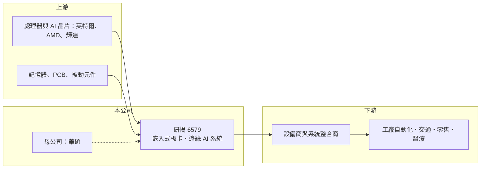

# 6579 研揚

> 上市｜[[產業索引-電腦及週邊設備業|電腦及週邊設備業]]｜上市（櫃）日期 2017/08/21

# 第一章：企業模式與商業藍圖

> [!info] 撰寫說明
> 精簡版，由 Claude 依公開資料整理，架構比照 [[2330台積電]]，資料截至 2026-10-08。來源：證交所開放資料快照（基本資料、2026 年第二季資產負債與損益、股利）、Goodinfo 經營績效頁、nStock 公司簡介。產品線、轉投資與市場描述有部分憑記憶整理，已標「待校對」。營收結構公開資料有限。#待校對

研揚科技（以下簡稱研揚）是 [[2357華碩]] 集團旗下的[[工業電腦]]廠，理解它的關鍵在於：它把消費性電腦集團的研發與採購資源，轉用在少量多樣、供貨期長的嵌入式與邊緣運算市場。

- **核心業務：** 研揚登記的營業項目涵蓋工業電腦、醫療電腦、工業控制器與自動化設計服務，產品包括嵌入式主機板、單板電腦、[[COM 模組]]、無風扇嵌入式系統、工業平板與網通設備（產品線部分待校對）。這類產品賣給設備商與系統整合商，裝進工廠機台、交通設備、零售終端與醫療儀器。工業電腦的重點不是最新規格，而是 7 到 10 年的長期供貨與穩定品質，因此客戶關係一旦建立就相當黏著。
- **營收結構：** 依 nStock 資料，華碩直接與間接持有研揚約 37.46% 股權，是最終母公司。產品別與地區別營收比重在這次查到的公開資料中未查得。研揚近年積極推出搭載 Intel、NVIDIA 等平台的[[邊緣 AI]]系統與開發板（待校對），讓產品從傳統控制電腦延伸到影像辨識、機器人與智慧零售等 AI 推論場景。
- **營運據點：** 總部位於台灣，合併報表包含多家子公司；2026 年第二季母公司業主權益約 101.8 億元、權益總計約 121.3 億元，差額約 19.5 億元為[[非控制權益]]，代表有相當比重的非全資子公司。依記憶，醫療電腦廠 [[6569醫揚]] 是研揚的子公司（待校對）。這種「母公司做通用產品、子公司深耕垂直市場」的架構，是台灣工業電腦集團常見的布局方式。
- **長期方向：** 研揚 2017 年在證交所上市，營收由 2020 年的 59.0 億元成長到 2025 年的 86.3 億元。長期成長動能在於邊緣 AI 從雲端往現場設備擴散，以及工業自動化、交通與零售數位化的持續需求。背靠華碩的供應鏈與品牌資源，是研揚與中小型同業最大的差異。

# 第二章：護城河深度與競爭優勢

研揚的護城河屬於「窄護城河」，來自長期供貨承諾、設計導入後的轉換成本，以及集團帶來的採購與研發規模。

- **競爭優勢：** 工業電腦客戶在設備中導入一塊主機板後，往往要經過數月到一年的驗證，之後多年不會輕易更換，這讓研揚的既有客戶營收具有延續性。華碩集團的零組件採購量大，在缺料時期較能確保供貨，對講究交期穩定的工業客戶很重要。研揚的[[毛利率]]長年維持在 29% 至 36% 之間，也反映它賣的不是純硬體組裝。
- **主要對手：** 全球工業電腦龍頭 [[2395研華]] 的規模與通路遠大於研揚，其他台灣同業包括 [[6166凌華]]、3088艾訊、8234新漢、[[8050廣積]]、[[2397友通]] 與 6414樺漢。各家在嵌入式板卡與系統上的產品重疊度高，差異主要在垂直市場的深耕程度與服務能力。研揚的定位是中型品牌，靠集團資源與邊緣 AI 平台的上市速度競爭。
- **觀察重點：** 長期最值得追蹤的是[[營業利益率]]能否穩定在 10% 以上。2022 年營業利益率達 14.3%，2024、2025 年卻降到 7% 多，同期毛利率仍有 33% 至 36%，代表費用擴張或產品組合拉低了本業獲利（推估）。2026 年上半年營業利益率回升到約 10.2%，若邊緣 AI 產品放量能延續，代表費用投入開始產生回報。

# 第三章：財務體質與盈利規模

資料日期：2026-10-08，表格是撰寫當時的快照；最新月營收、毛利率、累計 EPS 由自動排程寫在本筆記的屬性欄位（月營收、毛利率、累計EPS 等）。#待校對

研揚的財務呈現「高毛利、中等營益率、業外占比高」的集團型工業電腦廠樣貌：營收在 60 億至 90 億元之間循環，本業獲利對費用與產品組合敏感，轉投資收益對 EPS 影響不小。

| 年度 | 營收（億元） | [[毛利率]] | [[營業利益率]] | EPS（元） | [[ROE]] |
|---|---|---|---|---|---|
| 2020 | 59.0 | 32.7% | 10.5% | 3.58 | 5.56% |
| 2021 | 63.5 | 29.2% | 8.64% | 4.22 | 6.13% |
| 2022 | 83.5 | 33.0% | 14.3% | 10.03 | 13.3% |
| 2023 | 80.7 | 35.1% | 12.5% | 8.42 | 10.9% |
| 2024 | 71.9 | 35.9% | 7.62% | 7.72 | 9.41% |
| 2025 | 86.3 | 33.4% | 7.34% | 5.62 | 6.78% |

（來源：Goodinfo 經營績效頁；2022 年 ROE 欄位對位有疑慮，待校對。2026 年上半年依證交所資料，營收 52.3 億元、毛利率約 34.5%、營業利益率約 10.2%、EPS 6.15 元。）

- **營收規模：** 2020 至 2025 年營收年複合成長率約 7.9%（推算）。2022 年受惠缺料期間的備貨潮衝到 83.5 億元，2024 年隨客戶去化庫存降到 71.9 億元，2025 年再創新高，顯示工業電腦雖然穩定，仍有明顯的庫存循環。
- **獲利：** 2021 至 2025 年平均 ROE 約 9.3%（推算）。2026 年上半年營業利益 5.33 億元，業外收益卻有 5.12 億元，母公司淨利 7.73 億元，代表 EPS 有相當比重來自轉投資或金融收益，評估本業時應以營業利益為準（業外來源未查得）。
- **財務特色：** 2026 年第二季總資產約 164.1 億元、負債約 42.8 億元，負債比約 26%，每股淨值 60.08 元，財務結構保守。依證交所股利資料，最近一次（114 年度）現金股利 3.75 元，約為 2025 年 EPS 的 67%；Goodinfo 統計 2016 年以來平均現金股利約 4.13 元，配息相當穩定。自由現金流是否長期為正未查得。
- **[[ROIC]] 與 [[WACC]]：** 以 2025 年營業利益約 6.33 億元（86.3 億元 × 7.34%）、稅率 20% 計算，稅後營業利益約 5.07 億元；有息負債未查得，投入資本以權益總計 121.3 億元到總資產 164.1 億元為區間，ROIC 約 3.1% 至 4.2%（推算）。2022 年同法約 8% 至 10%（推算，以當前資本規模粗估）。WACC 以 [[CAPM]] 推估：無風險利率 1.75%、市場風險溢酬 6%、β 假設 0.9（工業電腦股常見值），權益成本約 7.2%；負債占比低，WACC 約 6.8%（推算）。以本業計算，近兩年 ROIC 低於 WACC，研揚的股東報酬有一部分仰賴轉投資收益；本業營益率回到 10% 以上，才算重新創造價值。

# 第四章：總體風險與地緣政治

研揚的風險集中在工業電腦的庫存循環、費用控制與集團關係，屬於穩健但成長需要靠新應用帶動的公司。

- **產業週期：** 工業電腦需求跟著製造業資本支出、交通與零售投資走，週期比消費電子長但仍明顯。2022 年缺料期間客戶重複下單，2023 至 2024 年則經歷去庫存，營收與營益率一起下滑，這種[[長鞭效應]]在中游板卡廠特別明顯。
- **營運風險：** 邊緣 AI 平台更新快，研揚需要持續投入研發與認證，若新產品放量速度不如預期，費用率會壓縮獲利。同業眾多、產品規格透明，一般型號的價格競爭長期存在。記憶體、處理器缺貨或漲價時，也會影響出貨與毛利。
- **其他風險：** 營收以外銷為主（推估），新台幣升值會壓縮獲利；美國關稅與供應鏈「去中化」要求可能迫使生產據點調整。華碩為最終母公司，關係人交易與集團策略變化，也是小股東需要留意的治理面向。

# 專有名詞解析

## 應用

- **[[邊緣 AI]]**：在終端設備或現場電腦上直接執行 AI 推論，不必把資料傳回雲端，延遲低、隱私性高。

## 金融

- **[[非控制權益]]**：合併子公司中不屬於母公司股東的權益，比例高代表有許多非全資子公司。
- **[[長鞭效應]]**：終端需求的小幅變動，沿供應鏈往上游傳遞時被逐級放大，造成上游庫存與訂單劇烈波動。

## 產業

- **[[工業電腦]]**：用於工廠自動化、交通、醫療等場域的電腦，強調耐用、長期供貨與客製化。
- **[[COM 模組]]**：把處理器、記憶體等核心功能做在一張小板上，再插到客戶自行設計的底板上使用的嵌入式模組。

# 核心供應鏈

- 上游：處理器與 AI 晶片來自 [[INTC英特爾]]、[[AMD超微]]、[[NVDA輝達]]，另需記憶體、PCB 與被動元件。
- 下游／客戶：全球設備製造商、系統整合商與通路商，應用在工廠自動化、交通、零售與醫療（具體客戶未點名，#待校對）。
- 同業：[[2395研華]]、[[6166凌華]]、3088艾訊、8234新漢、[[8050廣積]]、[[2397友通]]；集團關係：[[2357華碩]]、[[6569醫揚]]（待校對）。

## 最新新聞
<!-- news:start -->
<!-- news:end -->

## 相關連結
- [公開資訊觀測站](https://mopsov.twse.com.tw/mops/web/t05st03?step=1&firstin=1&co_id=6579)
- [Goodinfo](https://goodinfo.tw/tw/StockDetail.asp?STOCK_ID=6579)
- [Yahoo 股市](https://tw.stock.yahoo.com/quote/6579)
- [鉅亨網新聞](https://www.cnyes.com/twstock/6579/news)
