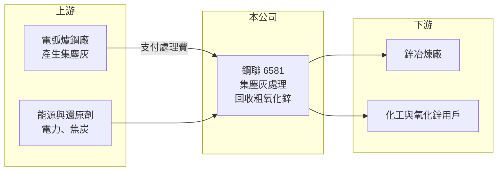

# 6581 鋼聯

> 上市｜[[產業索引-綠能環保|綠能環保]]｜上市（櫃）日期 2018/01/30

# 第一章：企業模式與商業藍圖

> [!info] 撰寫說明
> 精簡版，由 Claude 依公開資料整理，架構比照 [[2330台積電]]，資料截至 2026-10-08。來源：富邦 MoneyDJ 財務比率年表（2018 至 2025 年）；證交所開放資料快照（基本資料、2026 年上半年資產負債與損益、2025 年度股利、每月營收）；Yahoo 股市、工商時報新聞標題。製程、股東結構與客戶描述為憑記憶整理，已標「待校對」；歷年營收由每股營業額推算。#待校對

台灣鋼聯成立於 1995 年 5 月、2018 年 1 月上市，董事長林才翔、總經理謝宗霖，工廠位於彰化（待校對）。它是台灣處理煉鋼業有害廢棄物的專業廠，把電弧爐煉鋼產生的集塵灰回收成氧化鋅等產品，同時向鋼廠收取處理費，是典型「收錢處理、再賣回收物」的循環經濟模式。

- **核心業務：** 電弧爐把廢鋼熔煉成鋼材時，鍍鋅鋼板上的鋅會揮發進入集塵系統，形成含鋅量高的[[集塵灰]]，法規上屬於有害事業廢棄物，必須交給合格業者處理。鋼聯以高溫還原製程（一般稱為[[旋窯]]或威氏法，製程細節待校對）把集塵灰中的鋅濃縮成粗氧化鋅，再賣給鋅冶煉廠或化工業者。這讓它同時擁有兩種收入：鋼廠付的廢棄物處理費，以及氧化鋅的產品銷售收入。
- **營收結構：** 依每股營業額推算，2025 年營收約 22.1 億元（推算），2022 年約 26.4 億元是近年高點。氧化鋅售價跟著國際鋅價浮動，新聞也多次以「鋅價跌、獲利摔」描述鋼聯的業績，可見產品銷售占營收與獲利的比重很高。處理費則和鋼廠產量相關，波動較小，是營收的穩定底盤。
- **營運據點：** 主要處理廠位在彰化地區（待校對），鄰近中部的電弧爐鋼廠群。集塵灰體積大、運費高，處理廠離鋼廠越近越有成本優勢，因此地理位置本身就是競爭條件。
- **長期方向：** 近年新聞提到鋼聯擴大處理其他廢棄物的量能（年份未查得，細節待校對），目的是降低對鋅價的依賴，讓處理費收入占比提高。長期來看，台灣鋼鐵業朝電弧爐與低碳煉鋼發展，電弧爐用量增加會帶來更多集塵灰，是鋼聯原料（廢棄物）來源的結構性支撐。

# 第二章：護城河深度與競爭優勢

鋼聯的護城河來自有害廢棄物處理許可的稀缺性與鄰近鋼廠的地理位置，但產品價格受國際鋅價左右，無法完全掌控。

- **競爭優勢：** 有害事業廢棄物的處理需要環保主管機關核發許可，新設廠要通過環評、設置高溫設備與空污防制系統，時間長且地方阻力大，這形成很高的進入障礙。鋼聯的毛利率在 2018 至 2025 年間介於 42.8% 至 57.4%，在環保業中屬於很高的水準，代表處理費與回收產品兩邊都有定價空間。股東結構中包含國內電弧爐鋼廠（待校對），讓集塵灰來源穩定。
- **主要對手：** 台灣處理煉鋼副產物的業者包括 [[9930中聯資源]]（以高爐爐碴為主）、[[8422可寧衛]]（以固化掩埋為主）等，但直接以集塵灰回收氧化鋅的業者很少（國內同業家數待校對）。若集塵灰改送海外或以掩埋處理，也會和鋼聯形成替代競爭。
- **觀察重點：** [[營業利益率]]在 2022 年達 45.64%、2023 年降到 31.51%，與鋅價走勢高度同步。若處理費收入比重提高，營業利益率在鋅價低迷時仍能維持在 35% 以上，代表商業模式的穩定性改善。另一個重點是電弧爐鋼廠的產量，它決定集塵灰的供給量與處理費收入。

# 第三章：財務體質與盈利規模

資料日期：2026-10-08，表格是撰寫當時的快照；最新月營收、毛利率、累計 EPS 由自動排程寫在本筆記的屬性欄位（月營收、毛利率、累計EPS 等）。#待校對

鋼聯是高毛利、低負債、高配息的環保股，獲利隨鋅價起伏，但長期 ROE 維持在兩位數。

| 年度 | 營收（億元） | [[毛利率]] | [[營業利益率]] | EPS（元） | [[ROE]] |
|---|---|---|---|---|---|
| 2021 | 約 18.5（推算） | 54.66% | 39.31% | 5.08 | 15.38% |
| 2022 | 約 26.4（推算） | 57.35% | 45.64% | 8.84 | 24.24% |
| 2023 | 約 20.4（推算） | 42.80% | 31.51% | 4.54 | 11.95% |
| 2024 | 約 23.8（推算） | 53.37% | 41.48% | 7.47 | 19.38% |
| 2025 | 約 22.1（推算） | 51.03% | 38.59% | 6.17 | 15.34% |

註：營收以每股營業額乘以約 1.113 億股推算，並與 MoneyDJ 營收成長率交叉核對一致。2026 年上半年營收 12.82 億元、毛利率 58.30%、營業利益率 47.95%、EPS 4.37 元（證交所資料）。

- **長期指標：** 2021 至 2025 年營收年複合成長率約 4.5%（推算），近 5 年平均 [[ROE]] 約 17.3%（推算）。2025 年度配發現金股利 5.3 元，約為 EPS 6.17 元的 86%，配息率長期偏高。每股現金流量 2018 至 2025 年皆為正值（5.84 至 10.87 元），且高於 EPS，代表獲利有現金支撐，[[自由現金流]]長期為正（推估）。
- **[[ROIC]] 與 [[WACC]]：** 2025 年稅後營業利益約 6.8 億元（營業利益率 38.59% × 營收約 22.1 億元 × 0.8），投入資本約 48.8 億元（2026 年第二季權益總計 43.83 億元，加上以總負債 9.93 億元的一半推估的有息負債約 5.0 億元），ROIC 約 14%（推算）。WACC 約 6.1%（推算：無風險利率 1.75%、市場風險溢酬 6%、β 取環保同業常見值 0.8，股東權益成本 6.55%；稅前負債成本 2.5%、稅率 20%；權益比重約 90%）。ROIC 長期高出 WACC 約 8 個百分點，代表鋼聯在鋅價低點時仍能創造價值。
- **財務特色：** 2026 年第二季負債比率約 18%（負債 9.93 億元 ÷ 資產 53.76 億元），非流動資產 46.17 億元占總資產八成以上，反映處理廠屬重資產設備。資本公積 9.99 億元、保留盈餘 22.71 億元，財務結構保守。股價淨值比約 2.79 倍、殖利率約 4.8%（2026 年 10 月初快照）。

# 第四章：總體風險與地緣政治

鋼聯的風險集中在鋅價、鋼廠產量與環保法規三方面。

- **產業週期：** 氧化鋅售價隨倫敦金屬交易所鋅價波動，鋅價又受全球鍍鋅鋼需求、礦山供給與中國經濟影響，2023 年營收年減 22.6% 即反映鋅價下跌。鋼聯無法控制這個價格，只能靠處理費與成本控制平滑波動。
- **營運風險：** 集塵灰來源集中在國內電弧爐鋼廠，若鋼廠減產、外移或自建處理設備，處理量會直接下降。高溫處理設備需定期歲修與更新，若發生停機或工安事件，營收會中斷。
- **其他風險：** 高溫製程耗能、排放受空污法規管制，碳費與排放標準趨嚴會提高營運成本；新廠或擴產需經環評，地方反對可能延誤計畫。氧化鋅若有外銷，匯率也會影響收入（外銷比重待校對）。

# 專有名詞解析

## 金融

- **[[ROIC]]**：投入資本報酬率，稅後營業利益除以股東權益加有息負債，衡量本業運用資本的效率。
- **[[WACC]]**：加權平均資金成本，股東與債權人要求報酬率的加權平均，是 ROIC 要超越的門檻。
- **[[自由現金流]]**：營業活動現金流減去資本支出，代表企業可自由用於配息、還債或併購的現金。

## 產業

- **[[集塵灰]]**：電弧爐煉鋼時由集塵設備收集的粉塵，含鋅、鉛等重金屬，屬於有害事業廢棄物。
- **[[旋窯]]**：長條型可旋轉的高溫爐，常用於水泥燒製與廢棄物熱處理，可把金屬成分揮發濃縮回收。

# 核心供應鏈

- 上游：國內電弧爐鋼廠如 [[2006東和鋼鐵]] 等（是否為客戶或股東待校對），一貫作業鋼廠 [[2002中鋼]] 為產業背景。
- 下游／客戶：海內外鋅冶煉廠與氧化鋅加工業者（名單未查得）。
- 同業：[[9930中聯資源]]、[[8422可寧衛]]、[[6923中台]]。

## 最新新聞
<!-- news:start（自動產生，請勿手動編輯此範圍） -->
- 2026-10-06 🏛️ 重訊 17:03｜公告115年9月份合併自結損益｜[觀測站](https://mops.twse.com.tw/mops/#/web/t05st01)

完整紀錄：[[6581鋼聯 新聞]]
<!-- news:end -->

## 相關連結
- [公開資訊觀測站](https://mopsov.twse.com.tw/mops/web/t05st03?step=1&firstin=1&co_id=6581)
- [Goodinfo](https://goodinfo.tw/tw/StockDetail.asp?STOCK_ID=6581)
- [Yahoo 股市](https://tw.stock.yahoo.com/quote/6581)
- [鉅亨網新聞](https://www.cnyes.com/twstock/6581/news)
