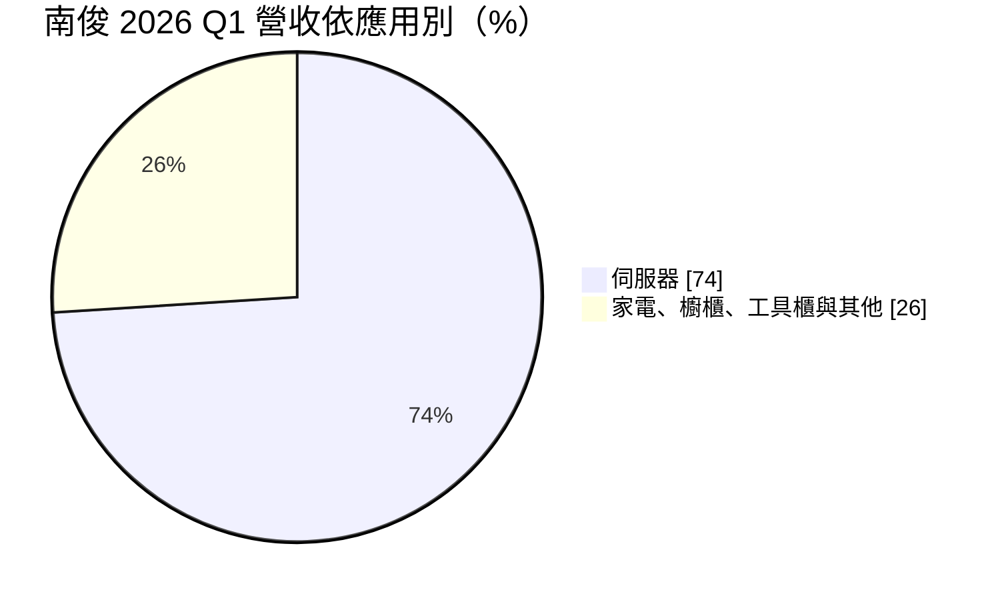
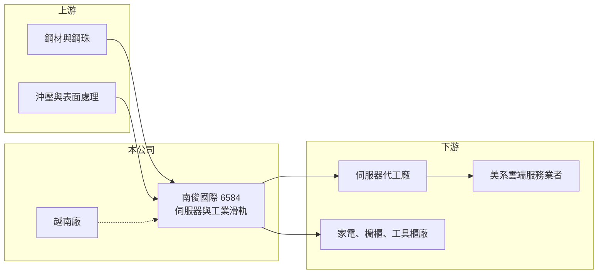

# 6584 南俊國際

> 上櫃｜[[產業索引-電子零組件業|電子零組件業]]｜上市（櫃）日期 2023/05/18

# 第一章：企業模式與商業藍圖

> [!info] 撰寫說明
> 精簡版，由 Claude 依公開資料整理，架構比照 [[2330台積電]] 的四章研究，資料截至 2026-10-08。來源：Goodinfo 經營績效頁、富果研究南俊個股分析與 2026 年法說會整理、櫃買中心開放資料快照（基本資料、每月營收、2026 年第二季損益與資產負債）。法說整理為第三方 AI 摘要，客戶與認證資訊需回到公司原始簡報核對。#待校對

南俊國際是台灣第二大的伺服器[[滑軌]]廠，近年從家電、櫥櫃用的鋼珠滑軌，轉型為以雲端資料中心為主的伺服器零組件供應商。本章說明它的業務組成與轉型路徑。

- **核心業務：** 南俊成立於 1984 年，2023 年轉上櫃，主力產品是鋼珠滑軌，也就是讓伺服器從機櫃中抽出、推入以便維修的軌道機構。除了伺服器，產品也用在家電、櫥櫃、工具櫃與車用，但這些傳統應用的成長性與毛利率都明顯低於伺服器。滑軌看似簡單，實際上要同時承受重量、維持順暢度並通過長期反覆抽拉測試，機構設計與量產良率是核心能力。
- **營收結構：** 依富果整理的法說內容，2026 年第一季伺服器應用占營收約 74%，高於公司原訂的 60% 至 70%。伺服器比重提高是毛利率從 2023 年的 18% 升到 2025 年 35% 的主因，因為伺服器滑軌單價高、規格要求嚴格，競爭者較少。
- **營運據點：** 總部位於桃園。為了因應美系雲端客戶要求「非中國、非台灣」產地的供應鏈政策，公司擴充越南廠，2026 年第二季越南廠營收占比已達約 20%。多地生產讓南俊能同時滿足成本與地緣政治的要求。
- **長期方向：** 公司的策略是把客戶從伺服器代工廠延伸到雲端服務業者（CSP），並跟上 AI 機櫃的規格升級。富果整理指出，南俊已進入三家美系 CSP 供應鏈，並在 2026 年 6 月取得 [[NVDA輝達]] 推薦供應商名單（RVL）認證。AI 機櫃的滑軌承重更高、單價更高，若能持續打入新平台，產品組合會繼續往高階移動。

# 第二章：護城河深度與競爭優勢

滑軌產業的門檻不在技術原理，而在認證、量產規模與客戶關係。本章分析南俊的競爭位置與它面對的強大龍頭。

- **競爭優勢：** 伺服器滑軌需要通過伺服器品牌、代工廠與 CSP 的多層認證，一旦導入某個平台，在該平台生命週期內很少更換，這形成一定的[[設計導入]]黏著度。南俊的另一個優勢是越南產能，在美系客戶要求分散產地時，具備現成的替代供應能力。
- **主要對手：** 全球伺服器滑軌由 [[2059川湖]] 主導，川湖長年維持極高的市占率與毛利率，是南俊必須挑戰的對象。南俊的角色比較像「第二供應商」，客戶為了分散風險、壓低採購成本，會刻意培養第二家。這個位置能帶來訂單，但議價能力仍低於龍頭。
- **觀察重點：** 第一，伺服器營收比重能否長期維持在七成以上，避免家電等低毛利業務拉低整體獲利。第二，AI 機櫃世代（如 GB300、Rubin）滑軌的實際市占率。第三，越南廠的良率與成本，能否讓公司在第二供應商的價格壓力下仍維持三成以上的毛利率。

# 第三章：財務體質與盈利規模

資料日期：2026-10-08，表格是撰寫當時的快照；最新月營收、毛利率、累計 EPS 由自動排程寫在本筆記的屬性欄位（月營收、毛利率、累計EPS 等）。#待校對

南俊的財報清楚呈現轉型前後的差別：2023 年以前毛利率不到兩成，2024 年起隨伺服器比重提高，獲利能力明顯躍升。

| 年度 | 營收（億元） | [[毛利率]] | [[營業利益率]] | EPS（元） | [[ROE]] |
|---|---|---|---|---|---|
| 2021 | 20.4 | 18.2% | 6.52% | 1.67 | 6.99% |
| 2022 | 20.0 | 18.1% | 4.25% | 2.26 | 9.07% |
| 2023 | 13.2 | 18.0% | 0.72% | 0.13 | 0.48% |
| 2024 | 19.2 | 26.1% | 10.6% | 2.94 | 9.25% |
| 2025 | 24.3 | 35.0% | 19.9% | 5.59 | 13.8% |
| 2026 上半年 | 17.1 | 41.7% | 29.6% | 6.47 | 未查得 |

- **營收規模：** 2020 年營收 14.5 億元，2025 年 24.3 億元，五年年複合成長率約 11%（推算）。2023 年營收大跌到 13.2 億元，反映伺服器與消費性產品同步去庫存；2026 年上半年營收已達 17.1 億元，約為 2025 年全年的七成。
- **獲利：** 營業利益率從 2023 年不到 1% 升到 2026 年上半年約 30%，屬於典型的[[營業槓桿]]：費用相對固定，營收與產品單價一起提高時，利潤放大得更快。2021 至 2025 年平均 ROE 約 7.9%（推算），但這個平均值被轉型前的低獲利拉低，2025 年以後的獲利結構與過去已不可比。
- **財務特色：** 2026 年第二季末總資產 54.9 億元、權益 37.2 億元，負債 17.6 億元，其中流動負債 12.3 億元。實收資本額約 7.14 億元。

**[[ROIC]] 與 [[WACC]]：** 有息負債明細未查得，假設約 8 億元（推估）。2025 年營業利益約 4.84 億元（24.3 億 × 19.9%），稅後約 3.87 億元；以 2025 年平均權益約 28 億元（由 ROE 與淨利回推）加有息負債 8 億元，投入資本約 36 億元，ROIC 約 11%（推算）。若以 2026 年上半年營業利益 5.07 億元年化，稅後約 8.1 億元，除以目前權益加負債約 45 億元，ROIC 約 18%（推算）。WACC 用 [[CAPM]] 推估：無風險利率 1.75%、市場風險溢酬 6%、β 取 1.2（AI 伺服器零組件股常見值，假設），股東權益成本約 9%；負債成本 2.5%、稅率 20%，以權益 85%、負債 15% 加權，WACC 約 7.9%（推算）。結論是：南俊在 2023 年以前 ROIC 明顯低於 WACC，沒有創造價值；2025 年起轉為高於 WACC，價值創造能否持續取決於伺服器比重與單價能否維持。

# 第四章：總體風險與地緣政治

南俊的風險來自對 AI 伺服器景氣的高度依賴，以及身為第二供應商的議價位置。

- **產業週期：** 伺服器資本支出具有明顯週期，雲端業者擴建資料中心時拉貨強勁，調整庫存時訂單會急凍，2023 年營收大減就是例子。伺服器占比愈高，公司受 CSP 資本支出循環的影響就愈大，[[長鞭效應]]也會放大波動。
- **營運風險：** 與 [[2059川湖]] 相比，南俊的規模與客戶認證數量仍小，若新平台認證失利，或客戶只把南俊當作壓價工具，訂單量與毛利率都可能受壓。越南廠擴產初期的良率與管理也有執行風險。
- **其他風險：** 鋼材是主要原料，價格波動會影響成本；外銷以美元計價，新台幣升值會壓縮毛利。美國關稅與「非中國、非台灣」供應鏈政策，一方面提高越南產能的價值，另一方面也可能要求更多資本支出。

# 專有名詞解析

## 金融

- **[[營業槓桿]]**：固定成本占比高的公司，營收增加時營業利益會以更大幅度增加，反之亦然。
- **[[ROIC]]**：投入資本報酬率，稅後營業利益除以股東權益加有息負債，衡量本業運用資本的效率。
- **[[WACC]]**：加權平均資金成本，依股東權益與負債的比重，加權計算公司取得資金的平均成本。
- **[[CAPM]]**：資本資產定價模型，以無風險利率加上 β 乘以市場風險溢酬估算股東要求報酬率。

## 產業

- **[[滑軌]]**：讓伺服器或抽屜沿軌道抽出與推入的機構件，伺服器滑軌需承受重量並通過長期反覆抽拉測試。
- **[[設計導入]]**：零組件在客戶新產品設計階段就被選用，一旦導入通常在整個產品生命週期內持續供貨。

# 核心供應鏈

- 上游：鋼材與鋼珠供應商、沖壓與表面處理加工。
- 下游／客戶：伺服器代工廠，例如 [[2382廣達]]、[[3231緯創]]、[[2317鴻海]]（推估，未查得具名）；終端為美系雲端服務業者，富果整理提及 [[MSFT微軟]]、[[AMZN亞馬遜]]；家電與櫥櫃廠。
- 同業：[[2059川湖]]。

## 最新新聞
<!-- news:start -->
<!-- news:end -->

## 相關連結
- [公開資訊觀測站](https://mopsov.twse.com.tw/mops/web/t05st03?step=1&firstin=1&co_id=6584)
- [Goodinfo](https://goodinfo.tw/tw/StockDetail.asp?STOCK_ID=6584)
- [Yahoo 股市](https://tw.stock.yahoo.com/quote/6584)
- [鉅亨網新聞](https://www.cnyes.com/twstock/6584/news)
