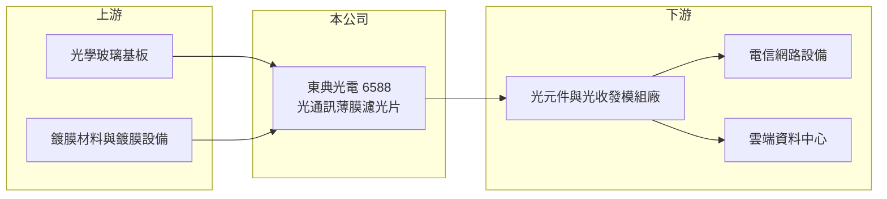

# 6588 東典光電

> 上櫃｜[[產業索引-通信網路業|通信網路業]]｜上市（櫃）日期 2020/07/01

# 第一章：企業模式與商業藍圖

> [!info] 撰寫說明
> 本文由 Claude 依公開資料整理，架構比照 [[2330台積電]] 的四章研究，資料截至 2026-10-08。財務數字來源：Goodinfo 年度經營績效頁與基本資料頁、櫃買中心開放資料（基本資料、2026 年第二季資產負債與損益、本益比殖利率）。公開資料有限，產品結構與客戶描述部分為整理性推論，已標「待校對」。#待校對

評估光通訊上游零件廠，要看它的產品是否能跟著網路頻寬升級持續被採用。本章說明東典光電（股票代號：6588，以下簡稱東典）如何以[[薄膜濾光片]]切入光通訊與資料中心供應鏈。

## 一、核心定位：光通訊用薄膜濾光片

東典成立於 2000 年，2020 年在櫃買中心掛牌，實收資本額約 3.5 億元，公司登記地址在宜蘭縣五結鄉。依公司揭露的主要業務，產品是三類光通訊用薄膜濾光片：用於光通訊主動元件、用於光通訊被動元件，以及用於雲端資料中心。濾光片的功能是讓特定波長的光通過、其他波長反射，是光收發模組與分波多工器裡把不同顏色的光分開或合併的關鍵零件。

濾光片屬於小而精密的零件，單價不高，但鍍膜層數多、良率要求高，需要長期累積的鍍膜設備調校與製程經驗。東典的角色因此是上游元件供應商，產品賣給光元件與[[光收發模組]]廠，再由這些客戶組裝成模組交給網通設備商與雲端業者。

## 二、產品世代：從電信分波多工走向資料中心

光通訊早期的濾光片需求主要來自電信骨幹網路的分波多工系統，以及 5G 前傳網路。近年需求重心轉往資料中心，高速光收發模組在一條光纖中傳送多個波長時，需要大量的小型濾光片（推估，待校對）。各產品的營收比重未查得。這種世代更替對東典是雙面刃：電信需求下滑時營收明顯萎縮，資料中心需求回升時則有機會帶動稼動率與毛利率回升。

## 三、長期方向

東典的長期方向是把產品重心從電信網路移往資料中心與高速光模組應用。這個轉型的意義在於，資料中心的光連接數量會隨 AI 叢集擴大而增加，只要能通過一線模組廠的認證，就能取得較穩定的出貨。不過公司規模小、客戶集中度可能偏高（推估），轉型成效仍需觀察多年獲利是否穩定。

# 第二章：護城河深度與競爭優勢

在長期價值投資中，「護城河」指企業抵禦競爭、維持超額利潤的保護機制。本章分析東典在濾光片領域的優勢與限制。

## 一、護城河的組成

* **鍍膜製程經驗：** 薄膜濾光片需要在玻璃基板上鍍上數十到上百層膜，每層厚度都要精準控制。二十多年的製程累積讓東典能做出符合光通訊規格的產品，這是新進者短期難以複製的門檻。
* **客戶認證：** 濾光片一旦被光模組廠設計導入，更換供應商需要重新驗證光學特性與可靠度，具有一定的轉換成本。

不過濾光片本身標準化程度不低，中國大陸廠商產能龐大、報價積極，東典的護城河屬於較窄的類型。2023 至 2024 年毛利率一度為負，顯示在需求低迷時缺乏定價能力。

## 二、主要競爭對手

| 對手 | 定位 | 對東典的威脅 |
|---|---|---|
| [[6426統新]] | 台灣光通訊濾光片與光學鍍膜廠 | 產品高度重疊，爭取同一批模組廠訂單 |
| 中國大陸薄膜濾光片廠 | 產能大、成本低 | 壓低標準品報價 |
| 國際光學鍍膜大廠 | 技術與客戶基礎雄厚 | 在高階規格占優勢 |

## 三、守得住／守不住／觀察重點

守得住的是已導入客戶的特定規格產品。守不住的是電信與標準品的價格，2022 至 2025 年連續虧損就是證明。長期觀察重點是資料中心用濾光片的營收占比能否持續提升，以及 2026 年上半年轉為小幅獲利後，毛利率能否穩定維持在三成左右。

# 第三章：財務體質與盈利規模

資料日期：2026-10-08，表格是撰寫當時的快照；最新月營收、毛利率、累計 EPS 由自動排程寫在本筆記的屬性欄位（月營收、毛利率、累計EPS 等）。#待校對

財務報表是檢驗護城河是否真實存在的最終標準。本章用六年的三率、ROE 與資本報酬，檢視東典從虧損谷底回升的過程。

## 一、多年度經營績效

| 年度 | 營收（新台幣） | [[毛利率]] | [[營業利益率]] | EPS（元） | [[ROE]] |
|---|---|---|---|---|---|
| 2020 | 3.35 億 | 42.0% | 24.5% | 2.23 | 8.25% |
| 2021 | 2.03 億 | 35.7% | 8.11% | 0.48 | 1.55% |
| 2022 | 1.70 億 | 9.61% | -22.3% | -0.66 | -2.20% |
| 2023 | 1.08 億 | -28.2% | -78.9% | -3.07 | -11.0% |
| 2024 | 1.36 億 | -36.1% | -79.3% | -5.36 | -18.8% |
| 2025 | 1.73 億 | 5.92% | -36.0% | -1.77 | -7.78% |
| 2026 上半年 | 1.84 億 | 29.9% | 4.90% | 0.27 | 未查得 |

這張表呈現典型的小型零件廠營運槓桿：營收從 2020 年的 3.35 億元掉到 2023 年的 1.08 億元時，固定的折舊與人事成本讓毛利率轉負；2026 年上半年營收已超過 2025 全年，毛利率就回到近三成。2021 至 2025 年平均 ROE 約 -7.6%（推算），2020 至 2025 年營收年複合成長率約 -12%（推算）。最近一年未配發現金股利。

## 二、[[ROIC]] 與 [[WACC]]：價值創造利差

**ROIC 推算：** 2025 年營業損失約 0.62 億元（1.73 億 × -36.0%）。2026 年第二季權益總計約 9.2 億元，負債約 3.6 億元，假設有息負債約 2 億元（推估），投入資本約 11.2 億元，2025 年 ROIC 約 -5.5%（推算）。若以 2026 年上半年營業利益 0.09 億元年化，ROIC 約 1.3%（推算）。

**WACC 推算：** 台灣 10 年期公債 1.75%、市場風險溢酬 6%、β 取光通訊同業常見值 1.3，股東權益成本約 9.6%；負債成本 2.5%、稅後 2.0%；權益占投入資本約 82%，WACC 約 8.2%（推算）。

**結論：** 東典近四年的 ROIC 遠低於 WACC，長期處於毀損價值的狀態。2026 年上半年雖然轉虧為盈，但要讓 ROIC 超過 8% 左右的資金成本，營業利益率需要回到 2020 年那種兩成以上的水準。

# 第四章：總體風險與地緣政治

任何企業都無法脫離宏觀環境獨立存在。本章分析東典長期必須面對的風險。

## 一、光通訊需求週期

濾光片需求跟著電信與資料中心的資本支出起伏。2021 至 2024 年營收大幅衰退，說明電信端需求轉弱時，公司缺乏其他產品支撐。資料中心需求雖然提供新的成長機會，但雲端業者的投資節奏同樣有週期性。

## 二、規模與競爭風險

東典營收規模只有一至三億元，固定成本占比高，訂單一減少就容易轉為虧損。中國大陸同業產能大、價格低，可能持續壓縮標準品毛利率。客戶集中度若偏高（推估），單一客戶調整庫存就會明顯影響營收。

## 三、匯率與財務

產品主要外銷（推估），新台幣升值會壓縮毛利率。公司過去幾年累積虧損，保留盈餘僅約 0.2 億元，短期內配息能力有限。

# 專有名詞解析

## 應用

- **[[薄膜濾光片]]**：在玻璃上鍍多層光學薄膜，只讓特定波長的光通過，用於光通訊的分波與合波。

## 金融

- **[[ROIC]]**：投入資本報酬率，稅後營業利益除以股東權益與有息負債的合計，衡量本業對所有資金提供者的報酬。
- **[[WACC]]**：加權平均資金成本，依股東權益與負債的比重加權計算的資金成本，ROIC 高於它才代表創造價值。

## 產業

- **[[光收發模組]]**：把電訊號轉成光訊號傳送、再把光訊號轉回電訊號的模組，是資料中心與電信網路的核心零件。

# 核心供應鏈

## 1. 上游：基板與鍍膜材料
- 光學玻璃基板、鍍膜靶材與真空鍍膜設備供應商

## 2. 中游：東典與同業
- 同業：[[6426統新]]、中國大陸薄膜濾光片廠

## 3. 下游：客戶
- 光收發模組與光元件廠，例如 [[4979華星光]]、[[3234光環]] 一類的模組廠（是否為東典客戶未查得）
- 電信與資料中心網路設備

## 最新新聞
<!-- news:start -->
<!-- news:end -->

## 相關連結
- [公開資訊觀測站](https://mopsov.twse.com.tw/mops/web/t05st03?step=1&firstin=1&co_id=6588)
- [Goodinfo](https://goodinfo.tw/tw/StockDetail.asp?STOCK_ID=6588)
- [Yahoo 股市](https://tw.stock.yahoo.com/quote/6588)
- [鉅亨網新聞](https://www.cnyes.com/twstock/6588/news)
