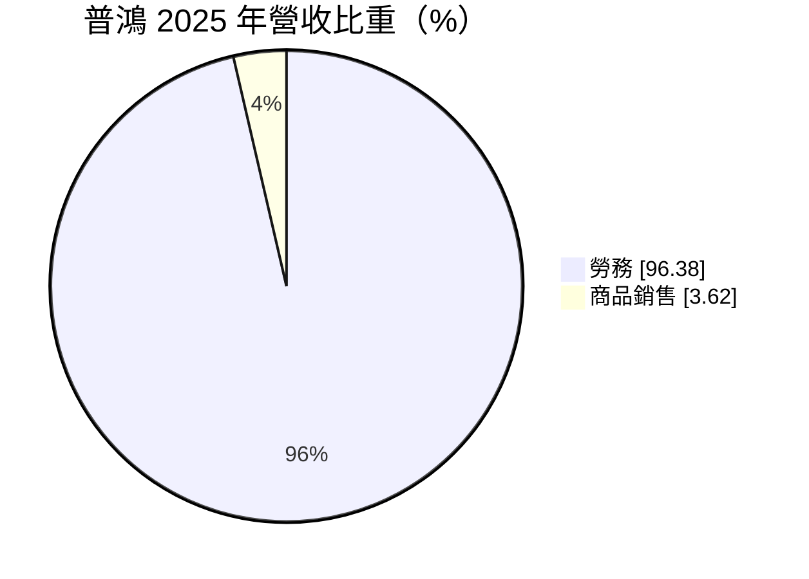
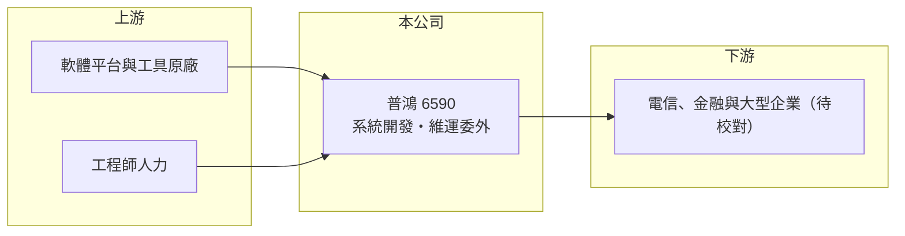

# 6590 普鴻

> 上櫃｜[[產業索引-資訊服務業|資訊服務業]]｜上市（櫃）日期 2018/12/24

# 第一章：企業模式與商業藍圖

> [!info] 撰寫說明
> 精簡版，由 Claude 依公開資料整理，架構比照 [[2330台積電]]，資料截至 2026-10-08。來源：Goodinfo 經營績效年表（2019 至 2025 年）；富邦 e 點通（MoneyDJ）公司基本資料（2025 年營收比重）；櫃買中心開放資料快照（基本資料、2026 年第二季資產負債與上半年損益、每月營收、股利）。具體服務內容與客戶產業在可連上的來源中揭露有限，依記憶整理的部分標示待校對，公開資料有限。#待校對

普鴻（普鴻資訊）成立於 2000 年 7 月、2018 年 12 月上櫃，總部在台北市松山區光復南路，實收資本額約 2.87 億元，董事長兼總經理林群國。它是以人力與技術服務為主的資訊服務公司，2025 年營收約 6.6 億元，其中九成六是勞務收入，幾乎不靠轉賣硬體，這在台灣中小型資訊服務業中相當少見。

- **核心業務：** 普鴻的收入幾乎全部來自勞務，也就是替客戶開發、建置與維運資訊系統的人力與技術服務。推估服務內容包括應用系統開發、系統維運與[[委外服務]]，客戶以電信、金融與大型企業為主（待校對）。
- **營收結構：** 勞務收入的特點是按人月或專案計價，維運合約通常一簽多年，屬於[[經常性收入]]比重較高的模式。由於不轉賣硬體，營收規模雖然不大，但毛利率可以維持在 40% 以上，遠高於以商品銷售為主的同業。
- **營運據點與人均產值：** 總部在台北市，服務以台灣為主。勞務型公司的關鍵指標是人均產值，也就是每位工程師每年能帶來多少營收；員工人數未查得，因此人均產值無法推算。
- **長期方向：** 企業持續把資訊系統的開發與維運外包給專業廠商，以降低自建 IT 團隊的成本，這是普鴻的長期成長動能。2019 至 2025 年營收從 4 億元成長到 6.6 億元，[[營業利益率]]也從 13.8% 提高到 24%，顯示規模擴大後的營運槓桿。

# 第二章：護城河深度與競爭優勢

普鴻的護城河來自客戶系統的深度熟悉與長期維運關係，這是勞務型資訊服務最典型的轉換成本。

- **競爭優勢：** 資訊系統上線後，維運廠商最了解系統細節，客戶若要更換廠商，必須重新交接文件、程式與作業流程，風險高、時間長，因此多半會續約。普鴻以勞務為主、毛利率長年維持 42% 至 50%，說明客戶願意為專業服務支付合理價格，而不是只比價。
- **主要對手：** 勞務型資訊服務的同業包括 [[6697東捷資訊]]、[[6752叡揚]]、[[2471資通]]、[[2453凌群]]、[[4953緯軟]] 等。普鴻規模較小，競爭力取決於在特定客戶與領域的累積。
- **觀察重點：** 第一，營收能否持續成長，證明客戶基礎在擴大而非只靠少數客戶；第二，營業利益率能否維持在 20% 以上；第三，工程師薪資上漲時，公司能否把成本轉嫁到合約價格上。

# 第三章：財務體質與盈利規模

資料日期：2026-10-08，表格是撰寫當時的快照；最新月營收、毛利率、累計 EPS 由自動排程寫在本筆記的屬性欄位（月營收、毛利率、累計EPS 等）。#待校對

普鴻的財務特色是高毛利、高 ROE、獲利穩定，屬於中小型資訊服務股中品質較好的一群。

| 年度 | 營收（億元） | [[毛利率]] | [[營業利益率]] | EPS（元） | [[ROE]] |
|---|---|---|---|---|---|
| 2019 | 4.01 | 37.4% | 13.8% | 2.78 | 13.8% |
| 2020 | 4.08 | 46.7% | 23.1% | 4.09 | 18.6% |
| 2021 | 4.64 | 46.4% | 19.1% | 4.64 | 20.2% |
| 2022 | 5.21 | 49.8% | 23.7% | 4.74 | 17.7% |
| 2023 | 6.76 | 43.7% | 20.2% | 6.08 | 20.6% |
| 2024 | 5.86 | 42.2% | 17.5% | 5.04 | 15.3% |
| 2025 | 6.64 | 48.0% | 24.0% | 5.12 | 17.7% |
| 2026 上半年 | 3.70 | 41.8% | 15.3% | 2.50 | 未查得 |

註：2019 至 2025 年取自 Goodinfo；2026 年上半年取自櫃買中心開放資料推算（營業毛利 1.55 億元、營業利益 0.57 億元）。

- **長期指標：** 2020 至 2025 年營收年複合成長率約 10.2%（推算），2021 至 2025 年平均 ROE 約 18.3%（推算）。櫃買中心快照顯示最近一年度現金股利約 1.50 元，相對 2025 年 EPS 5.12 元，現金配息率約三成（推算），是否另配股票股利未查得，待校對。2026 年 1 至 8 月累計營收較去年同期成長約 12%。
- **[[ROIC]] 與 [[WACC]]：** 2025 年營業利益約 1.59 億元（6.64 億 × 24.0%），稅後約 1.27 億元；2026 年第二季股東權益 8.32 億元，有息負債未查得，勞務型公司借款通常很少，假設接近 0，ROIC 約 15%（推算）。WACC 以無風險利率 1.75%、市場風險溢酬 6%、β 0.8（勞務型資訊服務股常見值）推得權益成本約 6.55%，資本幾乎全為權益，WACC 約 6.5%（推算）。ROIC 高出 WACC 約 9 個百分點，代表普鴻長期穩定創造經濟價值。
- **財務特色：** 2026 年第二季總資產 12.24 億元、負債比率約 32%，[[每股淨值]] 28.14 元。輕資產、低負債，營運所需資本主要是應收帳款與人力，不需要大額資本支出。

# 第四章：總體風險與地緣政治

普鴻的風險集中在人力成本與客戶集中，這是勞務型資訊服務公司的共同課題。

- **產業週期：** 資訊委外需求相對穩定，景氣差時企業反而可能增加外包以降低固定成本。但新系統開發專案會在景氣轉弱時延後，影響個別年度的成長。
- **營運風險：** 營收高度依賴工程師人力，人才流失或薪資快速上升都會壓縮利潤。若營收集中在少數大客戶，任一客戶縮減外包或改由內部團隊執行，都會造成明顯衝擊（客戶集中度未查得）。
- **其他風險：** AI 輔助開發工具普及，可能降低系統開發與維運所需的人力，長期改變按人月計價的商業模式；反過來說，若普鴻能善用 AI 提升人均產值，也可能是利潤率提升的機會。[[資安]]事件會帶來合約與商譽風險。

# 專有名詞解析

## 應用

- **[[委外服務]]**：企業把資訊系統開發、維運或業務流程交給外部專業廠商執行，以降低成本並專注本業。
- **[[資安]]**：資訊安全，保護系統與資料不被入侵、竊取或破壞的技術與管理措施。

## 金融

- **[[經常性收入]]**：每年固定重複發生的收入，例如維運年約、訂閱費，能讓營收比一次性專案更穩定。
- **[[ROIC]]**：投入資本報酬率，稅後營業利益除以股東權益加有息負債，衡量本業運用資本的效率。
- **[[WACC]]**：加權平均資金成本，股東與債權人要求報酬率的加權平均，是 ROIC 要超越的門檻。

# 核心供應鏈

- 上游：軟體平台與開發工具原廠，以及工程師人力市場。
- 下游／客戶：電信、金融與大型企業（待校對）。
- 同業：[[6697東捷資訊]]、[[6752叡揚]]、[[2471資通]]、[[2453凌群]]、[[4953緯軟]]。

## 最新新聞
<!-- news:start -->
<!-- news:end -->

## 相關連結
- [公開資訊觀測站](https://mopsov.twse.com.tw/mops/web/t05st03?step=1&firstin=1&co_id=6590)
- [Goodinfo](https://goodinfo.tw/tw/StockDetail.asp?STOCK_ID=6590)
- [Yahoo 股市](https://tw.stock.yahoo.com/quote/6590)
- [鉅亨網新聞](https://www.cnyes.com/twstock/6590/news)
