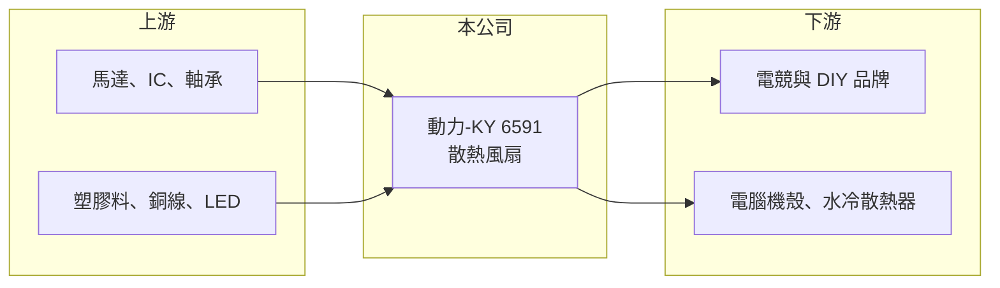

# 6591 動力-KY

> 上市｜[[產業索引-電腦及週邊設備業|電腦及週邊設備業]]｜上市（櫃）日期 2017/12/28

# 第一章：企業模式與商業藍圖

> [!info] 撰寫說明
> 精簡版，由 Claude 依公開資料整理，架構比照 [[2330台積電]]，資料截至 2026-10-08。來源：證交所開放資料快照（基本資料、2026 年第二季資產負債與損益、股利）、Goodinfo 經營績效頁、nStock 公司簡介、優分析新聞標題。產品線、生產據點與客戶描述有部分憑記憶整理，已標「待校對」。公開資料有限。#待校對

動力-KY 是在開曼群島註冊、回台上市的[[散熱風扇]]製造商，理解它的關鍵在於：它的營收高度跟著少數電腦與電競品牌客戶的新品週期起伏，是一家規模小、彈性大但波動也大的零組件廠。

- **核心業務：** 依 nStock 資料，動力-KY 的營業項目為散熱風扇的製造、批發、零售與貿易。開曼控股公司於 2013 年成立，作為集團回台上市的重組架構，2016 年登錄興櫃、2017 年 12 月在證交所上市。散熱風扇看似簡單，但轉速、噪音、壽命與燈效都要配合客戶機殼設計，屬於需要客製開發的零件。
- **營收結構：** 產品別與地區別營收比重在這次查到的公開資料中未查得。依優分析新聞標題，2025 年獲利成長主要受惠「泛電競」客戶訂單，推估產品大量用於電競主機、電腦機殼與水冷散熱器上的風扇（推估，待校對）。這類客戶重視外觀與燈效，產品單價與毛利高於一般標準風扇。
- **營運據點：** 依 KY 公司常見架構，實際生產據點推估在中國大陸（待校對）。具體廠區與產能未查得。生產集中在單一地區，使公司面臨關稅與供應鏈轉移的壓力。
- **長期方向：** 營收 2021 年達 18.4 億元高點後一度降到 2024 年的 12.6 億元，2025 年回到 17.5 億元，2026 年前三季又年減約四成。長期而言，動力-KY 要降低對單一客群的依賴，並跟上電腦與伺服器散熱功率提升的趨勢，才能讓營收穩定成長。

# 第二章：護城河深度與競爭優勢

動力-KY 的護城河很窄，主要來自與品牌客戶的共同開發關係與小量多樣的生產彈性，而不是技術或規模優勢。

- **競爭優勢：** 電競與 DIY 市場的風扇需要配合品牌設計外觀、燈效與控制軟體，開發週期短、款式多，大廠不一定願意接這類訂單，中小型廠商反而有生存空間。動力-KY 的[[毛利率]]在 2020 年與 2025 年都有 33% 以上，代表在對的產品週期中能賺取不錯的利潤。
- **主要對手：** 台灣散熱風扇大廠 [[2421建準]] 規模遠大於動力-KY，散熱模組業者如 [[3017奇鋐]]、[[3324雙鴻]]、[[6230尼得科超眾]] 也有自製風扇，另有中國大陸大量的風扇廠。動力-KY 無法在價格與規模上競爭，只能靠服務與設計彈性守住特定客戶。
- **觀察重點：** 長期最該追蹤的是客戶集中度與營收波動。2026 年第二季營業利益率約 -13.5%（nStock），上半年營業虧損 0.34 億元，但業外收益讓稅後仍小賺，顯示營收一旦下滑，固定費用就會吃掉本業獲利。能否開發新客群或新應用（例如伺服器、車用），是公司能否擺脫單一週期的關鍵。

# 第三章：財務體質與盈利規模

資料日期：2026-10-08，表格是撰寫當時的快照；最新月營收、毛利率、累計 EPS 由自動排程寫在本筆記的屬性欄位（月營收、毛利率、累計EPS 等）。#待校對

動力-KY 的財務呈現「規模小、[[營運槓桿]]大、配息率高」的樣貌：營收在 12 億至 18 億元之間擺盪，營收增減會被放大反映在獲利上。

| 年度 | 營收（億元） | [[毛利率]] | [[營業利益率]] | EPS（元） | [[ROE]] |
|---|---|---|---|---|---|
| 2021 | 18.4 | 31.0% | 18.1% | 6.83 | 15.1% |
| 2022 | 16.6 | 31.1% | 15.7% | 6.90 | 13.9% |
| 2023 | 13.8 | 28.3% | 8.85% | 3.40 | 6.77% |
| 2024 | 12.6 | 26.5% | 4.71% | 3.21 | 6.40% |
| 2025 | 17.5 | 33.7% | 14.6% | 5.37 | 9.95% |

（來源：Goodinfo 經營績效頁。2026 年上半年依證交所資料，營收 5.44 億元、毛利率約 23.6%、營業利益率約 -6.3%、EPS 0.73 元。）

- **營收規模：** 2020 年營收 15.8 億元，2025 年 17.5 億元，年複合成長率約 2.1%（推算），長期幾乎沒有成長，但年度間波動很大。2026 年 1 至 9 月營收約 8.23 億元，年減約四成（nStock），顯示主要客戶訂單的變化對公司影響極大。
- **獲利：** 2021 至 2025 年平均 ROE 約 10.4%（推算）。營業利益率在 4.7% 到 18.1% 之間大幅擺動，營收每回升一成，營益率可以拉高數個百分點，這就是小型零件廠的營運槓桿。
- **財務特色：** 2026 年第二季總資產約 33.9 億元、負債約 12.3 億元，負債比約 36%，每股淨值 52.43 元。依證交所股利資料，最近一次（114 年度）現金股利 4.0 元，約為 2025 年 EPS 的 74%；nStock 統計 2024 年度配息率約 73%，五年平均現金股利約 3.4 元，配息政策相當大方。自由現金流是否長期為正未查得。
- **[[ROIC]] 與 [[WACC]]：** 以 2025 年營業利益約 2.56 億元（17.5 億元 × 14.6%）、稅率 20% 計算，稅後營業利益約 2.04 億元；有息負債未查得，投入資本以股東權益 21.6 億元到總資產 33.9 億元為區間，ROIC 約 6.0% 至 9.5%（推算）。2024 年同法約 1.4% 至 2.2%，2026 年上半年本業虧損，ROIC 為負（推算）。WACC 以 [[CAPM]] 推估：無風險利率 1.75%、市場風險溢酬 6%、β 假設 1.0（小型電子零件股常見值），權益成本約 7.75%；稅後負債成本 2%、負債占三成，WACC 約 6.0%（推算）。只有在客戶旺季的年度 ROIC 高於 WACC，長期平均大致與資金成本相當，價值創造能力不穩定。

# 第四章：總體風險與地緣政治

動力-KY 的風險集中在客戶集中、規模過小與生產地，屬於高波動的小型零件股。

- **產業週期：** 電競與 DIY 電腦需求跟著顯示卡、處理器新品與消費景氣走，週期短且變化快。品牌客戶在新品推出前大量備貨，之後又快速去化庫存，零件廠的訂單常出現大起大落，2025 年大增、2026 年大減正是典型例子。
- **營運風險：** 營收仰賴少數品牌客戶（推估），客戶換供應商或產品失利，營收可能一次掉三到四成。營收下滑時固定費用壓縮獲利，2026 年上半年本業轉為虧損即是例證。公司規模小，研發與自動化投資能力有限。
- **其他風險：** 生產據點推估在中國大陸，美國關稅與客戶要求「中國以外」產能，可能迫使公司投資新廠。KY 公司的資訊揭露與跨境治理也是投資人需要留意的面向。銅、塑料與馬達零件價格波動會影響成本。

# 專有名詞解析

## 金融

- **[[營運槓桿]]**：固定成本占比高的企業，營收小幅變動會造成獲利大幅變動的現象。
- **[[配息率]]**：現金股利占每股盈餘的比例，反映公司把多少獲利發還股東。

## 產業

- **[[散熱風扇]]**：以馬達帶動扇葉產生氣流、把熱帶走的零件，伺服器、電腦、家電與車用都會使用。
- **[[電競周邊]]**：為電玩遊戲設計的鍵盤、滑鼠、耳機等配件，強調反應速度、精準度與耐用度。

# 核心供應鏈

- 上游：風扇馬達驅動 IC、軸承、塑膠料、銅線與 LED 燈珠供應商。
- 下游／客戶：電競、DIY 電腦與周邊品牌，以及機殼與散熱器廠（具體客戶未點名，#待校對）。
- 同業：[[2421建準]]、[[3017奇鋐]]、[[3324雙鴻]]、[[6230尼得科超眾]]、[[3338泰碩]]。

## 最新新聞
<!-- news:start -->
<!-- news:end -->

## 相關連結
- [公開資訊觀測站](https://mopsov.twse.com.tw/mops/web/t05st03?step=1&firstin=1&co_id=6591)
- [Goodinfo](https://goodinfo.tw/tw/StockDetail.asp?STOCK_ID=6591)
- [Yahoo 股市](https://tw.stock.yahoo.com/quote/6591)
- [鉅亨網新聞](https://www.cnyes.com/twstock/6591/news)
