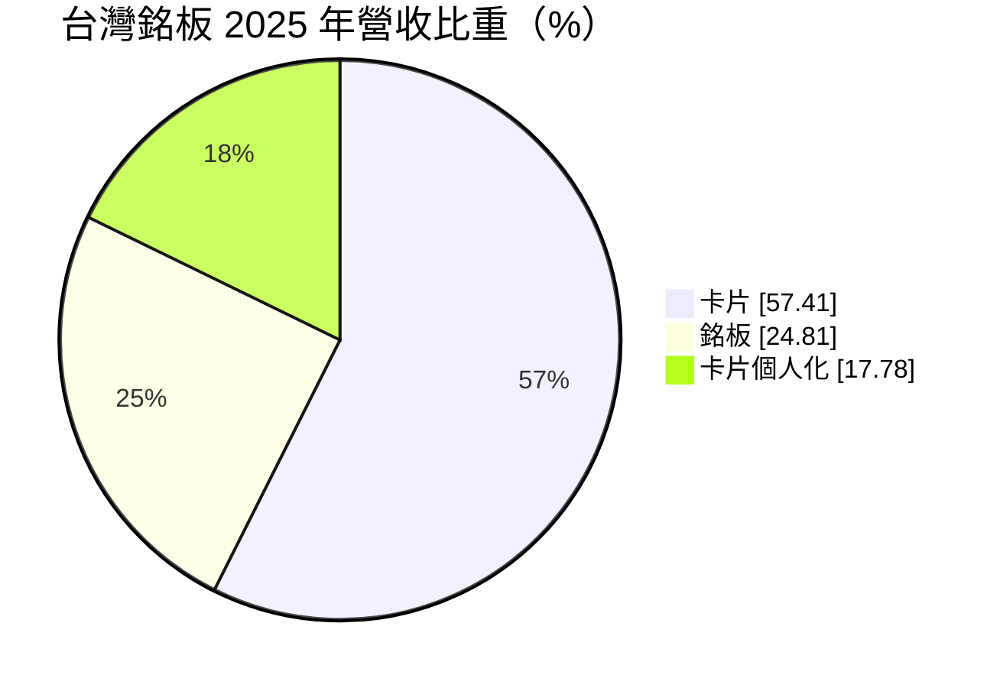
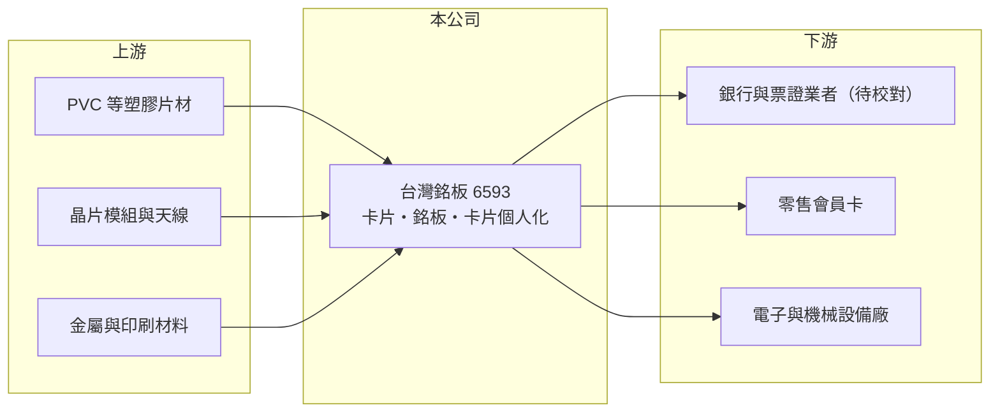

# 6593 台灣銘板

> 上櫃｜[[產業索引-資訊服務業|資訊服務業]]｜上市（櫃）日期 2017/11/03

# 第一章：企業模式與商業藍圖

> [!info] 撰寫說明
> 精簡版，由 Claude 依公開資料整理，架構比照 [[2330台積電]]，資料截至 2026-10-08。來源：Goodinfo 經營績效年表（2019 至 2025 年）；富邦 e 點通（MoneyDJ）公司基本資料（2025 年營收比重）；櫃買中心開放資料快照（基本資料、2026 年第二季資產負債與上半年損益、每月營收）。卡片種類、客戶與競爭對手依記憶整理，標示待校對。#待校對

台灣銘板成立於 1970 年 12 月、2017 年 11 月上櫃，總部與工廠位於桃園市龜山區華亞一路，實收資本額約 3.19 億元，董事長許嘉濬、總經理印文正。公司從工業銘板起家，後來發展出塑膠卡片與[[智慧卡]]製造，以及卡片個人化服務，雖然歸類在資訊服務業，本質上是一家結合印刷、精密加工與資料處理的製造服務業者。2025 年營收約 4.2 億元。

- **核心業務：** 卡片業務占 57%，推估包括會員卡、交通票卡、金融卡與各類[[RFID]]與晶片卡的卡體製造（待校對）。銘板占 25%，是貼在機器設備、電子產品上的標示牌與裝飾面板。卡片個人化占 18%，是把持卡人姓名、卡號、晶片資料寫入或印製到每一張卡上的服務。
- **營收結構：** 卡片與銘板屬於訂單型製造，隨客戶發卡量與設備出貨量起伏；卡片個人化則需要處理持卡人資料，必須通過金融或票證業者的安全認證，屬於門檻較高、毛利較好的服務（推估）。
- **營運據點與客戶產業：** 生產基地在桃園龜山，客戶推估涵蓋金融機構、票證公司、零售業會員卡與電子、機械設備製造商（待校對）。客戶產業雖然分散，但卡片需求與發卡機構的換卡週期高度相關。
- **長期方向：** 實體卡片面臨手機支付與虛擬卡的長期替代壓力，公司的長期課題是提高個人化服務與高附加價值晶片卡比重，並為銘板業務找到新的應用（例如電子產品的裝飾面板）。具體策略在這次查到的來源中未揭露。

# 第二章：護城河深度與競爭優勢

台灣銘板的護城河偏窄，主要來自卡片個人化的安全認證與長期客戶關係，卡片製造本身的差異化有限。

- **競爭優勢：** 卡片個人化要處理銀行帳號與持卡人資料，業者必須通過嚴格的資安與實體安全稽核，客戶不會輕易更換已認證的供應商，這是公司最主要的轉換成本。五十多年的製造經驗與在地交期，也讓公司在台灣中小量、客製化訂單上具備優勢。
- **主要對手：** 智慧卡製造與個人化的國際大廠包括法國 IDEMIA、Thales（前身含 Gemalto）、德國 G+D 等，中國大陸也有多家低價卡片廠（均為待校對）。在台灣市場則與其他本地卡片印製業者競爭。
- **觀察重點：** 第一，[[毛利率]]能否從 2025 年的 19% 回到 2023 年的 30% 水準；第二，卡片個人化比重能否提高；第三，2025 年轉為虧損後，公司是否調整產能或業務組合。

# 第三章：財務體質與盈利規模

資料日期：2026-10-08，表格是撰寫當時的快照；最新月營收、毛利率、累計 EPS 由自動排程寫在本筆記的屬性欄位（月營收、毛利率、累計EPS 等）。#待校對

台灣銘板的財務呈現營收停滯、獲利微薄且波動大的型態，2025 年起轉為虧損。

| 年度 | 營收（億元） | [[毛利率]] | [[營業利益率]] | EPS（元） | [[ROE]] |
|---|---|---|---|---|---|
| 2019 | 4.58 | 19.6% | -3.01% | -0.61 | -2.48% |
| 2020 | 5.22 | 18.4% | -0.78% | -0.23 | -0.98% |
| 2021 | 5.71 | 24.9% | 4.18% | 0.84 | 3.55% |
| 2022 | 5.20 | 21.0% | 0.74% | 0.12 | 0.50% |
| 2023 | 6.68 | 30.0% | 9.23% | 2.08 | 7.37% |
| 2024 | 6.29 | 25.5% | 1.97% | 0.39 | 1.28% |
| 2025 | 4.18 | 19.2% | -14.6% | -2.11 | -7.22% |
| 2026 上半年 | 2.41 | 23.8% | -10.2% | -1.30 | 未查得 |

註：2019 至 2025 年取自 Goodinfo；2026 年上半年取自櫃買中心開放資料推算（營業毛利 0.57 億元、營業損失 0.25 億元）。

- **長期指標：** 2020 至 2025 年營收年複合成長率約 -4.3%（推算），2021 至 2025 年平均 ROE 約 1.1%（推算），七年中有三年虧損。櫃買中心快照顯示最近一年度未配發現金股利。2026 年 1 至 8 月累計營收較去年同期成長約 11%，但上半年仍是營業虧損。
- **[[ROIC]] 與 [[WACC]]：** 2025 年營業損失約 0.61 億元（4.18 億 × -14.6%），虧損不計稅盾；2026 年第二季股東權益 8.56 億元，總負債僅 1.55 億元，有息負債未查得，假設約 0.5 億元，投入資本約 9.1 億元，ROIC 約 -6.7%（推算）。以 2026 年上半年年化營業損失約 0.49 億元計算，ROIC 約 -5.4%（推算）。WACC 以無風險利率 1.75%、市場風險溢酬 6%、β 1.0（中小型製造股常見值）推得權益成本 7.75%，資本幾乎全為權益，WACC 約 7.6%（推算）。ROIC 為負，與 WACC 差距超過 12 個百分點，代表目前投入的資本不但沒有賺回資金成本，還在侵蝕股東權益；即使在 2023 年獲利最好的一年，ROIC 也只約 5% 至 6%（推算），長期看並未創造經濟價值。
- **財務特色：** 2026 年第二季總資產 10.12 億元、負債比率約 15%，[[每股淨值]] 26.81 元。財務結構保守、負債很低，虧損短期內不至於影響存續，但淨值會隨虧損逐步下降。

# 第四章：總體風險與地緣政治

台灣銘板的風險主要是實體卡片的長期替代趨勢，以及小規模製造業者在價格競爭中的弱勢。

- **產業週期：** 卡片需求跟著銀行、票證與零售業的發卡與換卡週期，銘板需求則跟著電子與機械設備出貨。兩者都屬於景氣循環型需求，2025 年營收下滑三成多，顯示訂單波動對小廠影響很大。
- **營運風險：** 手機支付、虛擬卡與數位會員卡普及，長期會減少實體卡片的需求。卡片製造的固定成本高，營收下滑時毛利率會被產能利用率不足拖累，這也是 2025 年轉虧的主要原因（推估）。
- **其他風險：** PVC、晶片模組等原物料價格與供應會影響成本，晶片模組多仰賴進口，匯率波動也有影響。個人化服務涉及持卡人個資，若發生資料外洩，會面臨法律責任與客戶流失。

# 專有名詞解析

## 應用

- **[[智慧卡]]**：內嵌晶片、可儲存與加密資料的卡片，常見於金融卡、信用卡、交通票卡與身分證件。
- **[[RFID]]**：無線射頻辨識，利用無線電波讀取晶片標籤資料，不需接觸即可感應，常見於票卡與門禁。
- **[[卡片個人化]]**：把持卡人姓名、卡號與晶片金鑰等資料寫入或印製到空白卡片上的作業，需通過嚴格安全認證。

## 金融

- **[[ROIC]]**：投入資本報酬率，稅後營業利益除以股東權益加有息負債，衡量本業運用資本的效率。
- **[[WACC]]**：加權平均資金成本，股東與債權人要求報酬率的加權平均，是 ROIC 要超越的門檻。

# 核心供應鏈

- 上游：PVC 等塑膠片材、晶片模組與天線、金屬與印刷材料供應商（具體名單未查得）。
- 下游／客戶：銀行、票證業者、零售業會員卡發行者，以及電子與機械設備製造商（待校對）。
- 同業：IDEMIA、Thales、G+D 等國際卡片與個人化業者（待校對）。

## 最新新聞
<!-- news:start -->
<!-- news:end -->

## 相關連結
- [公開資訊觀測站](https://mopsov.twse.com.tw/mops/web/t05st03?step=1&firstin=1&co_id=6593)
- [Goodinfo](https://goodinfo.tw/tw/StockDetail.asp?STOCK_ID=6593)
- [Yahoo 股市](https://tw.stock.yahoo.com/quote/6593)
- [鉅亨網新聞](https://www.cnyes.com/twstock/6593/news)
