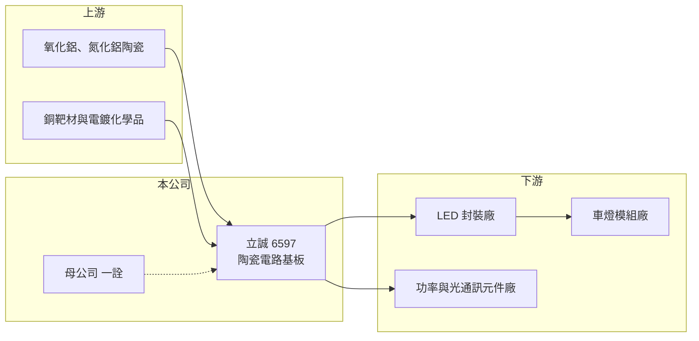

# 6597 立誠

> 上櫃｜[[產業索引-電子零組件業|電子零組件業]]｜上市（櫃）日期 2025/05/08

# 第一章：企業模式與商業藍圖

> [!info] 撰寫說明
> 精簡版，由 Claude 依公開資料整理，架構比照 [[2330台積電]] 的四章研究，資料截至 2026-10-08。來源：Goodinfo 經營績效頁、nStock 公司簡介、財經新聞標題（CMoney、Yahoo 股市、科技新報）、櫃買中心開放資料快照（基本資料、每月營收、2026 年第二季損益與資產負債）。公開資料有限，產品與應用別營收比重、客戶名單未查得。#待校對

立誠光電是一家專做[[陶瓷基板]]的公司，產品是承載 LED 晶粒與功率元件的陶瓷電路板，主要市場是車用照明。本章說明它的業務定位。

- **核心業務：** 立誠成立於 2011 年，2025 年 5 月上櫃，主要營業項目是 LED 陶瓷電路板的製造與銷售。高功率 LED 在發光時會產生大量熱，一般樹脂電路板散熱與耐熱都不足，因此改用導熱較好的氧化鋁或氮化鋁陶瓷，再以 [[DPC]] 等製程在陶瓷上做出銅線路。這類基板的價值在於同時解決散熱、絕緣與精細線路三件事。
- **營收結構：** 依財經媒體標題，立誠的定位是「車用 LED 陶瓷基板廠」，上櫃時強調積極拓展歐美車用照明客戶。各應用別營收比重在本次查到的資料中未揭露。2026 年財經媒體也出現陶瓷基板延伸到資料中心高壓直流電源（[[HVDC]]）與光通訊雷射元件的報導，代表公司正嘗試把車用以外的應用做大（具體營收貢獻未查得）。
- **營運據點：** 公司位於桃園蘆竹。母公司為上市的 [[2486一詮]]，依 nStock 資料持股約 63.7%，立誠屬於一詮集團的轉投資事業。
- **長期方向：** 車燈從鹵素燈改為 LED、再走向矩陣式智慧頭燈，單車使用的 LED 顆數與功率持續增加，是陶瓷基板最主要的長期需求來源。若能在功率半導體與光通訊等新應用取得認證，公司可以降低對單一車用景氣的依賴。

# 第二章：護城河深度與競爭優勢

陶瓷基板的競爭在於製程良率、線路精度與車規認證。本章分析立誠的條件與限制。

- **競爭優勢：** 車用零件需通過 [[AEC-Q]] 可靠度測試與車廠的長期驗證，一旦被採用，在車型生命週期內通常不會輕易更換，這是車用供應商的主要黏著度來源。立誠 2023 至 2024 年毛利率從 23% 升到約 30%，顯示產品組合往較高附加價值移動。
- **主要對手：** 陶瓷基板供應商包括台灣的 [[6271同欣電]]（陶瓷電路板為其傳統業務之一，待校對）、日本與中國大陸的陶瓷基板廠。中國同業擴產速度快、價格競爭激烈，是車用 LED 基板報價的主要壓力來源（推估）。
- **觀察重點：** 第一，2026 年轉為虧損後，毛利率能否回到兩成以上。第二，新應用（高壓電源、光通訊）能否從送樣走到量產。第三，大量非流動負債代表的擴產投資，何時能轉換為營收。

# 第三章：財務體質與盈利規模

資料日期：2026-10-08，表格是撰寫當時的快照；最新月營收、毛利率、累計 EPS 由自動排程寫在本筆記的屬性欄位（月營收、毛利率、累計EPS 等）。#待校對

立誠的規模小、獲利波動大，2024 年是高峰，2026 年上半年轉為虧損。本章用多年度數字說明它的獲利特性。

| 年度 | 營收（億元） | [[毛利率]] | [[營業利益率]] | EPS（元） | [[ROE]] |
|---|---|---|---|---|---|
| 2021 | 5.18 | 20.9% | 8.88% | 2.01 | 14.1% |
| 2022 | 4.73 | 18.3% | 3.72% | 1.15 | 7.36% |
| 2023 | 6.04 | 23.3% | 9.81% | 2.45 | 14.2% |
| 2024 | 8.67 | 29.5% | 15.5% | 4.62 | 23.3% |
| 2025 | 7.65 | 29.8% | 14.3% | 2.51 | 10.4% |
| 2026 上半年 | 3.07 | 16.7% | -5.22% | -0.48 | 未查得 |

- **營收規模：** 2020 年營收 4.33 億元，2025 年 7.65 億元，五年年複合成長率約 12%（推算）。但 2025 年與 2026 年連續兩年營收衰退，2026 年前八月累計營收年減約 14%。
- **獲利：** 毛利率在 2020 年曾低至 5.9%，2024 至 2025 年約 30%，2026 年上半年又回落到 16.7%，顯示產能利用率與報價對獲利的影響非常大。2021 至 2025 年平均 ROE 約 13.9%（推算）。
- **財務特色：** 2026 年第二季末總資產 22.8 億元、權益 7.69 億元、負債 15.1 億元，其中非流動負債約 10 億元，推估多為擴產用的長期借款。總資產約為年營收的三倍，屬資本密集型的製造業，折舊負擔重。實收資本額約 3.0 億元。

**[[ROIC]] 與 [[WACC]]：** 有息負債明細未查得，以非流動負債規模假設約 10 億元（推估）。2025 年營業利益約 1.09 億元（7.65 億 × 14.3%），稅後約 0.88 億元，投入資本約 17.7 億元（權益 7.69 億 + 有息負債 10 億），ROIC 約 5%（推算）；2026 年上半年營業損失約 0.16 億元，ROIC 轉為負值，約 -1.5%（推算，年化）。WACC 用 [[CAPM]] 推估：無風險利率 1.75%、市場風險溢酬 6%、β 取 1.1（中小型電子零組件股常見值，假設），股東權益成本約 8.4%；負債成本 2.5%、稅率 20%，以權益 45%、負債 55% 加權，WACC 約 4.9%（推算）。結論是：2025 年 ROIC 僅與 WACC 相當，2026 年上半年則低於 WACC。高財務槓桿雖然拉低了 WACC，但也放大虧損時的風險，新產能能否滿載是價值創造的關鍵。

# 第四章：總體風險與地緣政治

立誠的風險集中在車用景氣、價格競爭與擴產後的財務壓力。

- **產業週期：** 車用 LED 需求跟全球新車銷量與車燈改款週期相關，汽車市場轉弱或車廠去化庫存時，基板訂單會明顯減少。2025 至 2026 年營收連續下滑，就是需求轉弱與庫存調整的結果。
- **營運風險：** 陶瓷基板廠的固定成本高，產能利用率下降時毛利率會快速惡化，2020 年與 2026 年上半年的低毛利都是例子。負債比約 66%，高於多數電子零組件公司，若虧損延長，償債與再融資壓力會上升。
- **其他風險：** 中國陶瓷基板產能擴張可能長期壓低報價；銅與陶瓷粉體價格、電價也影響成本。作為一詮集團的子公司，集團策略與關係人交易也是需要追蹤的治理面議題。

# 專有名詞解析

## 應用

- **[[AEC-Q]]**：汽車電子委員會訂定的車用零件可靠度測試標準，被動與主動元件都需通過。

## 金融

- **[[ROIC]]**：投入資本報酬率，稅後營業利益除以股東權益加有息負債，衡量本業運用資本的效率。
- **[[WACC]]**：加權平均資金成本，依股東權益與負債的比重，加權計算公司取得資金的平均成本。

## 產業

- **[[陶瓷基板]]**：以氧化鋁或氮化鋁陶瓷為底材的電路板，導熱與耐熱性高，用於高功率 LED、功率半導體與雷射元件。
- **[[DPC]]**：直接鍍銅陶瓷基板製程，以濺鍍與電鍍在陶瓷上形成精細銅線路，適合高功率 LED 封裝。
- **[[HVDC]]**：高壓直流供電架構，在資料中心以較高的直流電壓配電，可降低轉換損耗與線材用量。

# 核心供應鏈

- 上游：氧化鋁與氮化鋁陶瓷基材、銅靶材與電鍍化學品。
- 下游／客戶：LED 封裝廠與歐美車燈模組廠（具名客戶未查得）；功率元件與光通訊元件廠（新應用，推估）。
- 同業：[[6271同欣電]]、中國與日本陶瓷基板廠；母公司 [[2486一詮]]。

## 最新新聞
<!-- news:start（自動產生，請勿手動編輯此範圍） -->
- 2026-10-22 🏛️ 重訊 17:32｜公告本公司國內第一次無擔保轉換公司債之委託代收債款 及存儲專戶行庫｜[觀測站](https://mops.twse.com.tw/mops/#/web/t05st01)
- 2026-10-12 🏛️ 重訊 17:11｜公告本公司最近一年累積處分有價證券達公告標準｜[觀測站](https://mops.twse.com.tw/mops/#/web/t05st01)

完整紀錄：[[6597立誠 新聞]]
<!-- news:end -->

## 相關連結
- [公開資訊觀測站](https://mopsov.twse.com.tw/mops/web/t05st03?step=1&firstin=1&co_id=6597)
- [Goodinfo](https://goodinfo.tw/tw/StockDetail.asp?STOCK_ID=6597)
- [Yahoo 股市](https://tw.stock.yahoo.com/quote/6597)
- [鉅亨網新聞](https://www.cnyes.com/twstock/6597/news)
