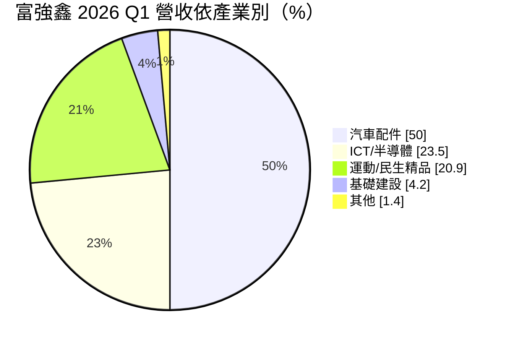
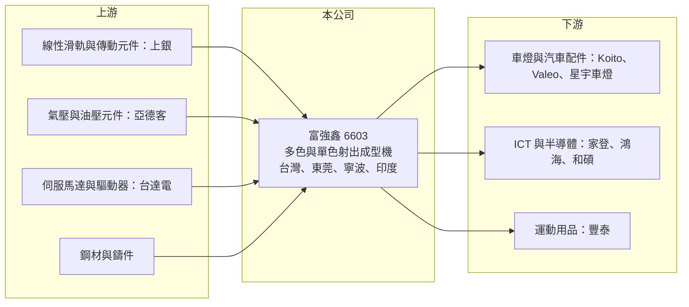

# 6603 富強鑫

> 上櫃｜[[產業索引-電機機械|電機機械]]｜上市（櫃）日期 2004/04/05

# 第一章：企業模式與商業藍圖

> [!info] 撰寫說明
> 精簡版，由 Claude 依公開資料整理，架構比照 [[2330台積電]] 的四章研究，資料截至 2026-10-08。來源：櫃買中心開放資料快照（基本資料、2026 年第二季資產負債與損益、本益比殖利率、每月營收）、富果研究 2026 年 5 月法說會摘要、Goodinfo 經營績效年度表。富果摘要為 AI 整理的法說內容，非公司官方文件。#待校對

富強鑫精密工業（以下簡稱富強鑫）是台灣主要的塑膠[[射出成型]]機製造商之一，本章說明它賣什麼設備、客戶在哪些產業，以及工廠如何在全球分工。

- **核心業務：** 富強鑫總部位於台南關廟，以自有品牌 FCS 銷售塑膠射出成型機，並提供智慧射出產線的整廠規劃。射出成型機是把塑膠粒加熱熔融、再高壓注入模具成形的設備，車燈、手機外殼、晶圓盒、鞋底等塑膠零件都靠它生產。富強鑫的技術核心是[[多色射出]]機，能在同一個成型週期內把不同顏色或材質的塑膠組合成一個零件，這類機台技術門檻與單價都高於一般單色機。
- **營收結構：** 依 2026 年第一季法說資料，產品別以多色機約 60%、單色機約 31% 為主。產業別中汽車配件約 50%、ICT 與半導體約 23.5%、運動與民生精品約 20.9%、基礎建設約 4.2%。車用占一半，主要是車燈：公司表示全球前八大車燈廠中有六家是客戶，包括 Koito、Valeo 與星宇車燈；ICT 客戶包括 [[3680家登]]、[[2317鴻海]]、[[4938和碩]]，運動用品客戶則有 [[9910豐泰]]。
- **營運據點：** 生產基地分布在台灣、中國東莞、浙江寧波（江北與前灣）以及印度。台灣廠負責智慧產線整廠、半導體專用機與全電式機台等高階產品；東莞廠生產中小型機台供應華南；寧波廠以車用大型與超大型多色機為主，供應華東、華北；印度廠初期以單色機服務當地車用客戶。這種「在客戶附近生產」的配置，是設備業因應大型機台運輸成本與售後服務需求的典型做法。
- **長期方向：** 富強鑫的長期方向有三條：一是區域化，跟著供應鏈移轉到北美、東南亞與印度的新產能接單；二是高值化，開發 AI、半導體（如晶圓盒）與新能源車專用機；三是低碳化，以全電式射出機與 MuCell [[物理發泡]]技術幫助客戶減少用料與耗電。公司也推出 iMF 4.0 智慧製造方案，整合遠端監控與故障預診，屬於[[工業4.0]]的應用。

# 第二章：護城河深度與競爭優勢

護城河決定設備廠能否在價格競爭中守住利潤。本章分析富強鑫在全球射出成型機市場的位置、主要對手，以及它的優勢守得住哪些市場。

- **競爭優勢：** 富強鑫最主要的優勢是多色射出的技術累積與車燈客戶基礎。車燈需要透光、多色與高精度的塑膠件，機台必須和模具、材料密切配合，車燈廠一旦在某品牌機台上完成製程開發，後續擴產通常沿用同一供應商。公司宣稱的 HB-3500R 水平轉盤對射機是亞洲最大噸數的多色機型，代表它在大型多色機有一定的工程能力。此外，台灣、中國、印度多地生產，讓它能貼近客戶提供安裝與售後服務。
- **優勢的侷限：** 射出成型機整體是成熟產業，單色機的技術差異小，價格競爭激烈。長期來看富強鑫的[[毛利率]]穩定在 22% 至 27%，但營業利益率多數年度只有 0% 至 6%，表示研發、業務與售後服務費用吃掉大部分毛利。它的護城河集中在多色與專用機這個利基，而非整體市場的定價能力。
- **主要對手：** 全球市場由中國海天國際（規模最大、以價格見長）、伊之密，以及日本住友重機械、日精樹脂、芝浦機械，歐洲的 Engel、Arburg、KraussMaffei 等品牌主導。中國廠商在中低階單色機以成本優勢搶市，日歐品牌則在全電式與高精密機台占優。富強鑫夾在中間，以多色機與客製化整線方案和兩端競爭。
- **觀察重點：** 判斷護城河是否加深，可以看多色機與專用機的比重能否持續提高、營業利益率能否穩定在 5% 以上，以及印度與東南亞據點能否成功承接供應鏈移轉的新訂單。印度市場在 2026 年第一季因當地[[反傾銷稅]]年減約四成，也提醒區域化布局會受到貿易政策牽動。

# 第三章：財務體質與盈利規模

資料日期：2026-10-08，表格是撰寫當時的快照；最新月營收、毛利率、累計 EPS 由自動排程寫在本筆記的屬性欄位（月營收、毛利率、累計EPS 等）。#待校對

財務數字是檢驗設備廠競爭力的最終標準。本章用多年度資料說明富強鑫營收成長但利潤率偏薄的特性，並推算資本報酬與資金成本。

| 年度 | 營收（億元） | [[毛利率]] | [[營業利益率]] | EPS（元） | [[ROE]] |
|---|---|---|---|---|---|
| 2020 | 30.6 | 22.3% | -0.7% | 0.08 | -0.4% |
| 2021 | 43.3 | 24.3% | 4.7% | 0.80 | 4.9% |
| 2022 | 46.1 | 26.7% | 5.6% | 1.05 | 7.2% |
| 2023 | 38.6 | 26.2% | 1.0% | 0.13 | 1.0% |
| 2024 | 45.3 | 25.6% | 2.7% | 0.50 | 2.9% |
| 2025 | 50.8 | 25.3% | 4.0% | 0.61 | 4.1% |

資料來源：Goodinfo 經營績效頁；2025 年營收 50.8 億元與富果法說摘要一致。2020 年 EPS 為正、ROE 為負，可能是 ROE 計算口徑不同，以原始資料照錄。

- **營收規模：** 營收從 2020 年的 30.6 億元成長到 2025 年的 50.8 億元，創歷史新高，2020 至 2025 年年複合成長率約 10.7%，但若從 2021 年起算只有約 4.1%（推算），代表成長主要集中在疫情後的設備補庫存期。2023 年營收下滑約 16%，反映設備業典型的週期波動。2026 年前 8 月累計營收約 31.1 億元，與前一年大致持平。
- **獲利：** 毛利率六年都在 22% 至 27% 之間，相當穩定；但營業利益率最高只有 2022 年的 5.6%，近五年（2021 至 2025）平均 ROE 約 4.0%（推算），獲利能力偏弱。2026 年上半年毛利率 25.0%、營業利益率 2.1%、EPS 0.14 元，所得稅占稅前淨利比例偏高，使淨利更薄。
- **財務特色：** 2026 年第二季底資產總計約 85.1 億元，負債約 56.7 億元，股東權益約 28.4 億元，負債比約 67%，對設備業來說槓桿偏高，其中非流動負債約 26.3 億元，推估包含長期借款與多地廠房建置所需資金（推估）。每股淨值 15.94 元。依法說資料，近五年平均配息率約 64%，最近一次現金股利約每股 0.40 元，屬於「有賺就配」但金額隨獲利起伏的型態。
- **[[ROIC]] 與 [[WACC]]：** 以 2025 年營業利益約 2.05 億元（營收 50.8 億元 × 4.03%）、稅率 20% 計算，稅後營業利益約 1.64 億元；有息負債未查得明細，以約 30 至 35 億元推估（負債總額扣除應付帳款與合約負債等營業性負債後的估計），投入資本約 58 至 63 億元，ROIC 約 2.6% 至 2.8%（推算）；2022 年景氣高點時約 3.5%（推算）。WACC 以 CAPM 推估：無風險利率 1.75%、市場風險溢酬 6%、β 假設 0.9（機械設備股常見值），股東權益成本約 7.2%；負債成本假設 2.5%、稅後 2.0%；以市值約 47 億元與有息負債約 32 億元計，負債占資本約 40%，WACC 約 5.1%（推算）。ROIC 長期低於 WACC，表示富強鑫雖然營收成長、持續配息，但資本報酬尚未超過資金成本，提升營業利益率是創造價值的關鍵。

# 第四章：總體風險與地緣政治

設備業是製造業景氣的放大器。本章整理富強鑫長期需要面對的產業週期、營運與地緣政治風險。

- **產業週期：** 射出成型機屬於資本設備，客戶在景氣好、產能不足時集中下單，景氣轉弱時則延後或取消採購，需求波動比終端產品更大。富強鑫有一半營收來自汽車配件，車市景氣、新車款開發節奏與電動車轉型速度都會直接影響車燈廠的設備投資；2023 年營收下滑就是週期影響的例子。
- **營運風險：** 營業利益率偏低，代表營收稍有下滑就可能接近損益兩平。多地設廠雖然貼近客戶，但也帶來固定成本與管理複雜度，新據點（如印度）在產能利用率提升前會拖累獲利。負債比偏高，利率上升會增加財務負擔。鋼材、鑄件與伺服馬達等關鍵零組件價格上漲時，設備報價不一定能即時反映。
- **其他風險：** 生產與銷售有相當比重在中國，面臨中國同業的價格競爭與美中貿易摩擦；印度的反傾銷稅已在 2026 年影響出貨，顯示新興市場的貿易政策變動是實際風險。營收以外銷與海外子公司為主，人民幣、印度盧比與新台幣的匯率變動會影響換算後的營收與利潤。

# 專有名詞解析

## 產業

- **[[射出成型]]**：將塑膠粒加熱熔融後高壓注入模具、冷卻後成形的加工方式，是塑膠零件最主要的量產工法。
- **[[多色射出]]**：在同一成型週期中把兩種以上顏色或材質的塑膠注入同一模具，常用於車燈與多色外殼。
- **[[物理發泡]]**：在熔融塑膠中注入氮氣或二氧化碳形成微小氣泡，可減少用料與重量，代表技術為 MuCell。
- **[[工業4.0]]**：以感測器、網路與數據分析串連生產設備，實現遠端監控、預測維修與自動化的智慧製造概念。
- **[[反傾銷稅]]**：進口國認定外國產品以低於正常價格傾銷時，對該產品額外課徵的關稅。

# 核心供應鏈

- 上游：線性滑軌與滾珠螺桿 [[2049上銀]]、氣壓元件 [[1590亞德客-KY]]、伺服馬達與驅動器 [[2308台達電]]（以射出機常見零組件供應商列示，實際採購對象待校對）；鋼材與鑄件供應商。
- 下游／客戶：車燈廠 Koito、Valeo、星宇車燈，台灣車燈業者 [[1522堤維西]]、[[6605帝寶]] 屬於同一應用領域（是否為客戶未查得）；ICT 與半導體 [[3680家登]]、[[2317鴻海]]、[[4938和碩]]；運動用品 [[9910豐泰]]。
- 同業：中國海天國際、伊之密、震雄集團，日本住友重機械、日精樹脂、芝浦機械，歐洲 Engel、Arburg、KraussMaffei；台灣同業多未上市櫃。

## 最新新聞
<!-- news:start（自動產生，請勿手動編輯此範圍） -->
- 2026-10-08 🏛️ 重訊 15:23｜公告本公司買回庫藏股期間屆滿執行情形｜[觀測站](https://mops.twse.com.tw/mops/#/web/t05st01)

完整紀錄：[[6603富強鑫 新聞]]
<!-- news:end -->

## 相關連結
- [公開資訊觀測站](https://mopsov.twse.com.tw/mops/web/t05st03?step=1&firstin=1&co_id=6603)
- [Goodinfo](https://goodinfo.tw/tw/StockDetail.asp?STOCK_ID=6603)
- [Yahoo 股市](https://tw.stock.yahoo.com/quote/6603)
- [鉅亨網新聞](https://www.cnyes.com/twstock/6603/news)
