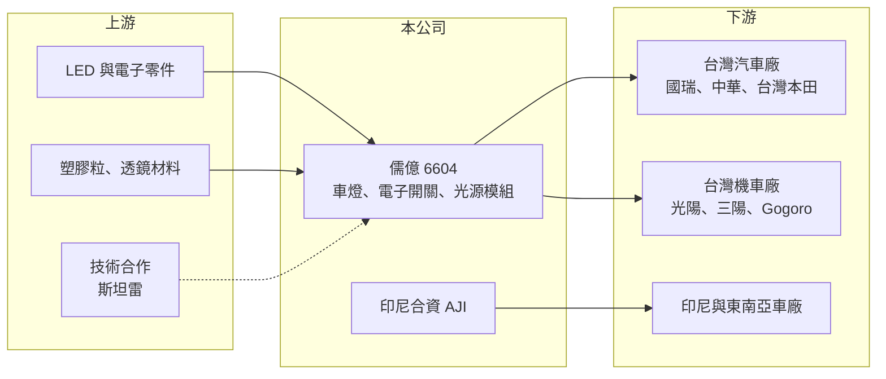

# 6604 儒億

> 上櫃｜[[產業索引-電機機械|電機機械]]｜上市（櫃）日期 2026/10/06

# 第一章：企業模式與商業藍圖

> [!info] 撰寫說明
> 精簡版，由 Claude 依公開資料整理，架構比照 [[2330台積電]] 的四章研究，資料截至 2026-10-08。來源：Goodinfo 年度經營績效頁、優分析 2026 年掛牌前報導、櫃買中心開放資料（基本資料、2026 年第二季資產負債與綜合損益）。創新板／新掛牌，公開資料有限（本公司為 2026 年 10 月新掛牌上櫃，非創新板）；產品別營收比重與 2022 年以前財務數據未查得。#待校對

儒億科技是堤維西集團旗下的汽機車車燈與電子零件廠，2026 年 10 月才掛牌上櫃。本章說明它的產品、客戶與長期方向。

## 一、核心定位：台灣汽機車原廠的車燈與電子件供應商

儒億成立於 1993 年，總部位於台南市安南區，2026 年 10 月 6 日在櫃買中心掛牌，掛牌後實收資本額約 5.1 億元，董事長吳國禎（櫃買中心開放資料）。公司是 [[1522堤維西]] 旗下公司，產品包括汽機車 [[OEM]] 市場的車燈、電子開關鎖類與光源啟動模組（優分析）。

* **專做原廠配套：** 和集團母公司以售後市場為主不同，儒億聚焦供應車廠的原廠零件。OEM 訂單綁定車型，一旦取得通常可以供貨到車型停產，營收相對穩定，但需要通過車廠的長期認證。
* **涵蓋汽車與機車：** 客戶同時包括汽車與機車廠，讓公司能分散單一車種市場的波動。

## 二、客戶與市場

台灣客戶包括國瑞汽車（[[2207和泰車]]旗下）、[[2204中華]]、台灣本田、光陽、[[2206三陽工業]] 與 Gogoro；海外則有日本與馬來西亞等業者。地區別上台灣約占 58%、印尼約占 5%（優分析）。

* **印尼合資公司 AJI：** 儒億持股 50% 的印尼合資公司 AJI 深耕當地 OEM 車燈市場，營運逐年成長，並以業外投資收益的形式挹注儒億獲利。印尼每千人汽車保有量僅約 99 台，公司看好長期成長空間。

## 三、技術能力：從傳統車燈走向智慧頭燈

公司已具備 [[AFS]] 主動轉向頭燈與 [[ADB]] 自適應遠光頭燈的製造能力，並與日本車燈大廠斯坦雷（Stanley）技術合作；同時擁有自己的基板廠與模具廠，可以彈性處理客製開發與量產切換（優分析）。智慧頭燈單價遠高於傳統車燈，是公司提升產品價值的主要方向。

## 四、長期藍圖

公司策略是隨智慧頭燈普及提高單車產值，並透過印尼合資公司開發東南亞市場，同時與堤維西集團互補。董事長在 2026 年表示，預期 2027 至 2028 年營運不會比 2026 年差。

# 第二章：護城河深度與競爭優勢

OEM 車燈需要長期認證與車型綁定，本章分析儒億的競爭優勢與限制。

## 一、護城河的核心組成要素

* **原廠認證與車型綁定：** 進入車廠供應鏈需要數年認證，一旦取得車型訂單通常會供貨數年，形成轉換成本。台灣主要汽機車廠幾乎都是儒億的客戶，顯示公司已建立穩固的本地關係。
* **垂直整合：** 自有基板廠與模具廠讓公司掌握車燈的關鍵製程，開發時程與成本控制優於只做組裝的同業。
* **日系技術合作與集團資源：** 與斯坦雷技術合作，加上堤維西集團在全球車燈市場的經驗，有助於取得智慧頭燈技術。

## 二、主要競爭對手

| 對手 | 定位 | 對儒億的威脅 |
|---|---|---|
| [[1521大億]] | 台灣 OEM 車燈大廠 | 在台灣汽機車原廠車燈直接競爭 |
| [[6605帝寶]] | 車燈廠，售後與原廠皆有 | 模具與量產規模大 |
| 小糸製作所、斯坦雷 | 日本車燈龍頭 | 日系車廠的主要供應商 |
| 中國車燈廠 | 低價、大量 | 在東南亞與機車市場競爭 |

## 三、守得住與守不住

* **守得住：** 台灣汽機車原廠的既有車型訂單，以及印尼合資公司的在地市場。
* **守不住：** 本業利潤率。2023 至 2025 年毛利率只有 13% 至 14%、營業利益率 2.4% 至 4.1%（Goodinfo），OEM 車廠議價力強，零件廠利潤空間有限。
* **觀察重點：** AFS 與 ADB 智慧頭燈訂單能否提高毛利率，以及台灣車市規模變化對營收的影響。

# 第三章：財務體質與盈利規模

資料日期：2026-10-08，表格是撰寫當時的快照；最新月營收、毛利率、累計 EPS 由自動排程寫在本筆記的屬性欄位（月營收、毛利率、累計EPS 等）。#待校對

本章用多年度數據檢視儒億「本業薄利、轉投資加分」的財務結構。

## 一、多年度三率與 ROE

| 年度 | 營收（新台幣） | [[毛利率]] | [[營業利益率]] | EPS（元） | [[ROE]] |
|---|---|---|---|---|---|
| 2023 | 20.1 億 | 14.4% | 4.06% | 2.97 | 20.2% |
| 2024 | 21.6 億 | 13.0% | 2.36% | 2.61 | 15.7% |
| 2025 | 20.7 億 | 13.4% | 3.50% | 2.73 | 13.5% |
| 2026 上半年 | 10.8 億 | 15.85% | 5.51% | 2.23 | 未查得 |

註：2023 至 2025 年取自 Goodinfo；2026 上半年依櫃買中心綜合損益計算（毛利 1.72 億元、營業利益 0.60 億元）。2022 年以前未查得（Goodinfo 頁面另列有 2005 至 2008 年資料，與本公司是否相同無法確認，未採用）。

* **營收穩定：** 營收維持在 20 億元左右，反映 OEM 訂單綁定車型的穩定特性，但也代表成長有限。
* **EPS 高於本業：** 2026 年上半年營業利益約 0.60 億元、業外收益約 0.56 億元（櫃買中心綜合損益），業外主要來自印尼合資公司 AJI 的投資收益（優分析）。轉投資收益讓 EPS 與 ROE 明顯高於本業水準。
* **ROE 下滑：** ROE 從 2023 年的 20.2% 降到 2025 年的 13.5%，2023 至 2025 年平均約 16.5%（推算）。

## 二、股利與財務結構

上櫃前的配息資料未查得。2026 年第二季底總資產約 30.9 億元、總負債約 21.6 億元（其中非流動負債約 12.6 億元）、權益約 9.4 億元，每股淨值 21.46 元（櫃買中心資產負債）。負債比約七成，高於一般零件廠，非流動負債可能包含長期借款（推估）。

## 三、[[ROIC]] 與 [[WACC]]

**ROIC 推算：** 2025 年營業利益約 20.7 億 × 3.5% ≈ 0.72 億元，稅後約 0.58 億元。有息負債未查得，假設總負債 21.6 億元的一半約 10.8 億元為有息負債，加上權益 9.4 億元，投入資本約 20.2 億元，ROIC 約 2.9%（推算）。

**WACC 推算：** 台灣 10 年期公債 1.75%、市場風險溢酬 6%、β 取汽車零件同業常見值 0.9，權益成本約 7.2%；負債成本 3%、稅率 20%，權益占比約 47%，WACC 約 4.6%（推算）。

**結論：** 以本業計算的 ROIC 低於 WACC，代表車燈本業的報酬不足以支應資金成本；若把 AJI 投資收益計入，整體報酬才接近或略高於資金成本（推估）。未來要長期創造價值，需要智慧頭燈拉高本業利潤率，或印尼業務持續成長。

# 第四章：總體風險與地緣政治

本章整理儒億長期面對的車市、技術與海外風險。

## 一、產業週期

* **台灣車市規模：** 台灣營收占近六成，台灣新車與機車銷量受景氣、補助與電動化政策影響，市場規模有限。
* **機車電動化：** 機車產業轉向電動化，車燈與電子開關的設計規格也跟著改變，需持續投入開發。

## 二、營運風險

* **客戶集中：** 營收集中在台灣少數汽機車廠，任一車廠車型減產或轉換供應商都會影響營收。
* **財務槓桿較高：** 負債比約七成，若營運轉弱，利息與還款壓力會放大獲利波動。
* **合資公司依賴：** 獲利有相當比例來自印尼合資公司，當地車市或合資關係變化會影響 EPS。

## 三、其他風險

* **東南亞政經風險：** 印尼車市受利率、匯率與政策影響，波動可能大於台灣。
* **原物料與匯率：** 塑膠粒、LED 與電子零件價格，以及新台幣與印尼盾匯率，都會影響成本與投資收益。

# 專有名詞解析

## 應用

- **[[AFS]]**：主動轉向頭燈，會隨方向盤轉動調整照射方向，讓駕駛在彎道看得更清楚。
- **[[ADB]]**：自適應遠光頭燈，以攝影機偵測前方來車並自動遮蔽部分光束，在開遠光燈時不會刺眼。

## 金融

- **[[ROIC]]**：投入資本報酬率，衡量企業用股東與債權人投入的資本，每年能產生多少稅後營業利益。
- **[[WACC]]**：加權平均資金成本，股東要求報酬與負債利息依資本結構加權後的平均值，是判斷是否創造價值的門檻。

## 產業

- **[[OEM]]**：原廠委託製造，指替品牌廠生產並以品牌廠名義出貨的零件或產品；車用領域指供應車廠組裝新車的零件。

# 核心供應鏈

- 上游：LED 光源、電子零件、塑膠粒與透鏡材料；技術合作夥伴為日本斯坦雷。
- 下游／客戶：國瑞汽車（[[2207和泰車]]旗下）、[[2204中華]]、台灣本田、光陽、[[2206三陽工業]]、Gogoro，以及日本、馬來西亞與印尼車廠。
- 同業：[[1521大億]]、[[6605帝寶]]、小糸製作所、斯坦雷。
- 集團：[[1522堤維西]]。

## 最新新聞
<!-- news:start（自動產生，請勿手動編輯此範圍） -->
- 2026-10-06 📰 媒體 10:39｜儒億上櫃漲逾7% 樂看東南亞車市｜[鉅亨網](https://news.cnyes.com/news/id/6622534)
- 2026-10-05 🏛️ 重訊 15:53｜公告本公司洽定上櫃買賣開始日並自同日起終止興櫃買賣｜[觀測站](https://mops.twse.com.tw/mops/#/web/t05st01)

完整紀錄：[[6604儒億 新聞]]
<!-- news:end -->

## 相關連結
- [公開資訊觀測站](https://mopsov.twse.com.tw/mops/web/t05st03?step=1&firstin=1&co_id=6604)
- [Goodinfo](https://goodinfo.tw/tw/StockDetail.asp?STOCK_ID=6604)
- [Yahoo 股市](https://tw.stock.yahoo.com/quote/6604)
- [鉅亨網新聞](https://www.cnyes.com/twstock/6604/news)
