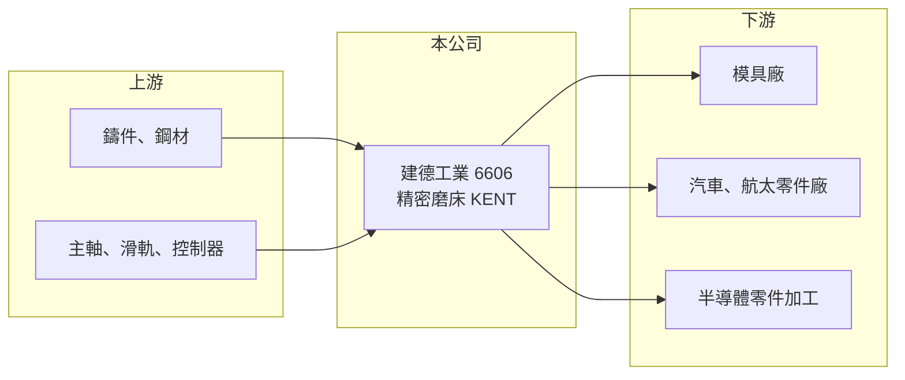

# 6606 建德工業

> 上市｜[[產業索引-電機機械|電機機械]]｜上市（櫃）日期 2023/03/24

# 第一章：企業模式與商業藍圖

> [!info] 撰寫說明
> 精簡版，由 Claude 依公開資料整理，架構比照 [[2330台積電]]，資料截至 2026-10-08。來源：證交所開放資料快照（基本資料、2026 年第二季資產負債與損益、營益分析、股利、每月營收）、Goodinfo 經營績效頁、nStock 公司簡介、旺得富 2023 年上市新聞。產品線與海外據點部分依記憶整理，已標註待校對。公開資料有限。#待校對

建德工業（以下簡稱建德）是台灣老牌的[[精密磨床]]製造商，英文品牌為 KENT，2023 年上市時被媒體稱為「全球精密磨床龍頭」。理解它的關鍵在於：磨床是工具機中講究精度的細分市場，建德靠專業化維持遠高於一般工具機同業的毛利率，但營收規模不大、成長性有限。

- **核心業務：** 建德成立於 1966 年，2023 年 3 月以每股 19 元在證交所上市，實收資本額約 11.03 億元，董事長為李金旆、總經理為黃盈璇，總部位於雲林斗六。公司營業項目為各種精密機械工作機台及工具鋼模的設計、製造與銷售，主力是平面磨床等磨削設備（待校對）。磨床用於零件的最後精修，對平面度與表面粗糙度要求極高，是模具、汽車、航太與半導體零件加工不可缺少的設備。
- **營收結構：** 公開資料未揭露產品別與地區別營收比重。依記憶，建德以外銷為主，北美市場透過自有的 KENT USA 通路銷售，比重較高（待校對）。月營收備註提到「本公司及子公司」，代表集團有海外或轉投資子公司一併貢獻營收。
- **營運據點：** 主要生產基地在雲林斗六工業區，地處中部工具機聚落之外，用地與人力成本相對較低。海外銷售與服務據點的實際配置未查得（待校對）。
- **長期方向：** 建德的長期策略是在磨床這個利基市場守住精度與品牌，而不是追求規模。2026 年前八月營收較前一年同期成長約 27%，2026 年上半年營業利益率接近 30%，顯示高階磨床需求回溫時，固定成本被攤薄的效果相當明顯。

# 第二章：護城河深度與競爭優勢

建德的護城河來自長年專注單一機種所累積的精度與品牌，屬於窄而深的利基型護城河。

- **競爭優勢：** 精密磨床的關鍵在床台剛性、主軸精度與刮花等手工技術，這些需要數十年累積，新進者很難在短時間追上。毛利率長期維持在 35% 至 46%，明顯高於一般工具機廠常見的 20% 至 30%，代表客戶願意為精度與穩定性付溢價。
- **主要對手：** 國際上有日本岡本（Okamoto）、德國與瑞士的高階磨床廠；台灣同業包括 [[4526東台]]、[[4533協易機]]、1583程泰 等綜合工具機廠，以及多家未上市的磨床專業廠（待校對）。
- **觀察重點：** 長期要追蹤營收能否突破 9 億元左右的天花板，以及高毛利率能否在景氣低迷時守住。2023 至 2024 年營收下滑時毛利率降到 37% 至 40%，仍維持在高檔，是護城河存在的證據。

# 第三章：財務體質與盈利規模

資料日期：2026-10-08，表格是撰寫當時的快照；最新月營收、毛利率、累計 EPS 由自動排程寫在本筆記的屬性欄位（月營收、毛利率、累計EPS 等）。#待校對

建德的財務呈現「規模小、利潤率高、配息大方」的特徵，但資本報酬率受限於帳上資產較多。

| 年度 | 營收（億元） | [[毛利率]] | [[營業利益率]] | EPS（元） | [[ROE]] |
|---|---|---|---|---|---|
| 2019 | 7.32 | 35.2% | 11.5% | 0.77 | 5.98% |
| 2020 | 7.08 | 37.5% | 11.3% | 3.90 | 24.9% |
| 2021 | 8.74 | 46.1% | 26.3% | 1.60 | 9.81% |
| 2022 | 9.01 | 42.7% | 21.4% | 1.47 | 9.07% |
| 2023 | 7.56 | 40.0% | 21.4% | 0.95 | 6.46% |
| 2024 | 7.29 | 37.0% | 17.3% | 0.92 | 6.69% |
| 2025 | 8.15 | 40.2% | 23.5% | 1.09 | 6.79% |
| 2026 上半年 | 4.85 | 43.4% | 29.6% | 0.82 | 未查得 |

（來源：Goodinfo 經營績效頁；2026 上半年取自證交所開放資料。）

- **營收規模：** 2019 至 2025 年營收在 7 億至 9 億元之間，2021 至 2025 年年複合成長率約 -1.7%（推算），屬於成熟、低成長的利基市場。2020 年 EPS 3.90 元、ROE 24.9% 明顯偏離本業水準，推估含一次性業外收益（待校對）。
- **獲利：** 2021 至 2025 年平均 ROE 約 7.8%（推算），本業利潤率雖高，但 ROE 不突出，原因是帳上權益偏大、財務槓桿低。2026 年上半年稅前純益率約 31%，但所得稅費用約占稅前淨利四成，稅後純益率降到約 18%，推估與海外子公司盈餘匯回或一次性稅務有關（待校對）。
- **財務特色：** 依 2026 年第二季資料，總資產約 23.4 億元、權益約 16.9 億元、負債約 6.5 億元，負債比約 28%，財務穩健。配息相當大方：2024 年度現金股利 3 元，高於當年 EPS；2025 年度配發 1.03 元，配息率約 95%（推算），幾乎把盈餘全數發還股東。
- **[[ROIC]] 與 [[WACC]]：** 2026 年上半年營業利益約 1.44 億元，年化後稅後營業利益約 2.30 億元（推算，稅率 20%），投入資本以權益 16.9 億元到「權益加全部負債」23.4 億元計算，ROIC 約 9.8% 至 13.6%（推算）；2025 年營業利益約 1.92 億元，ROIC 約 9%（推算）。WACC 以 [[CAPM]] 推估：無風險利率 1.75%、市場風險溢酬 6%、β 假設 1.0（工具機股常見值），權益成本約 7.75%；有息負債比重低，WACC 約 7.3%（推算）。ROIC 略高於 WACC，代表建德本業有創造價值，但利差不大，主要原因是資本使用效率不高。

# 第四章：總體風險與地緣政治

建德的風險來自工具機的景氣循環、外銷市場的匯率與關稅，以及規模較小的限制。

- **產業週期：** 工具機屬於資本財，需求跟著製造業投資循環，景氣下行時客戶最先延後購置設備。2023 至 2024 年營收下滑兩成即為例子，磨床雖屬精修設備、需求較穩，仍無法完全避開循環。
- **營運風險：** 營收規模不到 10 億元，研發與海外通路投入有限，若國際大廠或中國廠商在中高階磨床市場削價，建德的應對空間較小。精密加工仰賴資深技師，人才傳承也是長期挑戰。
- **其他風險：** 外銷比重高，新台幣升值會壓縮毛利；美國關稅政策變化直接影響北美客戶的採購成本（待校對）；鑄件與鋼材價格波動影響成本。

# 專有名詞解析

## 金融

- **[[配息率]]**：現金股利占每股盈餘的比例，越高代表公司把越多盈餘發還股東。
- **[[CAPM]]**：資本資產定價模型，以無風險利率加上 β 乘以市場風險溢酬，推估股東要求的報酬率。

## 產業

- **[[精密磨床]]**：以高速旋轉的砂輪磨削工件表面的工具機，用於零件最後的精修，精度可達微米等級。
- **[[工具機]]**：用來切削、加工金屬零件的機器，是製造業的母機，台灣中部有完整的工具機聚落。

# 核心供應鏈

- 上游：鑄件與鋼材，以及主軸、線性滑軌、控制器等關鍵零組件；台灣傳動元件廠如 [[2049上銀]] 為產業常見供應商，與建德的實際往來未查得，#待校對。
- 下游／客戶：模具廠、汽車與航太零件加工廠、半導體設備零件加工廠，以北美與海外客戶為主（待校對）。
- 同業：[[4526東台]]、[[4533協易機]]、1583程泰；國際對手有日本岡本等磨床廠。

## 最新新聞
<!-- news:start -->
<!-- news:end -->

## 相關連結
- [公開資訊觀測站](https://mopsov.twse.com.tw/mops/web/t05st03?step=1&firstin=1&co_id=6606)
- [Goodinfo](https://goodinfo.tw/tw/StockDetail.asp?STOCK_ID=6606)
- [Yahoo 股市](https://tw.stock.yahoo.com/quote/6606)
- [鉅亨網新聞](https://www.cnyes.com/twstock/6606/news)
