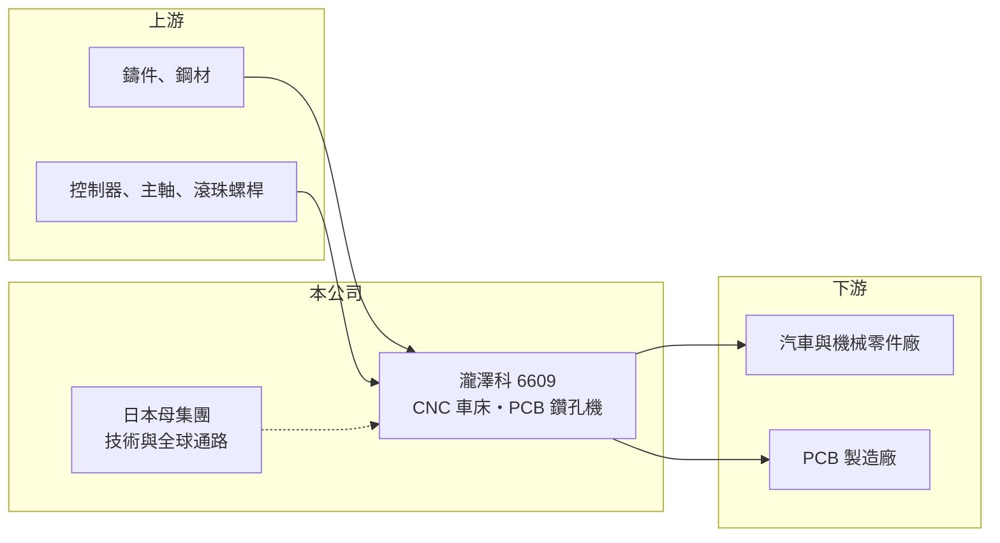

# 6609 瀧澤科

> 上櫃｜[[產業索引-電機機械|電機機械]]｜上市（櫃）日期 2003/09/23

# 第一章：企業模式與商業藍圖

> [!info] 撰寫說明
> 精簡版，由 Claude 依公開資料整理，架構比照 [[2330台積電]]，資料截至 2026-10-08。來源：櫃買中心開放資料快照（基本資料、2026 年第二季資產負債與損益、每月營收、本益比殖利率）、Goodinfo 經營績效頁、鉅亨網公司基本資料。日本母公司與股權沿革依記憶整理，已標註待校對。公開資料有限。#待校對

台灣瀧澤科技（以下簡稱瀧澤科）是日系背景的工具機製造商，主要產品為 [[CNC]] 車床與 [[PCB 鑽孔機]]。理解它的關鍵在於：公司同時站在傳統金屬加工與電子產業兩個循環上，車床需求跟著製造業投資走，鑽孔機需求則跟著電路板廠擴產走。

- **核心業務：** 瀧澤科成立於 1971 年，2003 年在櫃買中心上櫃，實收資本額約 7.25 億元，董事長為日籍的松田哲、總經理為林振詠，總部與工廠位於桃園平鎮。公司製造與銷售 CNC 車床與 PCB 鑽孔機，前者用於汽車、機械零件的車削加工，後者用於在電路板上鑽出導通孔。依記憶，瀧澤科是日本瀧澤鐵工所的台灣子公司，而日本瀧澤鐵工所於 2023 年被日本電產（Nidec）收購（待校對）。
- **營收結構：** 公開資料未揭露車床與鑽孔機的營收比重。2026 年 8 月營收較前一年同月成長約 92%，公司說明為「市場需求增加」；依產業脈絡推估，AI 伺服器帶動高層數電路板擴產，是鑽孔機需求回升的主因（推估）。
- **營運據點：** 主要生產基地在桃園平鎮，海外銷售依記憶透過日本母公司的全球通路，以及中國等地的據點進行（待校對）。
- **長期方向：** 瀧澤科的長期價值取決於兩件事：一是在日本母集團的分工中能承接多少車床與鑽孔機的生產，二是 PCB 鑽孔機能否跟上 AI 伺服器板所需的細孔徑、高層數加工規格。

# 第二章：護城河深度與競爭優勢

瀧澤科的護城河主要來自日系母公司的技術與品牌背書，以及在 PCB 鑽孔機這個寡占市場的長年經驗。

- **競爭優勢：** 日系品牌在精度與耐用度上有長期口碑，台灣工廠則提供較低的生產成本，這是「日本技術、台灣製造」的組合。PCB 鑽孔機全球供應商不多，客戶導入新機台需要驗證孔位精度與穩定度，具有一定的[[轉換成本]]。
- **主要對手：** CNC 車床在台灣有 [[1583程泰]]、[[4526東台]]、[[7709榮田]]、[[1530亞崴]] 等同業，國際上有日本 Mazak、Okuma 等大廠。PCB 鑽孔機主要對手為大量科技 [[3167大量]] 與日本、中國的鑽孔機廠商（待校對）。
- **觀察重點：** 毛利率長期只有 18% 至 24%，低於多數台灣工具機同業，2025 年更降到 11.9%，代表在車床市場的訂價能力有限。長期要看產品組合是否往鑽孔機等高毛利產品移動，以及日本母集團的策略調整。

# 第三章：財務體質與盈利規模

資料日期：2026-10-08，表格是撰寫當時的快照；最新月營收、毛利率、累計 EPS 由自動排程寫在本筆記的屬性欄位（月營收、毛利率、累計EPS 等）。#待校對

瀧澤科的財務呈現強烈的循環性：營收隨工具機與電路板景氣擺盪，獲利在高峰與虧損之間變化很大。

| 年度 | 營收（億元） | [[毛利率]] | [[營業利益率]] | EPS（元） | [[ROE]] |
|---|---|---|---|---|---|
| 2019 | 26.5 | 21.7% | 8.46% | 1.86 | 6.26% |
| 2020 | 21.2 | 17.9% | 4.11% | 0.27 | 0.91% |
| 2021 | 29.4 | 21.5% | 6.52% | 2.51 | 8.44% |
| 2022 | 36.0 | 24.0% | 9.89% | 5.10 | 15.8% |
| 2023 | 26.6 | 22.2% | 5.94% | 1.80 | 5.36% |
| 2024 | 26.9 | 21.2% | 5.97% | 2.58 | 7.63% |
| 2025 | 20.4 | 11.9% | -6.92% | -1.53 | -4.54% |
| 2026 上半年 | 11.5 | 17.7% | 0.69% | 0.12 | 未查得 |

（來源：Goodinfo 經營績效頁；2026 上半年取自櫃買中心開放資料。）

- **營收規模：** 營收在 20 億至 36 億元之間起伏，2022 年為高峰，2021 至 2025 年年複合成長率約 -8.7%（推算）。2025 年營收降到 20.4 億元並出現虧損，2026 年下半年月營收明顯回升。
- **獲利：** 2021 至 2025 年平均 ROE 約 6.5%（推算），營業利益率長期低於 10%。2026 年上半年稅前淨利約 0.29 億元，其中約 0.21 億元來自業外收入，本業幾乎只是損益兩平。
- **財務特色：** 依 2026 年第二季資料，總資產約 37.9 億元、權益約 23.8 億元、負債約 14.1 億元，負債比約 37%。保留盈餘約 15.0 億元，遠高於股本 7.25 億元，代表過去累積了可觀盈餘，但 2025 年虧損後近期未配發現金股利。
- **[[ROIC]] 與 [[WACC]]：** 2026 年上半年營業利益約 0.08 億元，年化後稅後營業利益約 0.13 億元（推算），以權益 23.8 億元到「權益加全部負債」37.9 億元計算，ROIC 約 0.3% 至 0.5%（推算）；2025 年營業虧損約 1.41 億元，ROIC 為負。WACC 以 [[CAPM]] 推估：無風險利率 1.75%、市場風險溢酬 6%、β 假設 1.1（工具機股常見值），權益成本約 8.35%；假設有息負債占資本約 20%、稅前負債成本 2.5%，WACC 約 7.1%（推算）。即使在 2022 年高峰，ROIC 也只略高於 WACC，長期來看公司大致沒有創造超額報酬。

# 第四章：總體風險與地緣政治

瀧澤科的風險來自雙重景氣循環、母公司策略與低毛利結構。

- **產業週期：** CNC 車床需求跟著汽車、機械等製造業投資，PCB 鑽孔機需求跟著電路板廠擴產，兩者都是高度循環的資本財。電路板產業過去曾有多次擴產後供過於求的經驗，鑽孔機訂單可能在一兩年內急升急降，屬於[[長鞭效應]]的末端。
- **營運風險：** 日籍董事長顯示經營決策與日本母集團高度連動，若母集團調整生產分工或把產能移往他處，台灣子公司的訂單會直接受影響（待校對）。毛利率偏低，景氣反轉時容易陷入虧損。
- **其他風險：** 外銷與日圓、美元匯率連動；中國工具機廠在中低階車床市場持續削價；鑄件、鋼材與控制器等零件成本波動。

# 專有名詞解析

## 金融

- **[[轉換成本]]**：客戶更換供應商時需要付出的時間、驗證與風險成本，越高代表客戶越不容易流失。
- **[[長鞭效應]]**：終端需求的小幅變動，沿供應鏈往上游傳遞時被逐級放大，造成上游庫存與訂單劇烈波動。
- **[[CAPM]]**：資本資產定價模型，以無風險利率加上 β 乘以市場風險溢酬，推估股東要求的報酬率。

## 產業

- **[[CNC]]**：電腦數值控制，用程式控制機台的刀具路徑進行切削、鑽孔或雕刻，是現代工具機的基礎。
- **[[PCB 鑽孔機]]**：在印刷電路板上鑽出導通孔的設備，孔位精度與速度決定電路板的良率與產能。
- **[[工具機]]**：用來切削、加工金屬零件的機器，是製造業的母機，台灣中部有完整的工具機聚落。

# 核心供應鏈

- 上游：鑄件、鋼材、CNC 控制器、主軸與滾珠螺桿等零組件；傳動元件常見供應商如 [[2049上銀]]，實際往來未查得，#待校對。
- 下游／客戶：汽車、機械零件加工廠，以及電路板製造商，PCB 客戶群可能包括 [[3037欣興]]、[[2313華通]]、[[3044健鼎]] 等大型板廠（推估，待校對）。
- 同業：車床領域的 [[1583程泰]]、[[4526東台]]、[[7709榮田]]、[[1530亞崴]]；鑽孔機領域的 [[3167大量]]。

## 最新新聞
<!-- news:start（自動產生，請勿手動編輯此範圍） -->
- 2026-10-12 📰 媒體 18:51｜營收速報 - 瀧澤科(6609)9月營收2.46億元年增率高達112.65％｜[鉅亨網](https://news.cnyes.com/news/id/6628399)

完整紀錄：[[6609瀧澤科 新聞]]
<!-- news:end -->

## 相關連結
- [公開資訊觀測站](https://mopsov.twse.com.tw/mops/web/t05st03?step=1&firstin=1&co_id=6609)
- [Goodinfo](https://goodinfo.tw/tw/StockDetail.asp?STOCK_ID=6609)
- [Yahoo 股市](https://tw.stock.yahoo.com/quote/6609)
- [鉅亨網新聞](https://www.cnyes.com/twstock/6609/news)
