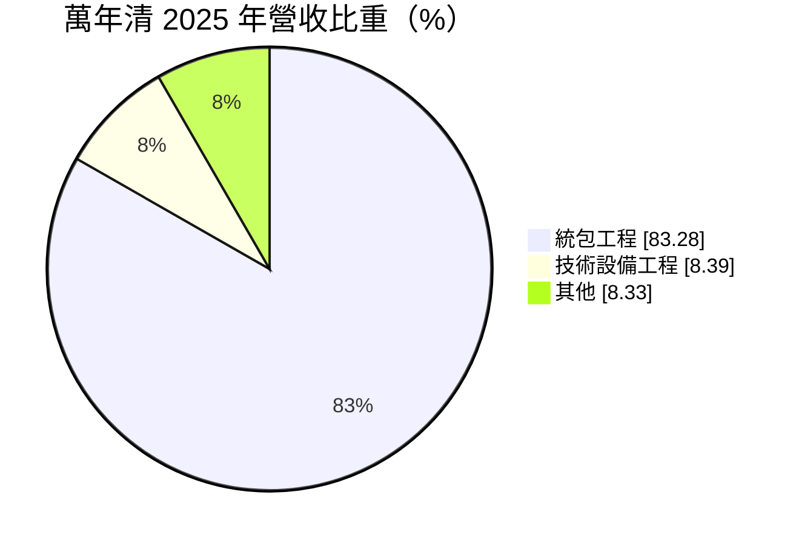
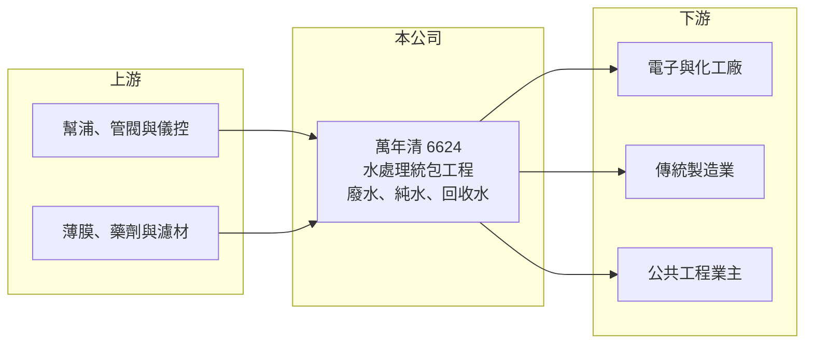

# 6624 萬年清

> 上櫃｜[[產業索引-綠能環保|綠能環保]]｜上市（櫃）日期 2019/05/28

# 第一章：企業模式與商業藍圖

> [!info] 撰寫說明
> 精簡版，由 Claude 依公開資料整理，架構比照 [[2330台積電]]，資料截至 2026-10-08。來源：富邦 MoneyDJ 財務比率年表（2018 至 2025 年）與基本資料（2025 年營收比重）；櫃買中心開放資料快照（基本資料、2026 年上半年資產負債與損益、本益比殖利率、每月營收）；經濟日報、工商時報、富果法說標題。客戶產業與技術細節為憑記憶整理，公開收購的年份依報導日期推估，均已標「待校對」；歷年營收由每股營業額與成長率推算。公開資料有限。#待校對

萬年清環境工程成立於 1999 年 2 月、2019 年 5 月上櫃，董事長張祐銘、總經理何家慶。它是台灣中小型的水處理[[統包工程]]商，替工廠設計、建造[[工業廢水處理]]、純水與回收水系統，也承接公共工程中的水處理設施。2025 年底（依報導日期推估，待校對）世紀集團與斐成公司對萬年清進行[[公開收購]]，並表示將帶領公司轉型為「智慧治水方案商」。

- **核心業務：** 2025 年營收中統包工程占 83.28%、技術設備工程占 8.39%、其他占 8.33%。統包工程是從設計、採購到施工一次承攬整套水處理系統，技術設備工程則是供應關鍵設備或模組，其他推估包括維運服務與耗材（內容待校對）。工業廢水處理是工廠取得排放許可的必要設施，純水與回收水系統則關係到生產品質與用水成本。
- **營收結構：** 依每股營業額與成長率推算，2025 年營收約 6.2 億元（推算），2024 年約 6.9 億元（推算）為近年高點。營收依工程進度認列，接單的時點決定各年度的起伏；2026 年 1 至 8 月累計營收 2.15 億元，年減約 31%，顯示在手訂單轉換為營收的速度放緩。
- **營運據點：** 以台灣為主，客戶涵蓋電子、化工與傳統製造業（產業比重待校對）。工程公司的主要資產是工程團隊、設計經驗與過往實績，而非大型廠房。
- **長期方向：** 新股東世紀集團（與哪一家上市櫃公司相關待校對）提出智慧治水轉型，方向推估是結合感測、自動控制與數據分析，提供水處理系統的遠端監控與節能優化服務。若轉型成功，萬年清可能從一次性工程走向長期服務合約，但目前仍在初期階段。

# 第二章：護城河深度與競爭優勢

萬年清的護城河較淺，主要依賴工程實績與客戶關係；水處理統包市場參與者眾多，價格競爭激烈。

- **競爭優勢：** 水處理工程需要針對不同產業的廢水特性設計處理流程，累積的設計案例與操作經驗是接單的基礎。上櫃公司的身分與新股東的集團資源，有助於承接規模較大的工程與取得金融機構的履約保證。不過 2018 年後[[毛利率]]從 35% 降到約 14% 至 23%，顯示早期的高毛利專案難以複製。
- **主要對手：** 半導體與高科技廠的水處理工程有 [[6944兆聯實業]]、[[2404漢唐]] 等大型廠務工程商；公共與一般工業水處理則有 [[8936國統]]（自來水管線與水處理）、欣達環工（未上市，待校對）等眾多中小型工程公司。萬年清規模較小，在大型專案上較難與頭部業者競爭。
- **觀察重點：** [[營業利益率]]在 2025 年為 3.01%、2026 年上半年為 −1.48%（由損益表計算），本業接近損益兩平。觀察重點是新股東入主後，能否帶來較高毛利的專案與服務型收入，讓營業利益率回到 5% 以上；以及在手訂單的規模能否支撐營收回升。

# 第三章：財務體質與盈利規模

資料日期：2026-10-08，表格是撰寫當時的快照；最新月營收、毛利率、累計 EPS 由自動排程寫在本筆記的屬性欄位（月營收、毛利率、累計EPS 等）。#待校對

萬年清 2019 年上櫃後獲利能力明顯下降，近五年 ROE 多在個位數，屬於低獲利的工程公司。

| 年度 | 營收（億元） | [[毛利率]] | [[營業利益率]] | EPS（元） | [[ROE]] |
|---|---|---|---|---|---|
| 2021 | 約 3.9（推算） | 19.76% | 2.57% | 0.04 | 0.25% |
| 2022 | 約 5.0（推算） | 22.94% | 6.27% | 1.36 | 7.69% |
| 2023 | 約 5.6（推算） | 19.88% | 4.75% | 1.20 | 6.47% |
| 2024 | 約 6.9（推算） | 14.43% | 1.10% | 0.71 | 3.73% |
| 2025 | 約 6.2（推算） | 20.38% | 3.01% | 0.36 | 1.82% |

註：2025 年營收以每股營業額 27.53 元乘以約 2,258 萬股推算，其他年度依 MoneyDJ 營收成長率回推；股本曾變動，推算值僅供參考。2026 年上半年營收 1.89 億元、毛利率約 17.2%、營業利益率約 −1.5%、EPS 0.01 元（櫃買中心資料，比率由損益表計算）。

- **長期指標：** 2021 至 2025 年營收年複合成長率約 13%（推算），但近 5 年平均 [[ROE]] 只有約 4.0%（推算）。最近一次年度現金股利約 0.29 元（櫃買中心殖利率資料），約為 2025 年 EPS 0.36 元的 80%。每股現金流量正負交錯（2023 年 −5.47 元、2024 年 6.49 元、2025 年 1.92 元），反映工程款收付的時間差，[[自由現金流]]不穩定。
- **[[ROIC]] 與 [[WACC]]：** 2025 年稅後營業利益約 1,500 萬元（營業利益率 3.01% × 營收約 6.2 億元 × 0.8），投入資本約 6.3 億元（2026 年第二季權益總計 5.00 億元，加上以總負債 2.69 億元的一半推估的有息負債約 1.3 億元），ROIC 約 2.4%（推算）。WACC 約 6.1%（推算：無風險利率 1.75%、市場風險溢酬 6%、β 取工程同業常見值 0.9，股東權益成本 7.15%；稅前負債成本 2.5%、稅率 20%；權益比重約 79%）。ROIC 低於 WACC 約 3.7 個百分點，代表目前的營運規模與毛利水準尚不足以創造價值。
- **財務特色：** 2026 年第二季負債比率約 35%（負債 2.69 億元 ÷ 資產 7.69 億元），較 2023 年的 64.91% 大幅下降。資本公積 2.40 億元高於保留盈餘 3,346 萬元，代表股東權益主要來自增資而非累積獲利。2026 年上半年歸屬母公司淨利僅 15.4 萬元，非控制權益分走大部分淨利。

# 第四章：總體風險與地緣政治

萬年清的風險集中在接單不穩、工程毛利與經營權變動後的轉型執行。

- **產業週期：** 工業水處理工程跟著製造業的擴廠與環保法規走，電子業或傳產業景氣下滑時，新廠投資減少會讓接單轉弱。公共工程則受政府預算與招標時程影響。
- **營運風險：** 統包工程以固定總價承攬，物料與人力成本上漲、工期延誤或設計變更，都可能讓單一專案虧損。公司規模小，一兩個大型專案的成敗就足以影響全年獲利。
- **其他風險：** 經營權變動後的策略調整需要時間，智慧治水轉型可能需要額外投資，短期內壓抑獲利；排放標準趨嚴是長期商機，但也提高技術要求與保固責任。

# 專有名詞解析

## 金融

- **[[ROIC]]**：投入資本報酬率，稅後營業利益除以股東權益加有息負債，衡量本業運用資本的效率。
- **[[WACC]]**：加權平均資金成本，股東與債權人要求報酬率的加權平均，是 ROIC 要超越的門檻。

## 產業

- **[[統包工程]]**：由單一廠商負責設計、採購與施工整個系統，業主只需面對一個窗口。
- **[[工業廢水處理]]**：把工廠排出的含污染物廢水處理到符合放流標準，是工廠取得排放許可的必要設施。
- **[[公開收購]]**：收購方公告以特定價格向不特定股東收購股票，常用於取得公司經營權。

# 核心供應鏈

- 上游：幫浦、管閥、薄膜與藥劑供應商（名單未查得），污水設備品牌如 [[6641基士德-KY]] 屬同一產業鏈。
- 下游／客戶：電子、化工與一般製造業工廠，以及公共工程業主（名單待校對）。
- 同業：[[6944兆聯實業]]、[[2404漢唐]]、[[8936國統]]。

## 最新新聞
<!-- news:start（自動產生，請勿手動編輯此範圍） -->
- 2026-10-19 🏛️ 重訊 16:24｜公告萬年清股份有限公司國內第一次有擔保轉換公司債(簡稱：萬年清一，代碼：66241)發行公司行使債券贖回權暨訂於115年12月10日終止櫃檯買賣等相關事宜。｜[觀測站](https://mops.twse.com.tw/mops/#/web/t05st01)
- 2026-10-12 📰 媒體 14:23｜萬年清前9月營收2.32億元年減37% 手中訂單看到明年H2｜[鉅亨網](https://news.cnyes.com/news/id/6628043)

完整紀錄：[[6624萬年清 新聞]]
<!-- news:end -->

## 相關連結
- [公開資訊觀測站](https://mopsov.twse.com.tw/mops/web/t05st03?step=1&firstin=1&co_id=6624)
- [Goodinfo](https://goodinfo.tw/tw/StockDetail.asp?STOCK_ID=6624)
- [Yahoo 股市](https://tw.stock.yahoo.com/quote/6624)
- [鉅亨網新聞](https://www.cnyes.com/twstock/6624/news)
