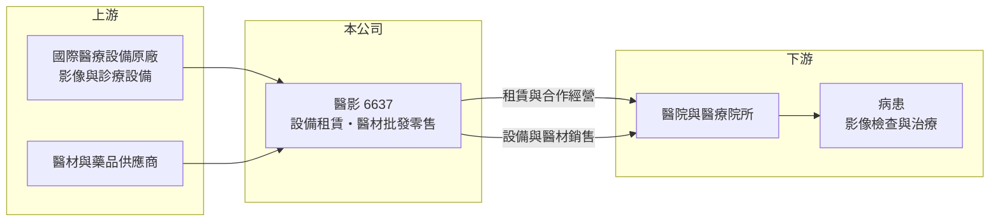

# 6637 醫影

> 上櫃｜[[產業索引-生技醫療業|生技醫療業]]｜上市（櫃）日期 2024/06/18

# 第一章：企業模式與商業藍圖

> [!info] 撰寫說明
> 精簡版，由 Claude 依公開資料整理，架構比照 [[2330台積電]] 的四章研究，資料截至 2026-10-08。來源：櫃買中心開放資料快照（基本資料、2026 年第二季綜合損益與資產負債、每月營收、本益比）、Goodinfo 經營績效頁、nStock 公司簡介。公開資料有限，產品線、代理品牌與營收比重未查得，業務模式部分為依營業項目與財務結構的推估。#待校對

本章說明醫影股份有限公司（股票代號：6637，以下簡稱醫影）的商業模式：一家以醫療器材租賃與銷售為主的醫療通路服務商。

- **核心業務：** 醫影 1992 年在台北設立，2024 年 6 月在櫃買中心上櫃，董事長兼總經理為謝穗徽。依公司登記的營業項目，業務包括醫療器材租賃、藥品及醫療器材批發與零售、國際貿易與管理顧問。從公司名稱與業務組合推估，醫影以醫療影像相關設備為主軸，透過租賃、銷售與合作經營，把昂貴的醫療設備提供給醫院使用（推估，待校對）。
- **營收結構：** 營收大致可分為兩類：一是設備租賃或合作經營帶來的持續性收入，二是設備與醫材的一次性銷售收入（推估）。2025 年營收從 2024 年的 8.29 億元跳升到 11.6 億元，毛利率卻從 40.5% 降到 30.1%，符合「低毛利的設備銷售占比提高」的特徵；2026 年 1 至 8 月累計營收 6.14 億元，較去年同期減少約 29%，說明銷售型收入具有明顯的專案起伏。
- **營運據點：** 總部在台北市，客戶以台灣的醫院與醫療院所為主（推估）。2026 年第二季非流動負債 4.34 億元、非流動資產約 9.71 億元，資產中有相當比重屬長期設備，這符合租賃業者需要先購置設備、再分年回收的資金模式。
- **長期方向：** 台灣人口老化使影像檢查與醫療設備需求長期成長，但中小型醫院往往無力一次購置高價設備，租賃與合作經營可以讓醫院以分期方式取得設備，這是醫影業務的長期基礎。公司的長期課題是擴大持續性收入的比重，降低對單一年度設備銷售的依賴。

# 第二章：護城河深度與競爭優勢

醫療設備通路業者的護城河，來自客戶關係、維修服務與資金調度能力。本章分析醫影的競爭地位。

- **競爭優勢：** 第一是長約關係。醫療設備租賃或合作經營通常為多年期合約，設備進駐醫院後，維修、耗材與升級都由同一家業者負責，醫院更換供應商的成本高。第二是資金與經驗。購置設備需要先投入大量資金，並承擔設備使用率不如預期的風險，有長期經營紀錄、懂得評估醫院需求的業者較具優勢。第三是精簡的營運費用，2026 年上半年營業費用只占營收約 10.5%，使營業利益率能維持在 15% 以上。
- **主要對手：** 台灣醫療設備代理與租賃同業包括 [[4104佳醫]]（透析與醫美設備代理）、[[4116明基醫]]；國際影像設備原廠如 GE 醫療、西門子醫療、飛利浦等，也會直接銷售或透過其他代理商與醫院合作。醫院採購多以招標進行，價格競爭不可避免。
- **觀察重點：** 第一，持續性收入（租賃、合作經營）占營收的比重是否提升，這決定獲利的穩定度。第二，毛利率能否回到 40% 以上，2025 年的下滑是否只是產品組合造成。第三，新設備投資的回收期與資產周轉率，避免為擴大營收而承擔過多長期資產。

# 第三章：財務體質與盈利規模

資料日期：2026-10-08，表格是撰寫當時的快照；最新月營收、毛利率、累計 EPS 由自動排程寫在本筆記的屬性欄位（月營收、毛利率、累計EPS 等）。#待校對

醫影的財報特色是「高營業利益率、高 ROE、高配息」。本章用多年度數字檢視這個特色是否穩定。

| 年度 | 營收（新台幣） | [[毛利率]] | [[營業利益率]] | EPS（元） | [[ROE]] |
|---|---|---|---|---|---|
| 2021 | 6.04 億 | 37.6% | 22.3% | 3.58 | 18.2% |
| 2022 | 4.87 億 | 49.2% | 30.0% | 5.20 | 23.8% |
| 2023 | 6.82 億 | 48.1% | 31.0% | 5.66 | 22.8% |
| 2024 | 8.29 億 | 40.5% | 24.1% | 7.17 | 22.7% |
| 2025 | 11.6 億 | 30.1% | 19.4% | 7.17（待校對） | 18.4% |
| 2026 上半年 | 5.21 億 | 27.3% | 16.8% | 2.60 | 約 13.0%（年化推算） |

資料來源：2021 至 2025 年為 Goodinfo 經營績效頁（合併報表），2024 與 2025 年 EPS 同為 7.17 元，與淨利推算不完全一致，待校對；2026 上半年為櫃買中心綜合損益快照。

- **營收規模：** 2020 年營收 5.46 億元，2025 年成長到 11.6 億元，五年年複合成長率約 16%（推算）。但成長並不平順，2022 年曾衰退，2026 年前 8 個月又明顯下滑，反映設備銷售的專案性質。
- **獲利：** 2021 年至 2025 年平均 ROE 約 21%（推算），在醫療通路業中屬於很高的水準。不過毛利率與營業利益率自 2023 年起連續下滑，2026 年上半年營業利益率 16.8%，已是近年低點，顯示獲利品質正在轉弱，需要追蹤是否為暫時性的產品組合變化。
- **財務特色：** 2026 年第二季總資產 19.22 億元、負債 8.48 億元，負債比約 44%，權益 10.74 億元，每股淨值 40.05 元。配息非常大方，依 nStock 與櫃買中心資料，2024 年度現金股利 3.63 元、2025 年度 4.5 元，以 2025 年 EPS 計算配息率約六成（推算）。
- **[[ROIC]] 與 [[WACC]]：** 有息負債未查得，以非流動負債 4.34 億元近似（可能包含租賃負債），投入資本約 15.07 億元。2025 年營業利益約 2.25 億元，稅後約 1.80 億元，ROIC 約 11.9%（推算）；2026 年上半年年化約 9.3%（推算）。WACC 方面，台灣 10 年期公債取 1.75%、市場風險溢酬 6%，β 未查得，取醫療通路業常見的 0.8 至 1.0，股東權益成本約 6.6% 至 7.8%；負債成本假設 2.5%、稅後 2.0%，以市值約 14.4 億元（股價淨值比 1.34 倍乘權益）與負債 4.34 億元計算，權益占約 77%，WACC 約 5.5% 至 6.4%（推算）。ROIC 高於 WACC 約 3 至 6 個百分點，代表公司長期在創造價值，但利差隨毛利率下滑而縮小。

# 第四章：總體風險與地緣政治

醫療設備通路業的風險，主要來自醫院採購預算、健保制度與設備技術更新。本章整理醫影的長期風險。

- **產業週期：** 醫院的設備採購受健保給付與醫院經營狀況影響，健保點值下降或醫院預算緊縮時，設備更新會延後。設備銷售型收入因此帶有明顯的專案週期。
- **營運風險：** 租賃業者先投入資金購置設備，若醫院使用量不如預期或合約提前終止，設備可能閒置並提列減損。公司規模不大，少數大型專案就可能左右年度營收；董事長兼任總經理，經營高度集中於核心經營者。
- **其他風險：** 醫療影像設備技術更新快，舊型設備的殘值可能快速下降。設備多為進口，新台幣貶值會提高採購成本。法規方面，醫療器材管理法對進口、維修與品質的要求持續提高，合規成本上升。

# 專有名詞解析

## 金融

- **[[毛利率]]**：營業毛利除以營業收入，反映產品扣除直接成本後的獲利空間。
- **[[ROE]]**：股東權益報酬率，稅後淨利除以股東權益，衡量公司運用股東資金賺錢的效率。
- **[[ROIC]]**：投入資本報酬率，稅後營業利益除以股東權益與有息負債的合計，衡量本業對所有資金提供者的報酬。
- **[[WACC]]**：加權平均資金成本，依股東權益與負債的比重加權計算的資金成本，ROIC 高於它才代表創造價值。

## 產業

- **[[醫療器材]]**：用於診斷、治療或矯正的器具與設備，上市前需取得各國衛生主管機關許可，生產須符合品質系統規範。
- **[[代理商]]**：向原廠採購產品再轉售給下游客戶的通路業者，價值在於庫存、配送與信用服務。

# 核心供應鏈

- 上游：國際醫療設備原廠與醫材、藥品供應商（代理品牌未查得）。
- 下游／客戶：台灣醫院與醫療院所，最終服務對象為接受檢查與治療的病患。
- 同業：[[4104佳醫]]、[[4116明基醫]]，以及國際設備原廠的直營或其他代理通路。

## 最新新聞
<!-- news:start（自動產生，請勿手動編輯此範圍） -->
- 2026-10-07 📰 媒體 18:53｜營收速報 - 醫影(6637)9月營收1.14億元年增率高達141.6％｜[鉅亨網](https://news.cnyes.com/news/id/6623873)

完整紀錄：[[6637醫影 新聞]]
<!-- news:end -->

## 相關連結
- [公開資訊觀測站](https://mopsov.twse.com.tw/mops/web/t05st03?step=1&firstin=1&co_id=6637)
- [Goodinfo](https://goodinfo.tw/tw/StockDetail.asp?STOCK_ID=6637)
- [Yahoo 股市](https://tw.stock.yahoo.com/quote/6637)
- [鉅亨網新聞](https://www.cnyes.com/twstock/6637/news)
