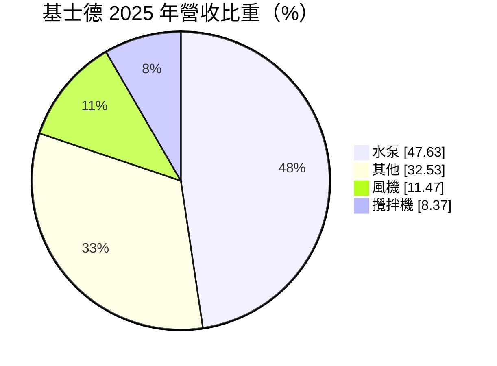
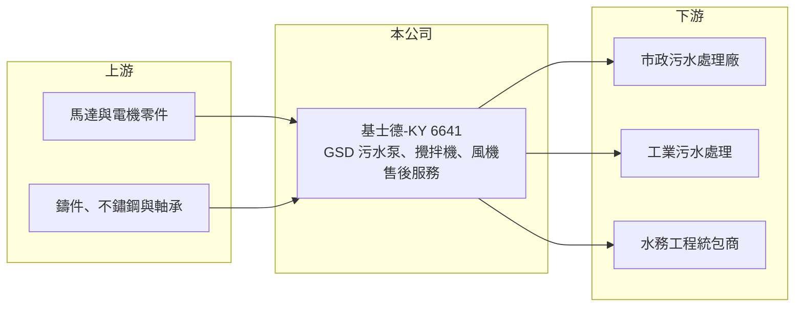

# 6641 基士德-KY

> 上市｜[[產業索引-綠能環保|綠能環保]]｜上市（櫃）日期 2018/09/21

# 第一章：企業模式與商業藍圖

> [!info] 撰寫說明
> 精簡版，由 Claude 依公開資料整理，架構比照 [[2330台積電]]，資料截至 2026-10-08。來源：富邦 MoneyDJ 財務比率年表（2018 至 2025 年）與基本資料（2025 年營收比重）；證交所開放資料快照（基本資料、2026 年上半年資產負債與損益、2025 年度股利、每月營收）。品牌、生產據點與中國市場比重為憑記憶整理，已標「待校對」；歷年營收由每股營業額推算。公開資料有限。#待校對

基士德控股成立於 2013 年 10 月，註冊於開曼群島，2018 年 9 月上市，董事長謝宏炅、總經理陳世賢，台灣聯絡處在高雄。它是以 GSD 品牌銷售污水處理設備的公司，產品包括污水泵、攪拌機、風機等，主要市場在中國的市政與工業污水處理廠（市場比重待校對），屬於水處理產業鏈中的關鍵設備供應商。

- **核心業務：** 2025 年營收中水泵占 47.63%、其他占 32.53%、風機占 11.47%、攪拌機占 8.37%。污水處理廠需要[[潛水泵]]抽送污水與污泥、攪拌機讓生化池均勻反應、風機替生物處理池打入空氣，這些設備長時間運轉、耗損大，需要定期維修與更換。「其他」類別推估包括零件、維修服務與系統整合（內容待校對）。
- **營收結構：** 依每股營業額推算，2025 年營收約 17.6 億元（推算），2021 年約 19.6 億元（推算），近五年規模大致持平、略為下滑。設備銷售與中國地方政府的污水廠興建與提標改造預算相關，近年中國地方財政緊縮，是營收停滯的主要背景（推估）。
- **營運據點：** 生產與銷售重心在中國（生產基地地點待校對），台灣主要負責控股與部分業務。KY 公司的營運實體在海外，投資人主要透過財報與法說了解營運。
- **長期方向：** 中國污水處理已進入「從興建轉向營運與提標」的階段，新增大型污水廠減少，但既有廠的設備汰換、節能改造與售後服務需求持續存在。基士德的長期方向推估是提高高效節能設備與售後服務的比重，並開拓中國以外的市場（策略細節待校對）。

# 第二章：護城河深度與競爭優勢

基士德的護城河來自品牌在中國污水處理市場累積的裝機基礎與售後服務，但面臨中國本土廠商的低價競爭。

- **競爭優勢：** 污水設備一旦裝進處理廠，後續的零件與維修通常會找原廠，龐大的裝機基礎帶來持續的售後收入。[[毛利率]]在 2018 至 2021 年維持在 38% 至 40%，顯示品牌曾享有定價優勢；近年仍有約 30%，在設備業屬中上水準。
- **主要對手：** 國際品牌如德國 KSB、瑞士 Sulzer（旗下 ABS）、美國 Xylem（旗下 Flygt）、德國 Wilo 等都在中國設廠，本土則有大量中低價水泵廠。國際品牌主打高端，本土廠以價格競爭，基士德夾在中間，需要靠性價比與服務突圍。
- **觀察重點：** [[營業利益率]]從 2020 年的 14.19% 降到 2023 至 2025 年的負值，2026 年上半年仍為 −2.47%，營業費用已高於毛利。觀察重點是公司能否透過費用控管或產品組合調整，讓營業利益率重新轉正；若長期無法轉正，代表品牌溢價已被本土競爭侵蝕。

# 第三章：財務體質與盈利規模

資料日期：2026-10-08，表格是撰寫當時的快照；最新月營收、毛利率、累計 EPS 由自動排程寫在本筆記的屬性欄位（月營收、毛利率、累計EPS 等）。#待校對

基士德的獲利從 2022 年起明顯滑落，本業連續三年小幅虧損，靠業外收入與所得稅利益維持帳面獲利。

| 年度 | 營收（億元） | [[毛利率]] | [[營業利益率]] | EPS（元） | [[ROE]] |
|---|---|---|---|---|---|
| 2021 | 約 19.6（推算） | 38.35% | 10.37% | 6.30 | 15.32% |
| 2022 | 約 18.4（推算） | 35.87% | 6.28% | 5.00 | 11.50% |
| 2023 | 約 17.7（推算） | 32.10% | −0.75% | 1.28 | 2.57% |
| 2024 | 約 18.2（推算） | 28.51% | −1.67% | 1.40 | 2.92% |
| 2025 | 約 17.6（推算） | 31.53% | −0.62% | 0.46 | 0.81% |

註：營收以每股營業額乘以 3,650 萬股推算，並與 MoneyDJ 營收成長率交叉核對一致。2026 年上半年營收 9.44 億元、毛利率 31.40%、營業利益率 −2.47%、EPS 0.19 元（證交所資料）。

- **長期指標：** 2021 至 2025 年營收年複合成長率約 −2.6%（推算），近 5 年平均 [[ROE]] 約 6.6%（推算），且逐年下滑。2025 年度配發現金股利 0.4 元，約為 EPS 0.46 元的 87%，可分配盈餘約 3.42 億元，配息能力尚可。每股現金流量 2018 至 2022 年為正，2023 與 2024 年轉負，2025 年回到 0.81 元，[[自由現金流]]近年不穩定。
- **[[ROIC]] 與 [[WACC]]：** 2025 年營業利益為負（營業利益率 −0.62% × 營收約 17.6 億元，約 −1,100 萬元），稅後營業利益約 −870 萬元；投入資本約 18.8 億元（2026 年第二季權益總計 15.07 億元，加上以總負債 7.40 億元的一半推估的有息負債約 3.7 億元），ROIC 約 −0.5%（推算）。WACC 約 6.1%（推算：無風險利率 1.75%、市場風險溢酬 6%、β 取設備同業常見值 0.9，股東權益成本 7.15%；稅前負債成本 2.5%、稅率 20%；權益比重約 80%）。ROIC 為負代表本業目前在侵蝕價值，2019 至 2021 年營業利益率在 10% 至 14% 時，ROIC 推估曾明顯高於 WACC，獲利能力的轉折是投資判斷的核心。
- **財務特色：** 2026 年第二季負債比率約 33%（負債 7.40 億元 ÷ 資產 22.46 億元），流動資產 12.94 億元約為流動負債的 1.8 倍，財務安全。2026 年上半年稅前虧損 685 萬元，但所得稅利益 1,055 萬元使稅後轉為小賺，帳面 EPS 不能代表本業。股價淨值比僅約 0.41 倍（2026 年 10 月初快照），市場對其獲利前景相當保守。

# 第四章：總體風險與地緣政治

基士德的風險集中在中國市場、價格競爭與 KY 公司的治理透明度。

- **產業週期：** 營收高度依賴中國市政污水處理投資，地方政府財政緊縮或專項債用途改變，會直接延後設備採購。工業污水端則跟著中國製造業景氣起伏。
- **營運風險：** 本土水泵廠的低價競爭持續壓縮毛利，營業費用若無法同步下降，本業虧損可能延續。應收帳款若集中在地方政府或國有企業，回收期長，會占用營運資金（應收帳款狀況待校對）。
- **其他風險：** 兩岸關係與中國政策變化影響台資企業的營運；人民幣對新台幣的匯率變動影響換算後的營收與獲利；KY 公司的財報與資訊揭露距離較遠，投資人需留意治理品質。

# 專有名詞解析

## 金融

- **[[ROIC]]**：投入資本報酬率，稅後營業利益除以股東權益加有息負債，衡量本業運用資本的效率。
- **[[WACC]]**：加權平均資金成本，股東與債權人要求報酬率的加權平均，是 ROIC 要超越的門檻。
- **[[自由現金流]]**：營業活動現金流減去資本支出，代表企業可自由用於配息、還債或併購的現金。

## 產業

- **[[潛水泵]]**：整台浸入液體中運轉的抽水設備，常用於污水處理廠與排水系統，耐腐蝕與可靠度要求高。
- **[[污水處理廠]]**：收集都市或工業污水，經物理、生物與化學程序處理到符合放流標準後排放的設施。

# 核心供應鏈

- 上游：馬達、鑄件與軸承供應商（名單未查得）。
- 下游／客戶：中國市政污水廠、工業園區污水處理與水務工程公司（名單待校對）。
- 同業：KSB、Sulzer、Xylem、Wilo 等國際水泵品牌；台灣水處理工程業者 [[6624萬年清]]。

## 最新新聞
<!-- news:start -->
<!-- news:end -->

## 相關連結
- [公開資訊觀測站](https://mopsov.twse.com.tw/mops/web/t05st03?step=1&firstin=1&co_id=6641)
- [Goodinfo](https://goodinfo.tw/tw/StockDetail.asp?STOCK_ID=6641)
- [Yahoo 股市](https://tw.stock.yahoo.com/quote/6641)
- [鉅亨網新聞](https://www.cnyes.com/twstock/6641/news)
