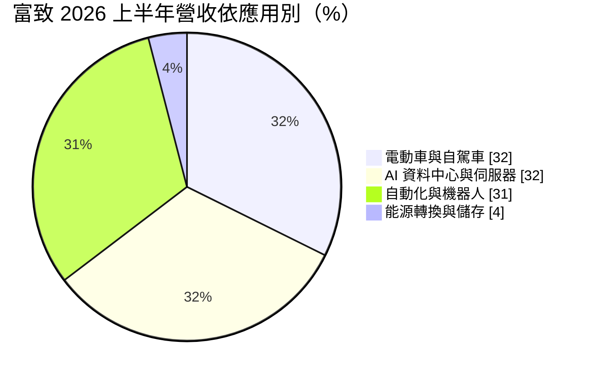
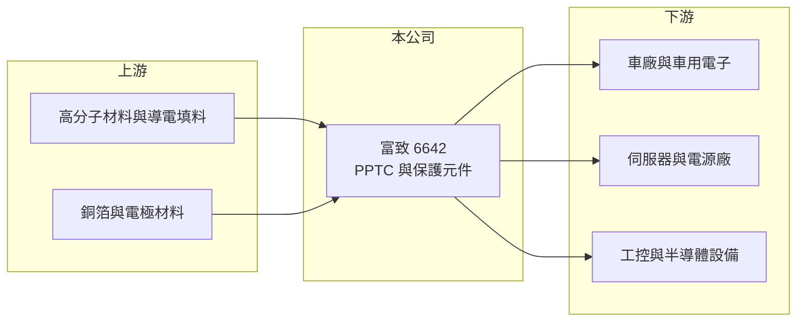

# 6642 富致

> 上櫃｜[[產業索引-電子零組件業|電子零組件業]]｜上市（櫃）日期 2019/09/23

# 第一章：企業模式與商業藍圖

> [!info] 撰寫說明
> 精簡版，由 Claude 依公開資料整理，架構比照 [[2330台積電]] 的四章研究，資料截至 2026-10-08。來源：Goodinfo 經營績效頁、富果研究 2026 年 8 月法說會整理、櫃買中心開放資料快照（基本資料、每月營收、2026 年第二季損益與資產負債）。法說整理為第三方 AI 摘要，客戶名單與市占率需回到公司原始簡報核對。#待校對

富致科技是全球少數專攻 [[PPTC]] 自恢復保險絲的台灣廠商，產品屬於[[保護元件]]，用來防止電路在過電流時燒毀。本章說明它的業務與應用結構。

- **核心業務：** 富致成立於 1999 年，2019 年上櫃。PPTC 是一種高分子材料元件，平時電阻很低，電流過大時溫度升高、材料膨脹讓電阻急升而切斷電流，故障排除後會自行恢復，不必像傳統保險絲一樣更換。依富果整理的法說內容，富致全球市占率約 7%、排名第三。產品線也延伸到過電壓保護元件、過電流加過電壓的複合元件與功率 MOSFET。
- **營收結構：** 2026 年上半年依應用別，電動車與自駕車約 32%、AI 資料中心與伺服器約 32%、自動化與機器人約 31%、能源轉換與儲存約 4%。三大應用平均分布，代表公司已從早年的消費性電子轉向車用、伺服器與工業等高可靠度市場。
- **營運據點：** 總部與工廠在新北市五股、新莊一帶。依法說整理，新莊產業園區新總部與新廠投資近 8 億元、歷時三年興建，2026 年啟用，部分製程產能可望提升一至兩倍，並導入高度自動化。
- **長期方向：** 公司的技術主軸是「高溫與高壓」。法說整理指出，PPTC 耐壓已從 60V 直流提升到 305V 交流，布局 AI 伺服器的 800V 高壓直流供電、電動車 48V 系統、儲能與充電樁。這些應用的共同點是電壓與功率愈來愈高，對保護元件的規格要求也愈嚴格。

# 第二章：護城河深度與競爭優勢

保護元件單價低，但一旦失效會造成整台設備損壞，因此客戶最在乎的是可靠度與認證，而不是價格。本章分析富致的護城河。

- **競爭優勢：** 富致掌握自有的高分子配方，依法說整理至 2026 年 4 月已取得 98 項專利。公司很早取得 [[IATF 16949]] 與 [[AEC-Q]] 車規認證，48V 高溫產品約 15 年前即開始布局，已打入國際車廠供應鏈。車用與工控客戶的驗證期長，一旦採用很少更換，這是富致毛利率長年維持在 45% 至 55% 的主要原因。
- **主要對手：** 全球 PPTC 市場由美國 Littelfuse（併購 Raychem 電路保護事業後的龍頭，待校對）與日本、台灣同業瓜分。台灣同業包括 [[6224聚鼎]]，以及做 PTC 熱敏電阻、壓敏電阻的 2428興勤。富致規模較小，策略是聚焦高壓、高溫等利基規格。
- **觀察重點：** 第一，新廠產能開出後，營收能否維持成長而不犧牲毛利率。第二，AI 伺服器高壓直流電源與 SiC 功率元件應用的實際出貨。第三，2026 年起對美洲與亞洲客戶的調價是否持續被接受。

# 第三章：財務體質與盈利規模

資料日期：2026-10-08，表格是撰寫當時的快照；最新月營收、毛利率、累計 EPS 由自動排程寫在本筆記的屬性欄位（月營收、毛利率、累計EPS 等）。#待校對

富致的財務特色是營收規模小、但毛利率極高，獲利隨下游庫存週期起伏。

| 年度 | 營收（億元） | [[毛利率]] | [[營業利益率]] | EPS（元） | [[ROE]] |
|---|---|---|---|---|---|
| 2021 | 5.96 | 54.5% | 32.2% | 4.65 | 19.1% |
| 2022 | 4.84 | 49.1% | 25.6% | 4.25 | 15.0% |
| 2023 | 4.22 | 43.5% | 18.9% | 1.81 | 6.56% |
| 2024 | 5.23 | 49.0% | 25.4% | 3.58 | 12.9% |
| 2025 | 5.42 | 45.4% | 22.5% | 2.60 | 9.06% |
| 2026 上半年 | 3.21 | 51.5% | 27.0% | 2.28 | 未查得 |

- **營收規模：** 2020 年營收 4.36 億元，2025 年 5.42 億元，五年年複合成長率約 4.4%（推算），成長並不快。2021 年是被動元件缺貨的高峰，之後兩年去庫存，營收到 2025 年才大致回到 2021 年附近。法說整理中公司預估 2026 年全年營收約 6.7 億元。
- **獲利：** 毛利率長年在 43% 至 55% 之間，即使在 2023 年景氣低點也有 43.5%，顯示產品有定價能力。研發費用占營收約 7%，研發與工程人員約占員工兩成，費用率較高，因此營業利益率對營收規模相當敏感。2021 至 2025 年平均 ROE 約 12.5%（推算）。
- **財務特色：** 2026 年第二季末總資產 18.0 億元、權益 10.9 億元、負債 7.1 億元，其中非流動負債 4.1 億元，推估與新廠建設的長期借款有關。實收資本額約 3.74 億元。

**[[ROIC]] 與 [[WACC]]：** 有息負債明細未查得，假設約 5 億元（推估）。2025 年營業利益約 1.22 億元（5.42 億 × 22.5%），稅後約 0.98 億元，投入資本約 15.9 億元（權益 10.9 億 + 有息負債 5 億），ROIC 約 6%（推算）；2026 年上半年營業利益 0.87 億元年化後，ROIC 約 9%（推算）。WACC 用 [[CAPM]] 推估：無風險利率 1.75%、市場風險溢酬 6%、β 取 1.0（被動元件股常見值，假設），股東權益成本約 7.8%；負債成本 2.5%、稅率 20%，以權益 70%、負債 30% 加權，WACC 約 6%（推算）。結論是：富致的毛利率很高，但新廠投資使投入資本大增，2025 年 ROIC 僅與 WACC 相當；要明顯創造價值，需要新產能帶來營收規模的成長。

# 第四章：總體風險與地緣政治

富致的風險在於規模小、受被動元件庫存週期影響，以及新廠折舊的壓力。

- **產業週期：** 保護元件屬於被動元件族群，需求跟電子產品、汽車與工業設備的庫存週期同步。2021 年缺貨時客戶超額下單，2022 至 2023 年就面臨去庫存，營收與毛利率一起下滑，[[長鞭效應]]明顯。2026 年上半年中國客戶因預期漲價而提前備貨，也可能造成後續的需求回落。
- **營運風險：** 新廠投資近 8 億元，約為年營收的 1.5 倍，若營收成長不如預期，折舊會壓縮獲利。全球市占率約 7%，與龍頭相比規模懸殊，大客戶若改採龍頭的整合方案，富致的議價力有限。
- **其他風險：** 銅、塑膠原料與人工成本上升會壓縮毛利，法說整理提到 2026 年上半年銅價約漲一成。外銷比重高，新台幣升值有匯損風險；車用客戶集中於國際車廠，電動車政策變化也會影響需求。

# 專有名詞解析

## 應用

- **[[IATF 16949]]**：國際汽車產業的品質管理系統標準，是成為車廠供應商的基本門檻。
- **[[AEC-Q]]**：汽車電子委員會訂定的車用零件可靠度測試標準，被動與主動元件都需通過。

## 金融

- **[[長鞭效應]]**：終端需求的小幅變動，沿供應鏈往上游傳遞時被逐級放大，造成上游庫存與訂單劇烈波動。
- **[[ROIC]]**：投入資本報酬率，稅後營業利益除以股東權益加有息負債，衡量本業運用資本的效率。

## 產業

- **[[PPTC]]**：高分子正溫度係數元件，又稱可復式保險絲，電流過大時自動斷路、故障排除後自行恢復。
- **[[保護元件]]**：防止靜電、突波或過電流損壞電路的元件，例如 ESD 抑制器、壓敏電阻與保險絲。

# 核心供應鏈

- 上游：高分子材料、導電填料、銅箔與電極材料。
- 下游／客戶：法說整理提及的車廠如 Tesla、Ford、現代與起亞；AI 與資料中心客戶如 [[AMZN亞馬遜]]、Supermicro；工控與半導體設備客戶如 [[ASML艾司摩爾]]、[[AMAT應用材料]]、Bosch。
- 同業：[[6224聚鼎]]、2428興勤、Littelfuse。

## 最新新聞
<!-- news:start -->
<!-- news:end -->

## 相關連結
- [公開資訊觀測站](https://mopsov.twse.com.tw/mops/web/t05st03?step=1&firstin=1&co_id=6642)
- [Goodinfo](https://goodinfo.tw/tw/StockDetail.asp?STOCK_ID=6642)
- [Yahoo 股市](https://tw.stock.yahoo.com/quote/6642)
- [鉅亨網新聞](https://www.cnyes.com/twstock/6642/news)
