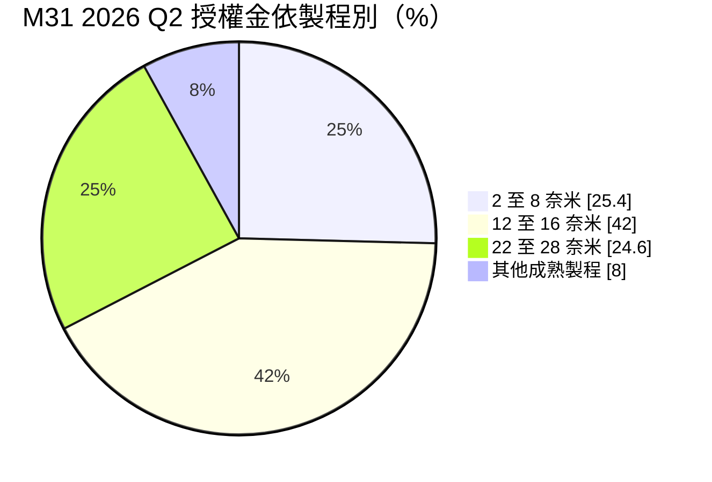
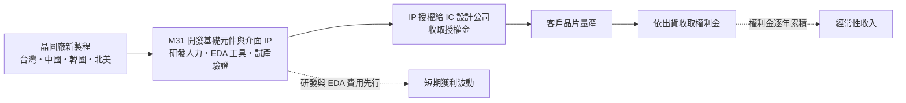
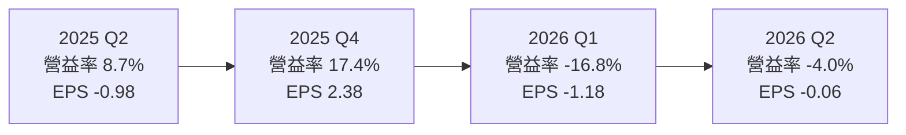

# 6643 M31

> 上櫃｜[[產業索引-半導體業|半導體業]]｜上市（櫃）日期 2019/01/23

# 第一章：企業模式與商業藍圖

> [!info] 撰寫說明
> 本文由 Claude 依公開資料整理，架構比照 [[2330台積電]] 的四章研究，資料截至 2026-10-08。財務數字來源：櫃買中心開放資料（2026 年第二季財報、基本資料、本益比殖利率）、円星科技 2025 年第四季與 2026 年第二季營運新聞稿、Goodinfo 年度經營績效、MoneyDJ 季度財務比率、富果 2026 年第二季法說會摘要；產業描述為整理性內容，尚未逐條比對原始文件。#待校對

在評估單一個股的長期投資價值時，首要步驟是拆解企業的底層獲利邏輯。本章針對円星科技（股票代號：6643，英文名 M31 Technology，以下簡稱 M31）的商業模式進行定性分析，說明一家不賣實體產品、只賣「電路設計藍圖」的公司如何收費，以及它為何在營收成長的同時出現虧損。

## 一、核心定位：晶圓廠與 IC 設計公司之間的矽智財供應商

M31 成立於 2011 年，2019 年在櫃買中心掛牌，總部位於新竹縣竹北。公司是[[矽智財]]（[[IP]]）供應商，也就是把晶片中常用、但每家公司都要重複設計的電路模組，事先在特定晶圓廠的特定製程上設計並驗證好，再授權給 IC 設計公司使用。客戶不用從零開始設計這些模組，可以縮短開發時間、降低失敗風險。

M31 的產品分為兩大類：

* **[[基礎元件IP]]：** 包括標準元件庫（Standard Cell）、記憶體編譯器與輸入輸出元件等，是每一顆晶片都會用到的「基本積木」。這類 IP 必須針對每一家晶圓廠、每一個製程節點重新開發，M31 通常與晶圓廠合作，在新製程推出時同步提供。
* **[[高速介面IP]]：** 包括 USB、MIPI、PCIe 與 [[SerDes]] 等負責晶片與外部高速傳輸的電路。M31 正開發 PCIe Gen6 與 112G SerDes，鎖定 AI、高速互聯與 [[CPO]] 應用。

依使用者整理的供應鏈關係，M31 位於 [[台積電供應鏈]] 上游的「晶片設計工具、IP 與設計服務」，以及 [[聯發科供應鏈]] 上游的「矽智財與設計工具」，提供基礎元件與傳輸介面 IP，同一環節的台灣同業還有 [[3035智原]]。

## 二、終端應用板塊：營收依收費方式、製程與地區拆解

M31 的收入分為兩種，商業性質差異很大：

* **[[授權金]]：** 客戶在設計階段一次性支付的授權費用，金額取決於 IP 的數量與製程先進程度。2026 年第二季占營收 82.2%。授權金反映的是「現在有多少新晶片在設計」。
* **[[權利金]]：** 客戶晶片量產後，依晶圓出貨片數或晶片售價抽取的比例費用，2026 年第二季占 17.8%。權利金反映的是「過去設計的晶片現在賣得多好」，具有累積性與延續性。

* **製程別：** 2026 年第二季，16 奈米及以下先進製程占授權金 67.4%，2025 年第四季為 49.2%。M31 的研發資源超過八成集中在 7 奈米以下，先進製程是主要收入來源。
* **地區別：** 2026 年第二季中國占 38.1%、台灣 28.5%、北美 23.7%、其他 9.8%。地區比重每季波動大，例如 2025 年第四季北美占 35.4%、中國 27.4%，取決於大型專案的認列時點。
* **客戶類型：** 2026 年第二季 [[Fabless]] 客戶占 81.0%、晶圓廠客戶占 19.0%；2025 年第四季晶圓廠客戶則占 40.6%。晶圓廠客戶通常是委託 M31 為新製程開發整套基礎 IP。

## 三、資本轉化邏輯：先投入研發，再靠授權與權利金回收

IP 公司的商業模式看似「毛利率 100%」，因為沒有實體產品成本，營收全部列為營業毛利。但真正的成本藏在營業費用：研發工程師的薪資、[[EDA]] 軟體授權費、雲端運算資源與試產驗證費用。M31 2026 年第二季營業費用約 4.39 億元，比營收 4.22 億元還高，因此出現營業虧損。

這種模式的特性是「研發先行、回收遞延」：每開發一個新製程平台，要先投入一到兩年的研發，等客戶完成設計並量產，權利金才會在之後數年陸續流入。管理層在 2025 年第四季說明，先進製程的 EDA 費用大幅增加，使 EPS 未能反映營運成果；與 EDA 廠商的長期合作條件已大致談妥，費用增幅可望趨緩。

## 四、企業長期藍圖：權利金比重提升與先進製程

* **權利金比重目標：** 管理層的目標是 2027 年權利金占營收超過 20%，長期朝 30% 邁進。16 奈米以下製程的權利金 2026 年第二季年增近四倍，已占權利金三成以上；2 奈米客戶產品預計最快 2026 年第四季至 2027 年第一季量產。
* **多晶圓廠平台：** M31 與台灣龍頭晶圓廠深化 4 奈米與 12 奈米平台合作，並預計簽訂最先進製程的新專案；與中國主要晶圓廠洽談 28 奈米平台開發，與北美 [[IDM]] 與晶圓廠洽談包含 GAA 製程在內的合作。
* **策略投資：** 2026 年 8 月董事會通過由 [[5274信驊]] 私募認購 53 萬股，認購後持股約 1.24%。雙方自 2017 年起合作，信驊的 [[BMC]] 晶片採用 M31 IP，未來將聚焦伺服器相關晶片的客製化 IP。

# 第二章：護城河深度與競爭優勢

在長期價值投資中，「護城河」指企業抵禦競爭、維持超額利潤的保護機制。本章分析 M31 在矽智財市場的護城河構成、主要競爭對手，以及它能否在國際 IP 大廠的競爭下建立穩定的獲利。

## 一、M31 護城河的核心組成要素

M31 的護城河屬於「窄護城河」，但具備 IP 產業特有的累積性：

* **1. 晶圓廠製程平台的先行者地位：** 基礎元件 IP 必須在晶圓廠新製程推出時同步就緒，IC 設計公司才能開始設計。M31 長期與多家晶圓廠合作開發製程平台，一旦成為某個製程的指定 IP 供應商，該製程上所有客戶都可能採用，形成平台效應。
* **2. 客戶設計中的高轉換成本：** IC 設計公司一旦在晶片中採用某家 IP，後續的衍生產品通常會沿用同一套 IP，以避免重新驗證。這讓授權關係具有延續性，量產後的權利金也能持續多年。
* **3. 權利金的累積效果：** 每一個成功量產的客戶專案都會在未來數年貢獻權利金。隨著採用 M31 IP 的晶片越來越多，權利金會逐年堆疊，這是 IP 公司長期最有價值的資產。

## 二、全球主要競爭對手格局

| 對手 | 定位 | 對 M31 的威脅 |
|---|---|---|
| [[SNPS新思科技]] | 全球最大介面 IP 與 EDA 供應商 | 在高速介面 IP 擁有最完整產品線，可與 EDA 綁售 |
| [[CDNS益華電腦]] | EDA 與介面 IP 大廠 | 在先進製程介面 IP 直接競爭 |
| [[ARM安謀]] | 處理器 IP 與部分實體 IP | 在基礎元件庫與處理器整合方案競爭 |
| [[3035智原]] | 台灣 ASIC 設計服務與 IP | 在成熟製程 IP 與台灣客戶競爭 |
| Alphawave 等 | 高速 SerDes IP 專業廠 | 在 112G 以上 SerDes 領先 |

## 三、優勢轉化：哪些市場守得住、哪些守不住

* **守得住：** 晶圓廠委託開發的基礎元件 IP，以及中國、台灣客戶在成熟與特殊製程的 IP 需求。M31 價格較國際大廠有彈性、服務反應快，在這些市場具競爭力。
* **守不住：** 最高階的 SerDes 與 PCIe 介面 IP。新思科技與益華電腦擁有完整產品線並能與 EDA 綁售，在 AI 晶片龍頭客戶的高速介面市場占有主導地位。M31 的 PCIe Gen6 與 112G SerDes 仍在開發與試產階段。
* **觀察重點：** 第一，權利金比重能否在 2027 年突破 20%，這是 M31 從「靠接案」轉向「靠累積」的關鍵指標。第二，2 奈米客戶產品能否如期量產。第三，營業費用的成長能否低於營收成長，讓營業利益率回到 2019 至 2023 年 27% 以上的水準。

# 第三章：財務體質與盈利規模

資料日期：2026-10-08。數字取自櫃買中心開放資料、円星科技營運新聞稿、Goodinfo 年度經營績效與 MoneyDJ 季度財務比率，表格是撰寫當時的快照；最新月營收、毛利率、累計 EPS 由自動排程寫在本筆記的屬性欄位（月營收、毛利率、累計EPS 等）。#待校對

財務報表是檢驗護城河是否真實存在的最終標準。本章用多年度的三率、ROE、現金流與資本報酬，檢視 M31 在高研發投入期的獲利品質。由於 IP 公司沒有營業成本，[[毛利率]]固定為 100%，評估重點應放在[[營業利益率]]。

## 一、獲利能力的基石：三率

| 年度 | 營收（億元） | [[毛利率]] | [[營業利益率]] | EPS（元） | [[ROE]] |
|---|---|---|---|---|---|
| 2019 | 8.69 | 100% | 42.6% | 9.90 | 28.2% |
| 2020 | 9.81 | 100% | 42.6% | 10.34 | 21.8% |
| 2021 | 10.1 | 100% | 30.9% | 8.12 | 16.3% |
| 2022 | 13.6 | 100% | 27.1% | 12.16 | 22.0% |
| 2023 | 16.1 | 100% | 27.7% | 12.60 | 22.2% |
| 2024 | 14.8 | 100% | 3.6% | 3.05 | 6.4% |
| 2025 | 17.8 | 100% | 5.2% | 1.69 | 3.7% |
| 2026 上半年 | 8.17 | 100% | -10.2% | -1.24 | 未查得 |

註：2019 至 2025 年取自 Goodinfo；2026 上半年取自櫃買中心開放資料。

* **[[營業利益率]]：** 2019 至 2023 年維持在 27% 至 43%，2024 年後驟降到個位數，2026 年上半年轉為 -10.2%。原因是先進製程研發人力與 EDA 費用大幅增加，而營收成長速度跟不上費用成長。
* **季度波動：** M31 的營收高度取決於大型專案的簽約與認列時點，單季營業利益率可以從 17% 掉到 -17%。2026 年上半年營收僅達全年目標約四成，主因先進製程新案的簽約與認列時程拉長。
* **業外：** 匯兌損益對 M31 影響明顯，2026 年第二季虧損收斂的主要原因之一就是匯兌損失大幅減少。

## 二、[[ROE]]：資本效率

M31 近 5 年（2021 至 2025 年）平均 ROE 約 14.1%（推算），但趨勢明顯向下：2022 至 2023 年約 22%，2024 年降到 6.4%，2025 年僅 3.7%。M31 幾乎沒有負債，負債比率約 11%，ROE 的變化完全來自獲利能力的變化。營收方面，2019 至 2025 年年複合成長率約 12.7%（推算），營收成長持續，但獲利沒有同步。

## 三、資本支出與自由現金流

* **[[CapEx]]：** IP 公司的主要投資是研發人力與軟體授權，大多直接列為費用，實體資本支出不大。具體金額本次未查得。
* **[[自由現金流]]：** 2019 至 2023 年獲利良好時自由現金流應為正（推估）；2024 年後獲利大幅下降，自由現金流可能轉弱。2026 年第二季底現金及約當現金約 3.55 億元，負債比率約 11%，財務結構仍保守。
* **股利：** 依櫃買中心資料，近四季現金股利合計約 1.19 元，以 2025 年 EPS 1.69 元計算配發率約七成（推算）。

## 四、[[ROIC]] 與 [[WACC]]：價值創造利差

* **ROIC（推算）：** 以 2025 年營收 17.8 億元乘營業利益率 5.23%，營業利益約 0.93 億元，稅後營業利益約 0.74 億元。M31 幾乎沒有有息負債，投入資本以 2026 年第二季股東權益 18.8 億元計算，ROIC 約 4.0%。若回到 2023 年 27.7% 的營業利益率，ROIC 可達 20% 以上（推算）。
* **WACC（推算）：** 以 [[CAPM]] 估算：無風險利率 1.75%、市場風險溢酬 6%、β 取 1.2（IP 與 IC 設計同業常見值，未查得公司實際數字），股權成本約 8.95%；幾乎無負債，WACC 約 8.9%。
* **結論：** 2025 年 ROIC 約 4.0% 低於 WACC 約 8.9%，2026 年上半年更為負值，代表目前的研發投資尚未替股東創造價值。M31 的投資邏輯是「現在投入、未來收權利金」，價值是否實現取決於先進製程客戶能否在 2027 年後大量量產，讓權利金帶動營業利益率回升。

# 第四章：總體風險與地緣政治

任何企業都無法脫離宏觀環境獨立存在。本章分析 M31 未來必須面對的地緣政治、產業週期、營運與技術風險。

## 一、地緣政治風險

* **中國營收比重高：** 中國在 2026 年第二季占營收 38.1%，M31 也正與中國主要晶圓廠洽談 28 奈米平台。美國若擴大對中國半導體設計與 IP 的出口管制，可能限制 M31 對中國客戶的先進製程授權，或使部分專案中止。
* **美國客戶與合規：** 北美是 M31 正在擴大的市場，同時服務美國與中國客戶，需要在技術出口合規上更加謹慎。

## 二、產業週期與市場結構風險

* **授權金的專案性：** 授權金占營收八成以上，而大型專案的簽約與認列時點難以預測，單季營收可能大幅波動。客戶延後新案時，M31 的營收會立即受影響。
* **市場結構：** 全球 IP 市場由新思科技、安謀與益華電腦主導，大廠能把 IP 與 EDA 或處理器綁售。M31 作為規模較小的業者，在議價與客戶取得上處於相對弱勢。

## 三、營運環境的隱性風險

* **EDA 費用與研發成本：** 先進製程的 EDA 工具費用昂貴，且 EDA 供應商同時是 M31 在介面 IP 的競爭對手，這種「供應商兼對手」的關係是 IP 公司特有的結構性風險。
* **匯率：** 授權金多以美元計價，新台幣升值會降低以台幣計算的營收，並產生匯兌損失。
* **信用損失：** 2026 年第二季認列部分預期信用損失，顯示部分客戶（特別是新創或中國客戶）的付款能力需要留意。

## 四、科技演進風險

先進製程從 FinFET 走向 [[GAA]]，基礎元件 IP 需要重新開發；[[Chiplet]] 與 UCIe 等晶片互連標準興起，也會改變介面 IP 的需求結構。這些技術轉換對 M31 是新的接案機會，但每次轉換都要先投入大量研發。若 M31 選錯技術方向或開發進度落後，前期投資可能無法回收；若選對方向，新世代的權利金將成為長期成長的基礎。

# 專有名詞解析

## 半導體

- **[[矽智財]]**：事先設計並驗證好的電路模組，授權給 IC 設計公司整合進晶片，可縮短開發時間，英文縮寫 IP。
- **[[基礎元件IP]]**：標準元件庫、記憶體編譯器、輸入輸出元件等每顆晶片都會用到的基本電路，需針對每個製程重新開發。
- **[[高速介面IP]]**：負責晶片與外部高速傳輸的電路設計，例如 USB、PCIe、MIPI 與 SerDes。
- **[[SerDes]]**：串列器與解串列器，把平行資料轉成高速串列訊號傳輸再還原，是晶片間高速傳輸的核心電路。
- **[[BMC]]**：基板管理控制器，伺服器上負責遠端監控與管理的晶片，信驊為全球主要供應商。
- **[[GAA]]**：環繞式閘極電晶體，閘極從四面包住通道以降低漏電，是 2 奈米世代接替 FinFET 的電晶體架構。
- **[[Chiplet]]**：小晶片架構，把大型晶片拆成多顆功能小晶片再封裝在一起，可提高良率並混用不同製程。
- **[[CPO]]**：共同封裝光學，把光收發元件與交換器或運算晶片封裝在一起，以縮短電訊號距離並降低耗電。
- **[[EDA]]**：電子設計自動化軟體，晶片設計必備的工具，由新思科技、益華電腦等少數廠商主導。

## 金融

- **[[授權金]]**：客戶在設計階段一次性支付的 IP 使用費，金額取決於 IP 數量與製程，反映新設計案的多寡。
- **[[權利金]]**：客戶晶片量產後依出貨量或售價按比例支付的費用，可隨量產持續多年，具經常性收入性質。
- **[[CAPM]]**：資本資產定價模型，以無風險利率加上 β 乘市場風險溢酬估算股東要求的報酬率。

# 核心供應鏈

## 供應鏈關係
- 供應給 [[2330台積電]]：基礎元件矽智財（台積電供應鏈 › 上游：晶片設計工具、IP與設計服務 (ASIC)）
- 供應給 [[2454聯發科]]：基礎元件與傳輸介面 IP 、[[3035智原]]（聯發科供應鏈 › 上游：矽智財 (IP) 與設計工具 (EDA)）

## 最新新聞
<!-- news:start -->
<!-- news:end -->

## 相關連結
- [公開資訊觀測站](https://mopsov.twse.com.tw/mops/web/t05st03?step=1&firstin=1&co_id=6643)
- [Goodinfo](https://goodinfo.tw/tw/StockDetail.asp?STOCK_ID=6643)
- [Yahoo 股市](https://tw.stock.yahoo.com/quote/6643)
- [鉅亨網新聞](https://www.cnyes.com/twstock/6643/news)
