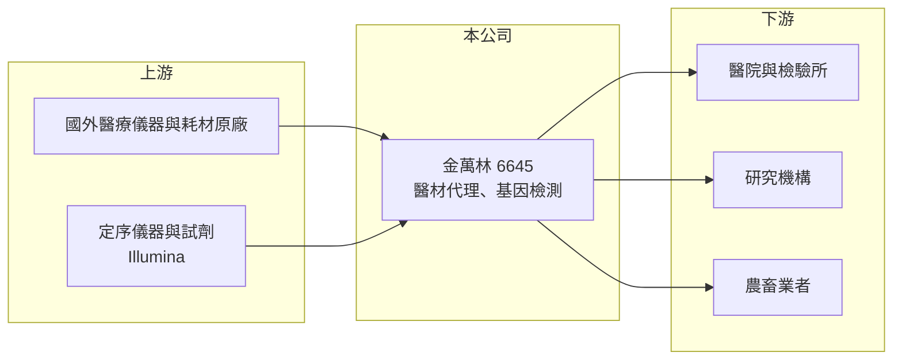

# 6645 金萬林-創

> 創新板｜[[產業索引-生技醫療業|生技醫療業]]｜上市（櫃）日期 2023/12/21

# 第一章：企業模式與商業藍圖

> [!info] 撰寫說明
> 精簡版，由 Claude 依公開資料整理，架構比照 [[2330台積電]] 的四章研究，資料截至 2026-10-08。來源：Goodinfo 年度經營績效頁、nStock 公司簡介、證交所開放資料（基本資料、2026 年第二季資產負債與綜合損益、營益分析、股利、每月營收）。創新板／新掛牌，公開資料有限；各業務營收比重、主要客戶與代理品牌未查得。#待校對

金萬林是一家結合醫療儀器耗材買賣與基因檢測服務的生技公司，本章說明它的業務組成與長期方向。

## 一、核心定位：醫材通路加上檢測服務

金萬林成立於 2004 年，總部位於新北市汐止，2023 年 12 月在證交所[[創新板]]掛牌，實收資本額約 6.1 億元，董事長陳惠娥（證交所開放資料）。集團主要經營醫療儀器及耗材的批發買賣，以及各項基因與醫療檢測服務（nStock）。

* **[[醫材代理]]：** 代理國外醫療儀器與耗材，銷售給醫院、檢驗所與研究機構。代理業務的毛利率取決於代理品牌的獨家程度，資本支出低，但營收受原廠代理權續約影響。
* **[[基因檢測]]服務：** 2023 年公司推出乳癌[[次世代定序]]（NGS）檢測服務，切入高階基因檢測市場；同年與定序儀器大廠 Illumina 合作，把基因技術延伸到智慧農畜產業（nStock 引用新聞）。檢測服務的毛利率高於純代理，但需要實驗室、認證與醫師端推廣。

## 二、業務演變

2021、2022 年公司毛利率超過 37%、營業利益率 10% 至 19%（Goodinfo），當時的高獲利可能與疫情期間的檢測需求有關（推估，待校對）。疫情需求消失後，2023 年起營收下滑、毛利率降到 11% 至 19%，連續三年虧損。這段轉折說明公司的核心挑戰：如何在一次性需求退去後，建立能長期獲利的業務組合。

## 三、長期方向

公司的方向是把重心放在精準醫療與 NGS 檢測，並延伸到農畜業的基因應用。營收方面，2026 年 1 至 9 月累計約 4.95 億元、年增約 33%（nStock），成長有所回溫，但獲利能否同步改善仍是關鍵。

# 第二章：護城河深度與競爭優勢

醫材代理與檢測服務的進入門檻不一，本章分析金萬林的優勢與明顯的弱點。

## 一、護城河的核心組成要素

* **代理權與客戶關係：** 醫材代理需要取得原廠授權、醫材許可證與醫院採購資格，既有的代理產品線與客戶關係是公司的基本盤。
* **檢測實驗室能力：** NGS 檢測需要實驗室認證、生物資訊分析與臨床報告能力，建立需要時間與資金，形成一定門檻。
* **跨領域應用：** 與 Illumina 合作把基因技術用在農畜產業，若能打開新市場，有機會分散醫療市場的競爭壓力。

## 二、主要競爭對手

| 對手 | 定位 | 對金萬林的威脅 |
|---|---|---|
| [[6615慧智]] | 基因檢測服務 | 在產前與癌症基因檢測競爭 |
| [[1784訊聯]] | 基因檢測與細胞儲存 | 檢測服務市場重疊 |
| [[4171瑞基]] | 分子診斷與 NGS 檢測 | 在 NGS 檢測與試劑競爭 |
| 國際醫材代理商 | 大型醫材通路 | 代理權與規模競爭 |

## 三、守得住與守不住

* **守得住：** 既有代理產品與醫院客戶，以及已建立的檢測實驗室。
* **守不住：** 利潤率。2023 至 2025 年營業利益率在 -26% 至 -33%（Goodinfo），毛利不足以支撐營運費用，代表目前的業務組合缺乏定價能力。
* **觀察重點：** 營收成長能否帶動毛利率回到 20% 以上，以及 NGS 檢測是否能成為穩定的高毛利收入。

# 第三章：財務體質與盈利規模

資料日期：2026-10-08，表格是撰寫當時的快照；最新月營收、毛利率、累計 EPS 由自動排程寫在本筆記的屬性欄位（月營收、毛利率、累計EPS 等）。#待校對

本章用多年度數據檢視金萬林由盈轉虧的過程與財務壓力。

## 一、多年度三率與 ROE

| 年度 | 營收（新台幣） | [[毛利率]] | [[營業利益率]] | EPS（元） | [[ROE]] |
|---|---|---|---|---|---|
| 2021 | 6.01 億 | 43.2% | 18.8% | 2.89 | 18.1% |
| 2022 | 6.71 億 | 37.9% | 10.0% | 1.05 | 7.55% |
| 2023 | 4.15 億 | 18.9% | -30.3% | -2.22 | -17.7% |
| 2024 | 5.02 億 | 11.2% | -32.9% | -3.02 | -26.3% |
| 2025 | 5.49 億 | 15.5% | -25.9% | -2.41 | -25.8% |
| 2026 上半年 | 2.78 億 | 14.96% | -27.70% | -1.26 | 未查得 |

註：2021 至 2025 年取自 Goodinfo；2026 上半年取自證交所營益分析與綜合損益。Goodinfo 另有 2016 至 2020 年資料，營收約 2.3 億至 3 億元，多數年度虧損。

* **營收回溫但仍虧損：** 營收從 2023 年的 4.15 億元回升到 2025 年的 5.49 億元，2026 年再成長約三成，但毛利率停在 11% 至 16%，營業虧損率仍在 -26% 上下。
* **ROE 大幅為負：** 2023 至 2025 年 ROE 都在 -18% 至 -26%，連續虧損快速侵蝕股東權益。

## 二、股利與財務結構

2025 年度未配發股利（證交所股利資料）。2026 年第二季底總資產約 10.4 億元、總負債約 6.0 億元、權益約 4.4 億元（歸屬母公司約 4.2 億元），保留盈餘為 -2.04 億元，每股淨值 6.92 元，已低於面額 10 元（證交所資產負債）。若虧損延續，資本結構壓力會加大。

## 三、[[ROIC]] 與 [[WACC]]

**ROIC 推算：** 2025 年營業利益約 5.49 億 × -25.9% ≈ -1.42 億元（虧損不計稅）。有息負債未查得，假設總負債 6.0 億元的一半約 3.0 億元為有息負債，加上權益 4.4 億元，投入資本約 7.4 億元，ROIC 約 -19%（推算）。

**WACC 推算：** 台灣 10 年期公債 1.75%、市場風險溢酬 6%、β 取醫材通路與檢測同業常見值 1.0，權益成本約 7.75%；負債成本 3%、稅率 20%，權益占比約 59%，WACC 約 5.6%（推算）。

**結論：** ROIC 深度為負，與 WACC 的差距超過 20 個百分點，代表公司目前正在消耗資本。2021 年 ROIC 曾明顯高於 WACC，但那可能是一次性需求帶來的；公司需要證明在常態市場下也能獲利，才談得上長期創造價值。

# 第四章：總體風險與地緣政治

本章整理金萬林長期面對的產業、財務與法規風險。

## 一、產業週期

* **一次性需求退潮：** 若早年高獲利來自疫情相關需求，之後的營收與毛利率都將回到較低的常態水準。
* **醫療預算與健保：** 醫院採購與檢測給付受健保政策影響，給付不足會限制高階檢測的普及速度。

## 二、營運風險

* **持續虧損與資本壓力：** 每股淨值已低於面額，若虧損延續，可能需要增資或減資彌補虧損。
* **代理權風險：** 代理業務依賴原廠授權，原廠收回代理或改設直營分公司，會直接衝擊營收。
* **檢測市場競爭：** 台灣基因檢測業者眾多，價格競爭激烈。

## 三、其他風險

* **法規：** 實驗室開發檢測（LDTs）與精準醫療相關法規變動，可能影響檢測服務的營運方式與成本。
* **匯率：** 代理進口儀器與耗材多以外幣計價，新台幣貶值會提高成本。

# 專有名詞解析

## 金融

- **[[創新板]]**：證交所 2021 年設立的板塊，讓尚未獲利但具技術或創新能力的公司掛牌，初期限合格投資人交易。
- **[[ROIC]]**：投入資本報酬率，衡量企業用股東與債權人投入的資本，每年能產生多少稅後營業利益。
- **[[WACC]]**：加權平均資金成本，股東要求報酬與負債利息依資本結構加權後的平均值，是判斷是否創造價值的門檻。

## 產業

- **[[醫材代理]]**：代理國外醫療器材在本地銷售與維修的業務，需取得原廠授權與醫材許可證。
- **[[基因檢測]]**：分析人體 DNA 以評估疾病風險、診斷或用藥選擇的檢測服務。
- **[[次世代定序]]**：NGS，可同時大量平行定序 DNA 片段的技術，是癌症基因檢測與精準醫療的核心工具。

# 核心供應鏈

- 上游：國外醫療儀器與耗材原廠（代理品牌未查得）、定序儀器與試劑供應商 Illumina。
- 下游／客戶：醫院、檢驗所、研究機構，以及農畜業者。
- 同業：[[6615慧智]]、[[1784訊聯]]、[[4171瑞基]]、國際醫材代理商。

## 最新新聞
<!-- news:start（自動產生，請勿手動編輯此範圍） -->
- 2026-10-09 🏛️ 重訊 12:16｜公告本公司初次申請股票創新板上市時所出具之承諾事項暨 其後續執行情形｜[觀測站](https://mops.twse.com.tw/mops/#/web/t05st01)
- 2026-10-07 📰 媒體 17:50｜營收速報 - 金萬林-創(6645)9月營收8,365萬元年增率高達103.46％｜[鉅亨網](https://news.cnyes.com/news/id/6623807)

完整紀錄：[[6645金萬林-創 新聞]]
<!-- news:end -->

## 相關連結
- [公開資訊觀測站](https://mopsov.twse.com.tw/mops/web/t05st03?step=1&firstin=1&co_id=6645)
- [Goodinfo](https://goodinfo.tw/tw/StockDetail.asp?STOCK_ID=6645)
- [Yahoo 股市](https://tw.stock.yahoo.com/quote/6645)
- [鉅亨網新聞](https://www.cnyes.com/twstock/6645/news)
