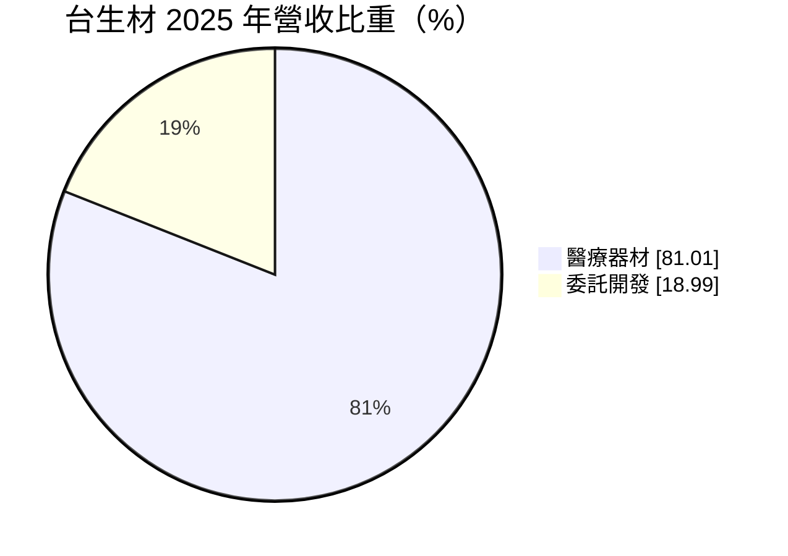
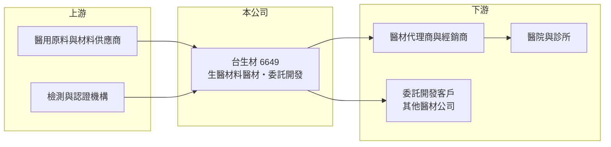

# 6649 台生材

> 上櫃｜[[產業索引-生技醫療業|生技醫療業]]｜上市（櫃）日期 2019/06/05

# 第一章：企業模式與商業藍圖

> [!info] 撰寫說明
> 精簡版，由 Claude 依公開資料整理，架構比照 [[2330台積電]] 的四章研究，資料截至 2026-10-08。來源：櫃買中心開放資料快照（基本資料、2026 年第二季綜合損益與資產負債、每月營收、本益比）、Goodinfo 經營績效頁、MoneyDJ 基本資料（2025 年營收比重）、聯合報 2025 年營收新聞標題。公開資料有限，具體產品名稱與客戶未查得，產品領域部分憑記憶整理，已標待校對。#待校對

本章說明台灣生醫材料（股票代號：6649，以下簡稱台生材）的商業模式：一家同時銷售自有醫材、並替其他公司做委託開發的生醫材料公司。

- **核心業務：** 台生材 2012 年設立，2019 年 6 月在櫃買中心上櫃，董事長為宗緒福、總經理為馬茂峰。公司以[[生醫材料]]技術為核心，開發並銷售[[醫療器材]]，並提供委託開發服務。依記憶，產品領域與組織修復、骨科或牙科的生醫材料有關（待校對）。生醫材料的價值在於能與人體組織相容、促進修復，屬於技術與法規門檻都較高的醫材類別。
- **營收結構：** 依 MoneyDJ 資料，2025 年營收中醫療器材占 81.01%、委託開發占 18.99%。醫材銷售是主要收入，委託開發則能運用既有技術與實驗室賺取服務費，同時累積與其他醫材公司的合作關係。

- **營運據點：** 研發與營運以台灣為主（地址未列）。公司規模小，2026 年第二季總資產 7.31 億元，屬於研發型的中小醫材公司。
- **長期方向：** 台生材的營收長年在 1 億元上下，2025 年跳升到 2.2 億元，依聯合報 2025 年報導標題，當年 9 月營收創歷史新高、年增四倍。這顯示公司已有產品開始放量，長期關鍵在於這股成長能否延續，並在更多國家取得醫材許可，把一次性的出貨高峰轉成穩定的銷售。

# 第二章：護城河深度與競爭優勢

小型醫材公司的護城河，主要來自醫材許可證與材料技術。本章分析台生材的優勢與競爭環境。

- **競爭優勢：** 第一是醫材許可證。植入或接觸人體組織的醫材需要通過生物相容性與臨床評估才能上市，取得各國許可證的時間長、成本高，已取證的產品對後進者形成門檻。第二是材料技術與委託開發經驗，替他人開發產品可以分攤研發設備成本，也能從合作中發現新的產品機會。
- **主要對手：** 生醫材料與骨科、牙科植入相關醫材的國際市場由強生、史賽克、捷邁邦美等大廠主導（產品重疊程度待校對）。台灣骨科醫材同業包括 [[4129聯合]]、[[4163鐿鈦]]，但產品類別不完全相同，競爭多在醫院採購與通路層面。
- **觀察重點：** 2025 年營收與獲利大幅成長，但 2026 年 1 至 8 月累計營收 0.90 億元，較去年同期 1.41 億元減少約 36%，上半年本業轉為虧損。投資人應觀察 2025 年的成長是持續性訂單還是一次性出貨，以及新產品與新市場許可的取得進度。

# 第三章：財務體質與盈利規模

資料日期：2026-10-08，表格是撰寫當時的快照；最新月營收、毛利率、累計 EPS 由自動排程寫在本筆記的屬性欄位（月營收、毛利率、累計EPS 等）。#待校對

台生材的財務數字很典型地呈現小型醫材公司的特性：營收基數小、波動大，少數訂單就能改變全年獲利。

| 年度 | 營收（新台幣） | [[毛利率]] | [[營業利益率]] | EPS（元） | [[ROE]] |
|---|---|---|---|---|---|
| 2021 | 0.42 億 | 77.1% | -136% | -1.44 | -10.6% |
| 2022 | 1.27 億 | 71.0% | 20.0% | 0.83 | 6.31% |
| 2023 | 0.73 億 | 64.7% | -19.5% | -0.24 | -1.59% |
| 2024 | 0.97 億 | 59.3% | -11.6% | -0.04 | -0.28% |
| 2025 | 2.20 億 | 61.2% | 27.6% | 1.40 | 8.99% |
| 2026 上半年 | 0.63 億 | 53.7% | -10.9% | 0.02 | 約 0.2%（年化推算） |

資料來源：2021 至 2025 年為 Goodinfo 經營績效頁（合併報表）；2026 上半年為櫃買中心綜合損益快照。

- **營收規模：** 營收從 2021 年的 0.42 億元成長到 2025 年的 2.2 億元，但中間有起伏，年複合成長率因基期過小不具參考意義。公司營收規模仍小，營業費用一年約 0.8 億元（以 2026 年上半年 0.41 億元年化推估），營收需要穩定超過 1.5 億元左右，本業才容易打平（推估）。
- **獲利：** 營收突破時，高毛利讓營業利益率快速拉升，2022 年與 2025 年都出現 20% 以上的營業利益率；營收回落時則立即轉虧，這是固定費用高的營運槓桿效果。毛利率從 2021 年的 77% 降到 2026 年上半年的 54%，可能與產品組合或價格有關（推估）。
- **財務特色：** 財務結構保守，2026 年第二季負債只有 0.87 億元，權益 6.44 億元，負債比約 12%，每股淨值 15.33 元。股利不連續，依 MoneyDJ 資料，2022 年度配發 0.2 元、2023 至 2024 年度未配息、2025 年度配發 1.0 元。
- **[[ROIC]] 與 [[WACC]]：** 有息負債未查得，以非流動負債 0.49 億元近似，投入資本約 6.93 億元。2025 年營業利益約 0.61 億元，稅後約 0.49 億元，ROIC 約 7.0%（推算）；2026 年上半年營業虧損，年化 ROIC 約 -1.6%（推算）。WACC 方面，台灣 10 年期公債取 1.75%、市場風險溢酬 6%，β 未查得，取中小型醫材股常見的 1.0 至 1.2，股東權益成本約 7.8% 至 9.0%，負債比重低，WACC 約 7.6% 至 8.7%（推算）。即使在 2025 年的好年度，ROIC 也只是接近 WACC，長期平均則明顯低於 WACC，代表公司目前仍在建立能穩定賺回資金成本的營收規模。

# 第四章：總體風險與地緣政治

小型醫材公司的風險集中在營收集中、法規與規模不足。本章整理台生材的長期風險。

- **產業週期：** 醫材需求本身受景氣影響較小，但台生材營收基數小，少數客戶或代理商的進貨節奏就會造成大幅波動，表現上更像專案型公司。
- **營運風險：** 營收與獲利集中於少數產品與客戶（推估），一旦主要客戶調整庫存或改採其他供應商，營收可能大幅衰退。委託開發收入依專案進度認列，同樣不穩定。研發與許可證申請需要持續投入，若新產品上市延後，固定費用會持續侵蝕獲利。
- **其他風險：** 各國醫材法規趨嚴，例如歐盟 MDR 提高臨床證據要求，會增加取證成本與時間。若主要市場在海外，匯率與當地代理商的經營狀況都會影響營收。

# 專有名詞解析

## 金融

- **[[毛利率]]**：營業毛利除以營業收入，反映產品扣除直接成本後的獲利空間。
- **[[營業利益率]]**：營業利益除以營業收入，反映本業扣除營業費用後的獲利能力。
- **[[ROIC]]**：投入資本報酬率，稅後營業利益除以股東權益與有息負債的合計，衡量本業對所有資金提供者的報酬。
- **[[WACC]]**：加權平均資金成本，依股東權益與負債的比重加權計算的資金成本，ROIC 高於它才代表創造價值。

## 產業

- **[[醫療器材]]**：用於診斷、治療或矯正的器具與設備，上市前需取得各國衛生主管機關許可，生產須符合品質系統規範。
- **[[生醫材料]]**：用於醫療並與人體組織接觸的材料，需具備生物相容性，常用於組織修復、骨填補與植入物。

# 核心供應鏈

- 上游：醫用原料與材料供應商、生物相容性檢測與認證機構（具體廠商未查得）。
- 下游／客戶：醫材代理商與經銷商、醫院與診所，以及委託開發的醫材公司。
- 同業：[[4129聯合]]、[[4163鐿鈦]]（骨科醫材，產品重疊程度待校對）。

## 最新新聞
<!-- news:start -->
<!-- news:end -->

## 相關連結
- [公開資訊觀測站](https://mopsov.twse.com.tw/mops/web/t05st03?step=1&firstin=1&co_id=6649)
- [Goodinfo](https://goodinfo.tw/tw/StockDetail.asp?STOCK_ID=6649)
- [Yahoo 股市](https://tw.stock.yahoo.com/quote/6649)
- [鉅亨網新聞](https://www.cnyes.com/twstock/6649/news)
