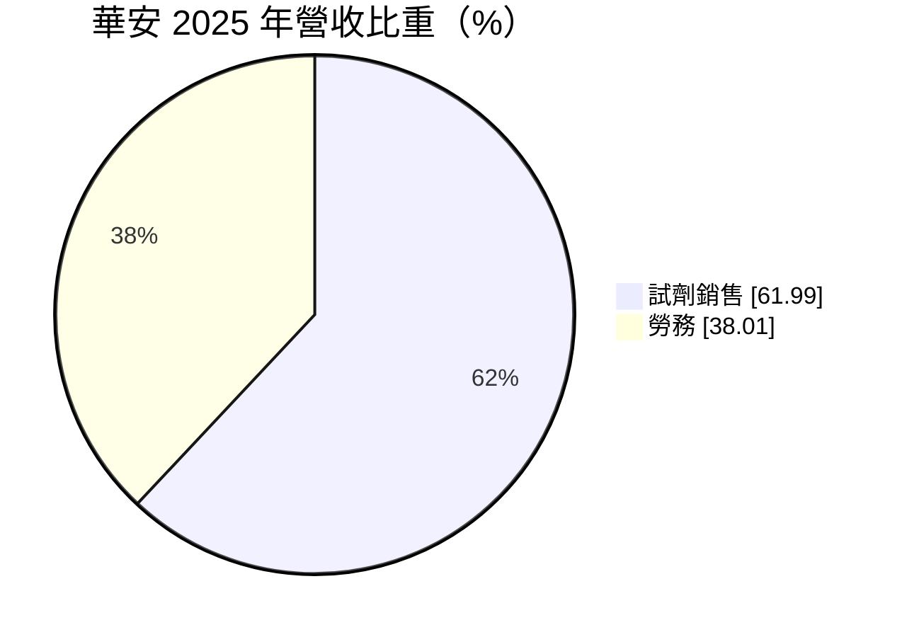
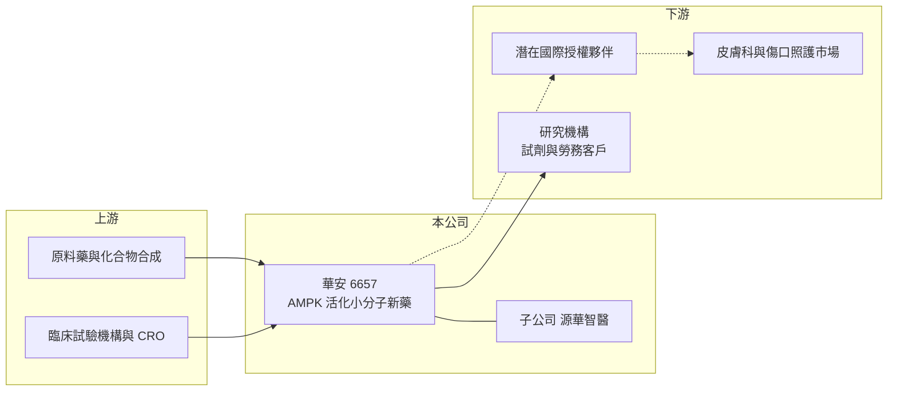

# 6657 華安

> 上市｜[[產業索引-生技醫療業|生技醫療業]]｜上市（櫃）日期 2023/06/12

# 第一章：企業模式與商業藍圖

> [!info] 撰寫說明
> 精簡版，由 Claude 依公開資料整理，架構比照 [[2330台積電]] 的四章研究，資料截至 2026-10-08。來源：證交所開放資料快照（基本資料、2026 年第二季綜合損益、資產負債、營益分析、股利、每月營收與備註、本益比）、Goodinfo 經營績效頁、MoneyDJ 基本資料（2025 年營收比重）、工商時報與自由時報新聞標題。公開資料有限，臨床管線名稱與適應症憑記憶整理，已標待校對。#待校對

本章說明華安醫學（股票代號：6657，以下簡稱華安）的商業模式：一家仍處於研發階段的新藥公司，以少量試劑與服務收入支應部分營運，主要價值寄託在臨床管線。

- **核心業務：** 華安 2012 年設立，2023 年 6 月在證交所上市（依記憶為臺灣創新板，待校對），董事長為陳翰民、總經理為江銘燦，公司英文名稱為 Energenesis Biomedical。依記憶，公司的核心技術是能活化細胞能量代謝路徑 [[AMPK]] 的小分子化合物，主要開發外用的落髮治療藥（ENERGI-F701）與糖尿病足部潰瘍等傷口修復藥（ENERGI-F703），兩者都在[[臨床試驗]]階段（待校對）。
- **營收結構：** 依 MoneyDJ 資料，2025 年營收中試劑銷售占 61.99%、勞務占 38.01%。這些收入規模很小，2025 年全年營收約 0.08 億元，主要是運用研發能力銷售研究用試劑與提供服務，作用是維持部分現金流，而不是公司價值的來源。

- **營運據點：** 總部位於台北市內湖區瑞光路，研發與營運以台灣為主。依自由時報新聞標題，公司另設有子公司源華智醫，規劃進入興櫃市場（年份未載明，細節未納入）。
- **長期方向：** 新藥公司的長期價值來自兩條路：一是自行完成臨床並取得藥證後銷售，二是在臨床中後期把產品授權給國際藥廠，收取[[授權金]]與後續分潤。落髮與慢性傷口都是需求龐大、現有療法效果有限的市場，若臨床數據成功，產品具備授權價值；但從臨床二期走到上市通常仍需多年與大量資金。

# 第二章：護城河深度與競爭優勢

研發階段新藥公司的護城河，來自專利、臨床數據與作用機轉的獨特性。本章分析華安的競爭地位。

- **競爭優勢：** 第一是作用機轉。以活化 AMPK 這條細胞能量代謝路徑來促進毛囊或組織修復，與目前主流的落髮藥物（例如米諾地爾、非那雄胺）機轉不同，若證實有效可形成差異化（待校對）。第二是專利布局，小分子化合物的物質專利是新藥公司最核心的資產，能在上市後提供多年的市場保護。
- **主要對手：** 落髮治療市場有米諾地爾、非那雄胺等已上市藥物，以及多家國際藥廠開發中的新藥，例如 JAK 抑制劑類的口服藥已核准用於圓禿。慢性傷口市場則有生長因子、敷料與再生醫療產品競爭。台灣上市櫃的小型新藥同業有 [[4174浩鼎]]、[[4157太景-KY]] 等，但適應症不同。
- **觀察重點：** 第一，關鍵臨床試驗的數據公布時程與結果，這是公司價值最主要的變數。第二，是否取得國際授權，授權金能大幅延長資金壽命。第三，現金消耗與增資頻率，因為公司每年營業虧損約 2.6 億至 3.8 億元。

# 第三章：財務體質與盈利規模

資料日期：2026-10-08，表格是撰寫當時的快照；最新月營收、毛利率、累計 EPS 由自動排程寫在本筆記的屬性欄位（月營收、毛利率、累計EPS 等）。#待校對

研發型新藥公司的財報重點不是獲利，而是「研發支出規模」與「資金能支撐多久」。本章用多年度數字觀察華安的資金消耗。

| 年度 | 營收（新台幣） | [[毛利率]] | [[營業利益率]] | EPS（元） | [[ROE]] |
|---|---|---|---|---|---|
| 2021 | 約 0.07 億 | 71.6% | 營收過小，不具意義 | -2.00 | -15.8% |
| 2022 | 約 0.07 億 | 70.3% | 營收過小，不具意義 | -3.99 | -36.5% |
| 2023 | 約 0.07 億 | 73.0% | 營收過小，不具意義 | -3.62 | -37.0% |
| 2024 | 約 0.08 億 | 73.4% | 營收過小，不具意義 | -3.03 | -29.9% |
| 2025 | 約 0.08 億 | 76.0% | 營收過小，不具意義 | -2.92 | -31.6% |
| 2026 上半年 | 0.03 億 | 71.9% | -5,916% | -2.10 | 約 -52%（年化推算） |

資料來源：2021 至 2025 年為 Goodinfo 經營績效頁（合併報表）；2026 上半年為證交所營益分析與綜合損益快照。

- **營收規模：** 營收每年只有數百萬元，2026 年 1 至 8 月累計 466 萬元，較去年同期 409 萬元小幅成長，證交所月營收備註說明主要是試劑銷售與勞務收入皆成長。營收規模對公司價值幾乎沒有影響。
- **獲利：** 2026 年上半年營業費用 1.94 億元，其中絕大部分應為研發與臨床支出（推估，研發費用明細未查得），營業損失 1.92 億元，EPS -2.10 元，虧損速度較 2025 年全年（淨損 2.58 億元）加快。依證交所股利資料，2025 年底待彌補虧損經處理後，可分配盈餘為 -0.09 億元，2025 年度未配息。
- **財務特色：** 2026 年第二季流動資產 7.04 億元、總負債 0.71 億元，權益 7.13 億元，每股淨值 8.11 元，已低於 10 元面額。以上半年的虧損速度粗估，每年營運支出約 3.8 億元，流動資產約可支應 2 年左右（推算，流動資產不全為現金），未來兩年內可能需要增資或取得授權金。股價淨值比 4.22 倍，市場評價主要來自對臨床成果的期待。
- **[[ROIC]] 與 [[WACC]]：** 公司幾乎沒有負債，以非流動負債 0.07 億元近似有息負債，投入資本約 7.20 億元。2025 年營業損失約 2.87 億元，稅後約 -2.30 億元，ROIC 約 -32%（推算）；2026 年上半年年化約 -43%（推算）。WACC 方面，台灣 10 年期公債取 1.75%、市場風險溢酬 6%，β 未查得，研發階段新藥股取 1.2 至 1.5，股東權益成本約 9.0% 至 10.8%，WACC 約 9% 至 10.8%（推算）。ROIC 大幅為負是研發階段的必然結果，代表股東資本正在轉換成臨床數據與專利；這筆投資是否創造價值，要等臨床成功與授權或上市後才能驗證，在此之前投資人承擔的是二元化的高風險。

# 第四章：總體風險與地緣政治

研發型新藥公司的風險，幾乎都集中在臨床成敗與資金。本章整理華安的長期風險。

- **產業週期：** 生技新藥股的評價與募資條件高度受資本市場情緒影響。市場資金緊縮時，增資價格偏低會大幅稀釋原股東，這與研發進度無關。
- **營運風險：** 管線集中於同一技術平台的少數產品，若關鍵臨床試驗失敗，公司價值可能大幅縮水。臨床試驗的收案進度、試驗設計與主管機關要求都可能延後時程，時程一延後就代表要多燒一段資金。每股淨值已低於面額，若虧損持續，可能面臨減資彌補虧損或增資的選擇。
- **其他風險：** 新藥要進入美國、歐洲等主要市場，必須通過 FDA 或 EMA 審查，法規要求高且耗時。即使取得藥證，落髮市場的藥品多屬自費，定價與市場推廣能力決定商業成果，小型公司往往需要依賴國際夥伴。

# 專有名詞解析

## 金融

- **[[ROIC]]**：投入資本報酬率，稅後營業利益除以股東權益與有息負債的合計，衡量本業對所有資金提供者的報酬。
- **[[WACC]]**：加權平均資金成本，依股東權益與負債的比重加權計算的資金成本，ROIC 高於它才代表創造價值。

## 產業

- **[[臨床試驗]]**：新藥上市前在人體進行的分階段試驗，一期看安全性、二期看初步療效、三期確認療效。
- **[[授權金]]**：藥廠將藥物開發或銷售權利授權給其他公司時收取的簽約金與里程碑金，通常屬一次性收入。
- **[[AMPK]]**：細胞內調節能量代謝的關鍵酵素，被活化時能促進細胞產生能量與修復，是多種代謝疾病藥物的研究標的。

# 核心供應鏈

- 上游：原料藥合成、委託製造與臨床試驗服務機構（具體廠商未查得）。
- 下游／客戶：目前為購買試劑與服務的研究機構；未來目標為國際授權夥伴，以及皮膚科落髮治療與慢性傷口照護市場。
- 同業：台灣小型新藥公司 [[4174浩鼎]]、[[4157太景-KY]]（適應症不同）。

## 最新新聞
<!-- news:start（自動產生，請勿手動編輯此範圍） -->
- 2026-10-15 🏛️ 重訊 15:52｜本公司受邀參加統一證券舉辦之法人說明會｜[觀測站](https://mops.twse.com.tw/mops/#/web/t05st01)

完整紀錄：[[6657華安 新聞]]
<!-- news:end -->

## 相關連結
- [公開資訊觀測站](https://mopsov.twse.com.tw/mops/web/t05st03?step=1&firstin=1&co_id=6657)
- [Goodinfo](https://goodinfo.tw/tw/StockDetail.asp?STOCK_ID=6657)
- [Yahoo 股市](https://tw.stock.yahoo.com/quote/6657)
- [鉅亨網新聞](https://www.cnyes.com/twstock/6657/news)
