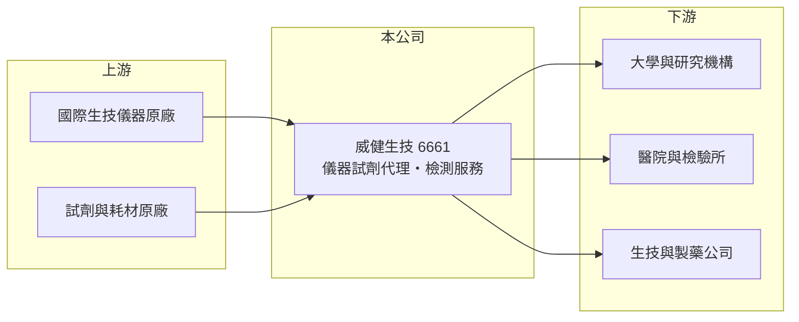

# 6661 威健生技

> 上櫃｜[[產業索引-生技醫療業|生技醫療業]]｜上市（櫃）日期 2021/01/27

# 第一章：企業模式與商業藍圖

> [!info] 撰寫說明
> 精簡版，由 Claude 依公開資料整理，架構比照 [[2330台積電]] 的四章研究，資料截至 2026-10-08。來源：櫃買中心開放資料快照（基本資料、2026 年第二季綜合損益與資產負債、每月營收、本益比）、Goodinfo 經營績效頁、nStock 公司簡介與新聞標題。公開資料有限，代理品牌、產品別營收比重與主要客戶未查得。#待校對

本章說明威健生技（股票代號：6661）的商業模式：一家把國際生技儀器與試劑引進台灣，並提供生技測試服務的專業通路商。

- **核心業務：** 威健生技 2003 年 1 月設立，2021 年 1 月在櫃買中心上櫃，董事長為陳貴弘、總經理為林怡杏。依公司揭露的營業項目，主要從事生技相關儀器與試劑的買賣，以及生技測試業務。也就是說，它扮演國際原廠在台灣的[[代理商]]，把定序、分子檢測或實驗室儀器與配套[[研究試劑]]賣給研究機構與醫療檢驗單位，同時提供檢測服務（代理品牌未查得）。
- **營收結構：** 營收大致由三部分組成：儀器的一次性銷售、試劑與耗材的持續性採購，以及檢測服務收入（比重未查得）。儀器賣出後，客戶要持續購買對應的試劑才能使用，這種「機台加耗材」的模式讓試劑收入具有一定的延續性。
- **營運據點：** 以台灣市場為主，客戶包括大學、研究機構、醫院與檢驗所（推估）。依 nStock 整理的新聞，2020 年底公司曾表示基因檢測需求回溫，顯示基因與分子檢測是主要應用領域之一。
- **長期方向：** 精準醫療與[[基因檢測]]的普及，帶動研究與臨床端對定序與分子檢測儀器的需求，是威健生技長期的成長基礎。但代理商的價值取決於代理品牌的競爭力與代理權是否穩定，公司長期需要在代理產品之外建立服務與技術支援的附加價值，才能維持獲利。

# 第二章：護城河深度與競爭優勢

生技儀器代理商的護城河，主要來自代理權、技術支援能力與客戶關係。本章分析威健生技在這些方面的處境。

- **競爭優勢：** 第一是裝機基礎。實驗室一旦採用某品牌儀器，後續的試劑、耗材與維修都會綁定同一通路，形成持續性收入。第二是技術支援，生技儀器的安裝、教育訓練與故障排除需要具備專業知識的應用工程師，這是單純貿易商難以取代的服務價值。
- **主要對手：** 生技儀器與試劑市場的國際原廠（例如 Thermo Fisher、Illumina、Roche 等）多在台灣設有直營子公司，代理商必須與原廠直營及其他代理商競爭。台灣的分子檢測相關上市櫃同業包括 [[4160訊聯基因]] 等，但商業模式以檢測服務為主，與純代理商不同。
- **觀察重點：** 毛利率長期穩定在 41% 至 44%（Goodinfo），顯示代理產品的定價大致穩定；問題在於營收規模下滑後營業費用無法同步縮減，使營業利益率從 2019 年的 9.2% 降到接近零。投資人應觀察營收能否回到 4 億元以上的規模，以及是否取得新的代理產品線。

# 第三章：財務體質與盈利規模

資料日期：2026-10-08，表格是撰寫當時的快照；最新月營收、毛利率、累計 EPS 由自動排程寫在本筆記的屬性欄位（月營收、毛利率、累計EPS 等）。#待校對

代理商的獲利由「毛利率乘營收規模」減去相對固定的人事與營運費用決定。本章用多年度數字觀察威健生技的規模經濟是否成立。

| 年度 | 營收（新台幣） | [[毛利率]] | [[營業利益率]] | EPS（元） | [[ROE]] |
|---|---|---|---|---|---|
| 2021 | 3.13 億 | 42.6% | 4.64% | 0.59 | 4.87% |
| 2022 | 3.22 億 | 44.1% | 5.37% | 0.41 | 3.11% |
| 2023 | 2.81 億 | 42.7% | -1.52% | -0.11 | -1.04% |
| 2024 | 3.23 億 | 42.1% | -0.26% | 0.05 | 0.24% |
| 2025 | 3.76 億 | 41.5% | 0.03% | 0.06 | 0.45% |
| 2026 上半年 | 1.91 億 | 41.7% | -3.8% | -0.34 | 約 -5.9%（年化推算） |

資料來源：2021 至 2025 年為 Goodinfo 經營績效頁（合併報表）；2026 上半年為櫃買中心綜合損益快照。

- **營收規模：** 2019 年營收 4.17 億元、2020 年 3.98 億元，之後降到 3 億元上下，2025 年回升到 3.76 億元。2020 年至 2025 年年複合成長率約 -1%（推算）。2026 年 1 至 8 月累計營收 2.56 億元，較去年同期成長約 3%。
- **獲利：** 毛利率幾乎不變，但營業利益率從 2019 年至 2020 年的 9% 左右降到近三年的零附近，代表營業費用相對營收過高。2021 年至 2025 年平均 ROE 約 1.5%（推算），資本效率偏低。
- **財務特色：** 2026 年第二季總資產 6.59 億元、負債 3.81 億元，負債比約 58%，在同規模生技公司中偏高；其中非流動負債 2.20 億元，可能包含長期借款或租賃負債（推估）。權益 2.78 億元，每股淨值 11.72 元。依 nStock 整理，2023 年曾除息 0.18 元，2025 年度未配息。
- **[[ROIC]] 與 [[WACC]]：** 有息負債未查得，以非流動負債 2.20 億元近似，投入資本約 4.98 億元。2025 年營業利益幾乎為零，ROIC 約 0%（推算）；2026 年上半年營業損失 0.07 億元，年化 ROIC 約 -2.4%（推算）。WACC 方面，台灣 10 年期公債取 1.75%、市場風險溢酬 6%，β 未查得，取通路業常見的 0.8 至 1.0，股東權益成本約 6.6% 至 7.8%；負債成本假設 2.5%、稅後 2.0%，以市值約 4.0 億元（股價淨值比 1.45 倍乘母公司權益）與負債 2.20 億元計算，權益占約 65%，WACC 約 5.0% 至 5.7%（推算）。ROIC 長期低於 WACC，代表目前的營運規模無法賺回資金成本；要改善，必須提高營收或降低費用率，使營業利益率回到 2019 年左右的水準。

# 第四章：總體風險與地緣政治

生技儀器代理商的風險，主要來自代理權、研究經費與匯率。本章整理威健生技的長期風險。

- **產業週期：** 客戶多為研究機構與醫療檢驗單位，採購受政府科研預算、醫院設備預算與檢測需求影響，預算緊縮時儀器採購會延後。
- **營運風險：** 代理商最大的風險是代理權被收回或原廠改為直營，一旦主力品牌轉換通路，營收可能大幅流失。營收規模小、費用相對固定，使獲利對營收變化非常敏感。負債比偏高，若虧損持續，財務彈性會下降。
- **其他風險：** 儀器與試劑多以外幣向國外原廠採購，新台幣貶值會壓縮毛利。醫療檢驗相關產品須符合醫療器材法規，法規變動會影響產品上市時程。國際原廠的併購與整併也可能改變代理版圖。

# 專有名詞解析

## 金融

- **[[營業利益率]]**：營業利益除以營業收入，反映本業扣除營業費用後的獲利能力。
- **[[ROIC]]**：投入資本報酬率，稅後營業利益除以股東權益與有息負債的合計，衡量本業對所有資金提供者的報酬。
- **[[WACC]]**：加權平均資金成本，依股東權益與負債的比重加權計算的資金成本，ROIC 高於它才代表創造價值。

## 產業

- **[[代理商]]**：向原廠採購產品再轉售給下游客戶的通路業者，價值在於庫存、配送與信用服務。
- **[[研究試劑]]**：供大學、研究機構與藥廠實驗室使用的抗體、蛋白質與化學品，不用於臨床診斷或治療。
- **[[基因檢測]]**：分析人體 DNA 以判斷疾病風險、遺傳狀況或用藥反應的檢驗服務。

# 核心供應鏈

- 上游：國際生技儀器、試劑與耗材原廠（代理品牌未查得）。
- 下游／客戶：大學與研究機構、醫院與檢驗所、生技與製藥公司（推估）。
- 同業：國際原廠在台直營子公司與其他生技代理商；分子檢測相關的 [[4160訊聯基因]]。

## 最新新聞
<!-- news:start -->
<!-- news:end -->

## 相關連結
- [公開資訊觀測站](https://mopsov.twse.com.tw/mops/web/t05st03?step=1&firstin=1&co_id=6661)
- [Goodinfo](https://goodinfo.tw/tw/StockDetail.asp?STOCK_ID=6661)
- [Yahoo 股市](https://tw.stock.yahoo.com/quote/6661)
- [鉅亨網新聞](https://www.cnyes.com/twstock/6661/news)
