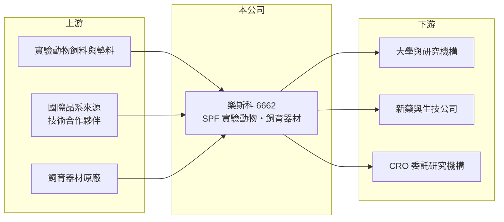

# 6662 樂斯科

> 上櫃｜[[產業索引-生技醫療業|生技醫療業]]｜上市（櫃）日期 2019/03/26

# 第一章：企業模式與商業藍圖

> [!info] 撰寫說明
> 精簡版，由 Claude 依公開資料整理，架構比照 [[2330台積電]] 的四章研究，資料截至 2026-10-08。來源：櫃買中心開放資料快照（基本資料、2026 年第二季綜合損益與資產負債、每月營收、本益比）、Goodinfo 經營績效頁、nStock 公司簡介、CMoney 個股筆記標題。公開資料有限，產品別營收比重與技術授權來源未查得，相關描述憑記憶整理，已標待校對。#待校對

本章說明樂斯科生物科技（股票代號：6662，以下簡稱樂斯科）的商業模式：它不開發藥物，而是供應新藥與醫學研究不可或缺的實驗動物，屬於生技產業的「基礎建設」。

- **核心業務：** 樂斯科 2001 年 5 月設立，2019 年 3 月在櫃買中心上櫃，董事長兼總經理為陳永豪。公司主要生產符合國際標準的[[SPF 實驗動物]]（無特定病原實驗動物），引進應用性高的基因轉殖動物，並代理實驗動物飼育器材。依記憶，公司英文名稱為 BioLASCO，並與國際實驗動物大廠 Charles River 有技術合作（待校對）。
- **營收結構：** 營收主要來自實驗鼠等實驗動物的銷售，其次是飼育器材代理與相關服務（比重未查得）。實驗動物是研究消耗品，研究計畫與藥物開發持續進行，就需要持續採購，因此營收具有一定的穩定性。
- **營運據點：** 生產與飼育設施位於台灣（地點未查得）。SPF 動物需要在嚴格控制的屏障設施中繁殖，防止病原感染，設施的建置與維運成本高，也是業者最重要的資產。
- **長期方向：** 台灣生技新藥研發、學術研究與[[CRO]]委託研究的發展，是實驗動物需求的長期動力。另一方面，國際上推動減少動物實驗（以細胞模型、類器官與電腦模擬替代）的趨勢，可能在長期限制需求成長，樂斯科需要透過基因轉殖等高附加價值品系與服務維持競爭力。

# 第二章：護城河深度與競爭優勢

實驗動物業的護城河，來自生物安全設施、品系授權與品質信任。本章分析樂斯科的競爭地位。

- **競爭優勢：** 第一是品質與穩定性。研究者需要遺傳背景一致、沒有特定病原的動物，實驗結果才可靠，一旦某實驗室長期使用某來源的動物，更換供應商會影響實驗的可比較性，形成轉換成本。第二是設施門檻，SPF 屏障設施投資大、需要長期維持生物安全紀錄，新進者難以短期建立。第三是品系來源，與國際大廠的合作關係讓公司能提供國際通用的品系（待校對）。
- **主要對手：** 台灣主要的實驗動物供應者包括國家實驗動物中心（非上市的財團法人）與各大學自有動物中心；國際上則有 Charles River、The Jackson Laboratory、Envigo 等大廠。樂斯科是台灣少數上市櫃的實驗動物業者，同業可比公司有限。
- **觀察重點：** 第一，國內新藥研發與 CRO 的景氣，直接影響實驗動物採購量。第二，基因轉殖與特殊品系的營收比重，這類產品單價與毛利較高。第三，減少動物實驗的法規趨勢在台灣推進的速度。

# 第三章：財務體質與盈利規模

資料日期：2026-10-08，表格是撰寫當時的快照；最新月營收、毛利率、累計 EPS 由自動排程寫在本筆記的屬性欄位（月營收、毛利率、累計EPS 等）。#待校對

樂斯科的財務特色是營收小、獲利穩定、配息率高。本章用多年度數字檢視這個特色。

| 年度 | 營收（新台幣） | [[毛利率]] | [[營業利益率]] | EPS（元） | [[ROE]] |
|---|---|---|---|---|---|
| 2021 | 2.28 億 | 46.2% | 未查得 | 1.76 | 9.73% |
| 2022 | 2.36 億 | 44.3% | 未查得 | 1.65 | 9.25% |
| 2023 | 2.65 億 | 39.4% | 未查得 | 1.94 | 10.9% |
| 2024 | 2.92 億 | 39.2% | 未查得 | 1.72 | 9.67% |
| 2025 | 2.63 億 | 39.9% | 未查得 | 1.66 | 9.35% |
| 2026 上半年 | 1.26 億 | 36.7% | 14.0% | 0.62 | 約 7.4%（年化推算） |

資料來源：2021 至 2025 年為 Goodinfo 經營績效頁（合併報表），該頁營業利益率欄位與 EPS、淨利明顯不一致，故列未查得；2026 上半年為櫃買中心綜合損益快照。

- **營收規模：** 營收長期在 2.3 億至 3.5 億元之間，2019 年曾達 3.47 億元，2020 年至 2025 年年複合成長率約 -2.5%（推算）。2026 年 1 至 8 月累計營收 1.76 億元，與去年同期大致持平（年增約 2%）。這是一個規模穩定但成長有限的利基市場。
- **獲利：** 2021 年至 2025 年平均 ROE 約 9.8%（推算），EPS 穩定在 1.6 至 1.9 元。毛利率從 2021 年的 46% 降到近年的 39% 至 40%，2026 年上半年再降到 36.7%，可能反映飼料、人力與設施成本上升（推估）。2026 年上半年營業費用只占營收約 23%，營業利益率 14.0%，費用控制相當精簡。
- **財務特色：** 2026 年第二季總資產 5.98 億元、負債 1.70 億元，負債比約 28%，權益 4.27 億元，每股淨值 16.69 元。配息率很高，依 nStock 整理，2023、2024 年度各配發現金 1.5 元，2025 年度 1.55 元，以 EPS 計算配息率約八至九成（推算），屬於把大部分獲利發還股東的穩定配息公司。
- **[[ROIC]] 與 [[WACC]]：** 有息負債未查得，以非流動負債 0.75 億元近似，投入資本約 5.02 億元。以 2026 年上半年營業利益 0.18 億元年化，稅後約 0.28 億元，ROIC 約 5.6%（推算）；若以 2025 年稅後淨利約 0.43 億元（EPS 1.66 元乘約 2,561 萬股）粗估，報酬率約 8.5%（推算，含業外收益）。WACC 方面，台灣 10 年期公債取 1.75%、市場風險溢酬 6%，β 未查得，實驗動物需求穩定，取 0.7 至 0.9，股東權益成本約 6.0% 至 7.2%；負債成本假設 2.5%、稅後 2.0%，負債約占 9%，WACC 約 5.6% 至 6.7%（推算）。ROIC 大致與 WACC 相當或略高，代表公司能穩定賺回資金成本，但創造的超額價值有限，符合成熟利基事業的特性。

# 第四章：總體風險與地緣政治

實驗動物業的風險，主要來自研究經費、生物安全與動物保護法規。本章整理樂斯科的長期風險。

- **產業週期：** 需求受政府科研預算、生技公司研發支出與 CRO 景氣影響。生技募資環境轉差時，新藥公司會縮減前臨床研究，實驗動物採購量隨之下降。
- **營運風險：** 生物安全事故是最大的營運風險，一旦屏障設施遭病原污染，可能需要淘汰整個族群並重建，期間無法供貨，客戶也可能流失。成本面上，飼料、能源與專業人力成本上升會壓縮毛利，而價格調整往往需要時間。
- **其他風險：** 國際間推動實驗動物的「替代、減量、精緻化」（3R 原則），美國也在 2022 年通過 FDA 現代化法案 2.0，不再強制新藥申請必須使用動物試驗（待校對），長期可能降低實驗動物需求。動物保護團體與社會觀感的壓力，也可能提高法規與營運成本。

# 專有名詞解析

## 金融

- **[[毛利率]]**：營業毛利除以營業收入，反映產品扣除直接成本後的獲利空間。
- **[[ROE]]**：股東權益報酬率，稅後淨利除以股東權益，衡量公司運用股東資金賺錢的效率。
- **[[ROIC]]**：投入資本報酬率，稅後營業利益除以股東權益與有息負債的合計，衡量本業對所有資金提供者的報酬。
- **[[WACC]]**：加權平均資金成本，依股東權益與負債的比重加權計算的資金成本，ROIC 高於它才代表創造價值。

## 產業

- **[[SPF 實驗動物]]**：無特定病原實驗動物，在屏障設施中飼育、確認不帶特定病原，讓研究結果不受感染干擾。
- **[[CRO]]**：受託研究機構，替藥廠與生技公司執行前臨床或臨床試驗的服務業者。

# 核心供應鏈

- 上游：實驗動物飼料與墊料、國際品系來源（依記憶為 Charles River 技術合作，待校對）、飼育器材原廠。
- 下游／客戶：大學與研究機構、新藥與生技公司、CRO 委託研究機構。
- 同業：國家實驗動物中心（非上市）、國際大廠 Charles River、The Jackson Laboratory、Envigo。

## 最新新聞
<!-- news:start -->
<!-- news:end -->

## 相關連結
- [公開資訊觀測站](https://mopsov.twse.com.tw/mops/web/t05st03?step=1&firstin=1&co_id=6662)
- [Goodinfo](https://goodinfo.tw/tw/StockDetail.asp?STOCK_ID=6662)
- [Yahoo 股市](https://tw.stock.yahoo.com/quote/6662)
- [鉅亨網新聞](https://www.cnyes.com/twstock/6662/news)
