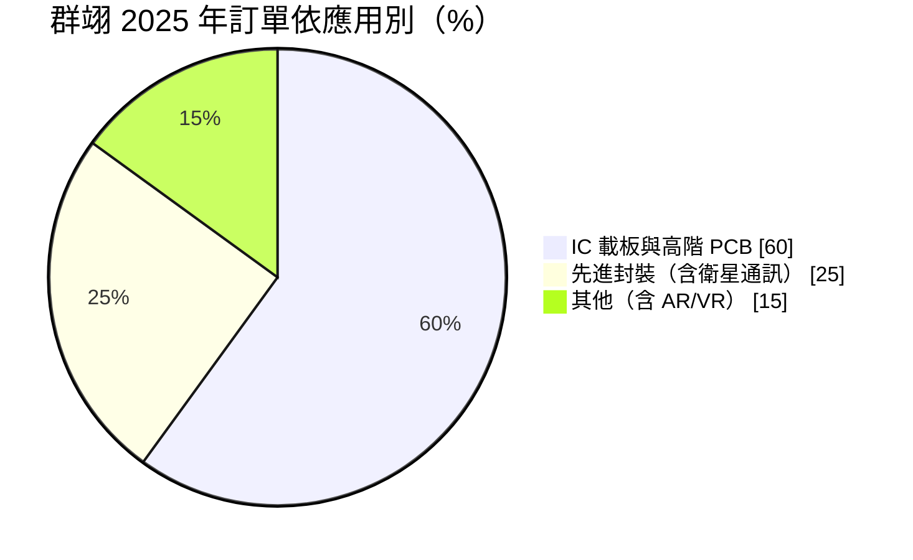
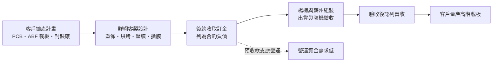
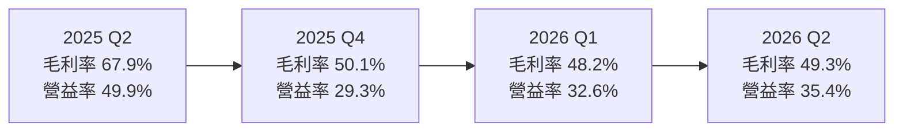
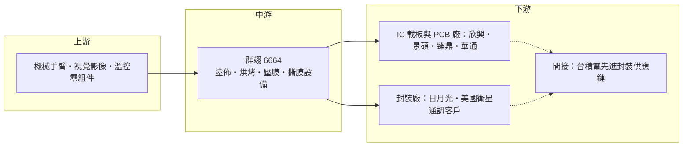

# 6664 群翊

> 上櫃｜[[產業索引-電子零組件業|電子零組件業]]｜上市（櫃）日期 2018/09/12

# 第一章：企業模式與商業藍圖

> [!info] 撰寫說明
> 本文由 Claude 依公開資料整理，架構比照 [[2330台積電]] 的四章研究，資料截至 2026-10-08。財務數字來源：櫃買中心開放資料（2026 年第二季財報、基本資料、本益比殖利率）、Goodinfo 年度經營績效、MoneyDJ 季度財務比率、富果 2026 年 3 月法說會摘要、財報狗；產業描述為整理性內容，尚未逐條比對原始文件。#待校對

在評估單一個股的長期投資價值時，首要步驟是拆解企業的底層獲利邏輯。本章針對群翊工業（股票代號：6664，以下簡稱群翊）的商業模式進行定性分析，說明一家桃園楊梅的設備廠，如何從電路板的烘烤與壓膜設備起家，延伸到 IC 載板、面板級封裝與玻璃基板，並維持接近六成的毛利率。

## 一、核心定位：電路板與封裝製程的「烘烤、塗佈、壓膜」設備專家

群翊成立於 1990 年，董事長為陳安順，總部與主要工廠位於桃園楊梅，另有中國蘇州生產據點，2018 年在櫃買中心掛牌。公司生產濕製程以外的熱處理與貼膜設備，核心製程包括：

* **塗佈（Coating）與烘烤（Curing）：** 在電路板或載板上塗上絕緣材料、防焊油墨或光阻後，用精準控溫的烤箱讓材料硬化。溫度均勻度與潔淨度直接影響產品[[良率]]。
* **壓膜（Laminating）與整平（Leveling）：** 把乾膜、增層材料等薄膜貼合在板子上，並確保表面平整，是 [[ABF載板]] 增層製程的關鍵步驟。
* **撕膜（Peeling-off）與自動化：** 結合機械手臂與視覺影像技術，把多道製程整合成自動化產線。

群翊的設備本身不直接生產晶片，而是賣給電路板廠、IC 載板廠與封裝廠，讓它們生產 AI 伺服器所需的高階電路板與載板。依使用者整理的供應鏈關係，群翊位於 [[台積電供應鏈]] 的「先進封裝大聯盟（CoWoS 設備與載板）」環節，提供 ABF 與先進封裝烘烤設備。需要說明的是，群翊的設備主要賣給載板廠與封裝廠，對台積電屬於間接供應；公司在 2026 年 3 月法說會表示，[[CoWoS]] 的直接參與仍少，正透過台積電供應鏈上的前後製程夥伴尋找切入點。

## 二、終端應用板塊：IC 載板與高階 PCB 為主

依 2026 年 3 月法說會，群翊 2025 年訂單結構如下：

* **IC 載板與高階 [[PCB]]（約六成）：** 包括 AI 伺服器用的高多層板、ABF 載板與射頻通訊板。群翊已打入頂尖 AI 伺服器電路板客戶的供應鏈。AI 伺服器的電路板層數與面積大幅增加，每一層都需要壓膜與烘烤，帶動設備需求。
* **先進封裝（約兩成五）：** 主要是[[面板級封裝]]（PLP）與[[玻璃基板]]相關設備。群翊開發出 700 x 700 毫米、號稱全球最大尺寸的 PLP 設備，供應美國衛星通訊客戶；[[3711日月光投控]]也已是客戶，已交付板級封裝相關設備。群翊也從方形載板設備延伸到圓形晶圓製程設備，包括貼膜、壓平、撕膜、塗佈與烘烤，已有客戶導入。
* **其他（約一成五）：** 包括 AR/VR 光學元件與顯示器相關設備。

依財報狗引述 2025 年 11 月法說會，先進封裝、玻璃基板、IC 載板與 AI 伺服器相關的高階設備，占接單比重約 75%。

## 三、資本轉化邏輯：訂金先收、交機後認列

群翊的營運模式有一個財務上的特點：設備客製化程度高，客戶下單時通常先付訂金，群翊把這筆錢列為[[合約負債]]，等設備出貨並驗收後才認列營收。2025 年底合約負債約 26.16 億元，超過當年營收的一倍。這代表兩件事：一是群翊在營收認列前就已收到大量現金，營運資金壓力低；二是合約負債的增減可以視為未來營收的領先指標。

同樣因為這個模式，群翊帳上的現金與金融資產很多。2025 年底現金及金融資產約 53.92 億元，約占總資產六成，負債比率 52% 看似偏高，主要是合約負債而非借款。

## 四、企業長期藍圖：楊梅二廠與玻璃基板

* **楊梅二廠：** 群翊 2024 年以約 6.22 億元購入楊梅近 3,000 坪土地，規劃第二座工廠。2026 年 3 月法說會表示擴建設計變更，增建兩層地下室、擴大無塵室面積並調整樓層高度，以容納更精密大型的設備，預計 2026 年動工，完工後目標總產能倍增。
* **研發投入：** 研發人員占比超過 25%，2025 年研發費用 1.94 億元、年增 45%，並在玻璃基板承載裝置取得關鍵專利。
* **新技術卡位：** 群翊聚焦 PLP、扇出型面板級封裝、[[CoPoS]] 與玻璃核心載板（Glass Core），這些都是 AI 晶片封裝在 CoWoS 之後可能採用的下一代技術。

# 第二章：護城河深度與競爭優勢

在長期價值投資中，「護城河」指企業抵禦競爭、維持超額利潤的保護機制。本章分析群翊在電路板與封裝熱製程設備市場的護城河構成、主要競爭對手，以及這些優勢能否維持接近六成的毛利率。

## 一、群翊護城河的核心組成要素

群翊的護城河屬於「窄到中等」，來自製程經驗與客製化能力：

* **1. 熱製程的 know-how：** 烘烤與壓膜看似簡單，但高階載板的線路極細、層數極多，溫度差異或微粒汙染都會造成[[翹曲]]、氣泡或短路。群翊三十多年專注熱製程與貼膜，累積大量材料與製程參數資料，能協助客戶調整製程，這是一般設備廠難以複製的。
* **2. 客製化與整線能力：** 每家載板廠的材料、板尺寸與產線配置都不同，群翊能把塗佈、烘烤、壓膜、撕膜整合成客製化的自動化產線。客戶一旦以群翊設備建立量產製程，後續擴產通常會沿用同一套設備，以避免重新驗證。
* **3. 新技術的先行卡位：** 在 PLP 與玻璃基板等尚未大規模量產的技術上，群翊已有設備出貨與專利。新技術的設備通常要與客戶共同開發數年，先進入的供應商較容易成為量產時的標準設備。

## 二、全球主要競爭對手格局

| 對手 | 定位 | 對群翊的威脅 |
|---|---|---|
| [[2467志聖]] | 台灣 PCB 與先進封裝熱製程、壓膜設備 | 產品線最接近，在載板與先進封裝直接競爭 |
| [[7734印能科技]] | 台灣先進封裝除泡與熱製程設備 | 在先進封裝熱處理設備互有重疊 |
| 日本設備廠 | 日系載板熱處理與真空壓膜設備廠 | 在日系載板客戶與高階真空壓膜領先 |
| 中國本土設備廠 | 中國 PCB 設備業者 | 以低價搶中國電路板廠訂單 |

## 三、優勢轉化：哪些市場守得住、哪些守不住

* **守得住：** AI 伺服器高階電路板與 ABF 載板的壓膜、烘烤設備，以及 PLP 與玻璃基板的新製程設備。這些市場看重良率與交期，客戶關注交期多於價格，群翊 2025 年毛利率 58.8%、營業利益率 39.6% 即反映定價能力。
* **守不住：** 一般電路板的標準烘烤設備，以及中國市場的中低階訂單，這些市場門檻較低，容易陷入價格競爭。群翊 2019 年毛利率只有 36.8%，說明產品組合偏中低階時，獲利能力會明顯下降。
* **觀察重點：** 第一，高階產品占接單比重能否維持在七成以上。第二，楊梅二廠完工後，產能倍增能否被訂單填滿。第三，CoPoS、玻璃基板等新技術的量產時程，以及群翊能否真正切入台積電先進封裝供應鏈。

# 第三章：財務體質與盈利規模

資料日期：2026-10-08。數字取自櫃買中心開放資料、Goodinfo 年度經營績效、MoneyDJ 季度財務比率與法說會摘要，表格是撰寫當時的快照；最新月營收、毛利率、累計 EPS 由自動排程寫在本筆記的屬性欄位（月營收、毛利率、累計EPS 等）。#待校對

財務報表是檢驗護城河是否真實存在的最終標準。本章用多年度的三率、ROE、現金流與資本報酬，檢視群翊的高毛利率是否穩定，以及它的資本效率。

## 一、獲利能力的基石：三率

| 年度 | 營收（億元） | [[毛利率]] | [[營業利益率]] | EPS（元） | [[ROE]] |
|---|---|---|---|---|---|
| 2019 | 16.7 | 36.8% | 20.5% | 5.40 | 16.6% |
| 2020 | 16.1 | 44.5% | 26.8% | 5.65 | 16.7% |
| 2021 | 19.1 | 39.9% | 24.6% | 6.12 | 17.2% |
| 2022 | 23.6 | 42.3% | 25.4% | 11.44 | 28.5% |
| 2023 | 24.3 | 46.8% | 28.8% | 12.65 | 26.5% |
| 2024 | 25.0 | 52.0% | 37.2% | 16.97 | 29.1% |
| 2025 | 25.7 | 58.8% | 39.6% | 15.06 | 22.5% |
| 2026 上半年 | 13.8 | 48.8% | 34.0% | 7.29 | 未查得 |

註：2019 至 2025 年取自 Goodinfo；2026 上半年取自櫃買中心開放資料。

* **[[毛利率]]：** 從 2019 年的 36.8% 一路升到 2025 年的 58.8%，主要來自高階產品占比提升。公司的毛利率目標約 50% 至 60%，實際數字取決於每季出貨的產品組合，單季波動可以很大（2025 年第二季高達 67.9%）。
* **[[營業利益率]]：** 費用率低，營業利益率長期在 20% 以上，2024 至 2025 年接近四成。
* **業外與匯率：** 群翊出口比重高，匯兌損益對稅後淨利影響明顯。2025 年匯兌由前一年的利益轉為損失，差異約 1.93 億元，使 EPS 由 16.97 元降到 15.06 元；以本業計算的 EPS 反而由 12.72 元升到 13.51 元。

## 二、[[ROE]]：資本效率

群翊近 5 年（2021 至 2025 年）平均 ROE 約 24.8%（推算），在設備股中屬於高水準。高 ROE 的來源是高營業利益率，加上客戶預付款降低了營運資金需求。營收方面，2019 至 2025 年年複合成長率約 7.4%（推算），營收成長不算快，但獲利成長遠快於營收：EPS 從 5.40 元增加到 15.06 元，代表成長主要來自產品升級而不是規模擴張。

## 三、資本支出與自由現金流

* **[[CapEx]]：** 設備組裝業的資本支出不大，主要是廠房與土地。2024 年購入楊梅土地約 6.22 億元，2026 年起二廠動工，資本支出將高於過去水準。
* **[[自由現金流]]：** 預收訂金讓群翊的營業現金流通常優於淨利，長期累積大量現金，2025 年底現金及金融資產約 53.92 億元（推估自由現金流長期為正）。
* **股利：** 2025 年度董事會提議現金股利每股 10.2 元，以本業 EPS 13.51 元計算配發率約 75%，以全部 EPS 15.06 元計算約 68%（推算）。群翊歷年維持高配息政策。

## 四、[[ROIC]] 與 [[WACC]]：價值創造利差

* **ROIC（推算）：** 以 2025 年營收 25.7 億元乘營業利益率 39.6%，營業利益約 10.2 億元，稅後營業利益約 8.14 億元。投入資本以 2026 年第二季股東權益 41.9 億元，加上有息負債約 10 億元（官方資料未拆分，負債總額 54.4 億元中大部分為合約負債，以非流動負債約 11.9 億元保守推估）計算，合計約 51.9 億元，ROIC 約 15.7%。由於股東權益中有大量現金，若扣除現金，實際投入營運的資本很小，營運資本報酬會遠高於這個數字。
* **WACC（推算）：** 以 [[CAPM]] 估算：無風險利率 1.75%、市場風險溢酬 6%、β 取 1.1（半導體設備同業常見值，未查得公司實際數字），股權成本約 8.35%；稅前負債成本 2.5%、稅後 2.0%；帳面權益占約 81%，WACC 約 7.1%。
* **結論：** ROIC 約 15.7% 明顯高於 WACC 約 7.1%，代表群翊長期在創造價值。這種高資本報酬來自「預收款模式加上高毛利產品」，只要高階產品比重不下滑，價值創造的利差可以維持。

# 第四章：總體風險與地緣政治

任何企業都無法脫離宏觀環境獨立存在。本章分析群翊未來必須面對的地緣政治、產業週期、營運與技術風險。

## 一、地緣政治風險

* **中國據點與市場：** 群翊在中國蘇州有生產據點，中國也是電路板產業的主要聚落。美中科技管制若擴及電路板與載板設備，或中國扶植本土設備商，群翊在中國的業務可能受影響。
* **客戶移往東南亞：** 電路板與載板廠為分散地緣風險，陸續在泰國等東南亞地區設廠。管理層也提到印度在先進封裝與載板領域有發展潛力。群翊需要建立跨國的安裝與售後服務能力，才能跟著客戶移動。

## 二、產業週期與市場結構風險

* **設備業的資本支出循環：** 群翊的營收取決於客戶的擴產計畫。ABF 載板在 2022 年擴產高峰後經歷多年供過於求，載板廠一旦縮減資本支出，設備訂單會比終端需求更早、更劇烈地下滑。
* **AI 投資的集中度：** 目前的高階訂單高度依賴 AI 伺服器帶動的載板與電路板擴產，若 AI 投資放緩，訂單能見度會快速縮短。

## 三、營運環境的隱性風險

* **匯率：** 群翊以外銷為主，2025 年匯兌差異就造成約 1.93 億元的影響，新台幣大幅升值會壓縮獲利。
* **產能與交期：** 管理層表示 2026 年訂單已滿，客戶關注交期多於價格。二廠完工前的產能限制可能讓群翊錯失部分訂單；完工後則面臨產能利用率的考驗。
* **營收認列時點：** 設備驗收後才認列營收，單季營收與毛利率容易因出貨時點與產品組合而大幅波動。

## 四、科技演進風險

先進封裝正處於技術路線的轉折點：CoWoS 之後，產業正在評估 CoPoS、面板級封裝與玻璃基板等方案。如果市場最終選擇群翊已卡位的技術，二廠的產能將迎來大量訂單；若技術路線轉向群翊較少涉入的方向，或量產時程延後，前期的研發與擴產投資回收就會變慢。此外，玻璃基板若取代部分有機載板，傳統壓膜與烘烤製程的需求結構也會改變，群翊需要在新舊技術之間同時布局。

# 專有名詞解析

## 半導體

- **[[ABF載板]]**：以味之素增層膜為絕緣材料的高階 IC 載板，用於 CPU、GPU、AI 晶片等高腳數覆晶封裝。
- **[[面板級封裝]]**：以方形大面板取代圓形晶圓進行封裝，可一次處理更多晶片、提高面積利用率，英文縮寫 PLP。
- **[[玻璃基板]]**：以玻璃取代有機樹脂作為載板核心材料，平整度與耐熱性較佳，被視為下一代 AI 晶片封裝材料。
- **[[CoPoS]]**：台積電規劃的面板級 CoWoS 封裝，把晶圓級中介層改為方形面板，以提高產能與降低成本。
- **[[CoWoS]]**：台積電的 2.5D 先進封裝技術，把運算晶片與高頻寬記憶體並排放在矽中介層上，是 AI 晶片主流封裝。
- **[[良率]]**：合格產品占總生產數量的比例，設備的溫度均勻度與潔淨度會直接影響載板與晶片良率。
- **[[翹曲]]**：載板或晶圓受熱後因材料膨脹係數不同而彎曲變形，是大尺寸封裝與載板製程的主要良率問題。

## 金融

- **[[合約負債]]**：客戶預先支付但公司尚未交貨的款項，交貨或驗收後才轉為營收，可視為未來營收的領先指標。
- **[[CAPM]]**：資本資產定價模型，以無風險利率加上 β 乘市場風險溢酬估算股東要求的報酬率。

## 產業

- **[[PCB]]**：印刷電路板，承載並連接電子零件的板子，AI 伺服器用的高多層板層數與面積都大幅增加。

# 核心供應鏈

## 1. 上游：零組件
- 機械手臂、視覺影像與溫控相關零組件：群翊整合成自動化產線，個別供應商未查得

## 2. 中游：群翊本身
- 塗佈、烘烤、壓膜、整平與撕膜設備：楊梅與蘇州組裝，楊梅二廠規劃中
- 面板級封裝與玻璃基板設備：700 x 700 毫米 PLP 設備已出貨

## 3. 下游：IC 載板與 PCB 客戶
- IC 載板與 PCB 廠：[[3037欣興]]、[[3189景碩]]、[[4958臻鼎-KY]]、[[2313華通]]、嘉聯益（依 2018 年科技新報報導，現況待校對）
- AI 伺服器高階電路板客戶：公司表示已打入頂尖客戶供應鏈，名稱未公開

## 4. 下游：先進封裝客戶
- 板級封裝相關設備：[[3711日月光投控]]
- 700 x 700 毫米 PLP 設備：美國衛星通訊客戶（名稱未公開）
- 先進封裝烘烤設備的間接供應：[[2330台積電]]（群翊表示直接參與 CoWoS 仍少，屬間接供應）

## 5. 終端品牌與同業
- 終端品牌：[[AAPL蘋果]]（2018 年科技新報報導指為主要品牌客戶，現況待校對）
- 同業競爭：[[2467志聖]]、[[7734印能科技]]、日本熱處理與真空壓膜設備廠、中國本土 PCB 設備廠

延伸閱讀：[[台積電供應鏈]]

## 供應鏈關係
- 供應給 [[2330台積電]]：ABF與先進封裝烘烤設備（台積電供應鏈 › 下游：先進封裝大聯盟 (CoWoS 設備與載板) › CoWoS 核心設備群）

## 最新新聞
<!-- news:start（自動產生，請勿手動編輯此範圍） -->
- 2026-10-12 📰 媒體 07:44｜營收：群翊(6664)9月營收2億7666萬元，月增率0.49%，年增率24.02%｜[富聯網](https://news.google.com/rss/articles/CBMiiAFBVV95cUxPT3Zob0VFVnZPLTBDeEhzczd1R3VQSUpveHRhRnczV2FJdFVhZkVDN2JndW1yaERjU19uNjlJdHhOS3c1YUF0NkZ4M0NoZFQ3X2RETzc5Y2FodzNVeUtlRF9VWG00Qkxid1hWNUF2THNuTl9kbjcxTmljZ1NHWngwWlk4VzlIbHN1?oc=5)
- 2026-10-08 📰 媒體 15:11｜《業績-電零組》群翊9月營收為2.77億元，年增24.02%｜[富聯網](https://news.google.com/rss/articles/CBMiiAFBVV95cUxPTE5yTV9jclNZUEFhM1NKckxKa3RhUndEYUQxa3FMdUpjZE5HUkJzQ3hwZzNlc18xelhPNkZsbUtKVHU5VW1ybWRRR1NNMEs4RG56dTVLYm4wM2VaM0NoeXpyLUhlUGx3aGZpS0wzSlE3dE9zX2U0WUUxejZmSHhMbGctUEFNRXVp?oc=5)
- 2026-10-07 📰 媒體 20:00｜AI先進封裝設備爆發 群翊訂單排至2027｜[理財周刊](https://news.google.com/rss/articles/CBMikgFBVV95cUxNcEVrN3hpby1sb0ZKejNJU284WlEwWFZQbjNEbWdCSnMwMXhmWFpxQ25pMWRncjBQay1RUjFNN3V4VE5wMjZ2cHpycHdFSk15RHRpXzFOZ2N2SkdGdEdHUUQtdThIRnlVYVhBdHlnVDV3QjczUzlPZ3dGcHhDVy1ob0owZDAxc0VxcF9XRlY5YnFGdw?oc=5)
- 2026-10-06 📰 媒體 15:34｜群翊(6664) 個股概覽 ／ 個股 - 股市｜[CMoney](https://news.google.com/rss/articles/CBMiU0FVX3lxTE1OQkpDN3E4dDFlRlBDNmY1UC1sbzNKRzNYanBnSjRzbjJBNEdDX3FJRURsR1AxQlB4aXhqcl9MRUZLX0Y1RWpZQmJkaXBxal9UcnFj?oc=5)

完整紀錄：[[6664群翊 新聞]]
<!-- news:end -->

## 相關連結
- [公開資訊觀測站](https://mopsov.twse.com.tw/mops/web/t05st03?step=1&firstin=1&co_id=6664)
- [Goodinfo](https://goodinfo.tw/tw/StockDetail.asp?STOCK_ID=6664)
- [Yahoo 股市](https://tw.stock.yahoo.com/quote/6664)
- [鉅亨網新聞](https://www.cnyes.com/twstock/6664/news)
