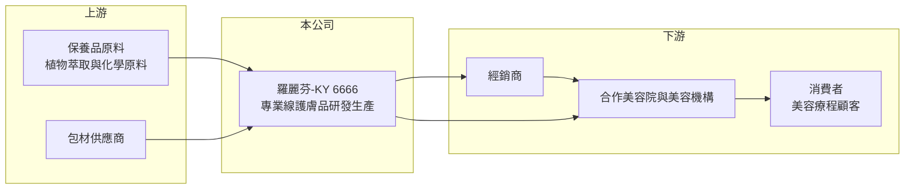

# 6666 羅麗芬-KY

> 上市｜[[產業索引-生技醫療業|生技醫療業]]｜上市（櫃）日期 2018/11/19

# 第一章：企業模式與商業藍圖

> [!info] 撰寫說明
> 精簡版，由 Claude 依公開資料整理，架構比照 [[2330台積電]] 的四章研究，資料截至 2026-10-08。來源：證交所開放資料快照（基本資料、2026 年第二季綜合損益、資產負債、營益分析、股利、每月營收、本益比）、Goodinfo 經營績效頁、nStock 公司簡介、ETtoday 2018 年上市新聞標題。公開資料有限，通路結構、門店數與地區營收比重未查得，營運地區與通路描述部分憑記憶整理，已標待校對。#待校對

本章說明羅麗芬控股（股票代號：6666，以下簡稱羅麗芬-KY）的商業模式：一家以美容院為主要通路、銷售自有品牌護膚品的品牌公司。

- **核心業務：** 羅麗芬-KY 是 2016 年在開曼群島設立的控股公司，屬於 [[KY股]]，2018 年 11 月在證交所上市（ETtoday 報導上市承銷價為 105 元）。主要營業項目為美容護膚產品的研發、生產與銷售。依記憶，營運主體在中國大陸，以「羅麗芬」品牌的[[專業線保養品]]透過美容院、美容機構銷售，也就是產品不是放在百貨或藥妝店架上，而是由美容師在療程中使用並推薦給顧客（待校對）。
- **營收結構：** 產品別與通路別比重未查得。從財務數字看，毛利率長年維持在 58% 至 69%，符合[[自有品牌]]保養品的高毛利特性；營業費用占營收比重高（2026 年上半年約 46%），反映品牌行銷、通路培訓與推廣是主要成本。
- **營運據點：** 控股公司在開曼，營運與生產主要在中國大陸（待校對）。董事為嘉黛國際有限公司（代表人羅麗芬），公司名稱與品牌都來自創辦人，品牌形象與創辦人高度連結。
- **長期方向：** 中國的專業美容市場規模大且分散，美容院需要穩定的產品供應與教育訓練支援，品牌商若能建立培訓體系與通路網絡，就能持續擴大合作店數。羅麗芬-KY 的長期課題是在中國消費降級與醫美競爭下，維持美容院通路的活力，並恢復 2019 年的營收高點。

# 第二章：護城河深度與競爭優勢

專業線美容品牌的護城河，主要來自通路網絡、教育訓練與品牌信任。本章分析羅麗芬-KY 的競爭地位。

- **競爭優勢：** 第一是通路綁定。美容院採用某品牌的產品與療程後，美容師的操作訓練、顧客的療程習慣都圍繞該品牌建立，更換品牌需要重新訓練並說服顧客，轉換成本不低。第二是品牌與毛利，專業線品牌不需要負擔大眾通路的上架與廣告費，以療程體驗建立信任，能維持高毛利率。
- **主要對手：** 同樣以中國美容院通路為主的台股同業有 [[4137麗豐-KY]]、[[4190佐登-KY]]；台灣的醫美與保養品同業則有 [[8436大江]]、[[6703軒郁]]。此外，國際保養品牌、中國本土新興品牌以及醫美診所，都在爭奪同一群重視保養的消費者。
- **觀察重點：** 第一，營收能否回到 2019 年的 14.5 億元高點，這反映美容院通路是否真正復甦。第二，營業利益率能否從過去五年的 5% 至 11% 持續回升，2026 年上半年已達 22.75%（證交所營益分析），若能維持，代表費用效率明顯改善。第三，中國消費景氣與美容院家數的變化。

# 第三章：財務體質與盈利規模

資料日期：2026-10-08，表格是撰寫當時的快照；最新月營收、毛利率、累計 EPS 由自動排程寫在本筆記的屬性欄位（月營收、毛利率、累計EPS 等）。#待校對

羅麗芬-KY 的財報清楚記錄了 2020 年疫情對美容院通路的衝擊，以及之後緩慢的修復過程。

| 年度 | 營收（新台幣） | [[毛利率]] | [[營業利益率]] | EPS（元） | [[ROE]] |
|---|---|---|---|---|---|
| 2021 | 9.17 億 | 58.2% | 5.80% | 1.48 | 4.27% |
| 2022 | 8.66 億 | 60.4% | 5.10% | 1.16 | 3.29% |
| 2023 | 9.71 億 | 61.9% | 7.39% | 1.86 | 5.28% |
| 2024 | 11.3 億 | 62.4% | 8.12% | 1.70 | 5.19% |
| 2025 | 11.1 億 | 65.5% | 11.0% | 2.42 | 6.26% |
| 2026 上半年 | 6.67 億 | 68.97% | 22.75% | 2.95 | 約 15.4%（年化推算） |

資料來源：2021 至 2025 年為 Goodinfo 經營績效頁（合併報表）；2026 上半年為證交所營益分析與綜合損益快照，ROE 以歸屬母公司淨利年化除以母公司權益推算。

- **營收規模：** 2019 年營收 14.5 億元、EPS 10.5 元、ROE 28.1%，是上市以來的高峰；2020 年營收驟降到 8.45 億元，之後逐步回升到 2025 年的 11.1 億元，2020 年至 2025 年年複合成長率約 5.6%（推算）。2026 年 1 至 8 月累計營收 8.43 億元，較去年同期成長約 12%。
- **獲利：** 2021 年至 2025 年平均 ROE 只有約 4.9%（推算），遠低於 2019 年的水準，主因是營收回落後，行銷與通路費用沒有同步縮減。毛利率則逐年上升，從 58% 提高到 2026 年上半年的 69%，加上營收回升，使營業利益率大幅改善。
- **財務特色：** 2026 年第二季總資產 25.57 億元、負債 7.12 億元，負債比約 28%，母公司權益 18.17 億元，每股淨值 38.34 元。依證交所股利資料，2025 年度配發現金股利 2.0 元，總額約 0.95 億元，配息率約 83%（以 2025 年 EPS 2.42 元推算）；2024 年度同為 2.0 元。章程規定現金股利不得低於股利總額的 10%。
- **[[ROIC]] 與 [[WACC]]：** 有息負債未查得，以非流動負債 0.63 億元近似，投入資本約 19.08 億元。2025 年營業利益約 1.22 億元，稅後約 0.98 億元，ROIC 約 5.1%（推算）；2026 年上半年營業利益 1.52 億元，年化稅後約 2.43 億元，ROIC 約 12.7%（推算）。WACC 方面，台灣 10 年期公債取 1.75%、市場風險溢酬 6%，β 未查得，取消費品常見的 0.9 至 1.1，股東權益成本約 7.2% 至 8.4%，負債比重低，WACC 約 7.0% 至 8.2%（推算）；若考量營運在中國的國家風險，實際資金成本可能再高 1 至 2 個百分點。2021 年至 2025 年 ROIC 低於 WACC，代表疫後幾年並未創造價值；2026 年上半年的改善若能延續全年，ROIC 才會重新高於 WACC。

# 第四章：總體風險與地緣政治

以中國美容院為主要通路的品牌公司，風險集中在中國消費景氣、通路變化與跨境治理。本章整理羅麗芬-KY 的長期風險。

- **產業週期：** 專業美容服務屬於可延後的消費，中國經濟放緩或消費信心下降時，顧客會減少療程頻率，美容院進貨隨之縮減。2020 年營收衰退四成，就是通路高度依賴實體服務的結果。
- **營運風險：** 醫美診所、電商品牌與直播銷售持續分流美容院顧客，若美容院家數減少，品牌商的通路基礎會跟著縮小。品牌與創辦人形象高度連結，經營團隊的傳承與品牌年輕化是長期課題。
- **其他風險：** 中國的化妝品監管法規近年趨嚴，新原料與功效宣稱的審查更嚴格，會增加產品開發成本。營收以人民幣計價，人民幣兌新台幣的匯率變動會影響換算後的營收與股利。KY 公司的資訊揭露與法律保障和台灣本地公司不同，兩岸關係變化也是需要留意的系統性風險。

# 專有名詞解析

## 金融

- **[[KY股]]**：在開曼群島等海外註冊、回台灣上市櫃的公司，營運主體多在海外，股票代號後加 KY。
- **[[營業利益率]]**：營業利益除以營業收入，反映本業扣除營業費用後的獲利能力。
- **[[ROIC]]**：投入資本報酬率，稅後營業利益除以股東權益與有息負債的合計，衡量本業對所有資金提供者的報酬。
- **[[WACC]]**：加權平均資金成本，依股東權益與負債的比重加權計算的資金成本，ROIC 高於它才代表創造價值。

## 產業

- **[[自有品牌]]**：公司以自己的品牌直接銷售產品，承擔行銷成本，但毛利與定價權較高。
- **[[專業線保養品]]**：透過美容院、美容師在療程中使用並推薦的保養品，與百貨、藥妝等零售通路產品區隔。

# 核心供應鏈

- 上游：保養品原料（植物萃取、化學原料）與包材供應商（具體廠商未查得）。
- 下游／客戶：合作美容院、美容機構與經銷商，最終使用者為接受療程的消費者（通路結構待校對）。
- 同業：[[4137麗豐-KY]]、[[4190佐登-KY]]、[[8436大江]]、[[6703軒郁]]。

## 最新新聞
<!-- news:start -->
<!-- news:end -->

## 相關連結
- [公開資訊觀測站](https://mopsov.twse.com.tw/mops/web/t05st03?step=1&firstin=1&co_id=6666)
- [Goodinfo](https://goodinfo.tw/tw/StockDetail.asp?STOCK_ID=6666)
- [Yahoo 股市](https://tw.stock.yahoo.com/quote/6666)
- [鉅亨網新聞](https://www.cnyes.com/twstock/6666/news)
