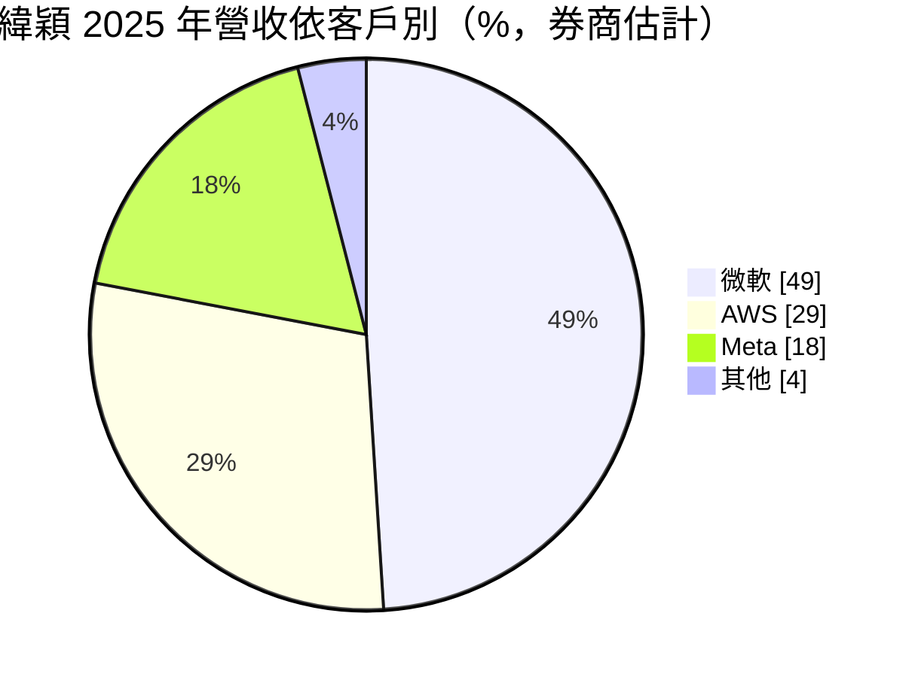
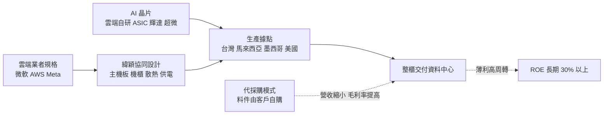
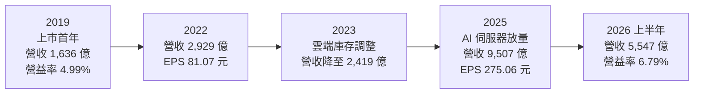
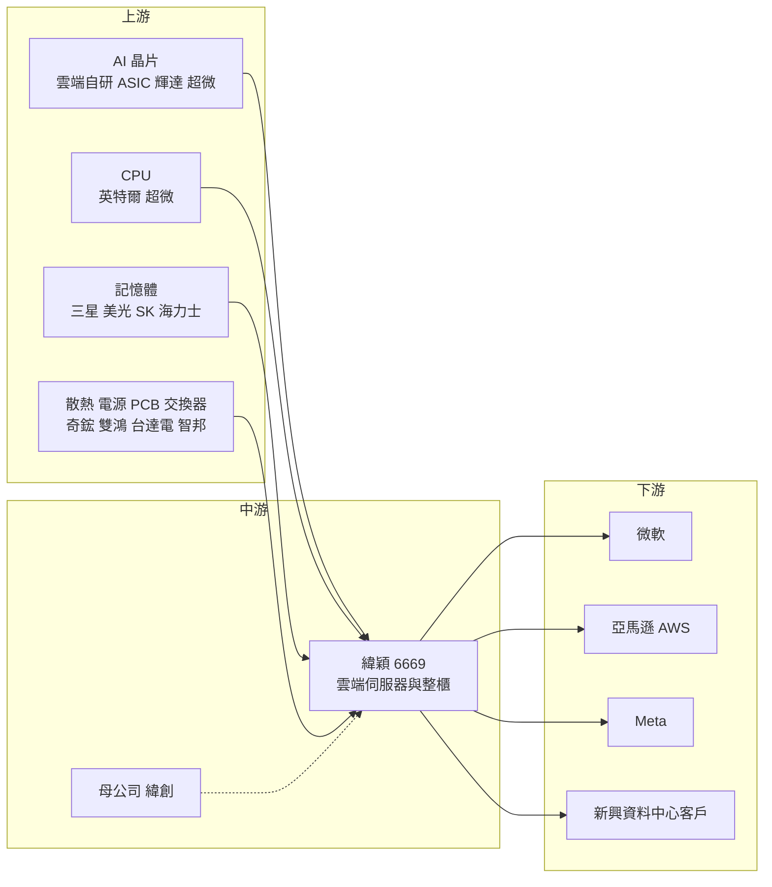

# 6669 緯穎

> 上市｜[[產業索引-電腦及週邊設備業|電腦及週邊設備業]]｜上市（櫃）日期 2019/03/27

# 第一章：企業模式與商業藍圖

> [!info] 撰寫說明
> 本文由 Claude 依公開資料整理，架構比照 [[2330台積電]] 的四章研究，資料截至 2026-10-08。財務數字來源：證交所開放資料快照（基本資料、2026 年第二季綜合損益與資產負債、2025 年度股利）、Goodinfo 經營績效頁與股利政策頁（2017 至 2025 年）、MoneyDJ 季資產負債表與年度現金流量表、優分析緯穎 2026 年 2 月法說會整理、數位時代 2024 年緯穎產能布局報導、凱基證券 2026 年 7 月研究報告（經媒體轉述）；產業描述為整理性內容，尚未逐條比對原始文件。#待校對

在評估一家公司的長期投資價值時，第一步是看懂它靠什麼賺錢、為什麼能一直賺下去。本章針對緯穎科技（股票代號：6669，以下簡稱緯穎）的商業模式進行定性分析，說明這家從 [[3231緯創]] 分拆出來的公司，為什麼只服務極少數客戶就能做到近兆元的營收規模，以及它在 AI 伺服器浪潮中押注雲端業者自研 [[ASIC]] 晶片的路線，代表什麼樣的機會與風險。

## 一、核心定位：只做超大型雲端業者生意的伺服器廠

緯穎成立於 2012 年 3 月 3 日，2019 年 3 月上市，董事長為洪麗寗、總經理為林威遠（證交所資料）。它原本是緯創內部服務雲端客戶的事業單位，分拆獨立後專門替超大型雲端服務業者（[[Hyperscaler]]）設計與製造資料中心使用的伺服器、儲存設備與整座機櫃。

要理解緯穎，先要理解伺服器產業的兩種生意模式。傳統模式是 [[ODM]] 替 HPE、戴爾這類伺服器品牌代工，品牌商掌握客戶與規格，代工廠只負責製造。另一種模式是直接服務雲端業者：亞馬遜、微軟、Meta 這些公司每年採購數十萬台伺服器，它們不需要品牌商的通用產品，而是自己定義規格，再找製造商直接下單。緯穎從成立開始就站在第二種模式，直接面對最終買家，並深度參與 [[OCP]] 開放運算計畫這類由雲端業者主導的硬體標準。

這個定位帶來兩個長期特徵：

- **與最終買家協同設計：** 緯穎在客戶的下一代資料中心規劃階段就參與主機板、機櫃、供電與散熱的設計，量產時自然取得訂單。這種角色讓它的毛利率與營業利益率長期高於傳統代工同業，2019 至 2025 年營業利益率大致在 5% 至 8% 之間（Goodinfo）。
- **客戶高度集中：** 依凱基證券 2026 年 7 月報告（媒體轉述），2025 年 [[MSFT微軟]]、[[AMZN亞馬遜]]（AWS）、[[META臉書]] 三家合計約占營收 96%。這是緯穎生意模式的本質：營收規模由少數雲端業者的資本支出決定，客戶的一次預算調整就足以改變全年表現。

## 二、產品與客戶板塊：通用伺服器打底，AI 伺服器以 ASIC 為主

依凱基證券報告，2025 年營收依客戶別的結構如下：

依產品別，公司在 2026 年 2 月法說會表示，2025 年 AI 伺服器與一般型伺服器大約各占一半營收（優分析整理）。兩條產品線的商業邏輯不同：

- **通用型伺服器：** 雲端業者用來跑網站、資料庫、儲存與一般運算的伺服器，是緯穎長期的基本盤。這類產品規格成熟、更換週期大約四到六年，需求穩定但單價較低。公司表示 AI 應用也帶動一般伺服器需求升溫，因為 AI 推論與資料處理同樣需要大量 CPU 運算與儲存。記憶體價格上漲時，記憶體約占一般伺服器成本的三成，是影響毛利的重要變數。
- **AI 伺服器：** 搭載 AI 加速晶片的高單價機種。緯穎的特色是 AI 伺服器中約九成為雲端業者自研 ASIC 晶片的機種，而非以輝達 GPU 為主，最具代表性的是 AWS 的 Trainium 系列。公司同時與 [[NVDA輝達]]、[[AMD超微]] 開發 GPU 平台專案，讓產品線不只押在單一晶片陣營。
- **機櫃級方案與散熱：** AI 機櫃的功耗快速上升，緯穎自有[[液冷]]與[[浸沒式冷卻]]技術，並能把伺服器、交換器、電源與散熱整合成整座機櫃交付。整櫃交付提高了單一訂單的金額，也提高了客戶轉換供應商的難度。

## 三、資本轉化邏輯：協同設計、全球組裝、整櫃交付

緯穎的獲利公式可以概括為「薄利、高周轉」。伺服器組裝的毛利率只有 8% 到 10% 左右，因為晶片、記憶體這些昂貴零件的價值大部分歸上游；但緯穎不需要蓋晶圓廠，固定資產很輕，營收規模卻極大，因此資產周轉率高，股東權益報酬率反而很高。這種結構有三個關鍵環節：

- **全球產能布局：** 依數位時代 2024 年報導，緯穎在台灣生產主機板，馬來西亞廠自 2023 年下半年投產、負責新雲端產品的後段組裝，並在 2024 年下半年完全撤出中國產能；墨西哥廠在 2023 年第四季完成驗收、2024 年起量產，是供應美洲的主要基地。依舊版整理，美國德州廠約在 2025 年底開始提供產能（待校對）。這個布局的核心邏輯是「靠近客戶、避開關稅」，因為客戶幾乎都是美國公司。
- **[[營運資金]]是真正的資本投入：** 伺服器廠的錢主要不是壓在廠房，而是壓在存貨與應收帳款。AI 機櫃零件昂貴，訂單放量時存貨會在短時間內暴增，例如 2026 年上半年存貨由 2025 年底約 1,363 億元增至約 2,074 億元（MoneyDJ 季資產負債表）。這也是緯穎營業現金流年年大幅波動的原因。
- **[[代採購模式]]：** 公司表示 2026 年 4 月起部分客戶改由客戶自行採購關鍵料件，料件金額不計入緯穎營收。這會讓營收成長看起來放緩，但毛利率提高、營運資金壓力減輕。評估緯穎時，應把毛利金額與營業利益金額看得比營收更重要。

## 四、企業長期藍圖：擴大 ASIC 優勢、分散客戶與北美在地化

緯穎的長期策略可以歸納成三條主線，每一條都對應它目前結構上的弱點。

- **擴大 ASIC 機櫃的領先地位：** 雲端業者自研 AI 晶片的目的，是降低對輝達的依賴與 AI 運算的總成本。只要這個趨勢延續，具備多代 ASIC 平台量產經驗的組裝廠就有結構性優勢。緯穎的機會在於，從單一平台延伸到更多雲端業者的自研晶片專案。
- **分散客戶結構：** 引進 AMD 平台、中東等新興資料中心客戶，目的是降低前三大客戶的集中度。凱基證券預估三大客戶比重 2027 年可能降至約 77%（券商預估，非公司財測）。
- **北美在地化與擴產籌資：** 依舊版整理，2026 年下半年董事會核准約 9.42 億美元的資本支出預算，主要投入電力設施、設備與土地廠房，並規劃發行無擔保[[可轉債]]與簽訂[[聯合授信]]支應擴產與營運資金（待校對）。這代表緯穎正從過去「輕資產」的模式，轉向需要更多實體投資的階段，資本配置的紀律將是長期觀察重點。

# 第二章：護城河深度與競爭優勢

在長期價值投資中，「護城河」指企業抵禦競爭、維持超額利潤的保護機制。本章分析緯穎與雲端業者深度綁定所形成的護城河、全球主要競爭對手，以及在客戶高度集中的情況下，這些優勢實際上能守住多少。

## 一、護城河的核心組成要素

緯穎的護城河屬於「中等偏窄」。它與客戶的綁定很深，但客戶數量極少、規模極大，議價力終究在客戶手上。具體來看，護城河由四個要素組成：

- **1. 與雲端業者的協同設計關係：** 緯穎從成立就直接服務雲端業者，累積了十多年的規格開發協作經驗。雲端業者每導入一個新供應商，都要重新驗證整套主機板、機櫃、供電與散熱設計，耗時又有風險，因此在同一世代產品中很少中途更換供應商。這種轉換成本是緯穎最主要的護城河。
- **2. ASIC 伺服器的量產經驗：** 自研 ASIC 晶片的伺服器沒有輝達那種完整的參考設計，組裝廠需要和客戶一起解決系統整合、散熱與良率問題。緯穎 AI 伺服器約九成是 ASIC 機種，這些經驗在雲端業者擴大自研晶片時，是多數以 GPU 為主的同業較少累積的能力。
- **3. 機櫃級整合與散熱能力：** AI 機櫃功耗動輒上百千瓦，需要液冷與高密度供電。能交付整櫃且到貨即上線的廠商不多，[[機櫃級整合]]的工程能力構成一定門檻。
- **4. 多地生產與供應鏈韌性：** 台灣、馬來西亞、墨西哥與美國的產能，讓緯穎能配合客戶的關稅與在地化要求。這不是技術門檻，但在地緣政治升溫後，成為接單的必要條件。

## 二、全球主要競爭對手格局

| 對手 | 定位 | 對緯穎的威脅 |
|---|---|---|
| [[2382廣達]]（雲達科技） | 最早直接服務美系雲端業者的台廠之一 | 在多家雲端業者的通用與 AI 伺服器都有大量份額，定位最接近緯穎 |
| [[2317鴻海]] | 全球最大電子代工廠，輝達 GPU 整櫃主要供應商 | 規模與垂直整合能力最強，也積極爭取雲端業者的 ASIC 伺服器 |
| [[3231緯創]] | 緯穎母公司，承接輝達 GPU 主機板與部分整櫃 | 集團內分工為主，但在 AI 伺服器領域有重疊 |
| [[2356英業達]]、[[4938和碩]] | 台灣伺服器 ODM | 在通用伺服器與部分 AI 專案競爭 |
| 美超微、Celestica | 美國與加拿大伺服器廠 | Celestica 在 ASIC 與網通機櫃與緯穎重疊，美超微以 GPU 伺服器與企業客戶為主 |

這張表的重點在於，伺服器組裝並不是技術獨占的產業。雲端業者普遍採用多供應商策略，每一世代產品都會重新分配訂單，緯穎的優勢需要每一代重新贏回來。

## 三、優勢轉化：哪些守得住、哪些守不住

- **守得住：** 已在量產中的 ASIC 平台與長期合作的雲端客戶。雲端業者在同一世代中途更換組裝廠的成本很高，因此一旦取得某個平台，通常能維持兩到三年的穩定出貨。緯穎過去十年能持續與微軟、Meta、AWS 合作，本身就是關係穩固的證據。
- **守不住：** 議價權與毛利率上限。客戶集中代表客戶可以要求降價，也可以透過代採購模式自己掌握昂貴料件，壓縮組裝廠的附加價值。緯穎的毛利率長期在 8% 到 10% 之間，很難再大幅提升，這是整個產業的結構限制，而不是緯穎的經營問題。
- **觀察重點：** 第一，雲端業者自研 ASIC 的趨勢是否延續，以及緯穎在下一代平台的份額。第二，前三大客戶以外的新客戶能否形成實質營收。第三，擴產與籌資之後，資本報酬率能否維持在高檔，而不是被大量營運資金與新廠房稀釋。

# 第三章：財務體質與盈利規模

資料日期：2026-10-08。數字取自 Goodinfo 經營績效頁與股利政策頁、證交所開放資料快照與 MoneyDJ 季資產負債表、年度現金流量表，表格是撰寫當時的快照；最新月營收、毛利率、累計 EPS 由自動排程寫在本筆記的屬性欄位（月營收、毛利率、累計EPS 等）。#待校對

財務報表是檢驗護城河是否真實存在的最終標準。本章用多年度的三率、ROE、現金流與資本報酬，檢視緯穎「薄利高周轉」模式的獲利品質，以及 AI 擴產期對資本效率的影響。

## 一、獲利能力的基石：三率

| 年度 | 營收（億元） | [[毛利率]] | [[營業利益率]] | EPS（元） | [[ROE]] |
|---|---|---|---|---|---|
| 2019 | 1,636 | 6.94% | 4.99% | 36.42 | 39.8% |
| 2020 | 1,869 | 8.19% | 6.01% | 49.25 | 38.5% |
| 2021 | 1,926 | 8.11% | 5.91% | 49.46 | 33.3% |
| 2022 | 2,929 | 8.19% | 6.09% | 81.07 | 42.9% |
| 2023 | 2,419 | 9.37% | 6.56% | 68.88 | 29.7% |
| 2024 | 3,605 | 10.4% | 7.79% | 126.57 | 34.9% |
| 2025 | 9,507 | 8.25% | 6.72% | 275.06 | 48.0% |

（來源：Goodinfo 經營績效頁，合併報表。2026 年上半年依證交所資料，營收 5,546.6 億元、毛利率 8.41%、營業利益率 6.79%、EPS 156.38 元。）

- **毛利率窄而穩：** 2019 至 2025 年毛利率在 6.9% 到 10.4% 之間，營業利益率在 5% 到 8% 之間。營收從 1,636 億元成長到 9,507 億元，利潤率卻沒有大幅擴張，說明緯穎的獲利成長主要來自規模，而不是議價力提高。2025 年毛利率反而從 2024 年的 10.4% 降到 8.25%，主因是 AI 機櫃中昂貴的晶片與記憶體料件拉高了營收、但組裝附加價值占比較低。
- **營收爆發式成長：** 2020 至 2025 年營收年複合成長率約 38%（推算，1,869 億元到 9,507 億元）。成長並不平順，2023 年雲端業者消化庫存，營收年減約 17%，顯示緯穎營收跟著雲端資本支出週期大起大落。
- **營業費用的槓桿：** 緯穎的營業費用相對營收很低，2026 年上半年營業費用約 89.7 億元，只占營收約 1.6%（證交所資料推算）。這讓營業利益率能維持在毛利率的八成左右，是「薄利」仍能「多銷」致富的關鍵。

## 二、[[ROE]]：資本效率

緯穎 2021 至 2025 年平均 ROE 約 37.8%（推算），在台灣上市公司中屬於非常高的水準。用杜邦分析拆解，緯穎的高 ROE 不是來自高利潤率（稅後淨利率只有 4.5% 至 6.3%），而是來自極高的資產周轉率與適度的財務槓桿：營收規模動輒是資產總額的兩倍以上，再加上大量應付帳款與短期借款支撐營運資金。

這種 ROE 的品質有兩面。好的一面是，緯穎不需要大量資本就能放大獲利，股東資金的使用效率很高。需要注意的一面是，高周轉依賴訂單持續放量，一旦雲端業者削減採購，營收下滑而費用與存貨跌價風險仍在，ROE 會快速下降，2023 年 ROE 降到 29.7% 就是例子。依 2026 年第二季資料，緯穎權益總計約 1,372.6 億元，負債總計約 4,196.6 億元，負債占資產比例約 75%，比 2025 年底的約 63% 明顯升高（證交所與 MoneyDJ 資料推算）。

## 三、資本支出、自由現金流與股利

- **[[CapEx]]：** 緯穎過去是典型的輕資產公司，2019 至 2022 年資本支出每年只有約 5 億到 15 億元。隨著 AI 擴產與北美在地化，2024 年增至約 48.9 億元、2025 年約 136.7 億元（MoneyDJ 年度現金流量表）。資本支出快速上升，代表公司的商業模式正在變重。
- **[[自由現金流]]：** 2018 至 2025 年自由現金流分別約為 -103、72、135、-147、292、182、-249、-143 億元（營業現金流減購置不動產廠房設備，MoneyDJ 資料推算），八年合計只有約 39 億元。這不是本業不賺錢，而是每一輪訂單放量都需要先墊付大量存貨與應收帳款。簡單說，緯穎的帳面獲利很高，但轉成股東可自由運用的現金需要時間，並且高度依賴週期。
- **股利：** 2019 至 2025 年度現金股利分別為每股 23、32、25、50、42、74、144.39 元，以當年 EPS 計算配發率約 51% 至 65%（推算）。2025 年度另以盈餘轉增資配發股票股利（證交所資料登載為每股 19.83 元），股本擴大後，未來 EPS 的比較基準會改變。公司章程規定股東股息及紅利不低於可分配盈餘的 10%，實際配發率長期維持約五到六成，屬於穩定但會隨獲利波動的政策。

## 四、[[ROIC]] 與 [[WACC]]：價值創造利差

- **ROIC（推算）：** 以 2025 年營收 9,507 億元乘以營業利益率 6.72%，營業利益約 638.9 億元，扣除 20% 稅率後稅後營業利益約 511.1 億元。投入資本以 2025 年底權益約 1,246.5 億元，加上有息負債約 1,040.6 億元（短期借款 684.7 億、一年內到期長期負債 37.2 億、應付公司債 185.5 億、長期銀行借款 94.3 億、租賃負債 38.9 億），合計約 2,287 億元，ROIC 約 22.3%（推算）。以 2026 年上半年營業利益 376.8 億元年化，稅後約 602.8 億元，除以 2026 年第二季權益 1,372.6 億元加有息負債約 1,657.4 億元（短期借款 766.2 億、一年內到期長期負債 596.5 億、應付公司債 157.9 億、長期銀行借款 95.5 億、租賃負債 41.3 億），投入資本約 3,030 億元，ROIC 約 19.9%（推算）。
- **WACC（推算）：** 以 [[CAPM]] 估算股東權益成本：無風險利率取台灣 10 年期公債約 1.75%，市場風險溢酬 6%，β 假設 1.2（伺服器組裝與 AI 硬體股常見值，未查得緯穎實際數字），權益成本約 8.95%。緯穎借款含新台幣與美元，稅前負債成本假設 3.5%，稅率 20%，稅後約 2.8%。以帳面價值計算，權益約占投入資本 45%、有息負債約 55%，WACC 約 5.6%；若改用市值權重（股價淨值比約 3.1 倍，權益約占 72%），WACC 約 7.2%（推算）。
- **價值創造判斷：** 緯穎的 ROIC 約 20% 至 22%，比 6% 至 7% 左右的資金成本高出約 13 至 16 個百分點，代表它在這段期間持續創造超額價值。不過 ROIC 已從 2025 年的約 22% 降到 2026 年上半年年化的約 20%，主因是存貨與借款同步膨脹。未來兩三年的關鍵在於，新增的廠房、可轉債與聯貸資金能否帶來同比例的營業利益；若營運資金膨脹速度持續快於獲利，利差會逐步收窄。

# 第四章：總體風險與地緣政治

任何企業都無法脫離宏觀環境獨立存在。本章分析緯穎未來必須面對的地緣政治、雲端資本支出週期、營運與技術風險。

## 一、地緣政治

- **美國關稅與在地製造：** 緯穎的客戶幾乎都是美國雲端業者，美國對進口伺服器與零組件的關稅政策，直接影響它的成本與報價。墨西哥與美國的產能是主要對沖手段，但美國廠的人工與營運成本較高，若無法轉嫁給客戶，利潤率會被壓縮。
- **墨西哥與 [[USMCA]]：** 墨西哥產能依賴美墨加協定的原產地規則享有關稅優惠。協定條件或美國對墨西哥的政策若改變，緯穎在北美的布局就需要重新調整。
- **出口管制：** 高階 AI 晶片受美國出口管制，緯穎若要擴大中東或其他地區的資料中心客戶，出貨會受到美國許可規範的限制。
- **台灣集中風險：** 研發、主機板生產與管理中樞仍在台灣，面臨與其他台灣科技公司相同的兩岸風險。

## 二、產業週期與市場結構

- **雲端資本支出週期：** 緯穎的營收完全取決於少數雲端業者的資本支出。2023 年雲端業者消化庫存時，緯穎營收年減約 17%，證明這個週期的力道。AI 投資若因獲利回報不如預期、電力不足或利率上升而放緩，緯穎的營收波動會比雲端業者本身更劇烈，這就是[[長鞭效應]]。
- **客戶集中：** 前三大客戶約占九成以上營收。任何一家改變供應商分配、延後新世代平台或擴大自製，都可能讓緯穎單年營收出現大幅變化。
- **零組件價格：** 記憶體約占一般伺服器成本三成。記憶體價格大漲時，客戶可能延後採購，緯穎也可能因報價時間差而吸收部分成本。

## 三、營運環境的隱性風險

- **營運資金與財務槓桿：** AI 機櫃料件昂貴，訂單放量時存貨與應收帳款會快速增加，需要靠短期借款、可轉債與聯貸支應。負債比上升後，若需求突然轉弱，存貨跌價與利息負擔會同時出現。
- **新平台導入：** 每一代 ASIC 與 GPU 平台的初期[[良率]]、散熱與系統整合問題，都可能讓出貨遞延，影響季度營收節奏。
- **營收認列方式改變：** 代採購模式使營收成長率失真，比較不同年度時，需要同時看毛利金額與營業利益金額。
- **股本擴大：** 股票股利與可轉債轉換都會擴大股本，未來 EPS 成長可能低於淨利成長。

## 四、科技或法規演進

AI 機櫃的功率密度持續提升，液冷、高壓直流供電與高速互連的設計門檻不斷提高。如果緯穎在這些技術上落後，或晶片商（例如輝達、AMD）以完整的整櫃參考設計主導規格，組裝廠在規格制定上的角色會被削弱，附加價值也會被壓縮。另一方面，若雲端業者自研晶片的路線失敗或放緩，緯穎在 ASIC 機種上累積的優勢也會跟著縮水。長期來看，緯穎需要同時在 ASIC 與 GPU 兩條路線維持競爭力，才能不被單一技術路線綁住。

# 專有名詞解析

## 半導體

- **[[ASIC]]**：特殊應用積體電路，為特定用途設計的晶片，例如雲端業者自研的 AI 加速晶片。

## 應用

- **[[Hyperscaler]]**：超大型雲端服務業者，例如微軟、亞馬遜、谷歌、Meta，自建全球資料中心並大量採購伺服器。

## 金融

- **[[營運資金]]**：流動資產減流動負債，主要是存貨與應收帳款，AI 伺服器料件昂貴使需求大增。
- **[[可轉債]]**：可轉換公司債，持有人可依約定價格把債券轉換為股票，轉換後會稀釋原股東持股。
- **[[聯合授信]]**：由多家銀行共同提供的大額貸款，常用於企業擴產或併購。
- **[[ROIC]]**：投入資本報酬率，稅後營業利益除以股東權益加有息負債，衡量本業運用資本的效率。
- **[[WACC]]**：加權平均資金成本，依股東權益與負債的比重，加權計算公司取得資金的平均成本。
- **[[CAPM]]**：資本資產定價模型，以無風險利率加上 β 乘以市場風險溢酬，估算股東要求的報酬率。
- **[[長鞭效應]]**：終端需求的小幅變動，沿供應鏈往上游傳遞時被逐級放大，造成上游庫存與訂單劇烈波動。

## 產業

- **[[ODM]]**：原始設計製造商，替品牌或客戶設計並製造產品，產品掛客戶的品牌出售。
- **[[OCP]]**：開放運算計畫，由 Meta 發起的資料中心硬體開放規格社群，讓伺服器與機櫃設計標準化。
- **[[機櫃級整合]]**：把伺服器、交換器、電源與散熱整合成整座機櫃出貨，客戶到貨即可上線。
- **[[液冷]]**：以冷卻液流經晶片上方的水冷板帶走熱量的散熱方式，散熱效率遠高於風扇氣冷。
- **[[浸沒式冷卻]]**：把整台伺服器浸泡在不導電的冷卻液中散熱的技術，散熱效率高但建置成本高。
- **[[代採購模式]]**：關鍵料件由客戶自行採購後交給代工廠組裝，料件金額不計入代工廠營收，營收縮小但毛利率提高。
- **[[USMCA]]**：美墨加協定，取代北美自由貿易協定，符合原產地規則的產品可享關稅優惠。

# 核心供應鏈

## 1. 上游：晶片與關鍵零組件
- AI 晶片：[[AMZN亞馬遜]]（Trainium 自研晶片）、[[NVDA輝達]]、[[AMD超微]]
- CPU：[[INTC英特爾]]、[[AMD超微]]
- 記憶體：[[005930三星電子]]、美光、SK 海力士
- 散熱：[[3017奇鋐]]、[[3324雙鴻]]、[[3653健策]]
- 電源：[[2308台達電]]、[[2301光寶科]]
- PCB 與 CCL：[[2368金像電]]、[[2383台光電]]
- 網路交換器：[[2345智邦]]
- 機構件與滑軌：[[8210勤誠]]、[[2059川湖]]

## 2. 中游：緯穎本身與集團
- 母公司：[[3231緯創]]

## 3. 下游：主要客戶
- 雲端業者：[[MSFT微軟]]、[[AMZN亞馬遜]]、[[META臉書]]
- 新興客戶：中東等地區的資料中心業者

## 4. 同業
- 台灣：[[2382廣達]]、[[2317鴻海]]、[[2356英業達]]、[[4938和碩]]
- 海外：美超微、Celestica

## 最新新聞
<!-- news:start（自動產生，請勿手動編輯此範圍） -->
- 2026-10-20 📰 媒體 08:10｜鉅亨速報 - Factset 最新調查：緯穎(6669-TW)EPS預估下修至121.6元，預估目標價為2739.04元｜[鉅亨網](https://news.cnyes.com/news/id/6633899)
- 2026-10-17 📰 媒體 08:10｜鉅亨速報 - Factset 最新調查：緯穎(6669-TW)EPS預估上修至122.85元，預估目標價為2739.04元｜[鉅亨網](https://news.cnyes.com/news/id/6632607)
- 2026-10-15 📰 媒體 18:30｜緯穎(6669)營收年增近100%卻跌停！基本面沒轉壞，市場為何先砍估值？｜[鉅亨網](https://news.cnyes.com/news/id/6631360)
- 2026-10-15 📰 媒體 13:52｜〈焦點股〉緯穎慘亮綠燈 跌破2000元關創波段低點｜[鉅亨網](https://news.cnyes.com/news/id/6631084)
- 2026-10-15 📰 媒體 08:10｜鉅亨速報 - Factset 最新調查：緯穎(6669-TW)EPS預估上修至121.72元，預估目標價為2739.04元｜[鉅亨網](https://news.cnyes.com/news/id/6630770)

完整紀錄：[[6669緯穎 新聞]]
<!-- news:end -->

## 相關連結
- [公開資訊觀測站](https://mopsov.twse.com.tw/mops/web/t05st03?step=1&firstin=1&co_id=6669)
- [Goodinfo](https://goodinfo.tw/tw/StockDetail.asp?STOCK_ID=6669)
- [Yahoo 股市](https://tw.stock.yahoo.com/quote/6669)
- [鉅亨網新聞](https://www.cnyes.com/twstock/6669/news)
