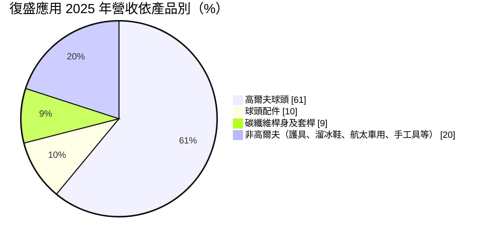
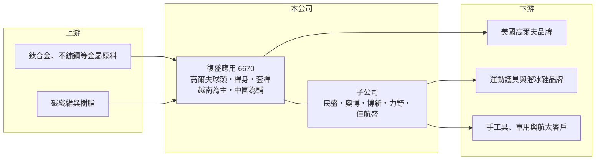

# 6670 復盛應用

> 上市｜[[產業索引-運動休閒|運動休閒]]｜上市（櫃）日期 2018/12/18

# 第一章：企業模式與商業藍圖

> [!info] 撰寫說明
> 精簡版，由 Claude 依公開資料整理，架構比照 [[2330台積電]]，資料截至 2026-10-08。來源：MoneyDJ 理財網財務比率年表（2018 至 2025 年）；富果研究 2026 年 3 月法說會備忘錄（產品結構、越南產能、子公司、資本支出、2025 年財務數字）；工商時報 2026 年 3 月民盛上櫃報導（民盛為子公司）；證交所開放資料快照（基本資料、2026 年上半年資產負債與損益、2025 年度股利）。主要客戶名稱來源未揭露，依產業常識整理並標待校對。#待校對

復盛應用科技成立於 2010 年 9 月、2018 年 12 月上市，總部在台北，董事長兼總經理江慶生，實收資本額約 13.9 億元。它是全球最大的高爾夫球頭代工廠之一，與 [[8924大田]]、[[8938明安]] 並稱台灣高爾夫球具代工三雄，近年積極用併購把觸角伸向運動護具、手工具、車用與航太零件。

- **核心業務：** 復盛應用替國際高爾夫品牌代工鐵桿、木桿、推桿球頭，並延伸到球頭配件、以[[碳纖維複合材料]]製作的桿身與整套球桿（套桿）組裝。高爾夫球頭需要精密鑄造、鍛造、CNC 加工與表面處理，每年隨品牌新品推出換款，代工廠必須跟著品牌的研發節奏快速打樣量產。
- **營收結構：** 依富果整理的 2026 年 3 月法說會，2025 年高爾夫球頭占 61%、球頭配件 10%、碳纖維桿身及套桿 9%，高爾夫相關合計約 80%；非高爾夫約 20%，包括航太及車用零件、溜冰鞋與護具、棒壘球棒與手工具。主要客戶為美國大型高爾夫品牌（市場普遍認為包括 Callaway、TaylorMade、Acushnet 等，公司未揭露，待校對）。
- **營運據點：** 公司推動「去中化」，越南廠出貨支數已占全體 75% 以上、金額占 55% 以上，其餘在中國生產（中國廠產能未查得）。2026 年自有資本支出約 5,000 萬至 6,000 萬美元，主要用於越南擴廠與自動化，並導入豐田生產管理系統（[[TPS]]）。
- **長期方向：** 經營層的目標是維持高爾夫本業持續成長，同時逐年降低高爾夫營收占比。併購聚焦四個領域：高爾夫本業、非高爾夫運動裝備、航太與車用、手工具。子公司包括運動護具與冰球鞋的 [[7811民盛]]（2020 年收購，2026 年上櫃）、溜冰鞋的奧博（評估上市）、手工具的博新（併購澳洲貿易公司）、車用的力野與航太的佳航盛。這種「本業現金流＋併購擴張」的資本配置，是復盛應用長期最重要的特色。

# 第二章：護城河深度與競爭優勢

復盛應用的護城河在於規模、越南產能與品牌客戶的長期信任，屬於代工業中少見的高集中度市場龍頭。

- **競爭優勢：** 高爾夫球頭代工市場高度集中在台灣三家廠商，品牌商每年推出新品，需要代工廠在數週內完成打樣、試產與量產，換廠的風險與成本都很高。復盛應用規模最大，能同時承接球頭、桿身與套桿組裝，提供一站式服務，套桿業務營業額從疫情前約一兩千萬美元成長到近一億美元。越南產能占比高，讓它在美國關稅與客戶「中國以外」要求下更具優勢。
- **主要對手：** 主要對手是同為台灣廠的 [[8924大田]] 與 [[8938明安]]，以及 [[8928鉅明]] 等球頭與複材廠；部分品牌也有少量自製或使用中國廠。三雄之間在客戶分配上長期穩定，競爭較少以價格戰形式出現。
- **觀察重點：** 美國高爾夫市場在疫情後打球人口增加，富果整理的產業數據顯示 2025 年美國高爾夫球具零售金額年增 8%、品牌庫存銷貨比下降，代表通路庫存健康。長期要看高爾夫運動人口能否維持、非高爾夫業務能否在併購後創造穩定獲利，以及越南擴廠的效率。

# 第三章：財務體質與盈利規模

資料日期：2026-10-08，表格是撰寫當時的快照；最新月營收、毛利率、累計 EPS 由自動排程寫在本筆記的屬性欄位（月營收、毛利率、累計EPS 等）。#待校對

復盛應用的毛利率約 23% 至 27%、營業利益率約 12% 至 17%，ROE 長年在 20% 以上，是高資本報酬的代工廠。

| 年度 | 營收（億元） | [[毛利率]] | [[營業利益率]] | EPS（元） | [[ROE]] |
|---|---|---|---|---|---|
| 2021 | 約 232（推算） | 23.56% | 13.53% | 18.03 | 32.51% |
| 2022 | 約 337 | 25.55% | 17.09% | 36.64 | 47.97% |
| 2023 | 約 250（推算） | 23.17% | 12.47% | 18.18 | 20.19% |
| 2024 | 約 284（推算） | 26.66% | 16.42% | 28.17 | 27.87% |
| 2025 | 297.9 | 25.45% | 15.55% | 22.44 | 19.46% |

註：2022 年營收依法說會「挑戰 2022 年 337 億元新高」；2024 年以 2025 年營收除以 1.05 推算；2021、2023 年以每股營業額乘以當期推估股數（約 1.31 億、1.37 億股）推算。

- **長期指標：** 2021 至 2025 年營收年複合成長率約 6%（推算），近 5 年平均 ROE 約 29.6%（推算）。2025 年度每股現金股利 16 元、配發率約 71%（法說會），每股現金流量 2018 至 2025 年皆為正，自由現金流足以同時支應配息、越南擴廠與併購。
- **[[ROIC]] 與 [[WACC]]：** 2025 年營業利益 46.3 億元，稅後約 37.0 億元（稅率 20%）。投入資本以 2026 年第二季權益總計 186.8 億元，加有息負債推估約 40 億元計算（負債總計 125.4 億元，法說會提到因併購與越南布局銀行借款增加），ROIC 約 16%（推算）。WACC 約 6.6%（推算：無風險利率 1.75%、市場風險溢酬 6%、β 取 0.9，股東權益成本 7.15%；稅前負債成本 2.5%、稅率 20%，以市值約 376 億元與負債 40 億元計算權重約 90：10）。ROIC 長期明顯高於 WACC，代表公司持續創造價值；要注意的是併購擴大投入資本後，ROIC 是否被稀釋。
- **財務特色：** 2026 年第二季總資產 312.3 億元、負債 125.4 億元，負債比率約 40%，每股淨值 111.41 元；權益總計與母公司權益差距約 31.5 億元，反映民盛等子公司的非控制權益。2026 年上半年營收 165.4 億元、毛利率 24.8%、營業利益率 15.3%、EPS 13.10 元。

# 第四章：總體風險與地緣政治

復盛應用的風險在於高爾夫市場週期、客戶集中，以及併購帶來的整合挑戰。

- **產業週期：** 高爾夫球具屬於高單價可選消費，疫情期間戶外運動需求帶動 2021 至 2022 年營收創高，2023 年品牌去庫存時營收與獲利明顯回落。品牌商的庫存水位會放大代工廠的訂單波動，是典型的[[長鞭效應]]。
- **營運風險：** 高爾夫營收集中在少數美國大品牌，任何一家品牌轉單或市占下滑都會直接影響營收。併購對象分布在護具、手工具、車用與航太，產業性質差異大，整合不順可能拖累整體獲利，車用子公司短期已承壓。
- **其他風險：** 主要客戶與終端市場在美國，美國關稅政策會影響品牌商的定價與下單；越南占產能多數，當地工資上漲、勞動法規與電力供應是長期成本變數。營收以美元計價，新台幣升值會壓縮換算後的獲利；鈦、不鏽鋼等金屬原料價格也影響成本。

# 專有名詞解析

## 金融

- **[[長鞭效應]]**：終端需求的小幅變動，沿供應鏈往上游傳遞時被逐級放大，造成上游庫存與訂單劇烈波動。
- **[[ROIC]]**：投入資本報酬率，稅後營業利益除以股東權益加有息負債，衡量本業運用資本的效率。
- **[[WACC]]**：加權平均資金成本，股東與債權人要求報酬率的加權平均，是 ROIC 要超越的門檻。

## 產業

- **[[碳纖維複合材料]]**：以碳纖維搭配樹脂成型的材料，重量輕、強度高，用於球拍、球桿、自行車與飛機結構件。
- **[[TPS]]**：豐田生產方式，強調消除浪費、及時生產與持續改善的製造管理系統，常被製造業導入以提升效率。

# 核心供應鏈

- 上游：鈦合金、不鏽鋼等金屬原料與鑄造材料；碳纖維與樹脂（名單未查得）。
- 下游／客戶：美國主要高爾夫品牌（推估包括 Callaway、TaylorMade、Acushnet，待校對）；子公司 [[7811民盛]] 的冰球、滑雪與護具品牌客戶；手工具、車用與航太客戶。
- 同業：[[8924大田]]、[[8938明安]]、[[8928鉅明]]；複材代工的 [[4536拓凱]]。

## 最新新聞
<!-- news:start -->
<!-- news:end -->

## 相關連結
- [公開資訊觀測站](https://mopsov.twse.com.tw/mops/web/t05st03?step=1&firstin=1&co_id=6670)
- [Goodinfo](https://goodinfo.tw/tw/StockDetail.asp?STOCK_ID=6670)
- [Yahoo 股市](https://tw.stock.yahoo.com/quote/6670)
- [鉅亨網新聞](https://www.cnyes.com/twstock/6670/news)
