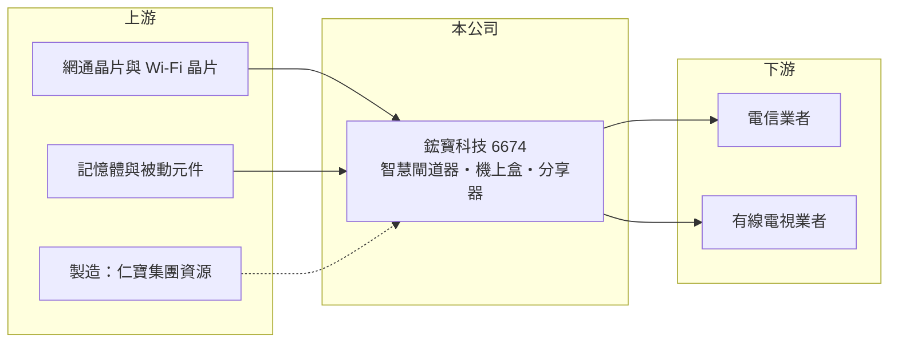

# 6674 鋐寶科技

> 上市｜[[產業索引-通信網路業|通信網路業]]｜上市（櫃）日期 2018/11/28

# 第一章：企業模式與商業藍圖

> [!info] 撰寫說明
> 本文由 Claude 依公開資料整理，架構比照 [[2330台積電]] 的四章研究，資料截至 2026-10-08。財務數字來源：Goodinfo 年度經營績效頁與基本資料頁、證交所開放資料（基本資料、2026 年第二季資產負債與損益、營益分析、股利）；仁寶股份轉換案依 Goodinfo 新聞標題與工商時報 2026 年 9 月報導標題整理。公開資料有限，客戶結構為推論，已標「待校對」。#待校對

評估寬頻用戶端設備廠，要看它能否在電信業者的設備汰換週期中穩定拿到標案，以及規模是否大到足以承受價格競爭。本章說明鋐寶科技（股票代號：6674，以下簡稱鋐寶）的商業模式與它面臨的結構性轉折。

## 一、核心定位：電信業者的用戶端設備供應商

鋐寶成立於 2009 年，2018 年在證交所上市，總部位於新竹縣竹北市，實收資本額約 6.8 億元。依公司揭露的主要業務，鋐寶研究、開發及銷售智慧閘道器、數位[[機上盒]]與無線寬頻分享器等通訊產品。這類產品統稱[[CPE]]，也就是放在用戶家中、連接電信或有線電視網路的終端設備。

CPE 的買方主要是電信與有線電視業者，它們以標案或長期合約大量採購，再租借或贈送給用戶（客戶結構為推論，待校對）。這種商業模式的好處是單一訂單量大，缺點是客戶議價力強、產品規格由業者主導，設備商的毛利率通常不高。

## 二、結構轉折：仁寶擬以[[股份轉換]]收購並下市

依 2026 年 9 月的報導標題，[[2324仁寶]]擬以現金股份轉換方式溢價收購鋐寶，鋐寶董事會並提議終止上市與公開發行，需經股東會決議（細節待校對）。若案件完成，鋐寶將成為仁寶的全資子公司，不再是可投資的上市標的。這個決定反映的是小型 CPE 廠在規模競爭中的處境：營收從 2021 年的 29.1 億元縮小到 2025 年的 5.98 億元，獨立經營的空間愈來愈小，併回大型代工集團、共用採購與製造資源，是常見的出路。

## 三、長期方向

在併購案之前，鋐寶的方向是從機上盒與分享器轉向智慧閘道器等整合型產品，以提高單機價值。不過從營收與獲利趨勢看，轉型尚未成功。對投資人而言，這家公司的長期研究價值主要在於作為案例：說明 CPE 產業的規模經濟有多重要，以及中小型網通廠在電信業者採購週期與價格壓力下如何被整併。

# 第二章：護城河深度與競爭優勢

在長期價值投資中，「護城河」指企業抵禦競爭、維持超額利潤的保護機制。本章分析鋐寶在 CPE 產業的競爭位置。

## 一、護城河的組成

* **電信業者認證：** CPE 必須通過電信業者的互通性與安全測試，取得認證後才能出貨，對已合作的業者有一定的轉換成本。
* **集團資源：** 與仁寶的關係讓鋐寶在零件採購與製造上可借助大集團的規模（推估，待校對）。

整體而言，鋐寶的護城河很窄。CPE 規格由晶片商參考設計主導，產品差異化有限，大廠可以用更低的成本與更完整的產品線搶單。

## 二、主要競爭對手

| 對手 | 定位 | 對鋐寶的威脅 |
|---|---|---|
| [[5388中磊]] | 全球寬頻 CPE 大廠 | 規模與客戶數遠大於鋐寶 |
| [[3596智易]] | 電信 CPE 與閘道器 | 爭取同一批歐美電信業者 |
| [[3380明泰]]、[[6285啟碁]] | 網通 ODM 大廠 | 產品線完整，可整包接單 |
| [[2419仲琦]]、[[4906正文]] | 寬頻與無線網通設備 | 中型廠直接競爭 |

## 三、守得住／守不住／觀察重點

守得住的只有少數已認證的既有專案。守不住的是新標案的價格與規模，營收連續五年下滑就是結果。長期觀察重點是股份轉換案的股東會結果與完成時程，以及併入仁寶後原有產品線的去留。

# 第三章：財務體質與盈利規模

資料日期：2026-10-08，表格是撰寫當時的快照；最新月營收、毛利率、累計 EPS 由自動排程寫在本筆記的屬性欄位（月營收、毛利率、累計EPS 等）。#待校對

財務報表是檢驗護城河是否真實存在的最終標準。本章用六年的三率、ROE 與資本報酬，檢視鋐寶的獲利品質。

## 一、多年度經營績效

| 年度 | 營收（新台幣） | [[毛利率]] | [[營業利益率]] | EPS（元） | [[ROE]] |
|---|---|---|---|---|---|
| 2020 | 27.0 億 | 14.2% | 0.85% | 0.70 | 2.78% |
| 2021 | 29.1 億 | 19.7% | 2.88% | 0.49 | 1.99% |
| 2022 | 25.1 億 | 14.7% | -3.98% | -0.94 | -4.02% |
| 2023 | 11.6 億 | 7.12% | -27.3% | -4.84 | -24.5% |
| 2024 | 9.42 億 | 17.7% | -15.1% | -2.46 | -15.6% |
| 2025 | 5.98 億 | 34.6% | -11.2% | -1.13 | -8.06% |
| 2026 上半年 | 2.17 億 | 12.8% | -56.9% | -1.97 | 未查得 |

即使在 2020 至 2021 年營收最高的時候，鋐寶的營業利益率也不到 3%，說明 CPE 代工型業務的利潤空間本來就薄。2023 年起營收腰斬，費用無法同步縮減，連續四年營業虧損。2021 至 2025 年平均 ROE 約 -10.0%（推算），2020 至 2025 年營收年複合成長率約 -26%（推算）。2025 年度未配發股利，2026 年第二季保留盈餘為 -1.33 億元。

## 二、[[ROIC]] 與 [[WACC]]：價值創造利差

**ROIC 推算：** 2025 年營業損失約 0.67 億元（5.98 億 × -11.2%）。2026 年第二季股東權益約 7.8 億元，負債約 3.3 億元且幾乎都是流動負債，假設有息負債約 1 億元（推估），投入資本約 8.8 億元，2025 年 ROIC 約 -7.6%（推算）；2026 年上半年營業損失 1.24 億元，年化後 ROIC 更低於 -25%（推算）。

**WACC 推算：** 台灣 10 年期公債 1.75%、市場風險溢酬 6%、β 取網通同業常見值 1.1，股東權益成本約 8.4%；負債成本 2.5%、稅後 2.0%；權益占投入資本約 89%，WACC 約 7.7%（推算）。

**結論：** 鋐寶的 ROIC 長期低於 WACC，且近年為負，代表本業持續毀損股東價值。這也是被大型集團收購下市的財務背景。

# 第四章：總體風險與地緣政治

任何企業都無法脫離宏觀環境獨立存在。本章分析鋐寶必須面對的風險。

## 一、併購與下市風險

股份轉換案若通過，股票將終止上市，投資人只能依轉換價格取得現金；若案件未通過或延宕，公司仍須獨力面對虧損與營收萎縮。這是目前影響最大的結構性事件。

## 二、產業與營運風險

CPE 產業高度依賴電信業者的設備汰換週期與標案，單一業者延後採購就會造成營收大幅波動。晶片與記憶體等關鍵零件價格上漲時，小廠缺乏議價力，毛利率首當其衝。

## 三、匯率與地緣政治

產品以外銷為主（推估），新台幣升值與美國關稅政策都會影響報價競爭力。部分電信業者要求非中國製造，也會改變生產布局的成本。

# 專有名詞解析

## 應用

- **[[CPE]]**：用戶端設備，放在家庭或企業端、連接電信或有線電視網路的設備，例如數據機、閘道器、分享器。
- **[[機上盒]]**：接收數位電視或網路影音訊號、輸出到電視的盒子，由電信或有線電視業者提供給用戶。

## 金融

- **[[股份轉換]]**：收購方以現金或股票換取目標公司全部股份，使其成為百分之百子公司，通常伴隨終止上市。
- **[[ROIC]]**：投入資本報酬率，稅後營業利益除以股東權益與有息負債的合計，衡量本業對所有資金提供者的報酬。
- **[[WACC]]**：加權平均資金成本，依股東權益與負債的比重加權計算的資金成本，ROIC 高於它才代表創造價值。

# 核心供應鏈

## 1. 上游：晶片與零組件
- 網通與 Wi-Fi 晶片：[[QCOM高通]]、[[AVGO博通]] 等晶片商（實際採用廠牌未查得）
- 集團關係：[[2324仁寶]]

## 2. 中游：鋐寶與同業
- 同業：[[5388中磊]]、[[3596智易]]、[[3380明泰]]、[[6285啟碁]]、[[2419仲琦]]、[[4906正文]]

## 3. 下游：客戶
- 電信與有線電視業者（具體客戶未查得）

## 最新新聞
<!-- news:start（自動產生，請勿手動編輯此範圍） -->
- 2026-10-06 🏛️ 重訊 18:19｜公告本公司重要營運主管異動｜[觀測站](https://mops.twse.com.tw/mops/#/web/t05st01)

完整紀錄：[[6674鋐寶科技 新聞]]
<!-- news:end -->

## 相關連結
- [公開資訊觀測站](https://mopsov.twse.com.tw/mops/web/t05st03?step=1&firstin=1&co_id=6674)
- [Goodinfo](https://goodinfo.tw/tw/StockDetail.asp?STOCK_ID=6674)
- [Yahoo 股市](https://tw.stock.yahoo.com/quote/6674)
- [鉅亨網新聞](https://www.cnyes.com/twstock/6674/news)
