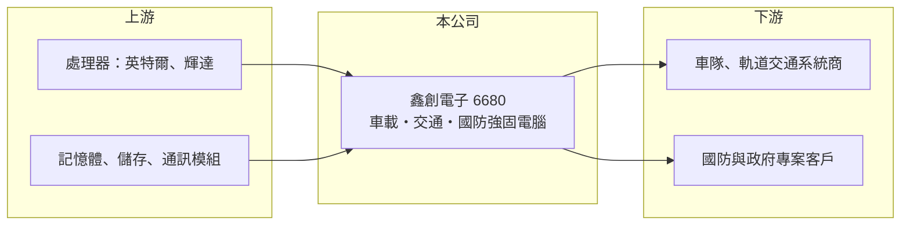

# 6680 鑫創電子

> 上櫃｜[[產業索引-電腦及週邊設備業|電腦及週邊設備業]]｜上市（櫃）日期 2019/09/16

# 第一章：企業模式與商業藍圖

> [!info] 撰寫說明
> 精簡版，由 Claude 依公開資料整理，架構比照 [[2330台積電]]，資料截至 2026-10-08。來源：櫃買中心開放資料快照（基本資料、2026 年第二季資產負債與損益）、Goodinfo 經營績效頁、經濟日報 2026 年 2 月報導。產品認證與英文品牌描述有部分憑記憶整理，已標「待校對」。公開資料有限。#待校對

鑫創電子（以下簡稱鑫創）是營收規模不到 10 億元的小型[[工業電腦]]廠，理解它的關鍵在於：它專做車載、交通與國防等嚴苛環境的強固型電腦，靠利基市場維持三成以上毛利，但規模小使獲利對匯率與費用非常敏感。

- **核心業務：** 鑫創成立於 2009 年，2019 年在櫃買中心掛牌。依經濟日報報導，產品線涵蓋[[邊緣 AI]]、車用產品、智慧交通、AI 自動化與軍工國防。主力是可以裝在車輛、列車與戶外機箱內的無風扇[[強固型電腦]]（英文品牌 Sintrones，待校對），需要耐震、耐寬溫並通過交通與車用規範。
- **營收結構：** 依經濟日報報導，車用相關產品是目前最大的營收來源；國防業務 2025 年占營收不到 10%，公司目標 2026 年底提高到約 20%。國防產品毛利率高於公司平均，比重提高有助拉升整體毛利。2025 年公司推出 20 款新產品，遠多於過去每年 5 至 6 款，代表正積極擴大產品線。
- **營運據點：** 總部位於台灣，國防客戶分布在印度、土耳其、歐洲、美國與日本（經濟日報）。具體生產據點未查得，推估以台灣組裝為主（推估）。對國防與歐美客戶而言，台灣製造本身就是符合[[非紅供應鏈]]要求的賣點。
- **長期方向：** 鑫創長期方向是從一般車載電腦走向國防、智慧交通與邊緣 AI 等高附加價值應用。公司 2026 年第一季起調漲售價至少一成，以反映零組件短缺，並提前備貨記憶體與處理器。國防業務能否穩定放量，決定鑫創能否脫離小型利基廠的規模限制。

# 第二章：護城河深度與競爭優勢

鑫創的護城河屬於「窄護城河」，來自車載與交通認證的門檻、少量多樣的客製能力，以及國防客戶的長期驗證。

- **競爭優勢：** 車載與軌道交通電腦需要通過電磁相容、耐震與寬溫等認證，一個專案從設計導入到量產往往要一年以上，客戶導入後很少更換供應商。鑫創長年維持 31% 至 35% 的[[毛利率]]，即使 2025 年本業幾乎不賺錢，毛利率仍有 32.7%，代表產品本身有定價能力，問題出在費用與匯率。
- **主要對手：** 台灣強固型與車載電腦同業包括 [[6922宸曜]]、[[3594磐儀]]、3022威強電、3416融程電，另有 [[2395研華]]、[[6166凌華]] 等大廠的車載產品線。國防市場則需與歐美本地的軍規電腦廠競爭。鑫創規模最小，必須靠專注特定車載與國防應用維持競爭力。
- **觀察重點：** 長期最該追蹤的是國防營收比重與[[營業利益率]]。2019 年營業利益率曾達 17.9%，2024 年仍有 9.1%，2025 年卻跌到 0.2%，經濟日報指出主因是美國關稅與新台幣升值造成的匯損。國防與高單價產品比重上升，若能讓營益率回到一成以上，代表 2025 年只是外部衝擊。

# 第三章：財務體質與盈利規模

資料日期：2026-10-08，表格是撰寫當時的快照；最新月營收、毛利率、累計 EPS 由自動排程寫在本筆記的屬性欄位（月營收、毛利率、累計EPS 等）。#待校對

鑫創的財務呈現「毛利率高、規模小、費用占比大」的利基廠樣貌：營收在 4 億至 7 億元之間，毛利率穩定在三成以上，但營業利益率波動大。

| 年度 | 營收（億元） | [[毛利率]] | [[營業利益率]] | EPS（元） | [[ROE]] |
|---|---|---|---|---|---|
| 2021 | 3.92 | 31.3% | 10.3% | 1.79 | 8.74% |
| 2022 | 5.35 | 32.3% | 12.7% | 3.75 | 17.7% |
| 2023 | 6.29 | 31.7% | 12.1% | 3.29 | 15.4% |
| 2024 | 6.67 | 34.5% | 9.09% | 4.15 | 18.2% |
| 2025 | 5.64 | 32.7% | 0.23% | -0.29 | -1.2% |

（來源：Goodinfo 經營績效頁。2026 年上半年依櫃買中心資料，營收 2.93 億元、毛利率約 34.3%、營業利益率約 1.6%、EPS 0.08 元。）

- **營收規模：** 2020 年營收 4.00 億元，2025 年 5.64 億元，年複合成長率約 7.1%（推算）。2021 至 2024 年連續成長，2025 年年減 15.4%。經濟日報報導公司預期 2026 年營收成長至少四成，截至 2026 年 8 月累計營收約 3.9 億元、年增約 23%（櫃買中心月營收資料）。
- **獲利：** 2021 至 2025 年平均 ROE 約 11.8%（推算），2022 至 2024 年 ROE 在 15% 至 18% 之間，表現不差。2025 年前三季每股虧損 1.03 元，全年收斂到 -0.29 元，代表第四季已轉盈。
- **財務特色：** 2026 年第二季總資產約 15.2 億元、負債約 9.8 億元、股東權益約 5.5 億元，負債比約 64%，每股淨值 22.89 元。非流動負債約 6.8 億元，相對公司規模偏高，推估包含長期借款或可轉換公司債（推估，明細未查得）；股本 2.40 億元與登記資本額 2.51 億元有差，也可能與轉換債轉換有關。Goodinfo 統計歷年平均現金股利約 1.84 元。自由現金流是否長期為正未查得。
- **[[ROIC]] 與 [[WACC]]：** 以 2024 年營業利益約 0.61 億元（6.67 億元 × 9.09%）、稅率 20% 計算，稅後營業利益約 0.49 億元；有息負債未查得，投入資本以股東權益 5.5 億元到總資產 15.2 億元為區間，ROIC 約 3.2% 至 8.8%（推算）。2025 年營業利益趨近於零，ROIC 約 0%（推算）。WACC 以 [[CAPM]] 推估：無風險利率 1.75%、市場風險溢酬 6%、β 假設 1.0（小型工業電腦股常見值），權益成本約 7.75%；稅後負債成本 2%、負債占五成，WACC 約 4.9%（推算）。正常年度 ROIC 與 WACC 相近或略高，2025 年則明顯低於資金成本，價值創造仰賴營益率恢復。

# 第四章：總體風險與地緣政治

鑫創的風險集中在規模、匯率與國防訂單的時程，屬於高毛利但體質較脆弱的小型股。

- **產業週期：** 車載與交通電腦跟著車隊汰換、公共運輸與物流投資走，專案常有延遲。國防訂單則受各國預算與採購程序影響，出貨時點不易預測。小公司一旦大案遞延，季度營收就會明顯下滑。
- **營運風險：** 營收規模不到 7 億元，研發與業務費用相對固定，營收稍微下滑營益率就大幅壓縮。記憶體與處理器缺貨時，小廠議價能力弱，必須提前備貨，增加庫存與資金壓力。負債比偏高，也降低了遇到逆風時的緩衝。
- **其他風險：** 營收以外銷為主，2025 年新台幣升值造成匯損，美國關稅也壓縮獲利。國防產品出口須遵守各國出口管制，客戶所在國的地緣政治變化可能影響訂單。

# 專有名詞解析

## 應用

- **[[邊緣 AI]]**：在終端設備或現場電腦上直接執行 AI 推論，不必把資料傳回雲端，延遲低、隱私性高。

## 產業

- **[[工業電腦]]**：用於工廠自動化、交通、醫療等場域的電腦，強調耐用、長期供貨與客製化。
- **[[強固型電腦]]**：為軍事、戶外、交通等嚴苛環境設計的電腦，需耐震、耐溫、防水防塵並長期供貨。
- **[[非紅供應鏈]]**：排除中國大陸產地與廠商的供應鏈安排，常見於美系客戶與國防相關採購。

# 核心供應鏈

- 上游：處理器與 AI 運算平台來自 [[INTC英特爾]]、[[NVDA輝達]]，另需記憶體、儲存裝置與 4G/5G 通訊模組。
- 下游／客戶：車隊管理、軌道交通與智慧交通系統整合商，以及印度、土耳其、歐美與日本的國防相關客戶（具體客戶未點名，#待校對）。
- 同業：[[6922宸曜]]、[[3594磐儀]]、3022威強電、3416融程電、[[2395研華]]、[[6166凌華]]。

## 最新新聞
<!-- news:start（自動產生，請勿手動編輯此範圍） -->
- 2026-10-21 📰 媒體 15:56｜鑫創電子推液冷強固型邊緣AI電腦 獲美國軍工航太電子創新認可｜[鉅亨網](https://news.cnyes.com/news/id/6634976)

完整紀錄：[[6680鑫創電子 新聞]]
<!-- news:end -->

## 相關連結
- [公開資訊觀測站](https://mopsov.twse.com.tw/mops/web/t05st03?step=1&firstin=1&co_id=6680)
- [Goodinfo](https://goodinfo.tw/tw/StockDetail.asp?STOCK_ID=6680)
- [Yahoo 股市](https://tw.stock.yahoo.com/quote/6680)
- [鉅亨網新聞](https://www.cnyes.com/twstock/6680/news)
